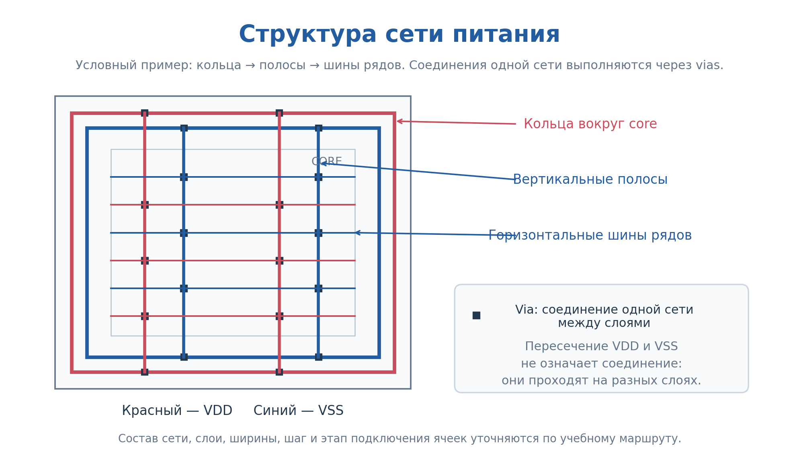
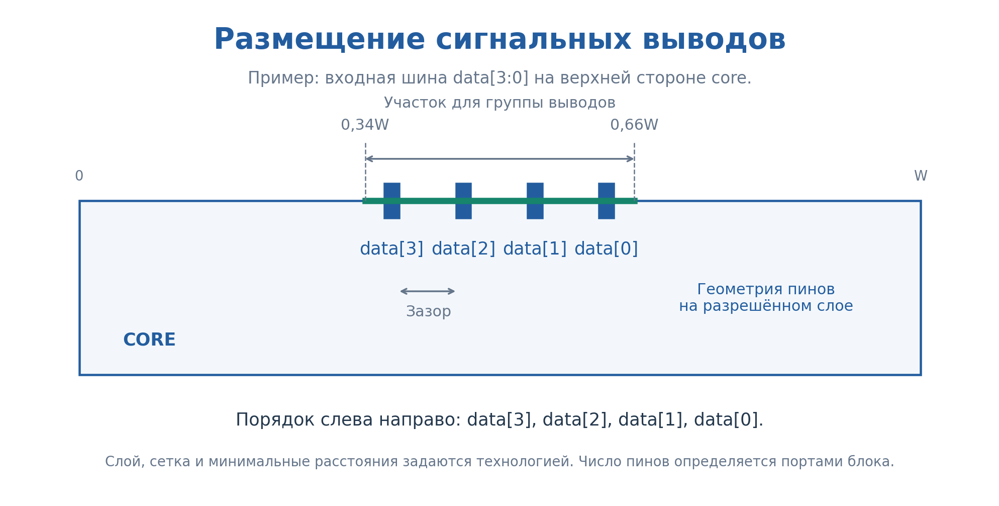
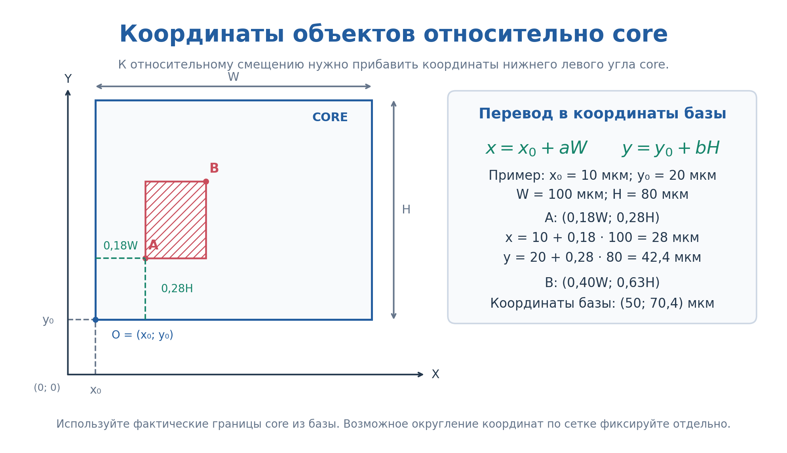
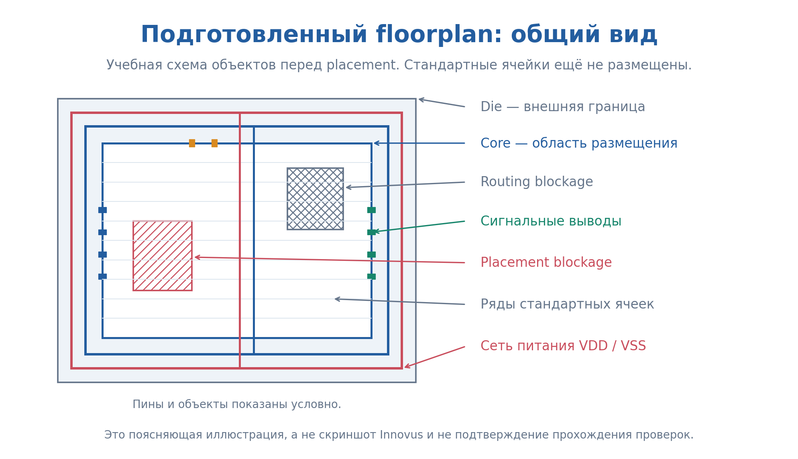
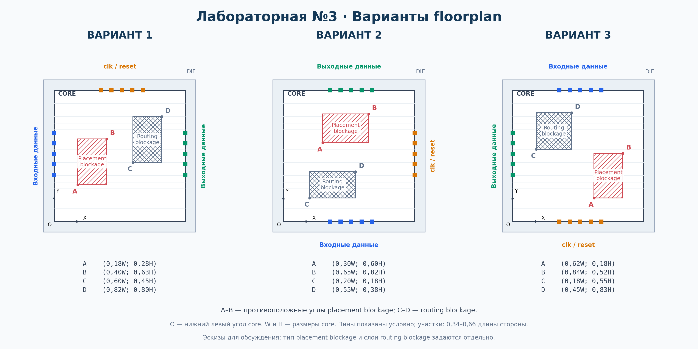
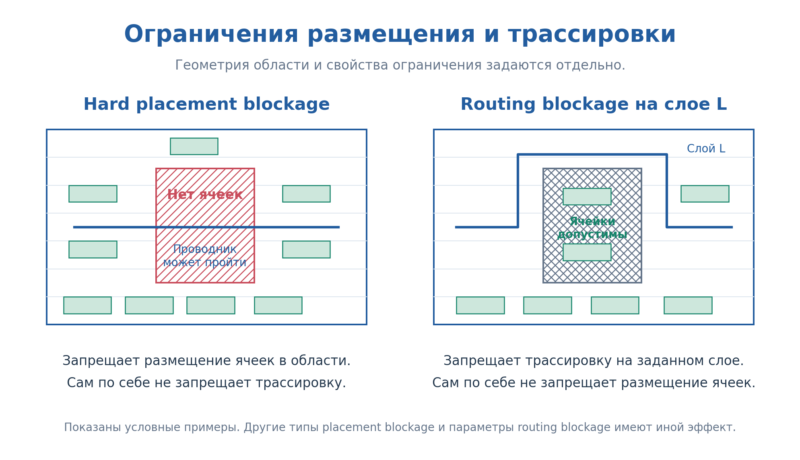

# Лабораторная работа №3
## Планирование топологии и создание сети питания

> Ссылки «Скриншот: …» — заготовки для изображений из Innovus; файлы будут добавлены позже.

> Рабочая редакция методических указаний. Пометки «Дополнить» обозначают сведения, которые преподаватель должен заполнить по реальному окружению до выдачи работы: команды Innovus, параметры технологии и точную геометрию дополнительного задания.

## Цель работы

Освоить подготовку физической реализации цифрового блока в Cadence Innovus: импорт исходных данных, создание floorplan, размещение сигнальных выводов, формирование сети питания и работу с рядами стандартных ячеек.

Научиться пользоваться графическими инструментами и Tcl-командами, проверять результат и сохранять базу проекта. При выполнении дополнительного задания — подготовить скрипт, воспроизводящий созданный floorplan из исходного проекта.

Полученная база используется в лабораторной работе №4 для placement, CTS и routing.

# Методический материал

# 1. Место floorplan в маршруте

После синтеза известны ячейки и логические соединения. На этапе floorplan добавляются физическая геометрия блока, ряды для размещения, выводы и сеть питания. Размещение функциональных стандартных ячеек выполняется на следующем этапе.


*Рисунок 1 — Место floorplan в маршруте. В задании на 4 создаётся placement blockage по периметру; в задании на 5 — два внутренних blockage и область cut row.*

# 2. Исходные данные

| Данные | Назначение |
| --- | --- |
| Netlist после LEC | Ячейки блока и их соединения |
| Technology LEF | Слои и технологические сведения, представленные в LEF |
| Cell LEF | Размеры ячеек, физические выводы и препятствия трассировки |
| `.lib` | Функции и характеристики ячеек для анализа и оптимизации |
| SDC | Временные ограничения своего блока |
| MMMC | Конфигурация режимов и условий анализа |
| RC-данные | Данные для оценки паразитных параметров в предусмотренном режиме |
| Процедуры и окружение | Настройка и выполнение учебного маршрута |

Комплект физических и временных библиотек и настройки анализа предоставляет преподаватель. Самостоятельно писать SDC в этой работе не требуется.


*Рисунок 2 — Условный инвертор в netlist, `.lib` и cell LEF. Cell LEF — абстрактное физическое представление, а не полная топология транзисторов.*

**Дополнить:** реальные файлы, пути, версия Innovus и интерфейс команд, настройки окружения и способы запуска.

# 3. Импорт проекта

1. Укажите свой блок как верхний модуль и подключите его корректный итоговый netlist.
2. Подключите предоставленные библиотеки и конфигурацию MMMC/SDC.
3. Проверьте имя проекта, наличие необходимых представлений ячеек и загрузку ограничений.
4. Устраните ошибки чтения и объясните существенные предупреждения.
5. Сохраните исходную базу после импорта, до изменений floorplan. Она служит начальной точкой для демонстрации повторного выполнения задания на 5.

**Дополнить:** проверенные команды импорта, проверки и сохранения исходной базы; признаки успешной загрузки по log.

# 4. Геометрия floorplan

## 4.1. Die, core, rows и site

Die задаёт внешнюю границу проектируемой области. При реализации отдельного блока это граница блока в проекте, которая не обязательно соответствует всему будущему кристаллу.

Core — основная область размещения стандартных ячеек. Между die и core задаются отступы. Rows — ряды размещения; site определяет базовую геометрию допустимых мест. Параметры рядов должны соответствовать физической библиотеке.


*Рисунок 3 — Геометрия floorplan и увеличенный фрагмент ряда.*

## 4.2. Создание floorplan через GUI

1. Откройте окно создания или настройки floorplan.
2. Выберите способ задания геометрии через **Cell Utilization**.
3. Задайте **50%** (или **0.5**, если поле принимает долю), соотношение сторон и предусмотренные окружением отступы.
4. Примените настройки и проверьте полученные границы die/core и rows.
5. Зафиксируйте значение Cell Utilization и полученные размеры для защиты.

[Скриншот: окно создания floorplan и поле Cell Utilization](doc/images/innovus_floorplan_gui.png)

> Заготовка: добавить скриншот Innovus с выделенным полем Cell Utilization и значением 50%. Точные названия меню и формат поля указать по используемой версии.

Для оценки 5 эту операцию сначала можно освоить через GUI, затем включить соответствующую команду с теми же параметрами в воспроизводимый Tcl-скрипт.

## 4.3. Площадь и плотность: пояснение и расчёт

Для пояснения связи площади и плотности используем отношение суммарной площади стандартных ячеек к площади core:

$$U_{core}=\frac{A_{cells}}{A_{core}}.$$

Для целевого значения 50%:

$$A_{core}=\frac{A_{cells}}{0{,}5}=2A_{cells}.$$

При заданном отношении сторон $r=W/H$:

$$W=\sqrt{rA_{core}},\qquad H=\sqrt{\frac{A_{core}}{r}}.$$

Если отступы равны $m_L$, $m_R$, $m_B$, $m_T$, размеры die:

$$W_{die}=W+m_L+m_R,\qquad H_{die}=H+m_B+m_T.$$

Эти формулы помогают объяснить выбранную геометрию; вручную рассчитывать размеры для оценки 4 не требуется. Для расчёта на 5 используйте площадь своего блока с проверенными единицами измерения и фактическую геометрию rows. Размеры округляются по site и рядам.


*Рисунок 4 — Одинаковая площадь ячеек при разных размерах core.*

Требование задания — задать Cell Utilization 50% при создании floorplan. Расчётное отношение площадей и utilization в отчёте могут использовать разные определения доступной площади; при сравнении укажите, какая площадь использована.

**Дополнить:** соотношение сторон, отступы, способ создания floorplan и допустимое отклонение от 50% из-за округления.

# 5. Инструменты Innovus

Демонстрационные операции показываются на простом counter. Задание выполняется на своём блоке.

## 5.1. Просмотр и выбор объектов

Перед изменением объекта проверьте его тип и свойства. Для проводника важны сеть, слой, ширина и координаты; для пина — порт, слой и геометрия; для ряда — границы, site и ориентация.

Освойте:

- включение и выключение отображения слоёв и типов объектов;
- выбор объекта и просмотр свойств;
- масштабирование и измерение расстояний;
- определение координат;
- редактирование и удаление выбранного объекта.

**Дополнить:** названия элементов GUI и скриншоты операций для используемой версии.

[Скриншот: отображение слоёв и свойства выбранного объекта](doc/images/innovus_view_objects.png)

## 5.2. Рисование проводников

Для создания проводника задаются сеть, слой, ширина, начальная и конечная точки. Внешне соприкасающиеся фигуры на разных слоях не соединены без подходящего перехода.

Порядок демонстрации:

1. Выберите инструмент создания проводника.
2. Задайте сеть, слой и ширину.
3. Создайте участок по координатам.
4. Проверьте свойства созданного объекта.
5. Покажите изменение геометрии и удаление участка.
6. Покажите соединение между слоями через vias.

Для питания используйте предусмотренный инструментом тип объектов питания. Простая нарисованная фигура без правильной сети и соединений не считается подключённым проводником питания.

**Дополнить:** действия в GUI, соответствующие команды, создание vias и проверка связности.

[Скриншот: создание проводника — сеть, слой, ширина](doc/images/innovus_draw_wire.png)

[Скриншот: соединение слоёв через vias](doc/images/innovus_vias.png)

## 5.3. Создание кольца питания через GUI и команды

Кольцо создаётся для двух отдельных сетей — питания и земли. Каждый его участок должен принадлежать соответствующей сети.

Необходимо задать сети, слои горизонтальных и вертикальных участков, ширины, расстояния и положение относительно границы блока/core. В углах и переходах между слоями нужны соединения, предусмотренные методикой.

1. Настройте привязку PG-выводов библиотечных ячеек к сетям питания и земли.
2. Создайте кольцо через GUI либо выполните команду или процедуру с предоставленными параметрами.
3. Проверьте положение, сети, слои, ширины и соединения.

**Дополнить:** реальная команда/процедура и пример её аргументов; положение кольца, имена сетей и параметры технологии.

[Скриншот: настройки кольца питания](doc/images/innovus_power_ring.png)

## 5.4. Создание stripes через GUI и команды

Stripes — полосы, распределяющие питание внутри блока. Они соединяются с кольцом своей сети и далее с другими элементами питания.

Задайте направление, слой, ширину, расстояние между сетями, шаг повторения, начальное смещение и область создания. Проверьте соединения через vias.

**Дополнить:** команда/процедура, допустимые параметры и демонстрация изменения шага и смещения.

[Скриншот: настройки stripes](doc/images/innovus_stripes.png)

## 5.5. Шины питания вдоль рядов

Ряды размещения и проводники питания — разные объекты. Наличие rows не означает наличия подключённых шин питания. Шины вдоль рядов и PG-выводы размещённых ячеек подключаются предусмотренными операциями маршрута.

**Дополнить:** что создаётся в №3 и что после placement в №4; команда формирования и подключения шин рядов; допустимые предупреждения до размещения.

[Скриншот: горизонтальные проводники питания вдоль rows](doc/images/innovus_row_rails.png)



*Рисунок 5 — Условная структура кольца, полос и шин рядов. Технологические слои и фактический состав задаются методикой.*

## 5.6. Вырезание и восстановление rows

Удаление ряда либо его участка меняет доступную область размещения, но само по себе не удаляет проводники и не меняет размеры core.

1. Просмотрите ряды и их свойства до изменения.
2. Задайте прямоугольную область вырезания.
3. Выполните команду удаления пересекающих её участков рядов.
4. Проверьте результат и границы оставшихся участков.
5. На демонстрационном примере восстановите исходные ряды и сравните результат с исходным состоянием.

Восстановление рядов не обязательно является обратной командой удаления. Используйте предусмотренный маршрут пересоздания рядов с исходными параметрами либо откройте сохранённую базу. Не создавайте дублирующиеся ряды.

В задании на 5 удалите участки rows в периферийной области от границы die до внутренней границы кольца питания. Задайте эту рамку четырьмя прямоугольными областями и проверьте, что ряды внутри кольца сохранились.

**Дополнить:** команды удаления и восстановления, настройки site/ориентации и численные границы областей вырезания.

[Скриншот: rows до и после cut row](doc/images/innovus_cut_rows.png)

[Скриншот: восстановление rows](doc/images/innovus_restore_rows.png)

Не следует вырезать ряды под любым металлом автоматически: в реальных проектах питание может проходить над ячейками. В данной работе вырезается именно заданная учебная область.

## 5.7. Размещение сигнальных выводов

Пины блока имеют геометрию на разрешённых слоях. Их размещение должно учитывать расстояния, сетку и порядок связанных сигналов.

На 4 стороны и порядок выбираются студентом. На 5 выполняется заданное расположение:

| Группа | Расположение |
| --- | --- |
| Входы | Центральный участок левой стороны |
| clk | Верхняя сторона |
| Выходы | Равномерно по высоте правой стороны |
| Reset и другие управляющие сигналы | Уточнить перед выдачей задания |



*Рисунок 6 — Пример участка и порядка битов. Показанная шина сверху иллюстрирует приём размещения и не задаёт стороны для задания на 5.*

**Дополнить:** разрешённые слои, участки и отступы от углов, команды размещения и проверки всех портов.

[Скриншот: окно размещения сигнальных пинов](doc/images/innovus_pin_placement.png)

## 5.8. Placement blockage

Placement blockage ограничивает размещение стандартных ячеек в заданной области. Он не удаляет rows и не запрещает автоматически прокладку проводников.

В задании на 4 создайте hard placement blockage от границы die до внутренней границы кольца питания. Рамку можно задать четырьмя прямоугольными областями. Проверьте тип и границы объектов. На 5 удалите этот периферийный blockage, вырежьте rows в той же области и создайте отдельный внутренний hard placement blockage A–B.

**Дополнить:** команда или действия GUI для создания hard placement blockage и пример задания четырёх областей по координатам.

[Скриншот: создание placement blockage](doc/images/innovus_placement_blockage.png)

## 5.9. Координаты и работа по геометрическому заданию

Координаты относительно core нужно преобразовать в координаты базы с учётом его фактического положения. Для точки $(aW,bH)$:

$$x=x_0+aW,\qquad y=y_0+bH.$$



*Рисунок 7 — Преобразование координат. Прямоугольник на рисунке служит геометрическим примером.*

# 6. Подготовка Tcl-скрипта и работа с .cmd

Этот раздел необходим для дополнительного задания. В обязательной части представление скрипта на защите не требуется.

## 6.1. Команды, переменные и source

Скрипт — текстовый файл с последовательностью команд. Команды выполняются в контексте текущей базы проекта. Переменные позволяют вынести параметры отдельно от действий.

Пример синтаксиса Tcl, без создания объектов Innovus:

```tcl
# Параметры демонстрационного примера; значения иллюстративные.
set core_width 100.0
set core_height 80.0
set x0 10.0
set center_x [expr {$x0 + $core_width / 2.0}]
puts "Центр core по X: $center_x"
```

Команда `source` выполняет команды из указанного файла в текущей сессии:

```tcl
source ../flow_scripts/flow.innovus.floorplan.tcl
```

Путь — пример; используйте фактический путь своего проекта. Если файл содержит определения процедур, их подключение не заменяет вызовы этих процедур.

## 6.2. Что такое файл .cmd

Файл `.cmd` используется как источник записанных команд сессии, если запись команд включена в используемом окружении. Это помогает найти команды, соответствующие выполненным действиям.

**Дополнить:** фактическое имя и расположение `.cmd`, условия записи GUI-действий и пример содержимого для используемой версии.

[Скриншот: файл .cmd и команда, полученная после действия в GUI](doc/images/innovus_cmd_history.png)

История команд не является автоматически готовым маршрутом: она может содержать команды просмотра, выделения, неудачные попытки и действия, зависящие от уже изменённой базы.

Чтобы подготовить скрипт:

1. Выполните нужную операцию на демонстрационном проекте и найдите соответствующую запись.
2. Уточните назначение команды и её аргументов.
3. Перенесите необходимую команду в отдельный Tcl-файл.
4. Замените случайные координаты и пути параметрами своего проекта.
5. Уберите команды, не требующиеся для получения результата.
6. Расположите операции в порядке их зависимостей и добавьте комментарии.
7. Проверьте скрипт на исходной базе.

## 6.3. Воспроизводимость для оценки 5

Для оценки 5 подготовьте два скрипта: создание результата задания на 4 из базы после импорта и преобразование сохранённого результата задания на 4 в результат задания на 5.

На защите:

1. Откройте исходную базу после импорта, до построения floorplan.
2. Подключите необходимые процедуры и выполните первый скрипт.
3. Сохраните и заново загрузите floorplan задания на 4, затем выполните второй скрипт.
4. Покажите оба результата и их параметры, выполните проверки.

Повторный запуск поверх уже готового floorplan не заменяет проверку из исходного проекта. Требуется совпадение значимых объектов и параметров, а не побайтовое совпадение базы или log.

# 7. Расчёт после вырезания рядов — для оценки 5

Зафиксируйте площадь core и площадь доступных рядов до и после удаления. Площадь рядов определяйте по фактическим оставшимся участкам, избегая двойного учёта пересечений.

$$A_{rows,available}=\sum_i W_iH_i.$$

$$U_{rows}=\frac{A_{cells}}{A_{rows,available}}.$$

Сравните $U_{rows}$ с исходным $U_{core}$. При уменьшении доступной площади плотность относительно неё возрастает. Сопоставьте расчёт с геометрией базы и объясните округления по site и рядам.

**Дополнить:** способ получения геометрии рядов и образец расчёта. Используемые определения не следует автоматически приравнивать к любой метрике utilization в отчёте.

# 8. Сохранение, загрузка и итоговые проверки

## 8.1. Как сохранить и загрузить floorplan

Сохраняйте две отдельные точки: **исходный проект после импорта** и **готовый floorplan**. Используйте разные имена, например `blockA_import` и `blockA_floorplan`.

### Сохранение

1. Откройте в GUI действие сохранения floorplan или базы проекта.
2. Выберите каталог и понятное имя сохранения.
3. Выполните сохранение и проверьте сообщение об успешном завершении.
4. Сохраните также log. Если инструмент создаёт несколько файлов или каталог базы, сохраняйте весь комплект.

[Скриншот: окно сохранения floorplan / базы проекта](doc/images/innovus_save_floorplan.png)

### Загрузка

1. Откройте действие загрузки ранее сохранённого floorplan или восстановления базы проекта.
2. Выберите сохранённый файл или базу. При загрузке отдельного файла floorplan сначала подготовьте совместимый проект с исходными библиотеками и netlist.
3. Выполните загрузку и проверьте сообщения инструмента.
4. Убедитесь, что восстановились размеры, rows, пины, placement blockage и геометрия питания.

[Скриншот: окно загрузки floorplan / восстановления базы](doc/images/innovus_load_floorplan.png)

Файл floorplan и полная база проекта могут сохранять разный состав данных. Для продолжения лабораторной работы №4 сохраните полную базу проекта и проверьте её повторное открытие. Для оценки 5 отдельно сохраните исходную базу после импорта для запуска скрипта.

**Дополнить по используемой версии:** точные пункты меню, формат файлов, команды сохранения/загрузки floorplan и сохранения/восстановления полной базы. Показать оба способа на демонстрационном проекте.

## 8.2. Итоговые проверки

Проверьте:

- корректность импорта и отсутствие неустранённых ошибок;
- размеры die/core, наличие и свойства рядов;
- размещение всех сигнальных портов;
- сети, слои и геометрию элементов питания;
- предусмотренные соединения кольца и горизонтальных проводников питания;
- на 4 — периферийный hard placement blockage; на 5 — его удаление и два внутренних blockage A–B и C–D;
- для задания на 5 — параметры кольца, центральные проводники, вырезанные ряды, заданное расположение пинов и два внутренних blockage.

**Дополнить:** точные команды проверки геометрии и связности, критерии успешного результата и допустимые предупреждения до placement.

Сохраните итоговую базу и log. Откройте сохранённую базу и убедитесь, что результат сохранился. Полнота подключения PG-выводов функциональных ячеек проверяется на соответствующем этапе после размещения; проверки №3 не заменяют IR Drop.



*Рисунок 8 — Поясняющая схема объектов floorplan, а не реальный результат Innovus. Требуемое расположение объектов для оценок 4 и 5 задано схемами в разделе 10.*

**Дополнить:** настоящий скриншот counter по обновлённому заданию, включая центральные проводники и вырезание рядов для уровня 5.

[Скриншот: результат задания на 4 в Innovus](doc/images/innovus_result_level4.png)

[Скриншот: результат задания на 5 в Innovus](doc/images/innovus_result_level5.png)

# 9. Справочные иллюстрации

Ранее подготовленные варианты с placement/routing blockages сохранены как материал для объяснения инструментов. Они не назначаются автоматически в качестве обязательного или дополнительного задания текущей редакции.



*Рисунок 9 — Дополнительные геометрические примеры.*



*Рисунок 10 — Hard placement blockage и routing blockage на условном слое.*

**Дополнить:** ссылки на предоставленные файлы, документацию версии Innovus и презентацию. Презентация строится по содержанию README; все необходимые шаги должны быть описаны здесь.
# Лабораторное задание

# 10. Задание

Используйте итоговый netlist своего блока `blockA` или `blockB`, полученный в лабораторной работе №2 и успешно прошедший LEC. Каждый студент выполняет физическую реализацию своего блока. При индивидуальном выполнении используется выбранный функциональный блок.

Работа разделена на обязательную часть с максимальной оценкой 4 и дополнительную часть для оценки 5. В обоих случаях студент должен понимать выполненные действия и объяснять результат. Ограничения максимальной оценки по срокам действуют по общим правилам курса.

## 10.1. Задание на 4 балла

1. Импортируйте проект своего блока в Innovus и сохраните исходную базу после импорта.
2. Создайте floorplan через GUI: в окне настройки задайте **Cell Utilization = 50%**. Если поле использует долю вместо процентов, укажите **0.5**. Покажите выбранное значение и полученные размеры die и core.
3. Создайте rows для размещения стандартных ячеек.
4. Расположите все сигнальные пины по своему усмотрению на разрешённых границах блока.
5. Создайте кольцо питания VDD/VSS по периметру блока.
6. Создайте горизонтальные проводники питания вдоль rows и подключите их к соответствующим кольцам.
7. Добавьте **placement blockage между границей die и внутренней границей кольца питания**, как показано на рисунке.
8. Проверьте геометрию и соединения, проанализируйте сообщения инструмента и сохраните итоговую базу.


*Схема задания на 4 балла. Серый — rows; красный и синий — две сети питания; полупрозрачные горизонтальные линии — проводники питания; жёлтая штрихованная область — placement blockage. Положение сигнальных пинов произвольное. Рисунок условный: размеры, число рядов и проводников определяются параметрами своего блока и технологии.*

Для оценки 4 все операции можно выполнять удобным способом: через GUI, команды в консоли или скрипт. **Использование команд и предоставление отдельного Tcl-скрипта не обязательны.**

Rows на схеме показаны по всей площади die для наглядности. В базе Innovus создавайте их в предусмотренной окружением области core с допустимыми отступами. На 4 вырезать rows не требуется: placement blockage запрещает размещение в выделенной области, но не удаляет ряды.

Размеры core определяются инструментом по площади своего блока, значению Cell Utilization и выбранному соотношению сторон. Единый размер для разных блоков не задаётся. Ручной расчёт размеров для оценки 4 не требуется.

## 10.2. Задание на 5 баллов

Сначала выполните **задание на 4 балла и сохраните полученный floorplan**. Затем на его основе выполните дополнительные условия.

1. **Расположите сигнальные пины заданным образом:** входы — слева, компактной группой по центру; `clk` — сверху; выходы — справа, равномерно распределив по высоте блока.
2. **Задайте параметры кольца питания относительно размера die** по таблице ниже. Каждая сеть VDD/VSS должна образовывать замкнутое кольцо с необходимыми vias.
3. **Добавьте в центре блока два толстых вертикальных проводника питания:** один для VDD, второй для VSS. Используйте два верхних разрешённых слоя металла. Каждый проводник соединяет верхнюю и нижнюю стороны соответствующего кольца. При переходах между слоями создайте необходимые vias.
4. **Удалите placement blockage по периметру**, созданный в задании на 4, и **вырежьте rows в этой области** — от границы die до внутренней границы кольца питания. Внутри кольца сохраните rows и горизонтальные проводники питания.
5. **Создайте два дополнительных прямоугольных blockage** по координатам A–D из таблицы ниже: hard placement blockage и routing blockage. Для routing blockage выберите разрешённый слой металла и укажите его при сдаче. Области не должны перекрывать кольцо и центральные проводники питания.
6. **Подготовьте два Tcl-скрипта:** первый создаёт floorplan задания на 4 из исходной базы после импорта netlist с Cell Utilization = 50%; второй выполняет дополнительные изменения задания на 5 на сохранённом floorplan задания на 4, включая изменение параметров кольца при необходимости.
7. **Проверьте воспроизводимость:** выполните первый скрипт из исходного проекта, сохраните и заново загрузите результат задания на 4, затем выполните второй скрипт. Оба результата должны воспроизводиться без ручного редактирования.
8. **Рассчитайте плотность относительно оставшейся площади rows** и сравните её с исходной плотностью относительно core. Покажите использованные площади и объясните различие. Дополнительный placement blockage не удаляет rows: его площадь укажите отдельно.
9. **Сохраните результат задания на 5 под отдельным именем**, сохранив также floorplan задания на 4.

### Параметры кольца питания

Обозначения: **W** — ширина die, **H** — высота die, **L = min(W, H)** — меньшая сторона die. Все размеры для расчёта выражаются в мкм.

| Обозначение на рисунке | Параметр | Как определить значение |
| --- | --- | --- |
| w | Ширина каждой шины VDD/VSS | 2% от L, но не более 20 мкм |
| s | Расстояние между краями шин VDD и VSS | 1% от L, но не более 20 мкм |
| o | Отступ от границы die до внешнего края кольца | 2% от L, но не более 20 мкм |

Для каждого параметра сначала рассчитайте соответствующий процент от L. Если результат превышает 20 мкм, используйте 20 мкм.

Округлите значения по технологической сетке. Они должны удовлетворять минимальным правилам выбранных слоёв и оставаться не больше 20 мкм. Если выполнить оба условия невозможно, согласуйте параметры с преподавателем. Кольцо должно целиком помещаться внутри die и не перекрывать сигнальные пины.

**Пример:** die 200 × 300 мкм → L = 200 мкм → w = 4 мкм, s = 2 мкм, o = 4 мкм. Рисунок условный и не задаёт масштаб этих параметров.

### Координаты дополнительных blockages

**O = (x0, y0)** — нижний левый угол die. X отсчитывается от левой стороны, Y — от нижней. W — ширина die, H — высота.

| Объект | Точка | X | Y |
| --- | --- | --- | --- |
| Hard placement blockage | A — нижний левый угол | x0 + 0.20 × W | y0 + 0.57 × H |
| Hard placement blockage | B — верхний правый угол | x0 + 0.36 × W | y0 + 0.74 × H |
| Routing blockage | C — нижний левый угол | x0 + 0.65 × W | y0 + 0.27 × H |
| Routing blockage | D — верхний правый угол | x0 + 0.81 × W | y0 + 0.44 × H |

Например, X точки A находится на расстоянии 20% ширины die от его левой границы, а Y — на расстоянии 57% высоты от нижней границы. Координаты округлите по допустимой сетке инструмента.


*Фиолетовая область — только cut row. Жёлтый прямоугольник A–B — hard placement blockage; бирюзовый C–D — routing blockage. Стрелками показаны ширина шины w, spacing s и отступ o. Цвета питания обозначают сети, а не номера металлических слоёв.*

**Для сдачи предоставьте:**

- **два сохранённых floorplan** — для заданий на 4 и на 5;
- **два Tcl-скрипта** — создание базового floorplan и дополнительные изменения;
- расчёт плотности после вырезания rows.

На защите покажите выполнение обоих скриптов, подключение питания, параметры кольца, расположение пинов, область cut row, типы и координаты blockages и слой routing blockage.

Cell Utilization 50% задаётся при создании базового floorplan, до вырезания rows. Изменять размеры блока для возвращения плотности относительно оставшихся рядов к 50% не требуется.

**Дополнить перед выдачей:** имена слоёв кольца и центральных проводников; распределение VDD/VSS между двумя верхними разрешёнными слоями, ширины центральных проводников и параметры vias; разрешённые слои пинов и место reset/остальных управляющих сигналов.

Placement, CTS и сигнальная трассировка не входят в данную работу.

# 11. Анализ и защита

Защита допускается с отчётом или без отчёта. В обоих случаях проводится беседа; выполненный объём и требования к пониманию одинаковые.

## 11.1. Что представить для обязательной части

- Сохранённую базу своего блока.
- Log и результаты предусмотренных проверок.
- Изображения floorplan: rows, сигнальные пины, кольцо, горизонтальные проводники питания и placement blockage.
- Таблицу: площадь ячеек, размеры и площадь core/die, плотность, отступы, основные параметры питания.
- Демонстрацию подключения проводников VDD/VSS к соответствующим кольцам.
- Объяснение размещения пинов, структуры питания, placement blockage и существенных предупреждений.

Для оценки 4 команды и отдельный управляющий скрипт не обязательны. Необходимо уметь объяснить выбранные настройки и полученный результат.

## 11.2. Что дополнительно представить для оценки 5

- Два сохранённых floorplan и два воспроизводимых Tcl-скрипта с комментариями, а также необходимые процедуры.
- Исходную базу или данные, позволяющие её восстановить.
- Демонстрацию первого скрипта из базы после импорта и второго — из сохранённого floorplan задания на 4.
- Параметры центральных проводников и их подключения.
- Входные пины слева по центру, clk сверху и выходные пины справа по высоте блока.
- Отсутствие rows в выделенной области и сохранение рядов внутри кольца.
- Расчёт плотности относительно оставшейся площади рядов.

## 11.3. Что необходимо уметь объяснить

- Назначение floorplan и исходных файлов.
- Различие die/core, rows/site и связь площади с плотностью.
- Различие rows, stripes и шин питания рядов.
- Параметры кольца, полос и соединений через vias.
- Различие placement blockage и cut row.
- Размещение портов, использованные слои и расстояния.
- Содержание проверок и ограничения анализа до placement.
- Для оценки 5 — работу скрипта, использование `.cmd`, преобразование координат, вырезание/восстановление рядов и расчёт доступной плотности.

Оценка 4 требует выполнения обязательной части и понимания результата. Оценка 5 требует также выполнения дополнительной части, воспроизводимости и уверенного объяснения решений. Наличие базы без понимания не гарантирует соответствующую оценку.

