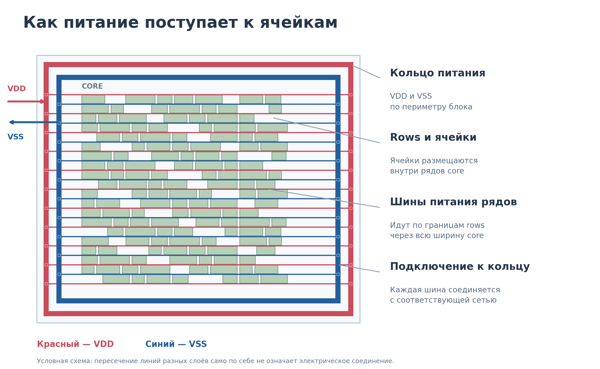

# Лабораторная работа №3

## Планирование топологии и создание сети питания

> Скриншоты находятся в `doc/images/`. Ссылки с именами `innovus_…` — оставшиеся заготовки; соответствующие файлы будут добавлены позже.

> Рабочая редакция методических указаний. Пометки «Дополнить» обозначают сведения, которые преподаватель должен заполнить по реальному окружению до выдачи работы: команды Innovus, параметры технологии и точную геометрию дополнительного задания.

## Цель работы

Освоить подготовку физической реализации цифрового блока в Cadence Innovus: импорт исходных данных, создание floorplan, размещение сигнальных выводов, формирование сети питания и работу с рядами стандартных ячеек.

Научиться пользоваться графическими инструментами и Tcl-командами, проверять результат и сохранять базу проекта. При выполнении дополнительного задания — подготовить скрипт, воспроизводящий созданный floorplan из исходного проекта.

Полученная база используется в лабораторной работе №4 для placement, CTS и routing.

# Методический материал

# 1. Место floorplan в маршруте

После синтеза известны ячейки и логические соединения. На этапе floorplan добавляются физическая геометрия блока, ряды для размещения, выводы и сеть питания. Размещение функциональных стандартных ячеек выполняется на следующем этапе.


*Рисунок 1 — Место floorplan в маршруте. В задании на 4 создаётся placement blockage по периметру; в задании на 5 — два внутренних blockage и область cut row.*

# 2. Исходные данные

| Данные | Назначение |
| --- | --- |
| Netlist после LEC | Ячейки блока и их соединения |
| Technology LEF | Слои и технологические сведения, представленные в LEF |
| Cell LEF | Размеры ячеек, физические выводы и препятствия трассировки |
| `.lib` | Функции и характеристики ячеек для анализа и оптимизации |
| SDC | Временные ограничения своего блока |
| MMMC | Конфигурация режимов и условий анализа |
| RC-данные | Данные для оценки паразитных параметров в предусмотренном режиме |
| Процедуры и окружение | Настройка и выполнение учебного маршрута |

Комплект физических и временных библиотек и настройки анализа предоставляет преподаватель. Самостоятельно писать SDC в этой работе не требуется.


*Рисунок 2 — Условный инвертор в netlist, `.lib` и cell LEF. Cell LEF — абстрактное физическое представление, а не полная топология транзисторов.*

**Дополнить:** реальные файлы, пути, версия Innovus и интерфейс команд, настройки окружения и способы запуска.

# 3. Импорт проекта

1. Укажите свой блок как верхний модуль и подключите его корректный итоговый netlist.

2. Подключите предоставленные библиотеки и конфигурацию MMMC/SDC.

3. Проверьте имя проекта, наличие необходимых представлений ячеек и загрузку ограничений.

4. Устраните ошибки чтения и объясните существенные предупреждения.

5. Сохраните исходную базу после импорта, до изменений floorplan. Она служит начальной точкой для демонстрации повторного выполнения задания на 5.

**Дополнить:** проверенные команды импорта, проверки и сохранения исходной базы; признаки успешной загрузки по log.

# 4. Геометрия floorplan

## 4.1. Die, core, rows и site

Die задаёт внешнюю границу проектируемой области. При реализации отдельного блока это граница блока в проекте, которая не обязательно соответствует всему будущему кристаллу.

Core — основная область размещения стандартных ячеек. Между die и core задаются отступы. Rows — ряды размещения; site определяет базовую геометрию допустимых мест. Параметры рядов должны соответствовать физической библиотеке.


*Рисунок 3 — Геометрия floorplan и увеличенный фрагмент ряда.*

### Core и периферийная IO-область

При создании floorplan сформируйте две области: **core** для стандартных ячеек и **периферийную IO-область** между core и die для сигнальных пинов и кольца питания. Задайте отступы core от каждой стороны die так, чтобы выбранное кольцо и пины помещались с допустимыми расстояниями. Rows создаются в core.

В этой лабораторной IO-область означает периферию блока с сигнальными пинами. Создавать pad ring или устанавливать отдельные IO pad cells не требуется.

**Ширина и высота die — не менее 200 мкм.** Целевая плотность стандартных ячеек относительно core — 50%. Если соблюдение минимальных размеров при выбранных IO-отступах требует увеличить core, фактическая плотность будет ниже 50%: укажите её и объясните причину. Не увеличивайте IO-отступы только ради получения значения 50%.

[Скриншот: границы die, core и периферийная IO-область](doc/images/innovus_core_io.png)

## 4.2. Создание floorplan через GUI

1. Откройте окно создания или настройки floorplan.

2. Выберите способ задания геометрии через **Cell Utilization**.

3. Задайте **50%** (или **0.5**, если поле принимает долю), соотношение сторон и предусмотренные окружением отступы.

4. Сформируйте core и периферийную IO-область, задав отступы между core и die. Примените настройки и проверьте rows в core.

5. Проверьте, что ширина и высота die не меньше 200 мкм. При необходимости увеличьте размеры, сохранив выбранные IO-отступы; фактическая плотность может стать ниже 50%.

6. Зафиксируйте целевое значение Cell Utilization, фактическую плотность, размеры core/die и IO-отступы.

[Скриншот: создание floorplan и Cell Utilization](doc/images/cell_utilization.PNG)

> При вводе Cell Utilization проверьте формат значения в используемой версии: проценты или доля.

Для оценки 5 эту операцию сначала можно освоить через GUI, затем включить соответствующую команду с теми же параметрами в воспроизводимый Tcl-скрипт.

## 4.3. Площадь и плотность: пояснение и расчёт

Для пояснения связи площади и плотности используем отношение суммарной площади стандартных ячеек к площади core:

$$U_{core}=\frac{A_{cells}}{A_{core}}.$$

Для целевого значения 50%:

$$A_{core}=\frac{A_{cells}}{0{,}5}=2A_{cells}.$$

При заданном отношении сторон $r=W/H$:

$$W=\sqrt{rA_{core}},\qquad H=\sqrt{\frac{A_{core}}{r}}.$$

Если отступы равны $m_L$, $m_R$, $m_B$, $m_T$, размеры die:

$$W_{die}=W+m_L+m_R,\qquad H_{die}=H+m_B+m_T.$$

Эти формулы помогают объяснить выбранную геометрию; вручную рассчитывать размеры для оценки 4 не требуется. Для расчёта на 5 используйте площадь своего блока с проверенными единицами измерения и фактическую геометрию rows. Размеры округляются по site и рядам.


*Рисунок 4 — Одинаковая площадь ячеек при разных размерах core.*

Требование задания — задать Cell Utilization 50% при создании floorplan. Расчётное отношение площадей и utilization в отчёте могут использовать разные определения доступной площади; при сравнении укажите, какая площадь использована.

**Дополнить:** соотношение сторон, отступы, способ создания floorplan и допустимое отклонение от 50% из-за округления.

## 4.4. Предварительная оценка сети питания



Сеть питания выбирают по нагрузке, допустимому падению напряжения, сопротивлению металлов и ограничениям по току. Одних размеров die недостаточно, чтобы определить ширины и шаг stripes.

### Оценка потребляемого тока

Используйте суммарную мощность своего блока из отчёта лабораторной работы №2 и напряжение того же режима:

$$I_{avg}=\frac{P}{V_{DD}}.$$

P выражается в ваттах, напряжение — в вольтах, ток — в амперах. Это средний ток для условий отчёта, а не пиковый ток. Запишите условия оценки мощности и принятые допущения.

### Допустимое падение напряжения

При заданном бюджете падения напряжения ΔV допустимое эквивалентное сопротивление пути для выбранного тока оценивается как:

$$R_{max}=\frac{\Delta V}{I}.$$

Бюджет задаёт преподаватель или требования проекта. Если бюджет относится к разности VDD−VSS у нагрузки, распределите его между падением в VDD и подъёмом потенциала VSS; нельзя выделить полный бюджет каждой сети одновременно.

### Сопротивление и ширина проводника

Для однородного прямого участка постоянной ширины:

$$R=R_{square}\frac{L}{w},\qquad \Delta V=IR.$$

R_square — сопротивление квадрата выбранного металла, L — длина участка, w — его ширина; L и w выражаются в одинаковых единицах. Отсюда для участка, несущего ток I:

$$w\geq\frac{I R_{square}L}{\Delta V_{segment}}.$$

ΔV_segment — выделенная этому участку часть бюджета. Формула не учитывает сопротивления vias, подводящих проводников и неоднородное распределение нагрузки.

При предварительном равномерном разделении тока между N одинаковыми параллельными ветвями можно принять I_branch ≈ I_total / N. Это допущение, а не гарантированное распределение тока реальной сетки. Для проводника также проверяется плотность тока:

$$J=\frac{I_{branch}}{w t},$$

где t — толщина металла. Допустимые токи проводников и vias берутся из технологических правил с учётом режима и температуры.

### Как выбрать начальную сетку

1. Оцените ток и задайте бюджет падения напряжения.

2. Выберите разрешённые слои, начальные ширины, число полос и шаг с учётом доступной площади и направления трассировки.

3. Оцените сопротивление характерных путей от источников питания к нагрузкам, включая vias, и нагрузку ветвей.

4. При недостаточном запасе увеличьте ширины, число путей и vias либо уменьшите шаг.

5. После размещения проверьте связность, IR Drop и токовые ограничения и при необходимости измените сетку.

Единой формулы шага stripes по общей мощности нет: важны распределение нагрузки и точки подключения источников питания. Учебные проценты ширины кольца и предел 20 мкм задают геометрию задания и не доказывают достаточность сети по току. В работе №3 изучите этот порядок оценки; полноценный анализ питания выполняется на соответствующем этапе курса.

Параметры металлов и токовые ограничения предоставляет преподаватель. Не подставляйте произвольные значения вместо данных технологии.

Справочно: [анализ IR Drop, токов и связности сети питания в OpenROAD](https://openroad.readthedocs.io/en/latest/main/src/psm/README.html). Это пример состава проверок, а не инструкция по командам Innovus.

# 5. Инструменты Innovus

Демонстрационные операции показываются на простом counter. Задание выполняется на своём блоке.


## 5.1. Просмотр и выбор объектов

Перед изменением объекта проверьте его тип и свойства. Для проводника важны сеть, слой, ширина и координаты; для пина — порт, слой и геометрия; для ряда — границы, site и ориентация.

Освойте:

- включение и выключение отображения слоёв и типов объектов;

- выбор объекта и просмотр свойств;

- масштабирование и измерение расстояний;

- определение координат;

- редактирование и удаление выбранного объекта.

**Дополнить:** названия элементов GUI и скриншоты операций для используемой версии.

[Скриншот: отображение слоёв и свойства выбранного объекта](doc/images/innovus_view_objects.png)

## 5.2. Рисование проводников

Для создания проводника задаются сеть, слой, ширина, начальная и конечная точки. Внешне соприкасающиеся фигуры на разных слоях не соединены без подходящего перехода.

Порядок демонстрации:

1. Выберите инструмент создания проводника.

2. Задайте сеть, слой и ширину.

3. Создайте участок по координатам.

4. Проверьте свойства созданного объекта.

5. Покажите изменение геометрии и удаление участка.

6. Покажите соединение между слоями через vias.

Для питания используйте предусмотренный инструментом тип объектов питания. Простая нарисованная фигура без правильной сети и соединений не считается подключённым проводником питания.

**Дополнить:** действия в GUI, соответствующие команды, создание vias и проверка связности.

[Скриншот: создание и редактирование проводника](doc/images/edit_wire.PNG)

[Скриншот: соединение слоёв через vias](doc/images/innovus_vias.png)

## 5.3. Создание кольца питания через GUI и команды

Кольцо создаётся для двух отдельных сетей — питания и земли. Каждый его участок должен принадлежать соответствующей сети.

Необходимо задать сети, слои горизонтальных и вертикальных участков, ширины, расстояния и положение относительно границы блока/core. В углах и переходах между слоями нужны соединения, предусмотренные методикой.

1. Настройте привязку PG-выводов библиотечных ячеек к сетям питания и земли.

2. Создайте кольцо через GUI либо выполните команду или процедуру с предоставленными параметрами.

3. Проверьте положение, сети, слои, ширины и соединения.

**Дополнить:** реальная команда/процедура и пример её аргументов; положение кольца, имена сетей и параметры технологии.


## 5.5. Шины питания вдоль рядов

Ряды размещения и проводники питания — разные объекты. Наличие rows не означает наличия подключённых шин питания. Шины вдоль рядов и PG-выводы размещённых ячеек подключаются предусмотренными операциями маршрута.

**Дополнить:** что создаётся в №3 и что после placement в №4; команда формирования и подключения шин рядов; допустимые предупреждения до размещения.


*Рисунок 5 — Условная структура кольца, полос и шин рядов. Технологические слои и фактический состав задаются методикой.*

## 5.6. Вырезание и восстановление rows

Удаление ряда либо его участка меняет доступную область размещения, но само по себе не удаляет проводники и не меняет размеры core.

1. Просмотрите ряды и их свойства до изменения.

2. Задайте прямоугольную область вырезания.

3. Выполните команду удаления пересекающих её участков рядов.

4. Проверьте результат и границы оставшихся участков.

5. На демонстрационном примере восстановите исходные ряды и сравните результат с исходным состоянием.

Восстановление рядов не обязательно является обратной командой удаления. Используйте предусмотренный маршрут пересоздания рядов с исходными параметрами либо откройте сохранённую базу. Не создавайте дублирующиеся ряды.

В задании на 5 удалите участки rows в периферийной области от границы die до внутренней границы кольца питания. Задайте эту рамку четырьмя прямоугольными областями и проверьте, что ряды внутри кольца сохранились.

**Дополнить:** команды удаления и восстановления, настройки site/ориентации и численные границы областей вырезания.

[Скриншот: вырезание rows — пример 1](doc/images/cut_row1.PNG)

[Скриншот: вырезание rows — пример 2](doc/images/cut_row2.PNG)

[Скриншот: восстановление rows](doc/images/innovus_restore_rows.png)

Не следует вырезать ряды под любым металлом автоматически: в реальных проектах питание может проходить над ячейками. В данной работе вырезается именно заданная учебная область.

## 5.7. Размещение сигнальных выводов

На 4 стороны и порядок выбираются студентом. На 5 выполняется заданное расположение:

| Группа | Расположение |
| --- | --- |
| Входы | Центральный участок левой стороны |
| clk | Верхняя сторона |
| Выходы | Равномерно по высоте правой стороны |
| Reset и другие управляющие сигналы | Уточнить перед выдачей задания |


*Рисунок 6 — Пример участка и порядка битов. Показанная шина сверху иллюстрирует приём размещения и не задаёт стороны для задания на 5.*

**Дополнить:** разрешённые слои, участки и отступы от углов, команды размещения и проверки всех портов.


[Скриншот: верхняя сторона](doc/images/Top.PNG)

[Скриншот: правая сторона](doc/images/Rigth.PNG)

## 5.8. Placement blockage

Placement blockage ограничивает размещение стандартных ячеек в заданной области. Он не удаляет rows и не запрещает автоматически прокладку проводников.

В задании на 4 создайте hard placement blockage от границы die до внутренней границы кольца питания. Рамку можно задать четырьмя прямоугольными областями. Проверьте тип и границы объектов. На 5 удалите этот периферийный blockage, вырежьте rows в той же области и создайте отдельный внутренний hard placement blockage A–B.

**Дополнить:** команда или действия GUI для создания hard placement blockage и пример задания четырёх областей по координатам.

[Скриншот: placement blockage](doc/images/placement_blk.PNG)

### Routing blockage и отличие от placement blockage

**Routing blockage** — область с ограничением трассировки на выбранном слое или наборе слоёв металла. При его создании необходимо задать границы и слои. Он не запрещает размещение стандартных ячеек и не удаляет rows или уже существующие проводники.

| Объект | Назначение | Удаляет rows? |
| --- | --- | --- |
| Hard placement blockage | Запрещает размещение стандартных ячеек внутри области | Нет |
| Routing blockage | Ограничивает прокладку проводников на указанных слоях | Нет |
| Cut row | Удаляет ряды или их участки в заданной области | Да |

Для routing blockage проверьте настройки применения ограничения к сигнальной и специальной трассировке в используемой версии инструмента. Наличие такого объекта само по себе не означает удаления или разрыва уже созданной сети питания.

### Создание и проверка blockages

1. Выберите нужный тип объекта: placement или routing blockage.

2. Задайте прямоугольную область координатами нижнего левого и верхнего правого углов.

3. Для placement blockage выберите тип **hard**; для routing blockage укажите выбранный разрешённый слой металла.

4. Создайте объект через GUI либо командой.

5. Выберите созданный объект и проверьте его тип, границы и, для routing blockage, слои и параметры ограничения.

6. Освойте изменение границ и удаление blockage. При выполнении задания на 5 включите эти операции во второй Tcl-скрипт.

В задании на 5, кроме hard placement blockage **A–B**, создайте routing blockage **C–D**. Координаты приведены в разделе задания. На защите покажите свойства обоих объектов и слой routing blockage.

Удаление placement blockage и восстановление rows — разные операции: удаление blockage не восстанавливает вырезанные ряды.

[Скриншот: область blockage в floorplan](doc/images/route_clk.PNG)

[Скриншот: свойства и границы blockages](doc/images/innovus_blockage_properties.png)

**Дополнить:** действия GUI и команды создания, изменения и удаления routing blockage; настройки ограничения сигнальной и специальной трассировки для используемой версии Innovus.

## 5.9. Координаты 

<обновить картинку >

# 6. Подготовка Tcl-скрипта и работа с .cmd

Этот раздел необходим для дополнительного задания. В обязательной части представление скрипта на защите не требуется.

## 6.1. Команды, переменные и source

Скрипт — текстовый файл с последовательностью команд. Команды выполняются в контексте текущей базы проекта. Переменные позволяют вынести параметры отдельно от действий.

Пример синтаксиса Tcl, без создания объектов Innovus:

```tcl
# Параметры демонстрационного примера; значения иллюстративные.
set core_width 100.0
set core_height 80.0
set x0 10.0
set center_x [expr {$x0 + $core_width / 2.0}]
puts "Центр core по X: $center_x"
```

Команда `source` выполняет команды из указанного файла в текущей сессии:

```tcl
source ../flow_scripts/flow.innovus.floorplan.tcl
```

Путь — пример; используйте фактический путь своего проекта. Если файл содержит определения процедур, их подключение не заменяет вызовы этих процедур.

## 6.2. Что такое файл .cmd

Файл `.cmd` используется как источник записанных команд сессии, если запись команд включена в используемом окружении. Это помогает найти команды, соответствующие выполненным действиям.

**Дополнить:** фактическое имя и расположение `.cmd`, условия записи GUI-действий и пример содержимого для используемой версии.

[Скриншот: файл .cmd и команда, полученная после действия в GUI](doc/images/innovus_cmd_history.png)

История команд не является автоматически готовым маршрутом: она может содержать команды просмотра, выделения, неудачные попытки и действия, зависящие от уже изменённой базы.

Чтобы подготовить скрипт:

1. Выполните нужную операцию на демонстрационном проекте и найдите соответствующую запись.

2. Уточните назначение команды и её аргументов.

3. Перенесите необходимую команду в отдельный Tcl-файл.

4. Замените случайные координаты и пути параметрами своего проекта.

5. Уберите команды, не требующиеся для получения результата.

6. Расположите операции в порядке их зависимостей и добавьте комментарии.

7. Проверьте скрипт на исходной базе.

# 8. Сохранение, загрузка и итоговые проверки

## 8.1. Как сохранить и загрузить floorplan

Сохраняйте две отдельные точки: **исходный проект после импорта** и **готовый floorplan**. Используйте разные имена, например `blockA_import` и `blockA_floorplan`.

### Сохранение

1. Откройте в GUI действие сохранения floorplan или базы проекта.

2. Выберите каталог и понятное имя сохранения.

3. Выполните сохранение и проверьте сообщение об успешном завершении.

4. Сохраните также log. Если инструмент создаёт несколько файлов или каталог базы, сохраняйте весь комплект.


### Загрузка

1. Откройте действие загрузки ранее сохранённого floorplan или восстановления базы проекта.

2. Выберите сохранённый файл или базу. При загрузке отдельного файла floorplan сначала подготовьте совместимый проект с исходными библиотеками и netlist.

3. Выполните загрузку и проверьте сообщения инструмента.

4. Убедитесь, что восстановились размеры, rows, пины, placement blockage и геометрия питания.

[Скриншот: окно загрузки floorplan / восстановления базы](doc/images/innovus_load_floorplan.png)

Файл floorplan и полная база проекта могут сохранять разный состав данных. Для продолжения лабораторной работы №4 сохраните полную базу проекта и проверьте её повторное открытие. Для оценки 5 отдельно сохраните исходную базу после импорта для запуска скрипта.

**Дополнить по используемой версии:** точные пункты меню, формат файлов, команды сохранения/загрузки floorplan и сохранения/восстановления полной базы. Показать оба способа на демонстрационном проекте.

# Лабораторное задание

# 10. Задание

Используйте итоговый netlist своего блока `blockA` или `blockB`, полученный в лабораторной работе №2 и успешно прошедший LEC. Каждый студент выполняет физическую реализацию своего блока. При индивидуальном выполнении используется выбранный функциональный блок.

Работа разделена на обязательную часть с максимальной оценкой 4 и дополнительную часть для оценки 5. В обоих случаях студент должен понимать выполненные действия и объяснять результат. Ограничения максимальной оценки по срокам действуют по общим правилам курса.

## 10.1. Задание на 4 балла

1. Импортируйте проект своего блока в Innovus и сохраните исходную базу после импорта.

2. Создайте floorplan через GUI: в окне настройки задайте **Cell Utilization = 50%**. Если поле использует долю вместо процентов, укажите **0.5**. Сформируйте core и периферийную IO-область. Ширина и высота die должны быть не менее 200 мкм. При необходимости увеличьте размеры с сохранением выбранных IO-отступов и укажите фактическую плотность ниже 50%. Покажите целевое значение, фактическую плотность, размеры и отступы.

3. Создайте rows для размещения стандартных ячеек.

4. Расположите все сигнальные пины по своему усмотрению на разрешённых границах блока.

5. Создайте кольцо питания VDD/VSS по периметру блока.

6. Создайте горизонтальные проводники питания вдоль rows и подключите их к соответствующим кольцам.

7. Добавьте **placement blockage между границей die и внутренней границей кольца питания**, как показано на рисунке.

8. Проверьте геометрию и соединения, проанализируйте сообщения инструмента и сохраните итоговую базу.


*Схема задания на 4 балла. Серый — rows; красный и синий — две сети питания; полупрозрачные горизонтальные линии — проводники питания; жёлтая штрихованная область — placement blockage. Положение сигнальных пинов произвольное. Рисунок условный: размеры, число рядов и проводников определяются параметрами своего блока и технологии.*

Для оценки 4 все операции можно выполнять удобным способом: через GUI, команды в консоли или скрипт. **Использование команд и предоставление отдельного Tcl-скрипта не обязательны.**

Rows на схеме показаны по всей площади die для наглядности. В базе Innovus создавайте их в предусмотренной окружением области core с допустимыми отступами. На 4 вырезать rows не требуется: placement blockage запрещает размещение в выделенной области, но не удаляет ряды.

Размеры core определяются инструментом по площади своего блока, значению Cell Utilization и выбранному соотношению сторон. Единый размер для разных блоков не задаётся. Ручной расчёт размеров для оценки 4 не требуется.

**Для сдачи предоставьте:**

- **сохранённый floorplan** — результат задания на 4;

- изображения готового floorplan с rows, сигнальными пинами, кольцом питания, горизонтальными проводниками питания и placement blockage;

- целевое значение Cell Utilization, фактическую плотность, размеры die/core и IO-отступы; каждая сторона die — не менее 200 мкм;

- log и результаты выполненных проверок.

**Tcl-скрипт для сдачи на 4 балла не требуется.**

## 10.2. Задание на 5 баллов

Сначала выполните **задание на 4 балла и сохраните полученный floorplan**. Затем на его основе выполните дополнительные условия.

1. **Самостоятельно рассчитайте размеры floorplan по результатам лабораторной работы №2**, используя раздел **4.3 «Площадь и плотность: пояснение и расчёт»**:

   - возьмите суммарную **площадь стандартных ячеек** своего блока из отчёта area и укажите единицы измерения;

   - для целевой плотности **50%** определите площадь core: площадь ячеек / 0.5;

   - выберите и укажите отношение ширины core к его высоте; рассчитайте ширину и высоту core;

   - сформируйте периферийную IO-область: выберите отступы между core и die для кольца и сигнальных пинов, затем рассчитайте размеры die;

   - обеспечьте ширину и высоту die не менее 200 мкм: каждую сторону die примите равной большему из рассчитанного значения и 200 мкм; затем определите фактические размеры core вычитанием IO-отступов и пересчитайте плотность;

   - если ограничение 200 мкм увеличило core, допускается плотность ниже 50%; покажите оба расчёта — для целевых 50% и для выбранной итоговой геометрии;

   - сравните расчёт с результатом задания на 4. Для задания на 5 задайте геометрию **явными рассчитанными размерами**, а не подбором через Cell Utilization. Покажите фактические размеры после округления по site и rows и полученную исходную плотность.

   Площадь ячеек из отчёта синтеза и плотность заполнения — разные величины. 50% относится к площади core до вырезания rows. Отступы добавляются при переходе от размеров core к размерам die.

2. **Расположите сигнальные пины заданным образом:** входы — слева, компактной группой по центру; `clk` — сверху; выходы — справа, равномерно распределив по высоте блока.

3. **Задайте параметры кольца питания относительно размера die** по таблице ниже. Каждая сеть VDD/VSS должна образовывать замкнутое кольцо с необходимыми vias.

4. **Добавьте в центре блока два толстых вертикальных проводника питания:** один для VDD, второй для VSS. Используйте два верхних разрешённых слоя металла. Каждый проводник соединяет верхнюю и нижнюю стороны соответствующего кольца. При переходах между слоями создайте необходимые vias.

5. **Удалите placement blockage по периметру**, созданный в задании на 4, и **вырежьте rows в этой области** — от границы die до внутренней границы кольца питания. Внутри кольца сохраните rows и горизонтальные проводники питания.

6. **Создайте два дополнительных прямоугольных blockage** по координатам A–D из таблицы ниже: hard placement blockage и routing blockage. Для routing blockage выберите разрешённый слой металла и укажите его при сдаче. Области не должны перекрывать кольцо и центральные проводники питания.

7. **Подготовьте два Tcl-скрипта:** первый создаёт floorplan задания на 4 из исходной базы после импорта netlist с целевым Cell Utilization = 50%, минимальным размером die 200 × 200 мкм и выделенной IO-областью; второй выполняет дополнительные изменения задания на 5 на сохранённом floorplan задания на 4, включая задание рассчитанных размеров и изменение параметров кольца при необходимости. Если размеры меняются, пересоздайте зависимые объекты по новой геометрии.

8. **Проверьте воспроизводимость:** выполните первый скрипт из исходного проекта, сохраните и заново загрузите результат задания на 4, затем выполните второй скрипт. Оба результата должны воспроизводиться без ручного редактирования.

9. **Рассчитайте плотность относительно оставшейся площади rows** и сравните её с исходной плотностью относительно core. Покажите использованные площади и объясните различие. Дополнительный placement blockage не удаляет rows: его площадь укажите отдельно.

10. **Сохраните результат задания на 5 под отдельным именем**, сохранив также floorplan задания на 4.

### Параметры кольца питания

Обозначения: **W** — ширина die, **H** — высота die, **L = min(W, H)** — меньшая сторона die. Все размеры для расчёта выражаются в мкм.

| Обозначение на рисунке | Параметр | Как определить значение |
| --- | --- | --- |
| w | Ширина каждой шины VDD/VSS | 2% от L, но не более 20 мкм |
| s | Расстояние между краями шин VDD и VSS | 1% от L, но не более 20 мкм |
| o | Отступ от границы die до внешнего края кольца | 2% от L, но не более 20 мкм |

Для каждого параметра сначала рассчитайте соответствующий процент от L. Если результат превышает 20 мкм, используйте 20 мкм.

Округлите значения по технологической сетке. Они должны удовлетворять минимальным правилам выбранных слоёв и оставаться не больше 20 мкм. Если выполнить оба условия невозможно, согласуйте параметры с преподавателем. Кольцо должно целиком помещаться внутри die и не перекрывать сигнальные пины.

**Пример:** die 200 × 300 мкм → L = 200 мкм → w = 4 мкм, s = 2 мкм, o = 4 мкм. Рисунок условный и не задаёт масштаб этих параметров.

### Координаты дополнительных blockages

**O = (x0, y0)** — нижний левый угол die. X отсчитывается от левой стороны, Y — от нижней. W — ширина die, H — высота.

| Объект | Точка | X | Y |
| --- | --- | --- | --- |
| Hard placement blockage | A — нижний левый угол | x0 + 0.20 × W | y0 + 0.57 × H |
| Hard placement blockage | B — верхний правый угол | x0 + 0.36 × W | y0 + 0.74 × H |
| Routing blockage | C — нижний левый угол | x0 + 0.65 × W | y0 + 0.27 × H |
| Routing blockage | D — верхний правый угол | x0 + 0.81 × W | y0 + 0.44 × H |

Например, X точки A находится на расстоянии 20% ширины die от его левой границы, а Y — на расстоянии 57% высоты от нижней границы. Координаты округлите по допустимой сетке инструмента.


*Фиолетовая область — только cut row. Жёлтый прямоугольник A–B — hard placement blockage; бирюзовый C–D — routing blockage. Стрелками показаны ширина шины w, spacing s и отступ o. Цвета питания обозначают сети, а не номера металлических слоёв.*

**Для сдачи предоставьте:**

- **два сохранённых floorplan** — для заданий на 4 и на 5;

- **два Tcl-скрипта** — создание базового floorplan и дополнительные изменения;

- исходную площадь ячеек из отчёта лабораторной работы №2 и расчёт ширины/высоты core и die для плотности 50%;

- сравнение расчётных и фактических размеров и расчёт плотности после вырезания rows.

На защите покажите выполнение обоих скриптов, подключение питания, параметры кольца, расположение пинов, область cut row, типы и координаты blockages и слой routing blockage.

В задании на 4 плотность 50% задаётся через Cell Utilization в GUI. В задании на 5 рассчитайте геометрию для целевой плотности 50% и задайте размеры явно до вырезания rows. В обоих заданиях приоритет имеет минимальный размер die 200 × 200 мкм; при его срабатывании допускается меньшая фактическая плотность. Изменять размеры блока для возвращения плотности относительно оставшихся рядов к 50% не требуется.

**Дополнить перед выдачей:** имена слоёв кольца и центральных проводников; распределение VDD/VSS между двумя верхними разрешёнными слоями, ширины центральных проводников и параметры vias; разрешённые слои пинов и место reset/остальных управляющих сигналов.

Placement, CTS и сигнальная трассировка не входят в данную работу.
