# Лабораторная работа №3

## Планирование топологии и создание сети питания

## Цель работы

Освоить подготовку физической реализации цифрового блока в Cadence Innovus: импорт исходных данных, создание floorplan, размещение сигнальных выводов, формирование сети питания и работу с рядами стандартных ячеек.

Научиться пользоваться графическими инструментами и Tcl-командами, проверять результат и сохранять базу проекта. При выполнении дополнительного задания — подготовить скрипт, воспроизводящий созданный floorplan из исходного проекта.

Полученная база используется в лабораторной работе №4 для placement, CTS и routing.

# Методический материал

# 1. Место floorplan в маршруте

После синтеза известны ячейки и логические соединения. На этапе floorplan добавляются физическая геометрия блока, ряды для размещения, выводы и сеть питания. Размещение функциональных стандартных ячеек выполняется на следующем этапе.

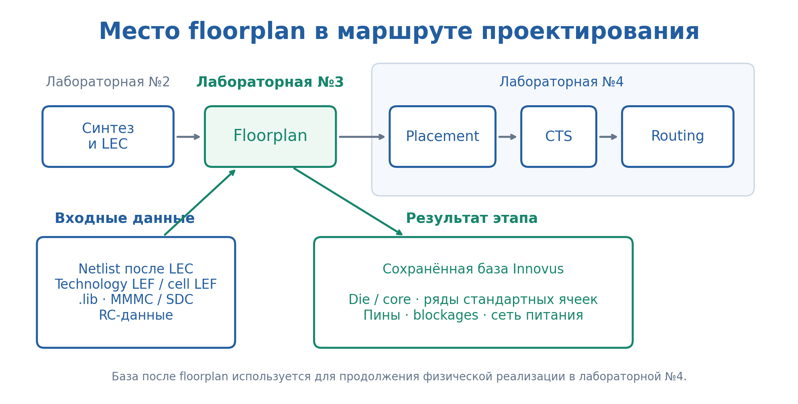

*Рисунок 1 — Место floorplan в маршруте. В задании на 4 создаётся placement blockage по периметру; в задании на 5 — два внутренних blockage и область cut row.*

# 2. Исходные данные

| Данные | Назначение |
| --- | --- |
| Netlist после LEC | Ячейки блока и их соединения |
| Technology LEF | Слои и технологические сведения, представленные в LEF |
| Cell LEF | Размеры ячеек, физические выводы и препятствия трассировки |
| `.lib` | Функции и характеристики ячеек для анализа и оптимизации |
| SDC | Временные ограничения своего блока |
| MMMC | Конфигурация режимов и условий анализа |
| RC-данные | Данные для оценки паразитных параметров в предусмотренном режиме |
| Процедуры и окружение | Настройка и выполнение учебного маршрута |

Комплект физических и временных библиотек и настройки анализа предоставляет преподаватель. Самостоятельно писать SDC в этой работе не требуется.

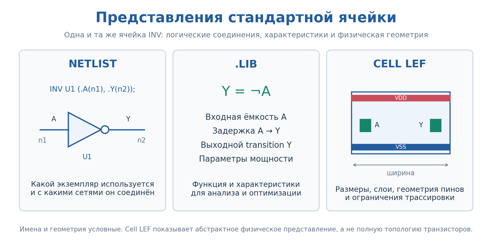

*Рисунок 2 — Условный инвертор в netlist, `.lib` и cell LEF. Cell LEF — абстрактное физическое представление, а не полная топология транзисторов.*

**Дополнить:** реальные файлы, пути, версия Innovus и интерфейс команд, настройки окружения и способы запуска.

# 3. Импорт проекта

Запуск Innovus и передача исходных данных выполняются через `Makefile`. Он задаёт имя блока, пути к netlist и библиотекам, конфигурацию MMMC и имена сетей питания.

## 3.1. Настройка Makefile

Выполняйте команды из корневого каталога проекта, в котором находится `Makefile`.

Укажите имя своего блока:

```makefile
export ENV_DESIGN = blockA
```

Имя должно совпадать с верхним модулем в netlist. Для второго блока используйте `blockB`.

Проверьте основные параметры:

| Переменная | Назначение |
| --- | --- |
| `PDK_DIR` | Каталог с PDK |
| `ENV_DESIGN` | Имя верхнего модуля |
| `ENV_NETLIST` | Netlist после синтеза и успешного LEC |
| `ENV_LEF_FILES` | Список технологического и библиотечного LEF |
| `ENV_MMMC` | Файл конфигурации MMMC |
| `ENV_POWER_NETS` | Имена сетей питания |
| `ENV_GROUND_NETS` | Имена сетей земли |
| `TECH_SIZE` | Технологический узел, нм |

В предоставленном Makefile пути формируются следующим образом:

```makefile
export ENV_DESIGN_DIR = $(PWD)/data/$(ENV_DESIGN)
export ENV_MMMC       = $(ENV_DESIGN_DIR)/mmmc.view
export ENV_NETLIST    = $(GENUS_OUTPUT_DIR)/syn_opt/$(ENV_DESIGN).v

export TECH_SIZE       = 130
export ENV_POWER_NETS  = VDD
export ENV_GROUND_NETS = VSS
```

Например, для `blockA` ожидаются файлы:

```text
data/blockA/mmmc.view
run/genus/outputs/syn_opt/blockA.v
```

Проверьте также пути к LEF-файлам и файлам, на которые ссылается `mmmc.view`: временным библиотекам, SDC и RC-данным.

## 3.2. Запуск Innovus

Не забудьде в терминале запустить лицензию 

Для интерактивной работы с графическим интерфейсом выполните:

```bash
make innovus
```

Можно передать имя блока непосредственно при запуске:

```bash
make innovus ENV_DESIGN=blockA
```

Makefile создаст рабочие каталоги и запустит Innovus в режиме Stylus из каталога:

```text
run/innovus_fp/
```

**Цель `make innovus` только запускает инструмент: импорт проекта необходимо выполнить в консоли Innovus.**

Для запуска подготовленного Tcl-сценария без GUI предусмотрена отдельная цель:

```bash
make innovus.fp ENV_DESIGN=blockA
```

Она выполняет файл:

```text
flow_scripts/flow.innovus.fp.tcl
```

Вывод сохраняется в:

```text
run/innovus_fp/logs/innovus_fp.log
```

Состав выполняемых операций определяется содержимым Tcl-сценария.

## 3.3. Команды импорта в Innovus

Переменные, объявленные в Makefile через `export`, доступны внутри Tcl как элементы `::env`.

Импорт выполняется процедурой `user_init_design`:

```tcl
    # Настройка технологического узла
    if {[info exists ::env(TECH_SIZE)] && $::env(TECH_SIZE) ne ""} {
        set_db design_process_node $::env(TECH_SIZE)
    }

    # Исходные данные и сети питания
    set_db init_netlist_files $::env(ENV_NETLIST)
    set_db init_lef_files     $::env(ENV_LEF_FILES)
    set_db init_power_nets    $::env(ENV_POWER_NETS)
    set_db init_ground_nets   $::env(ENV_GROUND_NETS)
    set_db init_mmmc_files    $::env(ENV_MMMC)

    # Чтение конфигурации анализа и физических библиотек
    read_mmmc $::env(ENV_MMMC)
    read_physical -lef $::env(ENV_LEF_FILES)

    # Чтение netlist и инициализация проекта
    read_netlist $::env(ENV_NETLIST) -top $::env(ENV_DESIGN)
    init_design
```

Команды выполняют следующие действия:

| Команда | Назначение |
| --- | --- |
| `set_db design_process_node` | Задаёт технологический узел для настроек инструмента; не заменяет загрузку PDK |
| `set_db init_*` | Задаёт параметры инициализации |
| `read_mmmc` | Читает конфигурацию режимов и условий анализа |
| `read_physical -lef` | Загружает физические описания из LEF |
| `read_netlist ... -top ...` | Загружает netlist и выбирает верхний модуль |
| `init_design` | Выполняет инициализацию проекта на основе загруженных данных |


## 3.4. Проверка результата

После импорта убедитесь, что:

- выбран правильный верхний модуль;
- netlist и LEF-файлы прочитаны без ошибок;
- для используемых ячеек найдены необходимые библиотечные представления;
- конфигурация MMMC, временные библиотеки и SDC загружены;
- имена сетей питания и земли соответствуют проекту.

Изучите сообщения в консоли и log-файлах, обращая внимание на:

- **ERROR** — ошибки необходимо устранить до продолжения работы;
- **WARNING** — предупреждения необходимо устранить либо уметь объяснить их причину и влияние на дальнейшую работу.

Не ограничивайтесь проверкой того, что проект открылся в GUI: ошибки и предупреждения могут указывать на неполную или некорректную загрузку исходных данных.

После устранения ошибок и анализа предупреждений можно переходить к созданию floorplan.
# 4. Геометрия floorplan

При создании floorplan задаются размеры блока, область размещения стандартных ячеек и периферийные отступы. Основные понятия этого этапа — **die**, **core**, **rows** и **site**.

## 4.1. Die, core, rows и site

**Die** — внешняя граница проектируемой области. При проектировании целой микросхемы она соответствует границе кристалла, а при реализации отдельного блока — границе этого блока.

**Core** — внутренняя область, предназначенная для размещения стандартных ячеек. Между границами die и core задаются отступы. В этой лабораторной работе периферийная область используется для кольца питания и сигнальных пинов; устанавливать отдельные IO pad cells не требуется.

**Rows** — ряды внутри core, в которых размещаются стандартные ячейки. Ряды задают допустимые положения и ориентации ячеек. Их участки можно удалять, исключая соответствующие области из размещения.

**Site** — базовая единица сетки размещения, описанная в LEF. Она задаёт ширину и высоту места размещения. Ширина стандартной ячейки обычно кратна ширине site; высота обычной однорядной ячейки соответствует высоте ряда.

Таким образом, die определяет внешние размеры блока, core — область размещения логики, rows — организацию рядов, а site — шаг сетки размещения.

На рисунке 3 показаны границы die и core, ряды стандартных ячеек и увеличенный фрагмент сетки размещения.

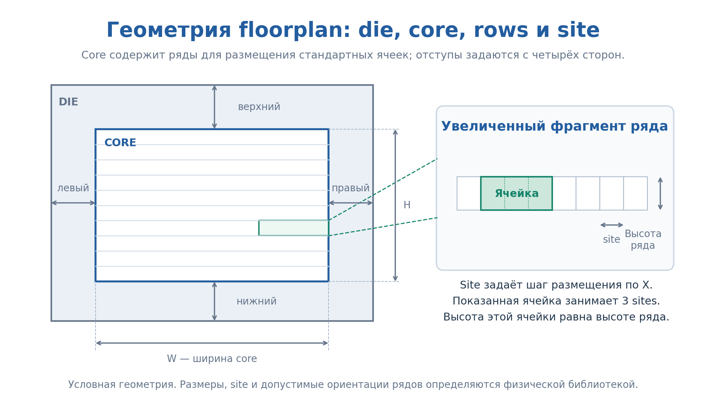

*Рисунок 3 — Геометрия floorplan: границы die и core, ряды размещения и site.*

## 4.2. Создание floorplan через GUI

В окне настройки floorplan геометрию можно задать двумя способами:

- **через целевую плотность размещения** — инструмент рассчитывает размеры области по площади стандартных ячеек;
- **через явные размеры** — пользователь вводит заранее рассчитанные ширину и высоту.

Основные параметры настройки:

| Параметр | Назначение |
| --- | --- |
| Cell Utilization | Целевая доля площади core, занимаемая стандартными ячейками |
| Aspect Ratio | Соотношение сторон области; порядок сторон следует проверить по обозначениям в окне |
| Core Margins / Offsets | Отступы между границами core и die с каждой стороны |
| Width / Height | Ширина и высота области при явном задании размеров |

### Задание через Cell Utilization

При использовании **Cell Utilization** инструмент рассчитывает размеры core по суммарной площади стандартных ячеек и заданной плотности. Например, значение 50% означает, что суммарная площадь ячеек составляет половину площади core.

Для определения формы области задаётся соотношение сторон, а для формирования периферийной области — отступы между core и die.

На рисунке 4 показан пример настройки floorplan через Cell Utilization.

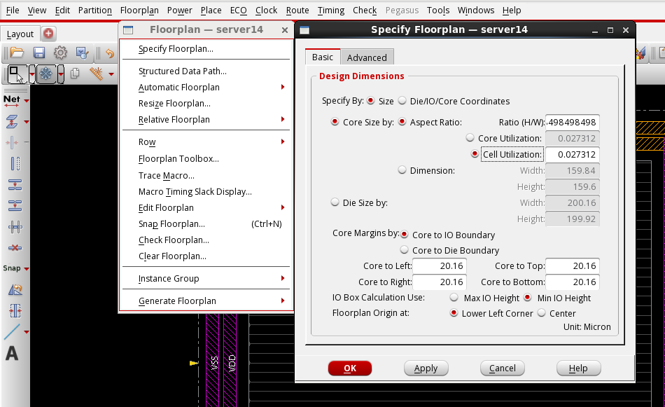

*Рисунок 4 — Задание геометрии floorplan через целевую плотность размещения.*

> Формат Cell Utilization зависит от интерфейса: плотность 50% может задаваться как `50` или `0.5`. Перед вводом проверьте единицы и обозначения поля.

### Задание явных размеров

В режиме явного задания геометрии ширина и высота вводятся вручную. Их предварительно рассчитывают по площади ячеек, целевой плотности и выбранному соотношению сторон. Порядок расчёта приведён в разделе 4.3.

Перед вводом проверьте, к какой области относятся поля размеров — **core или die**. При задании размеров die необходимо учитывать периферийные отступы.

На рисунке 5 показано окно ручного ввода размеров floorplan.

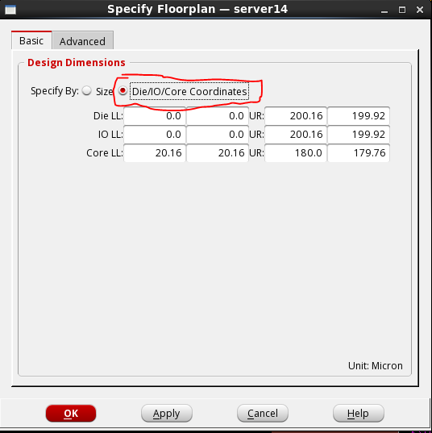

*Рисунок 5 — Явное задание ширины и высоты floorplan через GUI.*

### Отступы и проверка результата

Отступы формируют периферийную область между core и die. Её размеры выбирают с учётом расположения кольца питания, сигнальных пинов и технологических ограничений.

После применения настроек проверьте:

- границы и размеры die и core;
- отступы с каждой стороны;
- наличие и расположение rows внутри core;
- фактическую плотность заполнения.

Из-за округления по сетке размещения фактические размеры и плотность могут немного отличаться от расчётных.

## 4.3. Расчёт площади и размеров floorplan

Плотность заполнения показывает, какую долю выбранной области занимает суммарная площадь стандартных ячеек. При расчёте относительно площади core:

$$
U_{core}=\frac{A_{cells}}{A_{core}},
$$

где:

- **U_core** — плотность заполнения core, безразмерная величина; например, 50% соответствует 0.5;
- **A_cells** — суммарная площадь стандартных ячеек, мкм²;
- **A_core** — площадь core, мкм².

### Определение площади ячеек по отчёту синтеза

Для расчёта используйте **отчёт о площади (`report_area`) итоговой схемы после синтеза и оптимизации**, полученный в лабораторной работе №2.

1. Откройте отчёт о площади.
2. Найдите строку своего блока — `blockA` или `blockB`.
3. Определите суммарную площадь ячеек блока. В зависимости от формата отчёта соответствующее поле может называться **Cell Area**, **Instance Area** или **Total Cell Area**.
4. Проверьте единицы измерения. Для получения размеров в мкм площадь должна быть выражена в мкм².

Если отчёт содержит иерархию, используйте итоговую площадь блока **с учётом всех вложенных экземпляров**. Не складывайте её повторно с площадями дочерних модулей: это приведёт к двойному учёту.

Условный пример отчёта:

```text
Instance    Cell Count    Cell Area
----------------------------------
blockA             420     10000.00
```

Если площадь указана в мкм², для этого примера **A_cells = 10 000 мкм²**.

**Cell Count** — количество ячеек, а **Cell Area** — их суммарная площадь. Для расчёта размеров floorplan используется площадь, а не количество.

> Используйте данные для итогового netlist, который импортируется в Innovus. Площадь межсоединений, если она приведена отдельно, в A_cells не включается.

### Расчёт площади core

Для заданной целевой плотности:

$$
A_{core}=\frac{A_{cells}}{U_{core}},
$$

где:

- **A_core** — требуемая площадь core, мкм²;
- **A_cells** — суммарная площадь ячеек из отчёта синтеза, мкм²;
- **U_core** — выбранная целевая плотность в долях единицы.

При плотности 50%:

$$
A_{core}=2A_{cells}.
$$

Здесь **A_core** — площадь core, а **A_cells** — суммарная площадь ячеек; обе величины выражаются в мкм².

При неизменном составе ячеек увеличение площади core уменьшает плотность, а уменьшение площади — повышает её. Эта зависимость показана на рисунке 5.

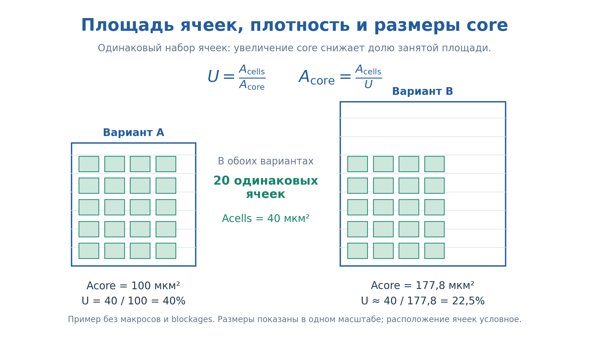

*Рисунок 5 — Одинаковая суммарная площадь ячеек при разных размерах core.*

### Расчёт ширины и высоты core

Одной площади недостаточно для определения формы блока: необходимо выбрать соотношение сторон:

$$
r=\frac{W_{core}}{H_{core}},
$$

где:

- **r** — отношение ширины core к его высоте, безразмерная величина;
- **W_core** — ширина core, мкм;
- **H_core** — высота core, мкм.

По площади и соотношению сторон размеры определяются следующим образом:

$$
W_{core}=\sqrt{rA_{core}},
\qquad
H_{core}=\sqrt{\frac{A_{core}}{r}},
$$

где:

- **W_core**, **H_core** — рассчитываемые ширина и высота core, мкм;
- **A_core** — площадь core, мкм²;
- **r** — выбранное отношение ширины к высоте.

Для квадратного core **r = 1**, поэтому:

$$
W_{core}=H_{core}=\sqrt{A_{core}},
$$

где **W_core** и **H_core** — стороны квадратного core в мкм, а **A_core** — его площадь в мкм².

### Расчёт размеров die

Размеры die определяются добавлением периферийных отступов к размерам core:

$$
W_{die}=W_{core}+m_L+m_R,
$$

$$
H_{die}=H_{core}+m_B+m_T,
$$

где:

- **W_die**, **H_die** — ширина и высота die, мкм;
- **W_core**, **H_core** — ширина и высота core, мкм;
- **m_L**, **m_R** — отступы между core и die слева и справа, мкм;
- **m_B**, **m_T** — отступы между core и die снизу и сверху, мкм.

Отступы выбираются с учётом места для кольца питания, сигнальных пинов и необходимых технологических расстояний.

### Пример расчёта

Исходные данные:

| Параметр | Значение |
| --- | --- |
| Суммарная площадь ячеек A_cells | 10 000 мкм² |
| Целевая плотность U_core | 0.5, или 50% |
| Соотношение сторон r | 1 — квадратный core |
| Отступы m_L, m_R, m_B, m_T | По 10 мкм |

Площадь core:

$$
A_{core}=\frac{10\,000}{0.5}=20\,000\text{ мкм}^2,
$$

где **A_core** — требуемая площадь core.

Ширина и высота core:

$$
W_{core}=H_{core}=\sqrt{20\,000}\approx141.42\text{ мкм},
$$

где **W_core** и **H_core** — размеры квадратного core.

При отступах по 10 мкм с каждой стороны размеры die:

$$
W_{die}=H_{die}\approx141.42+10+10=161.42\text{ мкм},
$$

где **W_die** и **H_die** — ширина и высота die.

Если установлено ограничение **die не менее 200 × 200 мкм**, при сохранении отступов по 10 мкм размеры core составят:

$$
W_{core}=H_{core}=200-10-10=180\text{ мкм},
$$

где **W_core** и **H_core** — размеры core после увеличения die.

Фактическая плотность:

$$
U_{core}=\frac{10\,000}{180\cdot180}\approx0.309=30.9\%,
$$

где **U_core** — отношение площади ячеек к новой площади core.

Таким образом, ограничение минимального размера die может привести к плотности ниже целевой. Отступы в этом примере условные; их допустимость проверяется отдельно.


# 5. Инструменты Innovus

В этом разделе рассматриваются основные инструменты работы с floorplan: выбор и перемещение объектов, рисование проводников, создание кольца и шин питания, редактирование rows, размещение пинов и создание blockages.

Приёмы работы показаны на демонстрационном проекте **counter**. При выполнении задания применяйте их к своему блоку, выбирая параметры с учётом его размеров и используемой технологии.

На рисунке 7 показан общий вид демонстрационного floorplan в Innovus.

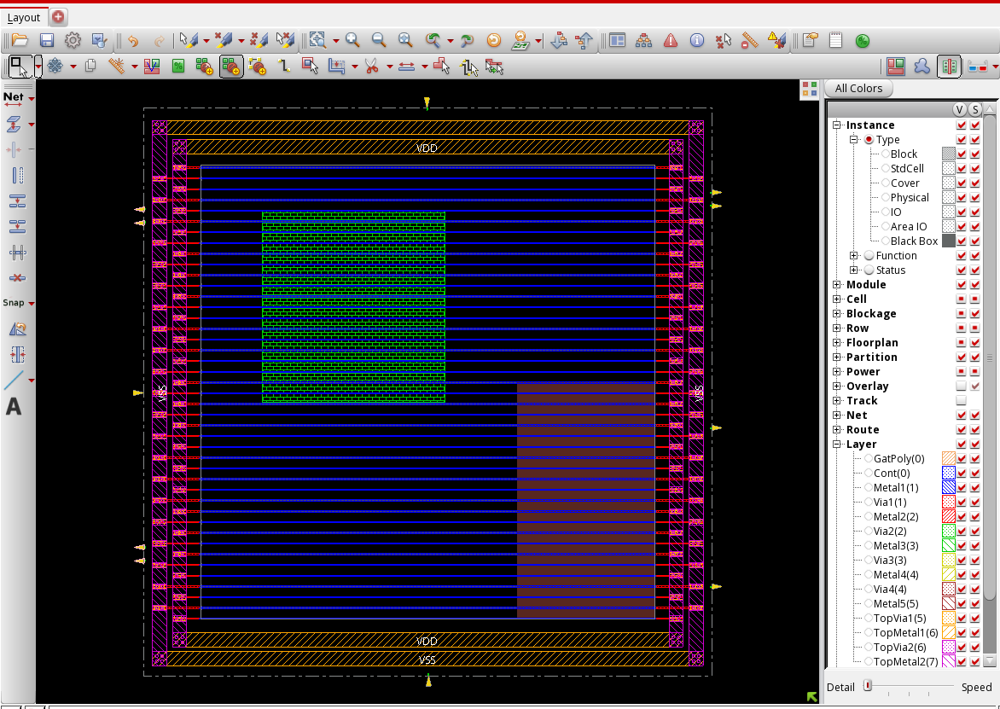

*Рисунок 7 — Демонстрационный floorplan блока counter в Innovus.*

## 5.1. Просмотр, выбор объектов и измерение расстояний

Для работы с floorplan используйте верхнюю панель инструментов и горячие клавиши.

| Клавиша | Действие |
| --- | --- |
| `a` | Переход в режим выбора объектов |
| `Shift + R` | Переход в режим перемещения объектов |
| `f` | Показ всей проектируемой области |
| `k` | Создание линейки для измерения расстояния |
| `Shift + K` | Удаление всех линеек |

Перед перемещением убедитесь, что выбран нужный объект.

### Верхняя панель инструментов

В верхней части окна расположены основное меню и кнопки быстрого доступа: выбор объектов, управление масштабом, перемещение по изображению и другие операции.

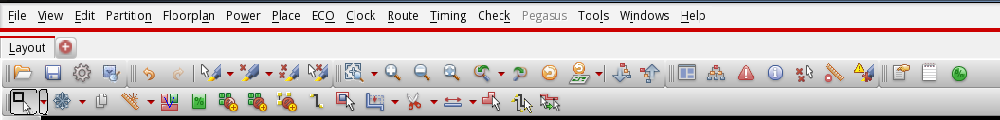

*Рисунок — Основное меню и верхняя панель инструментов Innovus.*

### Управление отображением и выбором объектов

Справа расположена панель **All Colors**. В ней можно раскрывать группы объектов и управлять их отображением и доступностью для выбора.

| Столбец | Назначение |
| --- | --- |
| V — Visible | Видимость объектов в рабочем окне |
| S — Selectable | Возможность выбирать объекты мышью |

Например, отключение видимости слоя скрывает его проводники, но не удаляет их из проекта. Отключение выбора позволяет избежать случайного выделения объектов при работе с другими элементами.

В группе **Layer** перечислены металлические слои и переходы между ними. Группы **Row**, **Blockage**, **Net** и другие позволяют управлять соответствующими объектами.

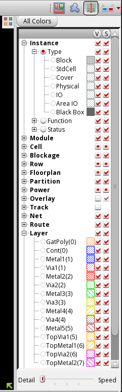

*Рисунок — Панель All Colors: управление видимостью и выбором объектов.*

### Измерение расстояний

Для проверки размеров, ширин и отступов используйте линейку:

1. Наведите указатель на рабочую область и нажмите `k`.
2. Укажите начальную и конечную точки измерения.
3. Посмотрите значение расстояния на созданной линейке.

Измерения выполняются в единицах длины проекта, обычно в **мкм**.

Чтобы убрать все созданные линейки, нажмите **Shift + K**.

## 5.2. Рисование проводников

Для ручного создания проводников используется панель **Wire Edit**. В ней задаются сеть, тип проводника, слои горизонтальных и вертикальных участков, их ширины и настройки создания vias.

Для проводников питания выберите вкладку **Special**.

### Настройка проводника

| Поле | Назначение |
| --- | --- |
| Nets | Сеть создаваемого проводника, например VDD или VSS |
| Shape | Тип специального проводника; на примере выбран STRIPE |
| Layer: H / V | Металлические слои горизонтальных и вертикальных участков |
| Width: H / V | Ширины горизонтальных и вертикальных участков |
| Via Creation | Настройки создания переходов между слоями |
| DRC Check | Проверка технологических правил при редактировании |
| Status | Статус создаваемого объекта; на примере выбран Fixed |

После настройки задайте начальную точку и нарисуйте необходимые участки проводника. При изменении направления используются соответствующие настройки **H** и **V**.

На рисунке 8 показана панель Wire Edit и пример горизонтальных и вертикальных проводников питания.

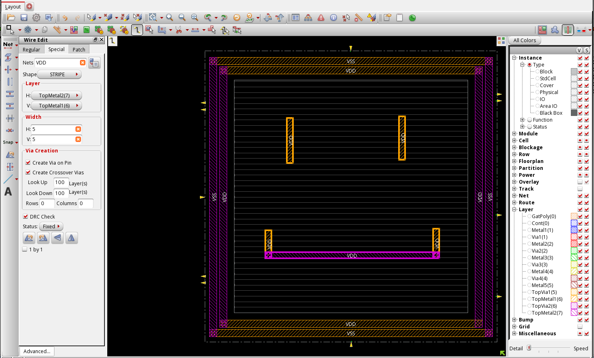

*Рисунок 8 — Панель Wire Edit: выбор сети, слоёв, ширин и настроек vias. Значения на скриншоте приведены для демонстрации.*

### Соединение проводников между слоями

Для электрического соединения проводников на разных металлических слоях используются **vias** — межслойные переходы.

Пересечение проводников на экране и одинаковое имя сети сами по себе не обеспечивают соединение: между слоями должны присутствовать vias.

На первом рисунке показано пересечение двух проводников сети **VDD** без видимого массива переходов.

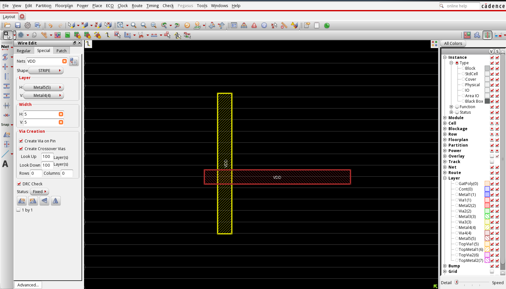

*Рисунок — Пересечение проводников VDD на разных металлических слоях до добавления vias.*

#### Добавление vias через GUI

Откройте **Power → Power Planning → Edit Power Via…**.

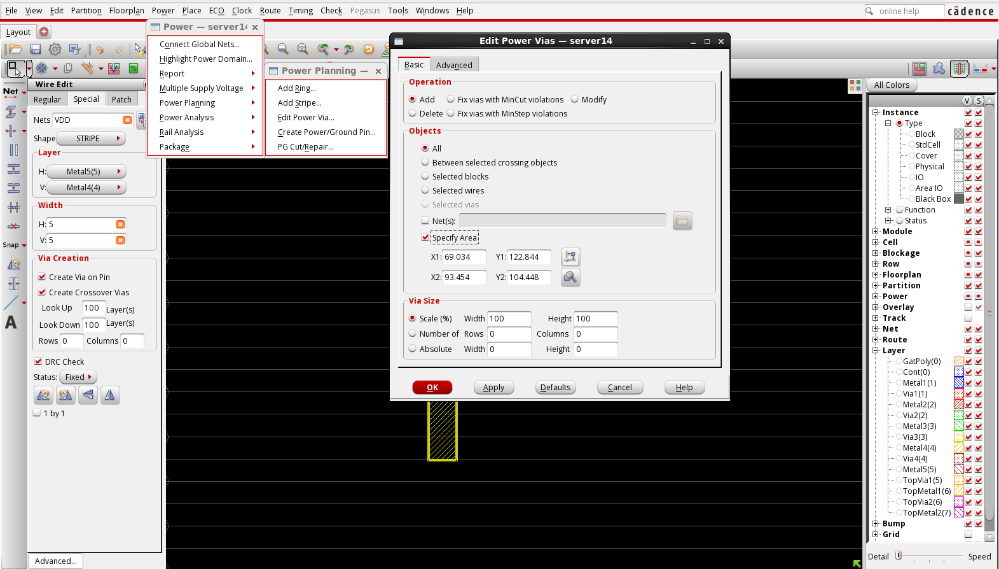

*Рисунок — Окно Edit Power Vias: добавление переходов в заданной области.*

Для создания переходов:

1. В области **Operation** выберите **Add**.
2. Укажите обрабатываемые объекты. Для локального добавления можно выбрать **All** и ограничить обработку через **Specify Area**.
3. Включите **Specify Area** и задайте прямоугольник вокруг нужного пересечения. Область можно указать мышью или координатами.
4. При необходимости включите фильтр **Net(s)** и укажите нужную сеть, например `VDD`.
5. В области **Via Size** задайте способ определения размера массива переходов.
6. Нажмите **Apply** или **OK** и проверьте сообщения инструмента.

В области **Via Size** доступны следующие настройки:

| Параметр | Назначение |
| --- | --- |
| Scale (%) | Масштабирование размера массива переходов |
| Number of Rows / Columns | Задание числа рядов и столбцов переходов |
| Absolute Width / Height | Задание размеров области массива |

Параметры должны соответствовать площади пересечения проводников и технологическим правилам. Значения на скриншоте приведены для демонстрации.

#### Проверка результата

После выполнения операции в месте пересечения появляется массив vias.

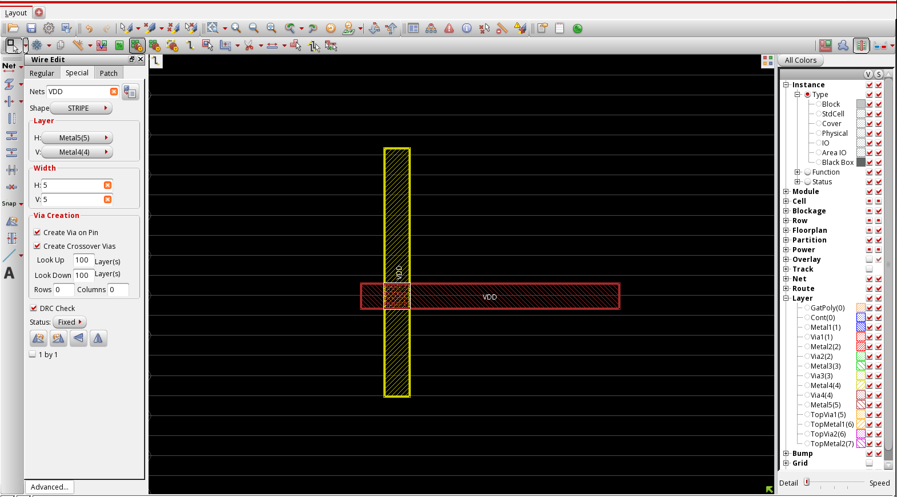

*Рисунок — Массив vias в области пересечения, соединяющий проводники сети VDD.*

Увеличьте масштаб и проверьте:

- наличие переходов между нужными металлическими слоями;
- принадлежность соединяемых проводников одной сети;
- размещение vias в области перекрытия проводников;
- отсутствие нарушений технологических правил и замыканий между VDD и VSS.

> Создавайте vias только между проводниками одной сети. В месте пересечения VDD и VSS на разных слоях переходов быть не должно.

### Направления металлических слоёв

Для металлических слоёв обычно задают предпочтительное направление трассировки — **горизонтальное или вертикальное**. У соседних слоёв эти направления, как правило, чередуются.

Один из распространённых вариантов:

- нечётные слои — горизонтальное направление;
- чётные слои — вертикальное направление.

Чередование позволяет прокладывать горизонтальные и вертикальные участки на разных слоях и соединять их через vias. Это упорядочивает трассировку и уменьшает число конфликтов между пересекающимися соединениями.

На показанном примере горизонтальные участки создаются на **TopMetal2(7)**, а вертикальные — на **TopMetal1(6)**.

> Соответствие чётности и направления не универсально. Проверяйте предпочтительные направления по технологическому LEF и настройкам инструмента. Числа в скобках в GUI могут обозначать индексы слоёв, а не номера из их названий.

#### Почему для кольца используются разные слои

В данной работе горизонтальные и вертикальные стороны кольца создаются на разных металлических слоях и соединяются через vias.

Использование одного слоя для всего кольца может вызвать следующие трудности:

- **Подключение внутреннего кольца.** Чтобы подвести питание к внутреннему кольцу, необходимо пересечь внешнее. На одном слое такое пересечение соединит VDD и VSS и вызовет короткое замыкание. Для пересечения потребуется переход на другой слой.
- **Ограничения направления проводников.** Некоторые технологии задают строгие ограничения на направление трассировки. На таких слоях часть сторон кольца может нарушать технологические правила. В других технологиях предпочтительное направление является рекомендацией, а не запретом.
- **Занятость трассировочных ресурсов.** Горизонтальные и вертикальные участки на одном слое занимают ресурсы обоих направлений и затрудняют прокладку других соединений на этом слое.

Разделение направлений по двум слоям упрощает построение кольца и подключение к нему других проводников питания.

> Кольцо на одном слое не обязательно имеет большее сопротивление или падение напряжения. Эти характеристики зависят от материала, толщины, ширины и длины проводников, а также расположения точек подключения питания.


## 5.3. Создание кольца питания через GUI и команды

Кольцо питания проходит по периметру выбранной области и используется для распределения питания. Для сетей **VDD** и **VSS** создаются отдельные замкнутые кольца.

### Создание через GUI

Откройте **Power → Power Planning → Add Ring…**. В появившемся окне **Add Rings** на вкладке **Basic** задайте сети, тип кольца и его геометрию.

На рисунке 9 показаны путь к инструменту и окно настройки.

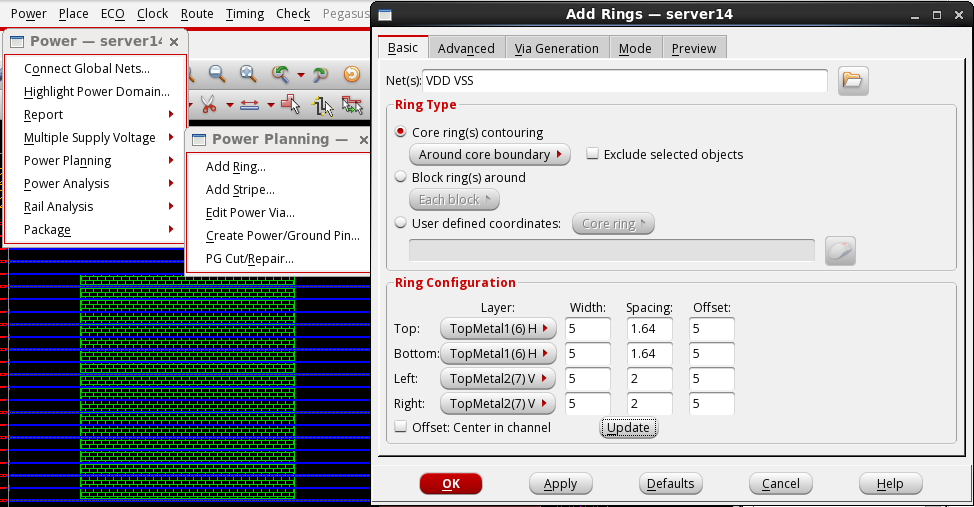

*Рисунок 9 — Создание кольца питания через Power → Power Planning → Add Ring.*

#### Сети и опорная граница

В поле **Net(s)** укажите имена сетей:

`VDD VSS`

В области **Ring Type** выберите **Core ring(s) contouring**. Параметр **Around core boundary** задаёт построение кольца вокруг границы core.

#### Геометрия кольца

В области **Ring Configuration** параметры задаются отдельно для четырёх сторон:

| Строка | Сторона кольца |
| --- | --- |
| Top | Верхняя |
| Bottom | Нижняя |
| Left | Левая |
| Right | Правая |

Для каждой стороны указываются:

| Поле | Назначение |
| --- | --- |
| Layer | Металлический слой участка |
| Width | Ширина проводника |
| Spacing | Расстояние между соседними проводниками VDD и VSS |
| Offset | Отступ относительно выбранной опорной границы |

Ширины, расстояния и отступы задаются в единицах длины проекта, обычно в мкм.

Для верхней и нижней сторон выбираются слои горизонтальных участков, для левой и правой — вертикальных. На скриншоте используются **TopMetal1(6) H** и **TopMetal2(7) V** соответственно. Это пример настройки; направления следует проверять для используемой технологии.

После заполнения параметров проверьте положение кольца через вкладку **Preview**, затем примените настройки кнопкой **Apply** или **OK**.

> Offset в этом окне задаётся относительно выбранной границы core. Его нельзя автоматически считать расстоянием от края die.


Создание кольца само по себе не подключает питание всех стандартных ячеек. Привязка их PG-выводов и физическое подключение шин питания выполняются отдельными операциями.

## 5.5. Шины питания вдоль рядов

Шины питания проходят вдоль rows и обеспечивают подключение PG-выводов стандартных ячеек к сетям VDD и VSS.

**Rows и шины питания — разные объекты.** Ряд задаёт места размещения ячеек, а шина является металлическим проводником. Создание rows само по себе не означает, что питание подключено.

Для формирования шин и соединения элементов сети питания используется специальная трассировка — **SRoute**.

### Настройка через GUI

Откройте **Route → Special Route…**. В окне **SRoute** на вкладке **Basic** укажите сети в поле **Net(s)**:

`VDD VSS`

На рисунке 10 показано окно настройки специальной трассировки.

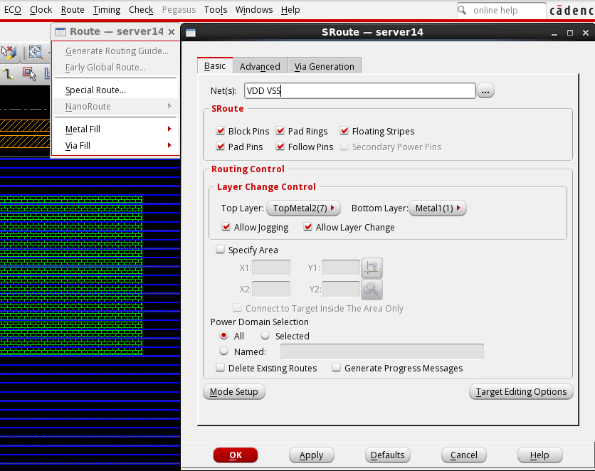

*Рисунок 10 — Окно SRoute: выбор сетей, типов подключаемых объектов и разрешённых слоёв.*

В области **SRoute** выбираются типы объектов, которые необходимо подключить:

| Параметр | Назначение |
| --- | --- |
| Follow Pins | Формирование и подключение шин вдоль рядов по геометрии PG-выводов стандартных ячеек |
| Block Pins | Подключение выводов питания макроблоков |
| Pad Pins | Подключение выводов питания IO-ячеек |
| Pad Rings | Подключение колец питания IO-ячеек |
| Floating Stripes | Подключение неподключённых полос питания |

Для работы с шинами стандартных ячеек используется **Follow Pins**. Остальные параметры выбираются по составу проекта; включать все опции только потому, что они отмечены на скриншоте, не требуется.

В области **Layer Change Control** задаются:

- **Bottom Layer** — нижний разрешённый слой;
- **Top Layer** — верхний разрешённый слой;
- **Allow Layer Change** — разрешение переходов между слоями;
- **Allow Jogging** — разрешение дополнительных изгибов проводников.

Диапазон слоёв должен позволять соединить шины рядов с кольцом или stripes через необходимые vias.

После настройки выполните операцию кнопкой **Apply** или **OK**.

### Проверка результата

После выполнения SRoute проверьте:

- наличие шин питания вдоль rows;
- соответствие шин сетям VDD и VSS;
- соединение шин с кольцом или stripes;
- наличие необходимых vias;
- отсутствие замыканий между VDD и VSS.

Просмотрите сообщения в консоли и log: ошибки необходимо устранить, предупреждения — устранить либо объяснить их причину и влияние на результат.


## 5.6. Вырезание и восстановление rows

Вырезание rows удаляет места для размещения стандартных ячеек в выбранной области. При этом размеры core остаются прежними, а уже созданные проводники питания автоматически не удаляются.

### Вырезание участка rows

Откройте **Floorplan → Row → Cut Core Row…**. В окне **Cut Core Rows** укажите, какие ряды необходимо изменить:

- **All Core Sites** — обработать ряды всех типов site;
- **Selected Core Sites** — обработать ряды выбранного типа site.

Для вырезания прямоугольной области выберите **Specified Area** и задайте её границы:

| Поле | Назначение |
| --- | --- |
| LLX | X-координата левого нижнего угла |
| LLY | Y-координата левого нижнего угла |
| URX | X-координата правого верхнего угла |
| URY | Y-координата правого верхнего угла |

Координаты можно ввести вручную либо указать область мышью с помощью кнопки справа от полей. Проверьте единицы измерения, используемые в проекте.

На рисунке 11 показано окно настройки области вырезания.

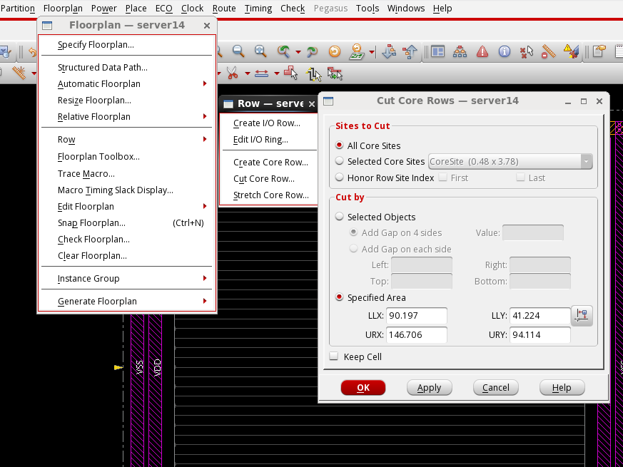

*Рисунок 11 — Окно Cut Core Rows: выбор site и прямоугольной области вырезания.*

Нажмите **Apply** или **OK** и проверьте результат. Пересекающие выбранную область ряды должны быть укорочены или разделены на отдельные участки. Ряды за её пределами должны сохраниться.

На рисунке 12 показан пример прямоугольного выреза внутри core.

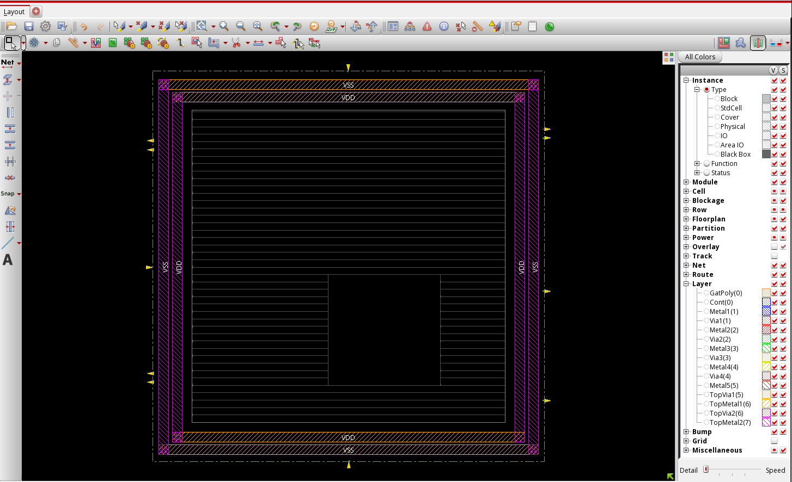

*Рисунок 12 — Ряды размещения после удаления участков в заданной области.*

Для области сложной формы операцию можно повторить с несколькими прямоугольниками. Например, периферийную рамку удобно задать четырьмя областями: слева, справа, сверху и снизу.

### Восстановление rows

Для восстановления рядов размещения выполните в консоли Innovus команду:

```tcl
init_core_rows
```
## 5.7. Размещение сигнальных выводов

Сигнальные выводы — **пины** — задают физические места подключения внешних сигналов блока. Для их размещения откройте **Edit → Pin Editor…**.

На рисунке 13 показано окно редактора. Слева расположены схема сторон блока и список портов, справа — настройки выбранных пинов.

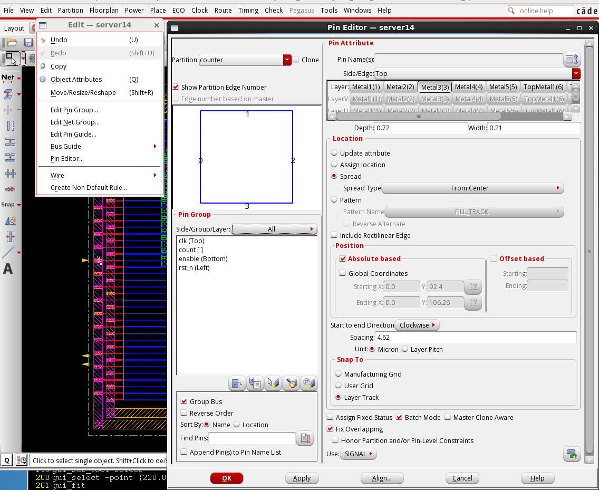

*Рисунок 13 — Окно Pin Editor: выбор портов, стороны блока, слоя и способа размещения.*

### Основные настройки

| Параметр | Назначение |
| --- | --- |
| Pin Name(s) | Порты, к которым применяются настройки |
| Side/Edge | Сторона блока для размещения |
| Layer | Металлический слой пинов |
| Depth / Width | Глубина и ширина пинов |
| Assign location | Задание положения пинов |
| Spread | Распределение пинов по выбранному участку |
| Starting / Ending | Начало и конец участка размещения |
| Spacing | Расстояние между пинами |
| Snap To | Привязка к сетке, например к трассировочным трекам |
| Group Bus | Группировка разрядов шин |
| Reverse Order | Изменение порядка следования пинов на обратный |

Доступность полей зависит от выбранного режима в области **Location**. Режим **Update attribute** используется для изменения атрибутов, а **Assign location** и **Spread** — для задания положения и распределения пинов.

### Порядок размещения

1. Выберите порт или группу портов в списке слева.
2. Проверьте список **Pin Name(s)**.
3. Укажите сторону **Side/Edge** и разрешённый слой **Layer**.
4. Задайте размеры пинов **Depth / Width**.
5. Выберите способ размещения: **Assign location** или **Spread**.
6. Задайте положение либо границы участка и параметры распределения.
7. Выберите привязку к трассировочным трекам в **Snap To**.
8. Для шин проверьте группировку и порядок разрядов.
9. Нажмите **Apply** и проверьте результат в рабочем окне.
10. Повторите операцию для остальных портов.

### Результат размещения

На рисунке 14 показан пример размещения сигнальных пинов по четырём сторонам блока. Жёлтые маркеры у границы обозначают расположение портов. Внутри видны rows, по периметру — кольца питания VDD/VSS.

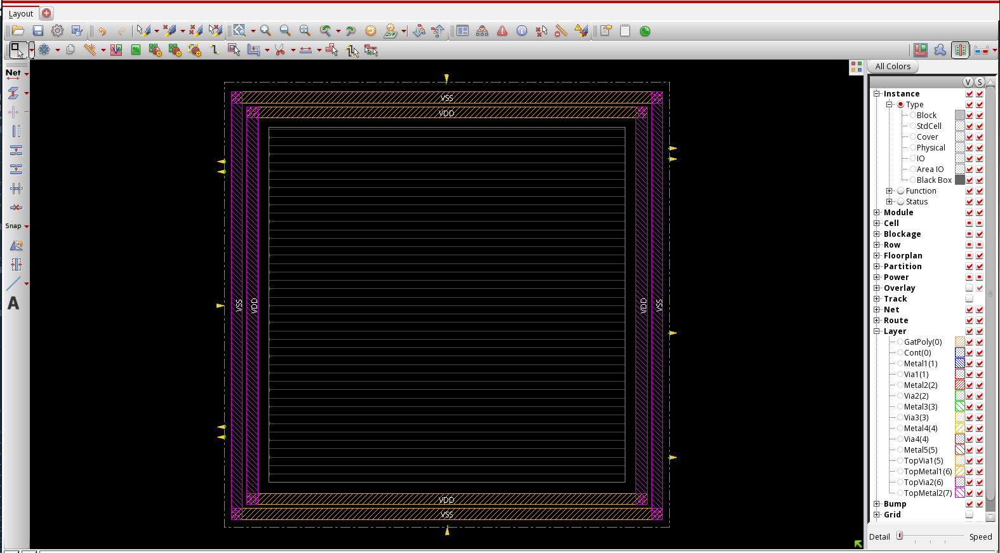

*Рисунок 14 — Пример размещения сигнальных пинов по сторонам блока в Innovus.*

Для проверки конкретного пина увеличьте масштаб, выберите его и просмотрите имя порта, слой и координаты в свойствах объекта.

После размещения убедитесь, что:

- все сигнальные порты имеют физические пины;
- пины расположены на заданных сторонах и участках;
- выбраны разрешённые металлические слои;
- порядок разрядов шин соответствует заданному;
- пины не перекрываются между собой и не замыкаются на питание.

> Жёлтый маркер показывает положение порта, но не заменяет проверку геометрии металлического пина. Если пин и проводник питания находятся на одном слое, их пересечение приведёт к замыканию.

## 5.8. Placement blockage

**Placement blockage** задаёт область с ограничениями на размещение ячеек. Например, его можно использовать, чтобы оставить свободное место под будущий макроблок или зарезервировать участок floorplan.

Основные типы ограничений:

| Тип | Назначение |
| --- | --- |
| Hard | Запрещает размещение стандартных ячеек в области |
| Soft | Ограничивает размещение на начальных этапах, но допускает использование области при последующей оптимизации |
| Partial | Ограничивает плотность размещения в области |

Для полного запрета размещения стандартных ячеек используется тип **Hard**.

### Создание и проверка

1. Выберите инструмент создания **Placement Blockage**.
2. Укажите тип **Hard**.
3. Задайте прямоугольную область двумя противоположными углами.
4. Завершите создание объекта.
5. Выберите созданный blockage и проверьте его тип и координаты в свойствах объекта.

Если требуется ограничить область сложной формы, используйте несколько прямоугольных blockages. Например, рамку по периметру можно составить из четырёх прямоугольников.

На рисунке 15 показан прямоугольный placement blockage внутри core. Ряды размещения в этой области сохраняются, но размещение стандартных ячеек запрещено.

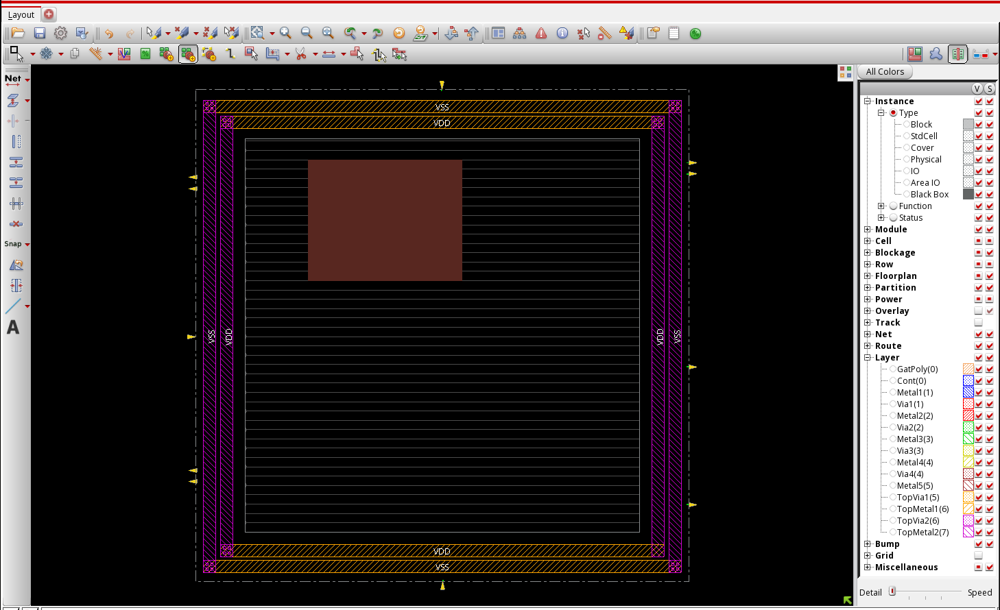

*Рисунок 15 — Пример прямоугольного placement blockage внутри core.*

### Изменение и удаление

Чтобы изменить границы blockage, выберите объект и отредактируйте его геометрию или координаты. Для снятия ограничения удалите сам blockage.

После изменения проверьте, что ограничение действует только в нужной области и не перекрывает участки, предназначенные для размещения.

> Placement blockage не удаляет rows и не запрещает трассировку проводников. Ограничения на прокладку проводников задаются отдельно с помощью **routing blockage**.

### Routing blockage и отличие от placement blockage

**Routing blockage** задаёт область, в которой ограничена трассировка на выбранном слое или нескольких слоях металла. Его используют, чтобы зарезервировать участок для будущих соединений или исключить прокладку проводников через определённую область.

При создании routing blockage необходимо задать:

- границы области;
- слой или набор слоёв металла;
- типы сетей, на которые распространяется ограничение, если такие настройки предусмотрены инструментом.

### Создание и проверка

1. Выберите инструмент создания **Routing Blockage**.
2. Укажите металлические слои, на которых требуется ограничить трассировку.
3. Задайте прямоугольную область двумя противоположными углами.
4. Завершите создание объекта.
5. Выберите созданный blockage и проверьте его границы, слои и параметры в свойствах объекта.

На рисунке 16 показана прямоугольная область routing blockage внутри core. Ряды размещения проходят через эту область и сохраняются.

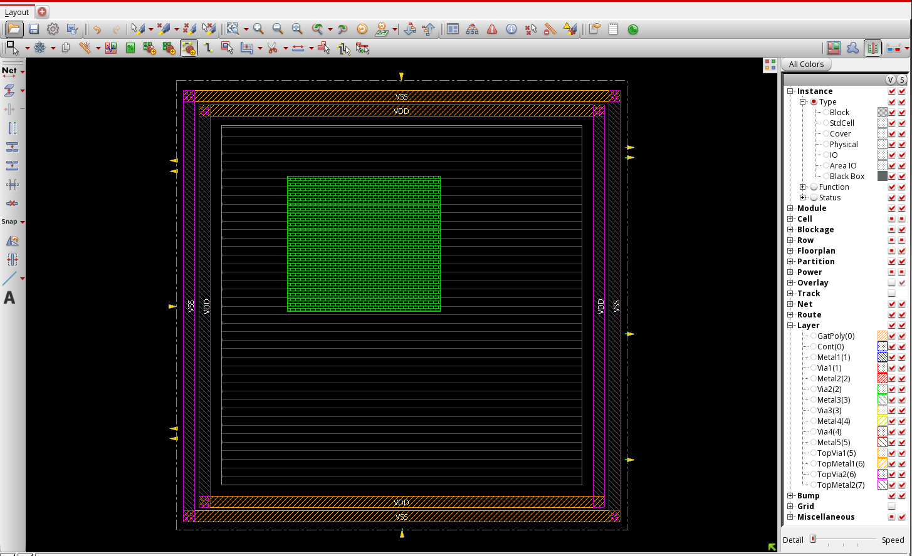

*Рисунок 16 — Пример прямоугольного routing blockage внутри core.*

### Сравнение ограничений

| Объект | Влияние на размещение ячеек | Влияние на трассировку | Удаляет rows? |
| --- | --- | --- | --- |
| Hard placement blockage | Запрещает размещение стандартных ячеек в области | Не задаёт запрета на трассировку | Нет |
| Routing blockage | Не задаёт запрета на размещение | Ограничивает трассировку на выбранных слоях | Нет |
| Cut row | Удаляет доступные места размещения в области | Не задаёт запрета на трассировку | Да |

Чтобы изменить ограничение, отредактируйте границы, набор слоёв или другие свойства routing blockage. Чтобы снять его, удалите сам объект.

> Routing blockage не удаляет уже существующие проводники. Его действие на сигнальную и специальную трассировку, включая сети питания, определяется настройками объекта и инструмента. После создания проверьте эти параметры в свойствах.

## 5.9. Координаты

Координаты позволяют определить положение точки на floorplan. Они используются при размещении объектов, задании границ blockages и вырезании rows.

Ось **X** направлена вправо, ось **Y** — вверх. Координаты задаются в единицах длины проекта, обычно в **микрометрах (мкм)**.

### Через контекстное меню

Щёлкните правой кнопкой мыши в рабочей области и выберите **Get Coordinate** для получения координат точки.

Для получения координат прямоугольной области в меню также доступен пункт **Get Box Coordinate**.

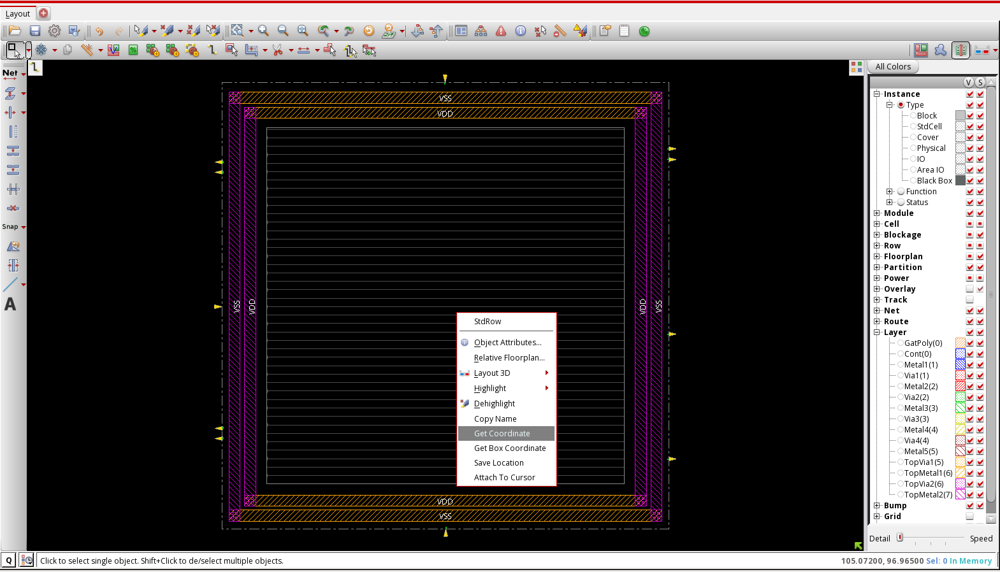

*Рисунок 17 — Команды Get Coordinate и Get Box Coordinate в контекстном меню Innovus.*

### В строке состояния

Текущие координаты указателя отображаются **в правом нижнем углу окна Innovus**. При перемещении мыши значения обновляются.

Первое число — координата **X**, второе — **Y**. На скриншоте показаны значения **X = 105.07200 мкм**, **Y = 96.96500 мкм**.

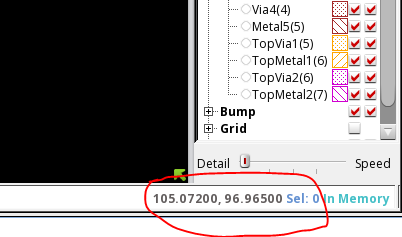

*Рисунок 18 — Отображение координат X и Y в правом нижнем углу окна Innovus.*

> При расчёте областей используйте фактические координаты границ die. Не считайте автоматически, что его нижний левый угол находится в точке (0, 0).

# 6. Подготовка Tcl-скрипта и работа с .cmd


## 6.1. Выполнение Tcl-команд и скриптов

Innovus использует команды языка **Tcl**. Их можно вводить в консоли инструмента или записывать в текстовый файл с расширением `.tcl`.

Чтобы выполнить готовый скрипт внутри текущей сессии Innovus, используйте команду `source`:

```tcl
source ../flow_scripts/flow.innovus.floorplan.tcl
```

Укажите фактический путь к своему файлу. Команды из скрипта выполняются последовательно и работают с текущей базой проекта.

## 6.2. Команды GUI и файл innovus.cmd

При выполнении операций через GUI Innovus в консоли отображаются соответствующие Tcl-команды. Их можно использовать для подготовки собственного скрипта.

На рисунке 19 показана консоль после создания кольца питания через GUI. Команда **add_rings** содержит выбранные параметры: сети VDD/VSS, металлические слои, ширины проводников, расстояния между ними и отступы.

После команды выводятся сообщения о результате: завершении создания кольца, количестве проводников и vias.

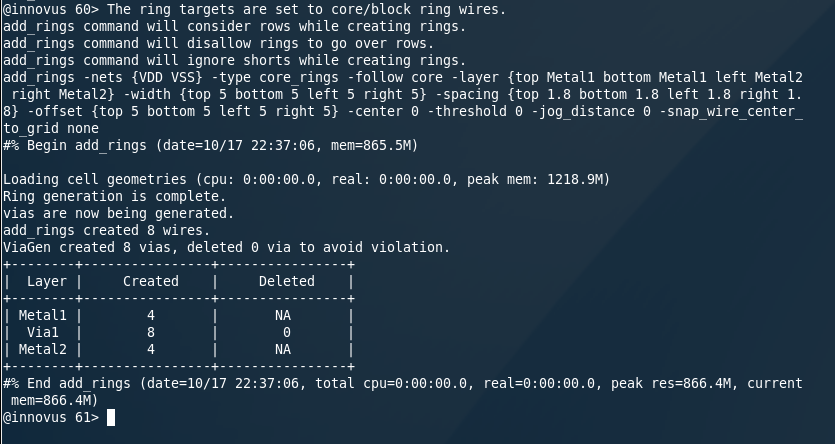

*Рисунок 19 — Команда add_rings и сообщения о создании проводников и vias. Параметры на скриншоте приведены для демонстрации.*

### Как перенести действие GUI в скрипт

1. Выполните нужную операцию через GUI.
2. Найдите соответствующую Tcl-команду в консоли.
3. Скопируйте её в свой файл `.tcl`.
4. Проверьте имена сетей, слои, размеры, координаты и остальные параметры.
5. Проверьте выполнение команды на исходном состоянии проекта.

Копируйте только саму команду: приглашения консоли вида `@innovus 60>`, таблицы и сообщения о выполнении в скрипт включать не нужно.

### Файл innovus.cmd

Команды сессии также сохраняются в файле **innovus.cmd**. Откройте его в текстовом редакторе, найдите нужную операцию и перенесите соответствующие команды в свой Tcl-скрипт.

> innovus.cmd — история работы, которая может содержать повторные действия, промежуточные настройки и неудачные попытки. Перед использованием команд проверьте их параметры и порядок выполнения.

# 8. Сохранение, загрузка и итоговые проверки

## 8.1. Как сохранить и загрузить floorplan

Сохраняйте два состояния: **исходный floorplan после импорта проекта** и **готовый floorplan после выполнения задания**. Используйте разные имена, например `blockA_import.fp` и `blockA_floorplan.fp`.

### Сохранение

1. Откройте **File → Save → Floorplan…**.
2. Выберите каталог и укажите имя файла.
3. Выполните сохранение и проверьте сообщения в консоли Innovus.

На рисунке 20 показан путь к сохранению floorplan.

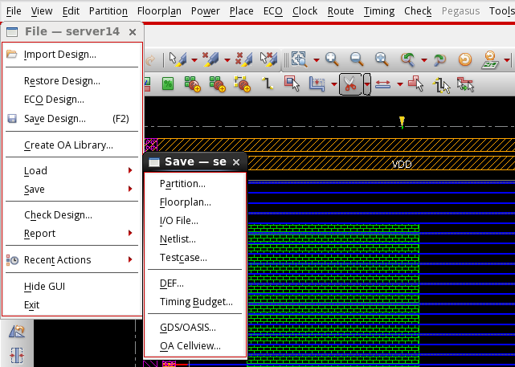

*Рисунок 20 — Сохранение floorplan через File → Save → Floorplan.*

### Загрузка

Загрузка находится в том же меню **File**, рядом с сохранением:

1. Откройте **File → Load → Floorplan…**.
2. Выберите ранее сохранённый файл `.fp`.
3. Выполните загрузку и проверьте сообщения в консоли.
4. Убедитесь, что восстановились размеры floorplan, rows, расположение пинов, blockages и проводники питания.

> Файл floorplan не заменяет полную базу проекта. Перед его загрузкой должен быть импортирован соответствующий проект с необходимыми библиотеками и netlist.


# 10. Задание

Используйте итоговый netlist своего блока `blockA` или `blockB`, полученный в лабораторной работе №2 и успешно прошедший LEC.

Каждый студент выполняет работу на своём блоке. При индивидуальном выполнении используется один выбранный функциональный блок.

Работа разделена на обязательную часть для оценки **4** и дополнительную часть для оценки **5**. В обоих случаях необходимо понимать выполненные действия и уметь объяснить полученный результат.

## 10.1. Задание на 4 балла

### 1. Импорт проекта

- Импортируйте в Innovus netlist своего блока, полученный в лабораторной работе №2 и успешно прошедший LEC.

### 2. Создание floorplan

Создайте floorplan через GUI со следующими параметрами:

| Параметр | Требование |
| --- | --- |
| Cell Utilization | 50%, или 0.5 при вводе доли |
| Соотношение сторон core | 1:1 |
| Минимальная ширина die | 200 мкм |
| Минимальная высота die | 200 мкм |
| Отступ между core и die | 20 мкм с каждой стороны |

Сначала определите размеры по Cell Utilization = 50%. Если хотя бы одна сторона die получается меньше 200 мкм, увеличьте размеры до выполнения минимального требования, сохранив отступы по 20 мкм.

При увеличении core допускается фактическая плотность ниже 50%.

Проверьте наличие rows внутри core. Ручной расчёт размеров для оценки 4 не требуется.

### 3. Размещение сигнальных пинов

Разместите все сигнальные пины через **Pin Editor**.

- Стороны, порядок и участки размещения выберите самостоятельно.
- Не допускайте перекрытия пинов между собой и замыканий на кольцо питания.

### 4. Создание кольца питания

Создайте отдельные замкнутые кольца для сетей **VDD** и **VSS**.

| Параметр | Значение |
| --- | --- |
| Сети | VDD и VSS |
| Ширина каждого проводника | 4 мкм |
| Расстояние между краями проводников VDD и VSS | 2 мкм |
| Расстояние от границы die до внешнего края кольца | 4 мкм |
| Слои | Два верхних разрешённых слоя металла |
| Соединения между слоями | Через vias |

Для горизонтальных сторон используйте слой с горизонтальным предпочтительным направлением, для вертикальных — с вертикальным.

Внешним расположите кольцо **VSS**, внутренним — **VDD**.

При таких параметрах внутренний край кольца находится на расстоянии **14 мкм от соответствующей границы die**:

**4 + 4 + 2 + 4 = 14 мкм.**

> Отступ 4 мкм задаётся от границы die до внешнего края кольца. Не переносите это число автоматически в поле Offset: в окне Add Rings оно может отсчитываться от границы core. Проверьте фактическое положение кольца по координатам.

### 5. Создание шин питания вдоль rows

- Проверьте привязку PG-выводов библиотечных ячеек к сетям VDD/VSS.
- Откройте **Route → Special Route…**.
- Укажите сети **VDD VSS**.
- Используйте **Follow Pins** для формирования шин питания вдоль rows.
- Разрешите необходимые переходы между слоями для подключения шин к кольцам.
- Выполните SRoute и проверьте результат.

### 6. Создание периферийного placement blockage

Создайте рамку из четырёх прямоугольных **hard placement blockages** — от границы die до внутреннего края кольца питания.

Ширина рамки с каждой стороны — **14 мкм**.

Обозначения:

- **(x0, y0)** — нижний левый угол die;
- **(x1, y1)** — верхний правый угол die.

| Область | Нижний левый угол | Верхний правый угол |
| --- | --- | --- |
| Левая | (x0, y0) | (x0 + 14, y1) |
| Правая | (x1 − 14, y0) | (x1, y1) |
| Нижняя | (x0 + 14, y0) | (x1 − 14, y0 + 14) |
| Верхняя | (x0 + 14, y1 − 14) | (x1 − 14, y1) |

Все координаты указаны в мкм. Для своего проекта подставьте фактические координаты границ die.

Rows не вырезайте. Часть рамки может находиться вне core, где rows изначально отсутствуют.

### 7. Проверка результата

Проверьте:

- каждая сторона die — не менее 200 мкм;
- отступы между core и die — по 20 мкм;
- rows присутствуют внутри core;
- все сигнальные порты имеют физические пины;
- ширина проводников кольца — 4 мкм;
- расстояние между кольцами — 2 мкм;
- отступ внешнего края кольца от die — 4 мкм;
- кольца VDD/VSS замкнуты и соединены необходимыми vias;
- шины рядов подключены к соответствующим кольцам;
- замыкания между VDD и VSS отсутствуют;
- периферийные blockages имеют тип Hard и заданные границы.

Просмотрите сообщения в консоли и log. Ошибки устраните, для оставшихся предупреждений объясните причину.

### 8. Сохранение результата

Сохраните готовый floorplan через **File → Save → Floorplan…** под именем `blockA_floorplan_4.fp` или `blockB_floorplan_4.fp`.

Загрузите его через **File → Load → Floorplan…** в соответствующий импортированный проект и проверьте восстановление результата.

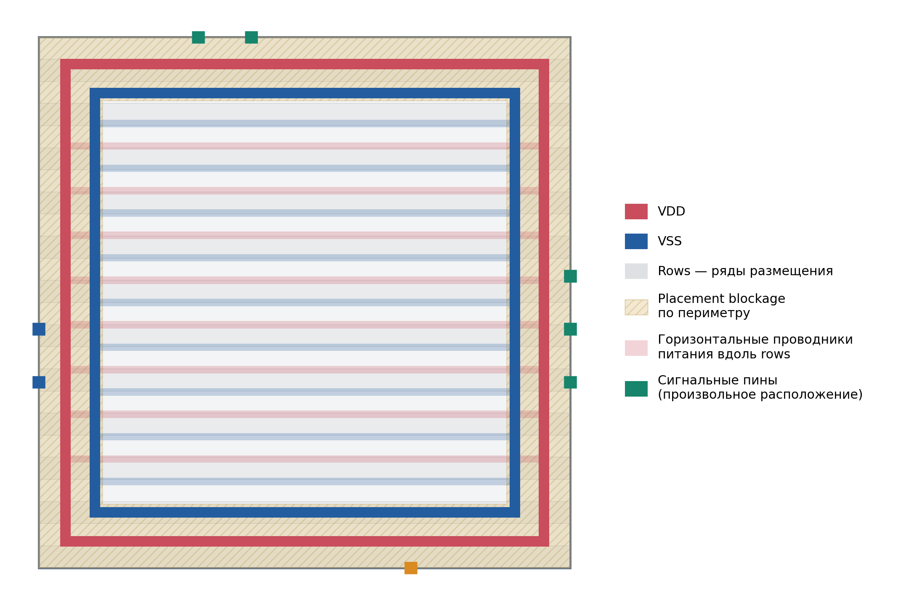

*Рисунок — Схема задания на 4 балла. Серым показаны rows, красным и синим — сети питания, жёлтой штриховкой — периферийный hard placement blockage. Положение сигнальных пинов произвольное. Рисунок условный.*


**Отдельный Tcl-скрипт для оценки 4 не требуется.** Операции выполняются через GUI и консоль Innovus.
## 10.2. Задание на 5 баллов

Выполните задание на 4 и сохраните результат. Затем создайте дополнительный вариант floorplan по требованиям ниже.

### 1. Рассчитайте размеры floorplan

Используйте площадь стандартных ячеек из отчёта лабораторной работы №2 и методику раздела **4.3 «Площадь и плотность: пояснение и расчёт»**.

**1. Определите площадь ячеек.**

Укажите суммарную площадь стандартных ячеек $A_{\mathrm{cells}}$ в мкм².

**2. Рассчитайте площадь core для плотности 50%.**

$$
A_{\mathrm{core}} = \frac{A_{\mathrm{cells}}}{0.5}
$$

**3. Рассчитайте размеры квадратного core.**

$$
W_{\mathrm{core}} = H_{\mathrm{core}} = \sqrt{A_{\mathrm{core}}}
$$

**4. Выберите отступы между core и die.**

Примите одинаковый отступ $d$ с четырёх сторон. Учитывайте кольцо питания и последующее вырезание rows: часть рядов должна попадать в удаляемую периферийную область.

**5. Рассчитайте размеры die с учётом минимального размера 200 мкм.**

$$
W_{\mathrm{die}} = \max\left(W_{\mathrm{core}} + 2d,\; 200\,\text{мкм}\right)
$$

$$
H_{\mathrm{die}} = \max\left(H_{\mathrm{core}} + 2d,\; 200\,\text{мкм}\right)
$$

**6. Уточните размеры core и фактическую плотность.**

При сохранении выбранных отступов итоговые размеры core составят:

$$
W_{\mathrm{core,final}} = W_{\mathrm{die}} - 2d
$$

$$
H_{\mathrm{core,final}} = H_{\mathrm{die}} - 2d
$$

Фактическая плотность:

$$
U_{\mathrm{core}} =
\frac{A_{\mathrm{cells}}}
{W_{\mathrm{core,final}} \cdot H_{\mathrm{core,final}}}
\cdot 100\%
$$

**7. Задайте рассчитанную геометрию в Innovus.**

Используйте явные размеры, а не подбор Cell Utilization. Проверьте фактические размеры после привязки к сетке site и rows.

В конце расчёта укажите **итоговую рассчитанную плотность заполнения core в процентах**, используя фактические размеры из Innovus. При увеличении die до минимального размера допускается плотность ниже 50%.

> Плотность на этом этапе рассчитывается относительно площади core до вырезания rows.

> 50%  примерная цифра допускается расхождение 8%

### 2. Разместите сигнальные пины

| Группа портов | Требование |
| --- | --- |
| Входные данные | Левая сторона, центральные 30% её длины |
| `clk` | По центру верхней стороны |
| Reset и остальные управляющие входы | Нижняя сторона |
| Выходы | Правая сторона, равномерно по участку от 10% до 90% её высоты |

Для блоков с другими именами портов используйте соответствующие функциональные группы.

Используйте 3 слой

### 3. Создайте кольца питания

Обозначения:

- **W** — фактическая ширина die;
- **H** — фактическая высота die;
- **L = min(W, H)** — меньшая сторона die.

| Обозначение | Параметр | Значение |
| --- | --- | --- |
| w | Ширина каждого проводника кольца | min(0.02 × L, 20 мкм) |
| s | Расстояние между краями проводников VDD и VSS | min(0.01 × L, 20 мкм) |
| o | Расстояние от die до внешнего края кольца | min(0.02 × L, 20 мкм) |

Например, для die **200 × 200 мкм**:

- w = 4 мкм;
- s = 2 мкм;
- o = 4 мкм.

Округлите значения по технологической сетке. Проверьте соответствие правилам технологии; каждый параметр должен оставаться не больше 20 мкм. 

Создайте **внешнее кольцо VSS** и **внутреннее кольцо VDD**.

Используйте два верхних разрешённых слоя:

- для верхней и нижней сторон — слой с горизонтальным предпочтительным направлением;
- для левой и правой сторон — слой с вертикальным предпочтительным направлением.

В углах соедините участки одной сети через vias. Каждое кольцо должно быть замкнутым.

> Значение o отсчитывается от границы die до внешнего края кольца. Поле Offset в Add Rings задавайте с учётом выбранной опорной границы. Проверьте результат по фактическим координатам проводников.

### 4. Добавьте центральные проводники питания

Создайте два вертикальных проводника:

- слева — VDD;
- справа — VSS.

Задайте:

| Параметр | Требование |
| --- | --- |
| Ширина каждого проводника | w |
| Расстояние между их краями | s |
| Положение пары | Симметрично относительно вертикальной оси die |
| Металлический слой | Используемый для вертикальных сторон кольца |

Каждый проводник должен соединять верхнюю и нижнюю стороны кольца своей сети.


### 5. Вырежьте периферийные участки rows

Удалите периферийные **hard placement blockages**, созданные в задании на 4.

Вырежьте rows под кольцами питания и снаружи них. Между **внутренним краем кольца VDD** и оставшимися rows оставьте зазор **2 мкм** с каждой стороны.

#### Определите ширину области вырезания

$$
t = o + 2w + s + a
$$

где:

- **t** — расстояние от границы die до границы оставшихся rows;
- **o** — отступ от границы die до внешнего края кольца;
- **w** — ширина каждого проводника кольца;
- **s** — расстояние между проводниками VDD и VSS;
- **a = 2 мкм** — зазор от внутреннего края кольца VDD до оставшихся rows.

#### Задайте области вырезания

Используйте фактические координаты die:

- **(x0, y0)** — нижний левый угол;
- **(x1, y1)** — верхний правый угол.

Откройте **Floorplan → Row → Cut Core Row…** и последовательно вырежьте четыре области:

| Область | LLX | LLY | URX | URY |
| --- | --- | --- | --- | --- |
| Слева | x0 | y0 | x0 + t | y1 |
| Справа | x1 − t | y0 | x1 | y1 |
| Снизу | x0 + t | y0 | x1 − t | y0 + t |
| Сверху | x0 + t | y1 − t | x1 − t | y1 |

Все значения задаются в **мкм**.

После вырезания проверьте, что rows сохранились внутри кольца, а зазор до его внутреннего края составляет **не менее 2 мкм**. При привязке границ к сетке размещения округляйте их в сторону увеличения зазора.

> При расчёте floorplan выберите отступ core от die меньше t, чтобы область вырезания пересекала существующие rows.

#### Проверьте результат

- Rows внутри кольца сохранились.
- Участки rows под кольцом и снаружи него удалены.
- Размеры die и core не изменились.
- Кольца и шины питания сохранились, поскольку вырезание rows не удаляет проводники.
- Шины оставшихся rows подключены к соответствующим сетям VDD/VSS.

### 6. Создайте дополнительные blockages

Используйте фактические размеры die и координаты его нижнего левого угла **O = (x0, y0)**.

| Объект | Точка | X | Y |
| --- | --- | --- | --- |
| Hard placement blockage | A — нижний левый угол | x0 + 0.20 × W | y0 + 0.57 × H |
| Hard placement blockage | B — верхний правый угол | x0 + 0.36 × W | y0 + 0.74 × H |
| Routing blockage | C — нижний левый угол | x0 + 0.65 × W | y0 + 0.27 × H |
| Routing blockage | D — верхний правый угол | x0 + 0.81 × W | y0 + 0.44 × H |

Рассчитайте координаты и округлите их по допустимой сетке.

Для routing blockage выберите один разрешённый металлический слой. Укажите его в отчёте и проверьте параметры ограничения в свойствах объекта.

Проверьте, что blockages находятся внутри оставшихся rows и не перекрывают кольцо и центральные проводники питания.

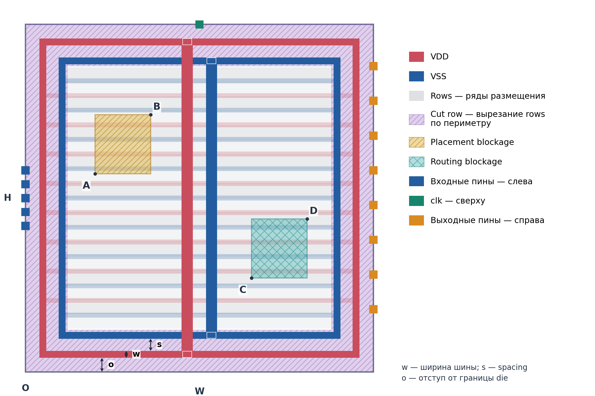

*Рисунок — Схема задания на 5 баллов. Фиолетовым показана область вырезания rows, жёлтым — hard placement blockage A–B, бирюзовым — routing blockage C–D. Цвета питания обозначают сети, а не металлические слои.*

### 8. Подготовьте два Tcl-скрипта

| Скрипт | Начальное состояние | Результат |
| --- | --- | --- |
| `floorplan_4.tcl` | Исходный проект после импорта netlist | Floorplan задания на 4 |
| `floorplan_5.tcl` | Загруженный floorplan задания на 4 | Floorplan задания на 5 |

В скриптах используйте параметры своего блока.


Для подготовки скриптов используйте команды из консоли Innovus и файла `innovus.cmd`. Удалите лишние действия и добавьте комментарии к основным этапам.

### 9. Проверьте воспроизводимость и сохраните результаты

1. Откройте исходный проект после импорта.
2. Выполните `floorplan_4.tcl` через `source`.
3. Сохраните результат как `blockA_floorplan_4.fp` или `blockB_floorplan_4.fp`.
4. Заново загрузите сохранённый floorplan.
5. Выполните `floorplan_5.tcl` через `source`.
6. Проверьте результат.
7. Сохраните его как `blockA_floorplan_5.fp` или `blockB_floorplan_5.fp`.

Оба результата должны воспроизводиться без ручного редактирования.

### Что предоставить для сдачи

1. **Сохранённые floorplan:**
   - исходный — после импорта проекта;
   - результат задания на 4;
   - результат задания на 5.

2. **Два Tcl-скрипта:**
   - `floorplan_4.tcl` — создание результата на 4 из исходного проекта;
   - `floorplan_5.tcl` — получение результата на 5 из floorplan задания на 4.

3. **Расчёты:**
   - площадь стандартных ячеек из отчёта лабораторной работы №2;
   - размеры core и die, отступы между ними;
   - итоговая плотность заполнения core по фактическим размерам из Innovus;
   - ширина проводников кольца, расстояние между ними и отступ от die;
   - границы вырезания rows с зазором;
   - координаты дополнительных blockages;
   - площадь оставшихся rows и плотность относительно этой площади.

4. **Изображения результатов на 4 и на 5**, на которых видны:
   - rows и расположение сигнальных пинов;
   - кольца и шины питания;
   - центральные проводники питания для задания на 5;
   - области blockages и результат вырезания rows.

5. **Log и результаты проверок.** Для оставшихся предупреждений укажите причину.
