# Лабораторная работа №4. Расширенная методичка

**Физическая реализация цифрового блока и ECO в Cadence Innovus**

Основной маршрут, команды placement/CTS/routing и экспорта, разбор `check_timing`, а также задания на «4» и «5» с вопросами находятся в [README.md](README.md).

Этот файл дополняет основную инструкцию: здесь разобраны устройство триггеров, OCV, MMMC, ограничения интерфейса, нагрузки, мощность, настройки CTS, физика decap и подробные ECO-команды. Перенесённые в основной README материалы заменены ссылками.

Для практического ECO переходите к [разделу 5](#lab4-timing-eco); условия задания и вопросы собраны [в конце основного README](README.md#main-assignment).

## Содержание

- [1. Углублённые основы физического проектирования](#lab4-goal)
- [2. Согласование исходных данных](#lab4-inputs)
- [3. Настройки и диагностика временного анализа](#lab4-preparation)
  - [3.1. MMMC: в каких условиях анализируется схема](#lab4-mmmc)
  - [3.2. Input delay и output delay: временные условия на границах блока](#lab4-io-delays)
  - [3.3. Подготовка проекта](#lab4-preparation-order)
  - [3.4. Дополнительная диагностика ограничений](#lab4-timing-checks)
- [4. Особенности этапов и выходных моделей](#lab4-implementation)
  - [4.1. Placement: опции отчётов и дополнительная диагностика](#lab4-placement)
  - [4.2. CTS: настройки сети, спецификация и CTD](#lab4-cts)
  - [4.3. Routing: физические особенности и диагностика](#lab4-routing)
  - [4.4. Особенности экспортируемых моделей](#lab4-export)
- [5. Подробный разбор timing reports и ECO](#lab4-timing-eco)
  - [5.1. Разбор конкретного временного отчёта](#lab4-timing-report)
  - [5.2. Почему существуют ячейки X1, X2 и X4](#lab4-drive-strength)
  - [5.3. Что такое ECO](#lab4-eco-principle)
  - [5.4. Выполнение ECO в интерактивном сеансе](#lab4-eco-commands)
  - [5.5. Сравнение отчётов до и после ECO](#lab4-eco-comparison)
- [6. Задания и условия выполнения](#lab4-assignment)
  - [Организация независимых запусков и ECO-экспериментов](#lab4-environment)
  - [6.1. Задание на «4»](#lab4-grade-4)
  - [6.2. Задание на «5»](#lab4-grade-5)

## Часть I. Дополнительные пояснения и команды

<a id="lab4-goal"></a>

## 1. Углублённые основы физического проектирования

<a id="fig-physical-design-sequence"></a>

Назначение маршрута и общая последовательность этапов приведены в [основном README](README.md#main-route). Здесь рассмотрим физические причины задержек, работу ячеек и компромиссы реализации.

<a id="lab4-timing-basics"></a>

### 1.1. Временные и физические характеристики

#### Почему триггеры важны в цифровой схеме

Комбинационная логика вычисляет результат по текущим входным значениям, но сама по себе не хранит состояние. **Триггеры позволяют сохранять данные между тактами:** промежуточные результаты вычислений, значения счётчиков, состояние управляющих автоматов.

**D-триггер (flip-flop)** хранит один бит. Группа триггеров образует многоразрядный регистр. Далее при рассмотрении временного пути запускающий и принимающий элементы будем называть регистрами.

<a id="fig-register-physical-design-tasks"></a>

Состав временного пути и его связь с clock показаны в [основном README](README.md#main-fig-timing-path). Далее рассмотрим внутреннее устройство принимающего элемента.

<a id="lab4-registers"></a>

#### Как D-триггер захватывает данные по фронту clock

D-триггер имеет вход данных **D**, тактовый вход **CK** и выход **Q**. По активному фронту CK он захватывает значение D и сохраняет его до следующего захвата.

Рассмотрим реализацию из двух последовательно соединённых **защёлок — master и slave**. Это один из вариантов устройства триггера; схема конкретной библиотечной ячейки может отличаться.

Защёлка работает в двух режимах:

- **Запись:** вход подключён к внутреннему узлу, и данные проходят внутрь.
- **Хранение:** вход отключён, а обратная связь поддерживает сохранённое состояние.

В статической CMOS-защёлке хранение можно организовать с помощью двух инверторов в замкнутой петле. Транзисторные ключи, управляемые clock, переключают защёлку между записью и хранением.

Для рассматриваемого D-триггера по положительному фронту последовательность следующая:

| Состояние clock | Master | Slave |
| --- | --- | --- |
| CK = 0 | Принимает данные с D | Хранит прежнее значение Q |
| CK ↑ | Переходит к хранению | Открывается для передачи данных master |
| CK = 1 | Хранит захваченное состояние | Передаёт сохранённые данные master к Q |

До положительного фронта изменения D проходят в master, но не достигают Q. При приходе фронта master отключается от D, а slave передаёт сохранённое состояние к выходу. После фронта новые изменения D уже не проходят через закрытый master.

При переходе CK обратно в 0 slave сохраняет выходное значение, а master начинает принимать данные для следующего захвата. Последовательность показана на [рисунке](#fig-clock-edge-inside).

<a id="fig-clock-edge-inside"></a>

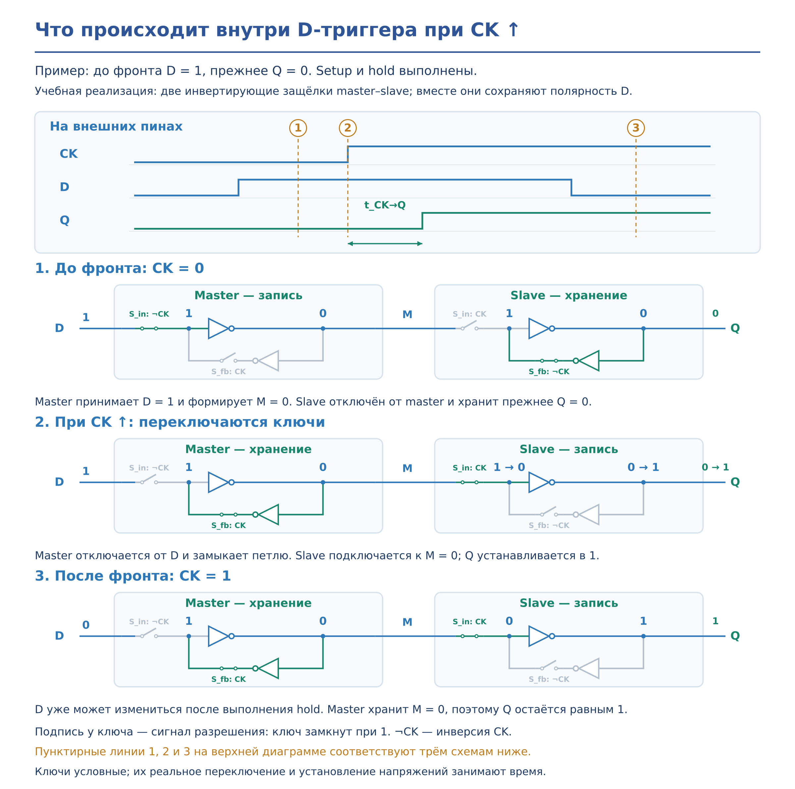

*Рисунок — Работа master и slave до положительного фронта CK, при его приходе и после установления выхода. Пунктирные линии 1, 2 и 3 соответствуют схемам ниже. У ключей указан сигнал разрешения: ключ замкнут при 1; ¬CK — инверсия CK.*

На рисунке каждая защёлка инвертирует данные, поэтому две последовательные защёлки сохраняют исходную полярность: захваченное D = 1 приводит к Q = 1.

**Захват по фронту возникает благодаря согласованному переключению двух защёлок.** Переключение транзисторов и изменение внутренних напряжений занимают время, поэтому Q устанавливается с задержкой **clock-to-Q**.

По фронту триггер захватывает значение D, а не обязательно переключает Q: если новое значение совпадает с прежним, выход остаётся неизменным.

#### Соглашение о знаке skew

Для пары регистров на [схеме временного пути](README.md#main-fig-timing-path) используем:

$$
t_{\mathrm{skew}} = L_{\mathrm{capture}} - L_{\mathrm{launch}},
$$

где $L_{\mathrm{launch}}$ и $L_{\mathrm{capture}}$ — задержки ветвей clock от общей опорной точки. Положительный skew означает более поздний приход clock к принимающему регистру. Это соглашение используется далее при разборе влияния тактовой сети на setup и hold.

<a id="lab4-setup-hold"></a>

#### Setup, hold и метастабильность

Определения и временные диаграммы setup/hold приведены в [основном README](README.md#main-timing). Здесь важно понять физическое происхождение этих требований.

Внутренние напряжения триггера меняются постепенно: транзисторы переключаются, а ёмкости узлов заряжаются и разряжаются. Данные должны успеть подготовить состояние к захвату и не помешать его завершению.

Рассмотрим внутренние узлы **X и Y** защёлки master:

- **При соблюдении setup и hold** к моменту захвата напряжения успевают приблизиться к устойчивым уровням: один узел — к 0, другой — к VDD. Обратная связь поддерживает это состояние.
- **При нарушении setup** D меняется слишком поздно: внутренние напряжения могут не успеть установиться до отключения входного тракта.
- **При нарушении hold** D меняется слишком рано после фронта: входной тракт ещё может влиять на узел хранения и мешать завершению захвата.

Сравнение этих случаев показано на [рисунке](#fig-flipflop-setup-hold).

<a id="fig-flipflop-setup-hold"></a>

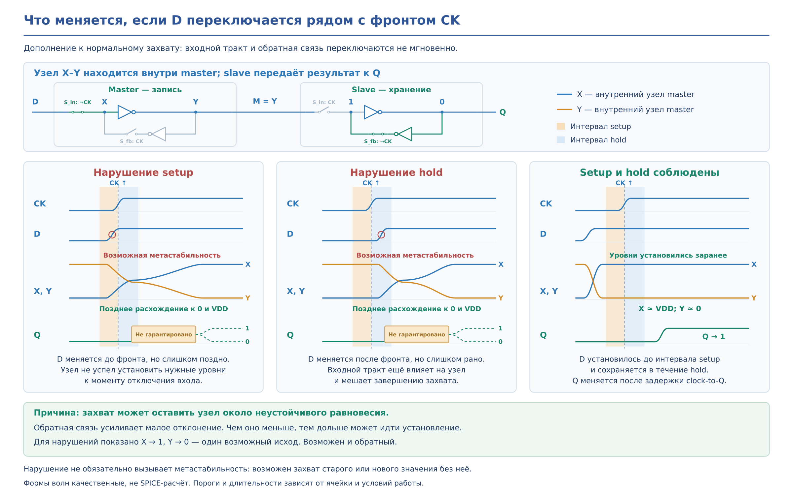

*Рисунок — Слева показано нарушение setup, в центре — нарушение hold, справа — корректный захват. X и Y — внутренние узлы master. Жёлтым выделен интервал setup, голубым — hold. Формы сигналов условные.*

**Метастабильность** возникает, если захват оставляет внутренний узел около **неустойчивого равновесия**. Напряжения находятся около порогов переключения инверторов, а устойчивое состояние ещё не установлено.

Обратная связь усиливает малое отклонение и постепенно переводит узел в одно из двух устойчивых состояний. Чем ближе начальное состояние к равновесию, тем дольше может длиться установление.

В результате Q может установиться позже ожидаемого и нарушить работу следующей логики. **Нарушение setup или hold не обязательно вызывает метастабильность:** возможен захват прежнего или нового значения без неё, но корректность захвата уже не гарантируется.

<a id="fig-setup-hold"></a>

Проверки пути, знаки slack и диаграмма с исходным и следующим фронтами разобраны в [основном README](README.md#main-timing). Перейдём к тому, как инструмент учитывает вариации задержек.

<a id="lab4-ocv"></a>

#### Учёт вариаций задержек: OCV, early и late

Задержки ячеек и соединений могут различаться даже внутри одного кристалла. Для учёта этих различий при временном анализе используют модели **OCV (On-Chip Variation)**.

В простейшей модели задержки корректируют коэффициентами **derate**:

$$
t_{\mathrm{analysis}} = k_{\mathrm{derate}}\cdot t_{\mathrm{base}}.
$$

Рассматривают ранний (**early**) и поздний (**late**) варианты распространения сигнала. Например, коэффициенты 0,95 и 1,05 уменьшают и увеличивают базовую задержку на 5%. Конкретные значения определяются настройками проекта и используемой моделью вариаций.

Для каждой проверки выбирают неблагоприятное сочетание задержек:

| Проверка | Clock запускающего регистра | Тракт данных | Clock принимающего регистра |
| --- | --- | --- | --- |
| **Setup** | Late | Late | Early |
| **Hold** | Early | Early | Late |

**Для setup** опасно, когда данные запускаются позже, распространяются медленнее, а захватывающий фронт приходит раньше. Времени на передачу становится меньше.

**Для hold** опасно обратное сочетание: данные запускаются раньше и распространяются быстрее, а захватывающий фронт приходит позже. Новые данные могут изменить вход D до завершения требуемого интервала удержания.

Сравнение проверок без дополнительных derate и с учётом OCV показано на [рисунке](#fig-setup-hold-ocv).

<a id="fig-setup-hold-ocv"></a>

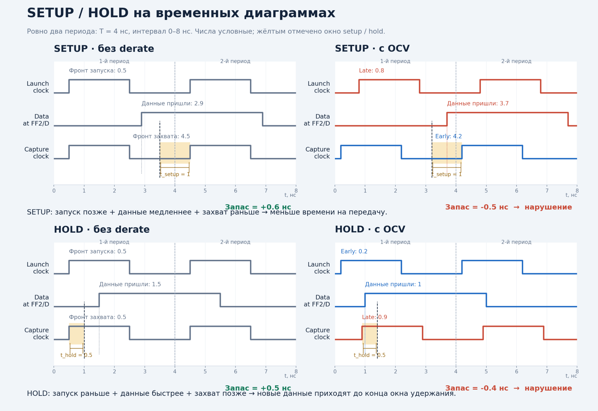

*Рисунок — Проверки setup и hold на интервале двух периодов clock. Early и late изменяют расчётные задержки, но не период источника clock. Числа условные.*

В примере период clock составляет 4 нс. Для setup требуется стабильность данных за 1 нс до захвата, для hold — в течение 0,5 нс после захвата:

| Проверка | Без дополнительных derate | С учётом OCV |
| --- | --- | --- |
| **Setup slack** | 4,5 − 1 − 2,9 = **+0,6 нс** | 4,2 − 1 − 3,7 = **−0,5 нс** |
| **Hold slack** | 1,5 − (0,5 + 0,5) = **+0,5 нс** | 1 − (0,9 + 0,5) = **−0,4 нс** |

Таким образом, положительный запас без учёта вариаций ещё не гарантирует выполнение ограничений при OCV. Сравнивать результаты следует при одинаковых настройках анализа.

Пример упрощён: в реальном STA также учитываются clock uncertainty, общие участки тактовых путей и предусмотренные потоком поправки.

#### Буферы и задержка распространения

**Буфер (buffer)** — логическая ячейка, которая сохраняет логическое значение сигнала: при 0 на входе на выходе устанавливается 0, при 1 — 1. Изменение выхода происходит с некоторой задержкой.

Основные применения буферов в физическом проектировании показаны на [рисунке](#fig-buffer-uses).

<a id="fig-buffer-uses"></a>

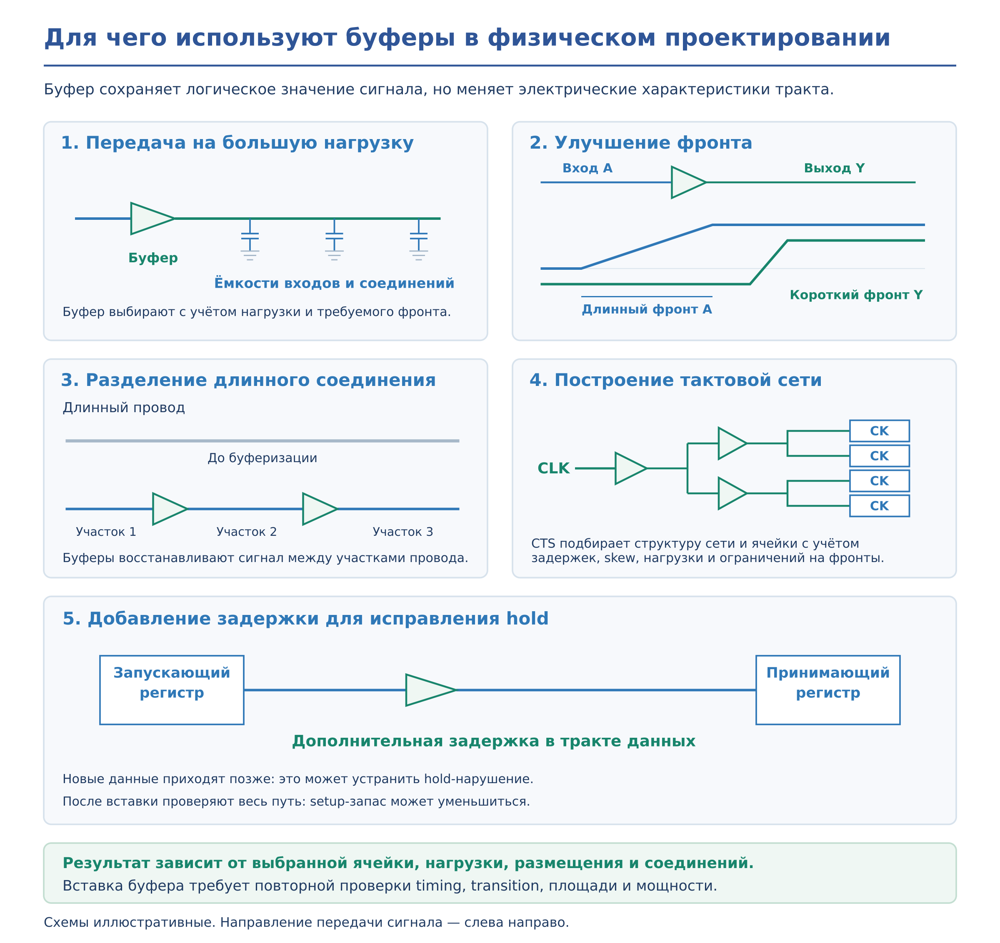

*Рисунок — Работа с ёмкостной нагрузкой, улучшение фронтов, буферизация длинных соединений, построение тактовой сети и добавление задержки для исправления hold.*

Буферы различаются нагрузочной способностью. Более мощный буфер обычно быстрее переключает большую нагрузку, но занимает больше площади и создаёт большую входную ёмкость для предыдущей ячейки. Поэтому вставка буфера требует проверки характеристик всего пути.

**Задержка распространения (delay)** — время между изменением сигнала на входе и соответствующим изменением на выходе. Её измеряют между пересечениями заданных уровней напряжения, как показано на [рисунке](#fig-buffer-delay).

<a id="fig-buffer-delay"></a>

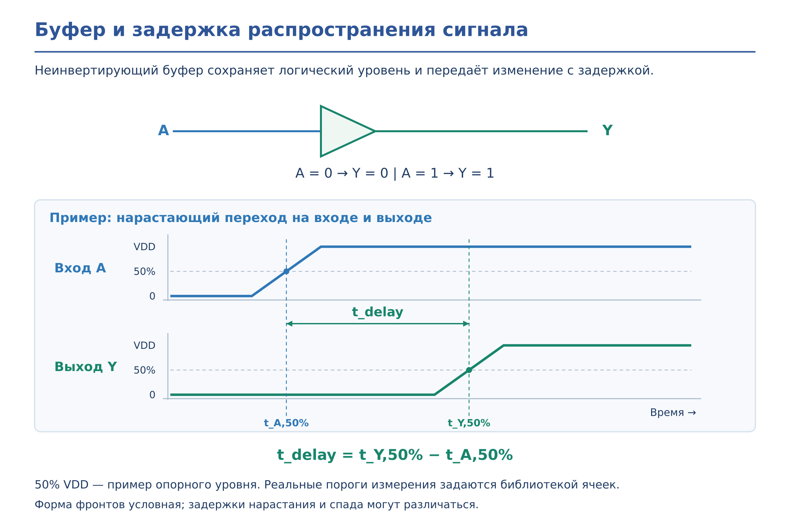

*Рисунок — Измерение задержки между входом и выходом неинвертирующего буфера.*

Для показанного примера:

$$
t_{\mathrm{delay}} = t_{Y,50\%} - t_{A,50\%}.
$$

Задержка зависит от типа ячейки, длительности входного фронта, выходной нагрузки и условий работы. Пороги измерения задаются библиотекой ячеек; 50% — пример.

#### Длительность фронта — transition

**Transition (slew)** — время нарастания или спада одного сигнала между заданными уровнями напряжения. Чем больше transition, тем медленнее изменяется сигнал.

На [рисунке](#fig-transition) показано измерение длительности нарастающего и спадающего фронтов между уровнями 20% и 80% напряжения питания.

<a id="fig-transition"></a>

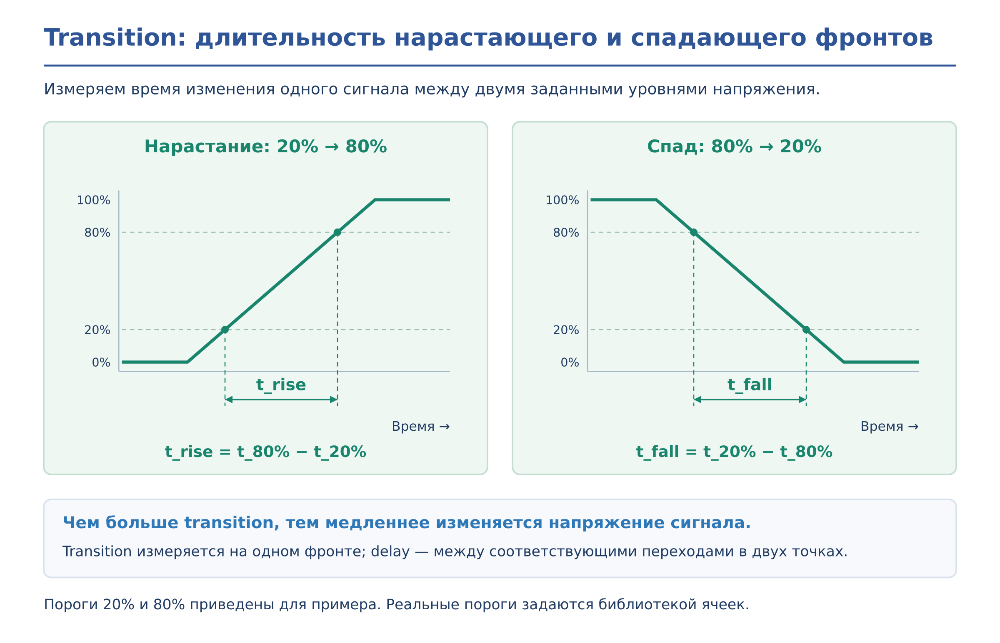

*Рисунок — Измерение длительности нарастающего и спадающего фронтов.*

Для нарастающего фронта:

$$
t_{\mathrm{transition,rise}} = t_{80\%} - t_{20\%}.
$$

Для спадающего фронта:

$$
t_{\mathrm{transition,fall}} = t_{20\%} - t_{80\%}.
$$

Реальные пороги измерения задаются библиотекой ячеек.

Медленный входной фронт обычно увеличивает задержку следующей ячейки и может повышать её внутреннюю мощность. Поэтому при анализе пути проверяют и задержки, и transition, включая соблюдение заданных ограничений на длительность фронтов.

#### Fanout и ёмкостная нагрузка

Выход ячейки нагружен входами потребителей и соединяющим их проводником, как показано на [рисунке](#fig-delay-transition-load). В упрощённой модели:

$$
C_{\mathrm{load}} \approx \sum_i C_{\mathrm{in},i} + C_{\mathrm{wire}}.
$$

<a id="fig-delay-transition-load"></a>

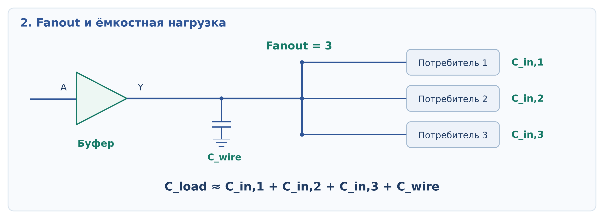

*Рисунок — Три входа-потребителя и ёмкость соединения образуют нагрузку выходного буфера.*

**Входная ёмкость потребителя** возникает прежде всего из-за затворов MOS-транзисторов: затвор отделён от полупроводника диэлектриком. Один вход ячейки может управлять несколькими затворами. Их ёмкости и паразитные ёмкости внутренних входных соединений учитываются моделью пина в `.lib`. Физический смысл показан на [рисунке](#fig-input-capacitance).

<a id="fig-input-capacitance"></a>


*Рисунок — Затворы транзисторов и внутренние соединения формируют входную ёмкость ячейки.*

<a id="fig-wire-capacitance"></a>

Происхождение ёмкости проводников и её влияние на задержку рассмотрены в [основном README](README.md#main-rc). Влияние ёмкостной связи с соседними сигнальными линиями зависит также от направления и времени их переключения.

При прочих равных увеличение ёмкостной нагрузки повышает затраты энергии на переключение. **Одинаковый fanout не означает одинаковую нагрузку:** потребители и соединения могут иметь разные ёмкости.

#### Физические характеристики

| Показатель | Что показывает |
| --- | --- |
| **Площадь ячеек** | Сумму площадей учитываемых ячеек; отличается от площади core и die |
| **Utilization** | Долю доступной площади размещения, занятую учитываемыми ячейками |
| **Congestion** | Загруженность ресурсов трассировки в выбранной области |
| **Потребляемая мощность** | Затраты мощности на переключения, внутренние процессы в ячейках и утечки |

**Площадь ячеек и utilization** характеризуют заполнение области размещения. В упрощённом случае, когда весь core доступен для ячеек:

$$
Utilization = \frac{\sum_i A_{\mathrm{cell},i}}{A_{\mathrm{core}}}\cdot100\%.
$$

Пример одинаковых core с разной заполненностью показан на [рисунке](#fig-area-utilization).

<a id="fig-area-utilization"></a>

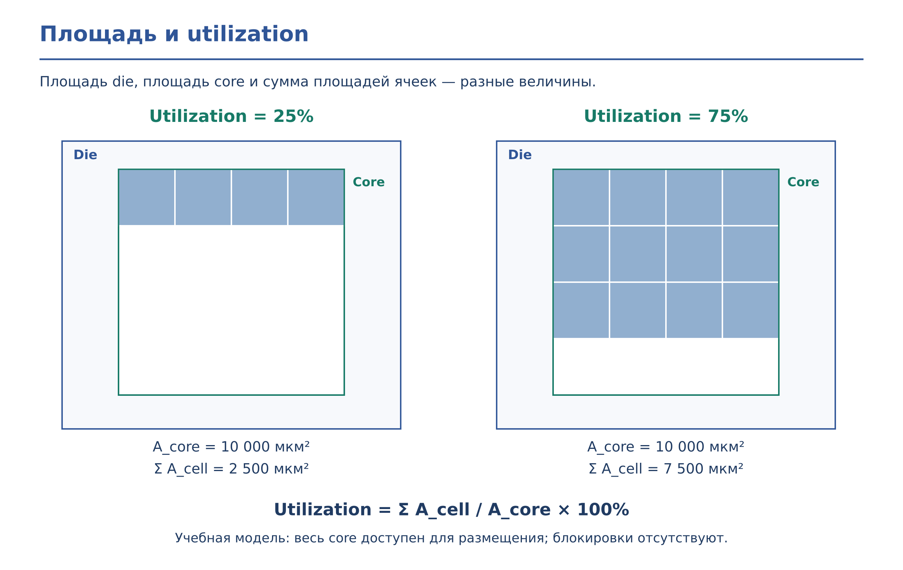

*Рисунок — Различие площади core и суммарной площади ячеек; utilization 25% и 75%.*
**Congestion** характеризует загруженность ресурсов трассировки. На слоях металлизации задаются **треки** — линии сетки, определяющие возможные положения проводников. Для каждого слоя обычно устанавливается предпочтительное направление трассировки: горизонтальное или вертикальное.

Доступные ресурсы ограничены: часть треков может быть занята другими соединениями или недоступна из-за препятствий и технологических ограничений. Если потребность в соединениях превышает доступные ресурсы, возникает **перегрузка**. Пример для одного слоя показан на [рисунке](#fig-routing-congestion).

<a id="fig-routing-congestion"></a>

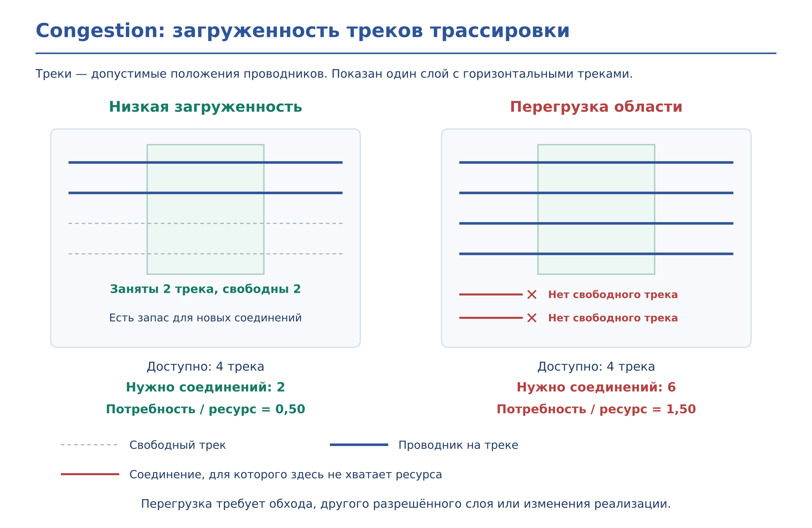

*Рисунок — Слева заняты два из четырёх треков. Справа для шести соединений четырёх треков недостаточно.*

В реальном проекте congestion анализируют **по участкам, слоям и направлениям**. Общая карта помогает найти проблемную область, а послойный анализ — определить, где именно не хватает ресурсов.

Простая суммарная оценка может скрывать перегрузку отдельного слоя, как показано на [рисунке](#fig-congestion-by-layer).

<a id="fig-congestion-by-layer"></a>

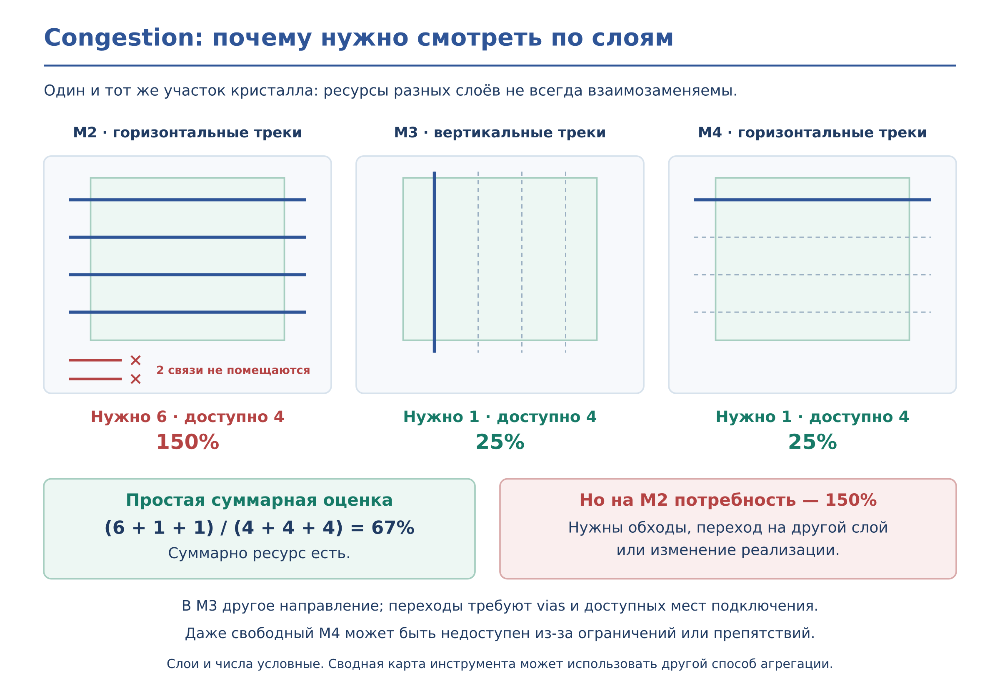

*Рисунок — Суммарная потребность составляет 67% ресурсов, но на M2 достигает 150%. Числа условные; способ агрегации в инструменте может отличаться.*

Свободные ресурсы другого слоя не всегда могут заменить перегруженные: необходимо учитывать направление трассировки, препятствия, доступ к пинам и допустимые положения переходов **vias**.

Если прямое соединение построить нельзя, трассировщик может использовать обход или перейти на другие разрешённые слои. Пример такого пути показан на [рисунке](#fig-routing-layer-detour).

<a id="fig-routing-layer-detour"></a>

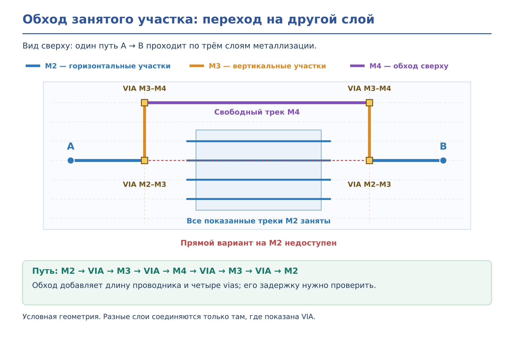

*Рисунок — Вид сверху: соединение A–B обходит занятый участок M2 через M3 и M4. Каждый слой показан своим цветом, жёлтые квадраты обозначают vias.*

Обход добавляет длину проводника и переходы между слоями, что меняет сопротивление, ёмкость и задержку соединения. Поэтому устранение перегрузки требует повторной проверки временных характеристик.

**Низкая utilization не гарантирует низкий congestion:** даже при свободном месте для ячеек множество соединений может проходить через одну небольшую область.

**Потребляемая мощность** складывается из трёх составляющих:

- **Мощность переключения нагрузок (switching power)** — затраты на заряд и разряд ёмкостей межсоединений и входов потребителей. Приближённо:

  $$
  P_{\mathrm{switching}} \approx \alpha C_{\mathrm{load}}V^2f,
  $$

  где $\alpha$ — среднее число переходов 0 → 1 за период clock, $C_{\mathrm{load}}$ — переключаемая ёмкость, $V$ — напряжение питания, $f$ — частота clock.

- **Внутренняя мощность (internal power)** — затраты на переключение внутренних ёмкостей ячейки и кратковременный сквозной ток между VDD и VSS. Например, во время изменения входного уровня CMOS-инвертора PMOS и NMOS могут некоторое время проводить одновременно.

- **Мощность утечек (leakage power)** — потребление даже без переключений. Закрытый транзистор не является идеальным разрывом: через него и другие структуры протекают малые токи. Утечки зависят от технологии, температуры, напряжения и состояния ячейки.

Первые две составляющие относятся к **динамической мощности**, утечки — к **статической**:

$$
P_{\mathrm{total}} =
P_{\mathrm{switching}} +
P_{\mathrm{internal}} +
P_{\mathrm{leakage}}.
$$

Механизмы потребления показаны на [рисунке](#fig-power-components). Внутренняя мощность и утечки поясняются на примере CMOS-инвертора, границы которого выделены пунктиром.

<a id="fig-power-components"></a>

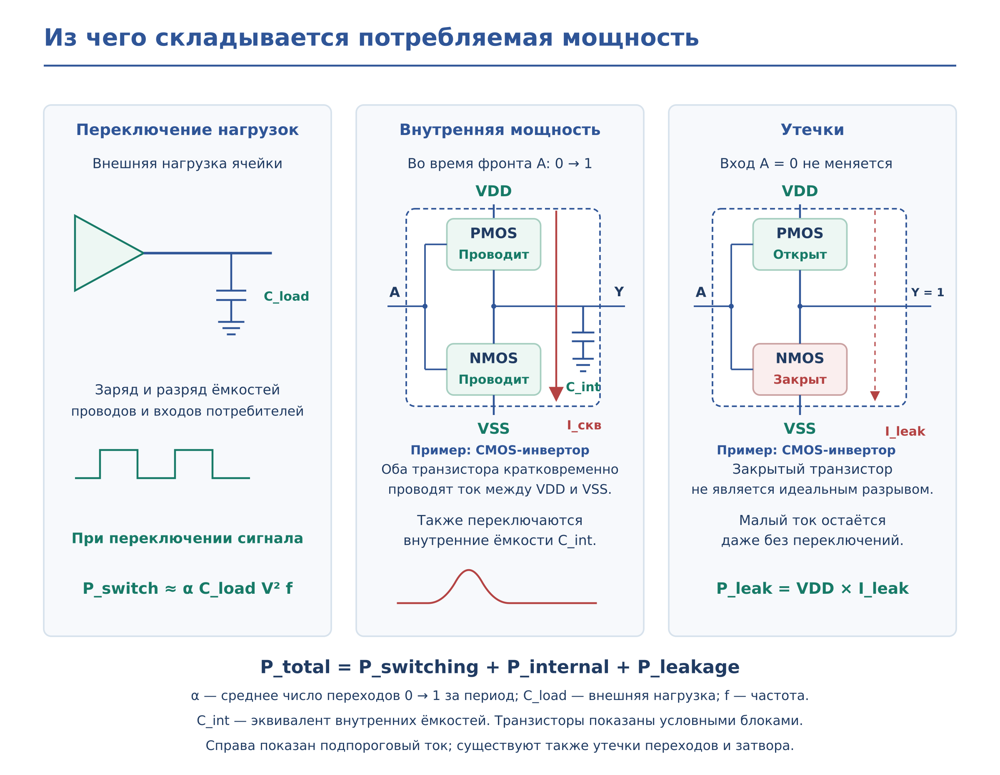

*Рисунок — Переключение внешней нагрузки, внутренние потери при переключении и утечки в устойчивом состоянии.*

Сравнивать результаты следует при одинаковых условиях: clocks, analysis views, правилах подсчёта площади и модели активности для оценки мощности.

### 1.2. Компромиссы при физическом проектировании

Физическое проектирование требует одновременно учитывать **мощность, быстродействие и площадь — PPA (Power, Performance, Area)**. Улучшение одного показателя может ухудшить другой. При этом реализация должна сохранять логическую функцию, обеспечивать требуемые соединения, выполнять временные ограничения и соответствовать правилам технологии.

Основные компромиссы приведены в таблице.

| Решение | Возможная польза | Возможная цена |
| --- | --- | --- |
| Уменьшить задержку тракта данных | Улучшить setup | Ухудшить hold, если минимальная задержка также уменьшится |
| Добавить задержку для исправления hold | Улучшить hold | Уменьшить setup-запас, увеличить число ячеек, площадь и мощность |
| Выбрать ячейку большей нагрузочной способности | Улучшить выходной transition и уменьшить задержку при большой нагрузке | Увеличить площадь и входную ёмкость, нагрузив предыдущую ячейку |
| Добавить буферы | Разделить нагрузку, улучшить фронты или передачу по длинному соединению | Добавить ячейки, собственные задержки и переключаемые ёмкости |
| Уменьшить core | Сократить площадь области реализации, потенциально укоротить соединения | Увеличить utilization и риск локального congestion |
| Увеличить core | Снизить плотность размещения, дать больше ресурсов трассировке | Увеличить площадь; некоторые соединения могут стать длиннее |
| Добавить ветви и буферы в clock-сеть | Улучшить отдельные характеристики доставки clock | Увеличить площадь, переключаемую ёмкость и мощность clock-сети |

Примеры взаимосвязанных изменений показаны на [рисунке](#fig-physical-design-tradeoffs).

<a id="fig-physical-design-tradeoffs"></a>

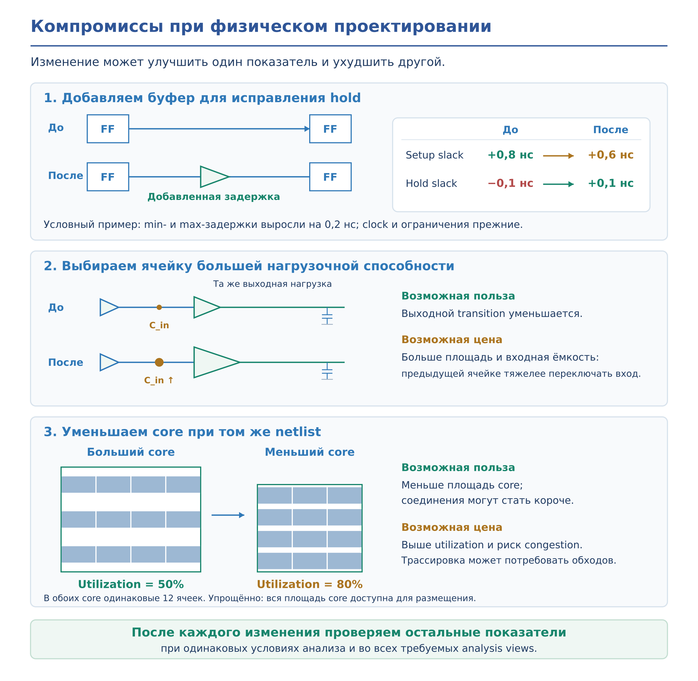

*Рисунок — Возможная польза и цена вставки буфера, увеличения нагрузочной способности ячейки и уменьшения core. Числа условные.*

**Эти зависимости не являются безусловными.** Например, буфер добавляет собственную задержку, но может уменьшить суммарную задержку длинного соединения. Более мощная ячейка может ускорить свой выход, но замедлить предыдущую ячейку из-за большей входной ёмкости. Результат оценивают по отчётам для всей затронутой реализации.

#### Компромисс между setup и hold

Если вставка буферов увеличила задержку данных и в max-, и в min-анализе, новые данные приходят позже:

- **Hold может улучшиться:** прежнее значение дольше сохраняется на входе принимающего регистра.
- **Setup может ухудшиться:** новые данные устанавливаются ближе к следующему захватывающему фронту.

В примере на рисунке добавление 0,2 нс к обеим задержкам устраняет hold-нарушение: запас меняется с −0,1 до +0,1 нс. При этом setup-запас уменьшается с +0,8 до +0,6 нс.

Поэтому после исправления hold проверяют setup, а после ускорения пути — hold.

#### Влияние skew

При принятом определении

$$
t_{\mathrm{skew}} = L_{\mathrm{capture}} - L_{\mathrm{launch}}
$$

увеличение положительного skew в обычном однотактном пути, при прочих равных:

- даёт больше времени для setup;
- ужесточает hold, поскольку прежние данные должны сохраняться до более позднего момента.

Поэтому уменьшение skew само по себе не гарантирует улучшения всех временных запасов. Изменение clock-сети влияет на несколько путей, и результат оценивают по всем требуемым проверкам.

Описанные зависимости исследуются в [ECO-задании на «5»](#lab4-grade-5).

<a id="lab4-inputs"></a>

## 2. Согласование исходных данных

<a id="fig-implementation-inputs"></a>

Состав и назначение входных файлов перечислены в [основном README](README.md#main-route). При их подготовке учитывайте следующие особенности.

**Netlist должен пройти проверку эквивалентности в лабораторной №2. Объект реализации — модуль, для которого подготовлен floorplan.** Раздельная физическая реализация всех модулей и последующая иерархическая интеграция в задание не входят.

Проверяйте согласованность данных на уровне объектов: библиотечные файлы должны содержать модели используемых ячеек, SDC — ссылаться на существующие порты и сигналы, а MMMC — на нужные ограничения, библиотеки и RC-данные.

**Файл floorplan не является полной базой проекта.** Перед его загрузкой необходимо импортировать совместимые netlist, библиотеки и настройки анализа. Сеть питания восстанавливается из результатов лабораторной №3 предусмотренным учебным потоком способом.

<a id="lab4-preparation"></a>

## 3. Настройки и диагностика временного анализа

<a id="lab4-mmmc"></a>

### 3.1. MMMC: в каких условиях анализируется схема

Общее назначение MMMC описано в [основном README](README.md#main-route). Здесь проследим, как режимы, библиотеки и RC-данные связываются в конкретные сценарии анализа.

#### Режим работы и условия анализа

**Mode** описывает режим работы схемы: какие clocks используются, какие значения управляющих сигналов учитываются и какие временные ограничения действуют.

Например:

- **Функциональный режим** — выполнение обычных вычислений.
- **Тестовый режим** — сканирование или другие предусмотренные проектом тестовые операции.

Ограничения режима задаются соответствующими SDC-файлами. В учебном проекте используйте предоставленные режимы: создавать тестовый режим дополнительно не требуется.

**Corner** описывает условия расчёта задержек. Для ячеек учитывают параметры **PVT**:

| Параметр | Что описывает |
| --- | --- |
| **Process** | Вариант технологических параметров транзисторов |
| **Voltage** | Напряжение питания |
| **Temperature** | Температуру |

Временные модели ячеек для заданных условий содержатся в библиотеках `.lib`. Обозначения `SS`, `TT` и `FF` обычно характеризуют process-вариант; для выбора библиотеки также необходимо учитывать напряжение и температуру.

Для межсоединений задаются **RC-условия** — параметры расчёта сопротивлений и ёмкостей проводников и vias.

Различие режима работы и условий расчёта показано на [рисунке](#fig-mmmc-mode-corner).

<a id="fig-mmmc-mode-corner"></a>

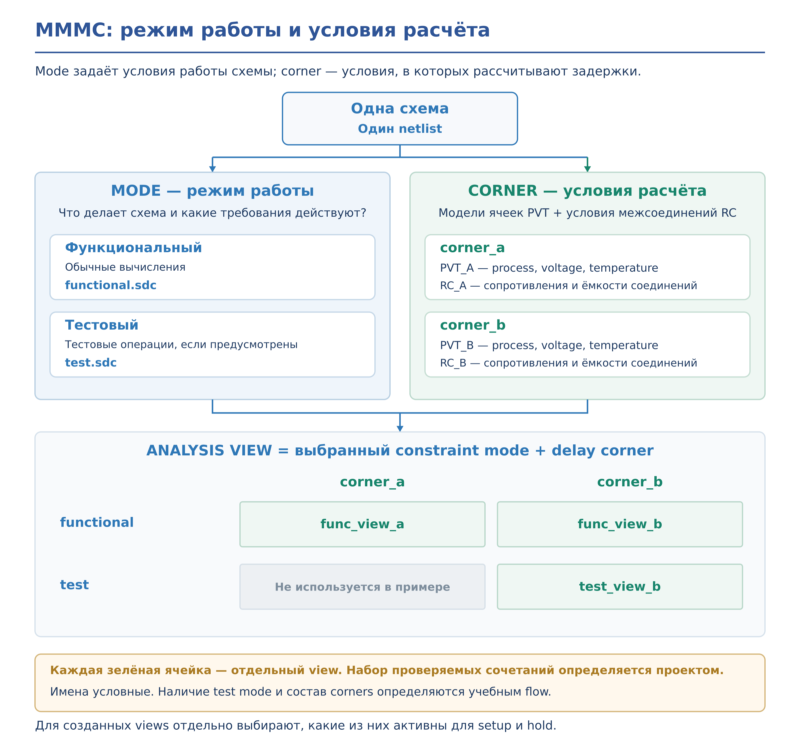

*Рисунок — Одна схема анализируется с разными ограничениями режима и моделями задержек. Выбранные сочетания образуют отдельные analysis views. Имена объектов условные.*

<a id="lab4-rc-corner"></a>

#### RC corner: условия расчёта межсоединений

**RC corner** задаёт модели и условия расчёта паразитных сопротивлений и ёмкостей проводников и vias.

При неизменной геометрии трассировки разные RC corners могут давать разные значения R и C. Это влияет на задержки соединений и длительность фронтов сигналов. Связь физического соединения с его RC-моделью показана на [рисунке](#fig-rc-corner).

<a id="fig-rc-corner"></a>

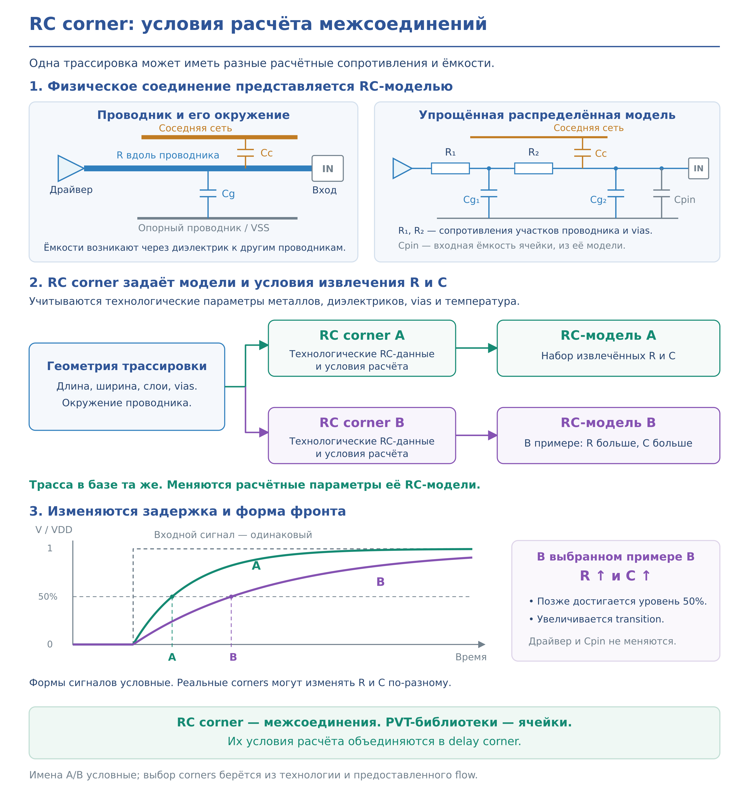

*Рисунок — Одна трассировка в разных RC corners: меняются расчётные параметры межсоединений и отклик сигнала. В примере B увеличены R и C; реальные corners могут изменять их по-разному.*

Входная ёмкость принимающей ячейки **Cpin** берётся из модели ячейки и не задаётся RC corner. Условия расчёта ячеек и межсоединений объединяются в **delay corner**.

#### Из каких объектов состоит MMMC

Конфигурация MMMC связывает ограничения, библиотечные модели и данные межсоединений через несколько объектов.

| Объект | Назначение |
| --- | --- |
| **Analysis view** | Объединяет один constraint mode и один delay corner в конкретный сценарий анализа |
| **Constraint mode** | Связывает режим работы с его SDC-файлами |
| **Delay corner** | Объединяет условия расчёта задержек ячеек и межсоединений |
| **Timing condition** | В Common UI связывает library sets и, при необходимости, operating conditions |
| **Library set** | Объединяет timing-библиотеки необходимых ячеек и макроблоков |
| **Operating condition** | При необходимости задаёт условия PVT, используемые вместе с библиотечными моделями |
| **RC corner** | Задаёт технологические данные и параметры расчёта сопротивлений и ёмкостей межсоединений |

Основная связь:

**Analysis view = Constraint mode + Delay corner.**

Таким образом, analysis view определяет одновременно:

- **какие требования проверяются** — через constraint mode и SDC;
- **как рассчитываются задержки** — через delay corner, модели ячеек и RC-данные.

Связи объектов показаны на [рисунке](#fig-mmmc-structure). Схема читается **сверху вниз: от analysis view к используемым настройкам и исходным данным**.

<a id="fig-mmmc-structure"></a>

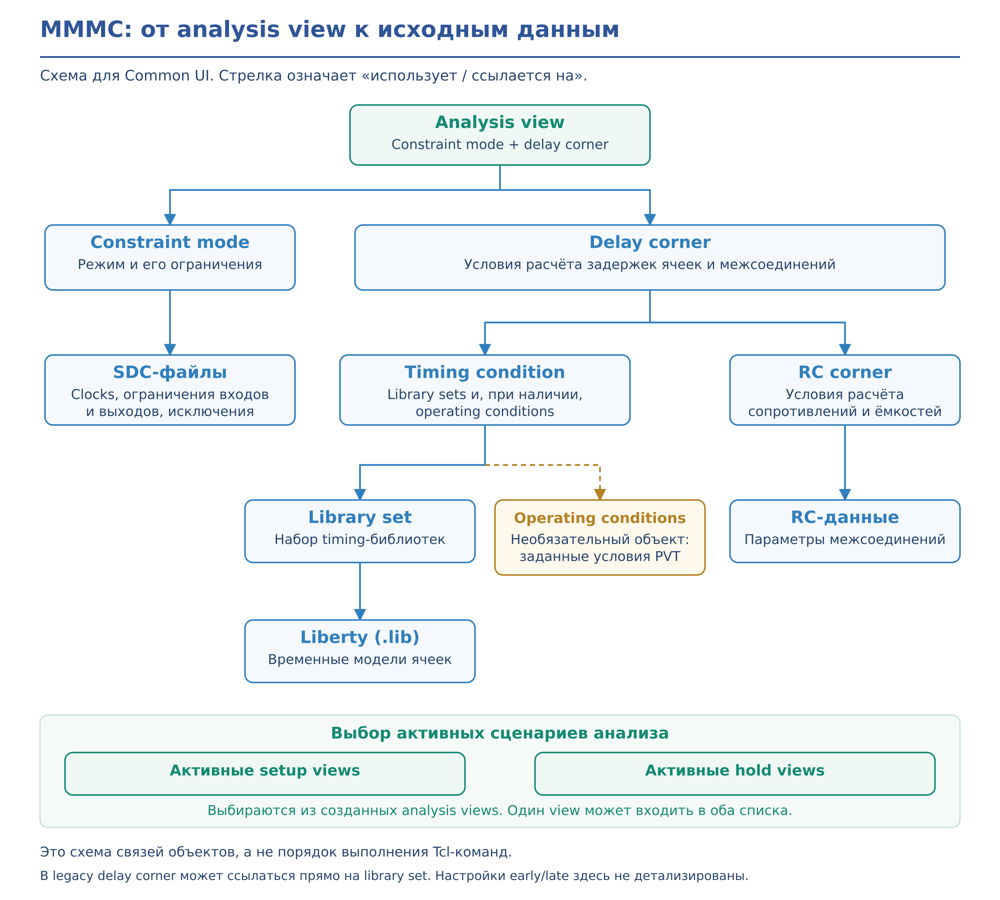

*Рисунок — Связи объектов MMMC в Common UI. Стрелка означает «использует / ссылается на», а не порядок выполнения Tcl-команд. Необязательный operating condition выделен пунктирной связью.*

Схему удобно разбирать по ветвям:

- **Analysis view → Constraint mode → SDC-файлы** — режим работы и его ограничения.
- **Analysis view → Delay corner → Timing condition → Library set → Liberty** — модели задержек ячеек. При необходимости timing condition также использует operating conditions.
- **Analysis view → Delay corner → RC corner → RC-данные** — условия расчёта задержек межсоединений.

Выбор активных setup и hold views показан отдельным блоком: это настройка использования созданных сценариев анализа.

Состав объектов и синтаксис зависят от интерфейса и версии инструмента. В legacy-конфигурациях library set может задаваться непосредственно в delay corner. Также возможны раздельные early/late timing conditions и RC corners. Используйте структуру предоставленного учебного flow.

#### Какие views используются для setup и hold

Создать analysis view недостаточно: необходимо выбрать, **какие views активны для setup, а какие — для hold**. Один view может использоваться для обеих проверок.

Условный пример конфигурации с двумя views:

| Analysis view | Constraint mode | Delay corner | Активен для |
| --- | --- | --- | --- |
| `func_view_a` | `functional` | `corner_a` | Setup |
| `func_view_b` | `functional` | `corner_b` | Hold |

Здесь режим работы и его SDC одинаковые, а условия расчёта задержек различаются. Имена условные и не относятся к объектам учебного проекта.

**Название view не определяет его назначение:** необходимо проверить фактические списки активных setup и hold views.

Правило «SS только для setup, FF только для hold» не является универсальным. На результат влияют напряжение, температура, RC-условия и модель вариаций задержек. Набор проверяемых views определяется технологией и требованиями проекта.

Если учебный flow использует один view для setup и hold, это позволяет выполнить работу в заданных условиях, но не подтверждает выполнение ограничений во всех возможных условиях работы изделия.

#### Как прочитать MMMC своего проекта

Откройте предоставленный файл конфигурации, например `mmmc.view`. Ниже показана активная часть учебного примера: один функциональный режим и один analysis view для setup и hold.

```tcl
# ################
# TYP
# ################

# Список timing-библиотек
set lib_list_typ {}

lappend lib_list_typ \
    "$::env(PDK_DIR)/IHP_Open_PDK/sg13g2_stdcell/lib/sg13g2_stdcell_typ_1p20V_25C.lib"

# Условия расчёта межсоединений
create_rc_corner \
    -name typ \
    -temperature {25} \
    -pre_route_res {1} \
    -pre_route_cap {1} \
    -pre_route_clock_res {0} \
    -pre_route_clock_cap {0} \
    -post_route_res {1} \
    -post_route_cap {1} \
    -post_route_cross_cap {1} \
    -post_route_clock_res {0} \
    -post_route_clock_cap {0}

# Набор timing-библиотек
create_library_set \
    -name typ \
    -timing $lib_list_typ

# Условия работы ячеек
create_opcond \
    -name typ \
    -process {1} \
    -voltage {1.20} \
    -temperature {25}

# Связь библиотек с условиями работы
create_timing_condition \
    -name typ \
    -opcond {typ} \
    -library_sets {typ}

# Условия расчёта задержек ячеек и межсоединений
create_delay_corner \
    -name typ \
    -timing_condition {typ} \
    -rc_corner {typ}

# ################
# ANALYSIS VIEW
# ################

# Функциональный режим и его SDC
create_constraint_mode \
    -name func \
    -sdc_files [list \
        "$::env(ENV_DESIGN_DIR)/$::env(ENV_DESIGN).sdc"]

# Сценарий анализа
create_analysis_view \
    -name typ \
    -constraint_mode {func} \
    -delay_corner {typ}

# Выбор активных views
set_analysis_view \
    -setup {typ} \
    -hold {typ}
```

Разбирать конфигурацию удобно **с последней команды**, прослеживая ссылки на ранее созданные объекты:

1. **`set_analysis_view`** выбирает view `typ` для setup и hold.
2. **`create_analysis_view`** связывает его с constraint mode `func` и delay corner `typ`.
3. **`create_constraint_mode`** указывает SDC-файл с ограничениями проекта.
4. **`create_delay_corner`** объединяет timing condition `typ` и RC corner `typ`.
5. **`create_timing_condition`** связывает library set `typ` с operating condition `typ`.
6. **`create_library_set`** указывает используемую `.lib`.
7. **`create_rc_corner`** задаёт температуру и параметры масштабирования RC для межсоединений.

**Одинаковое имя `typ` используется для объектов разных типов.** Это отдельные объекты, связанные параметрами команд.

В примере используется библиотека `sg13g2_stdcell_typ_1p20V_25C.lib`. Operating condition задаёт process = 1, напряжение 1,20 В и температуру 25 °C. Эти настройки должны соответствовать библиотечным моделям: изменение `create_opcond` само по себе не создаёт новую библиотеку для другого corner.

Температура задаётся отдельно для **ячеек** в `create_opcond` и **межсоединений** в `create_rc_corner`. В этом примере оба значения равны 25 °C.

Параметры `pre_route_*` и `post_route_*` относятся к масштабированию расчётных R и C до и после трассировки. Например, коэффициент `1` означает отсутствие дополнительного масштабирования соответствующей величины, а не сопротивление 1 Ом или ёмкость 1 Ф. Значения коэффициентов, базовые технологические данные и настройки экстракции берутся из предоставленного учебного flow.

**В этой конфигурации один view активен для обеих проверок.** Закомментированные заготовки для других corners не создают дополнительных сценариев анализа.

В timing reports проверяйте название analysis view. **Положительный slack в одном view не подтверждает выполнение ограничений в остальных.**
При сравнении вариантов ECO сохраняйте одинаковые режимы, библиотеки, RC-условия, настройки OCV и списки активных views.

<a id="lab4-io-delays"></a>

### 3.2. Input delay и output delay: временные условия на границах блока

При анализе отдельного блока инструмент рассчитывает задержки его внутренних ячеек и соединений. Однако данные приходят из внешней схемы и передаются внешнему приёмнику. Влияние этой внешней схемы необходимо учесть в SDC.

Для этого используют:

- **`set_input_delay`** — задаёт время прихода данных на вход блока относительно указанного clock.
- **`set_output_delay`** — задаёт внешние временные требования к данным на выходе блока относительно указанного clock.

Эти команды **описывают временные условия интерфейса**, а не добавляют физические элементы задержки. Внешней схемой может быть соседний блок на том же кристалле или устройство на плате.

Расположение внешних триггеров и учитываемые участки пути показаны на [рисунке](#fig-11).

<a id="fig-11"></a>

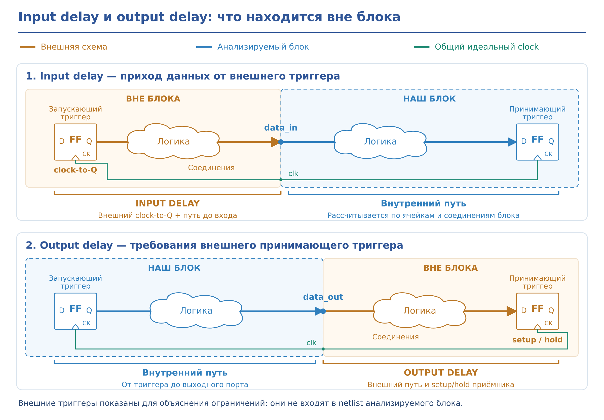

*Рисунок — Input delay учитывает приход данных от внешнего запускающего триггера; output delay — внешний путь после выходного порта и требования принимающего триггера.*

На рисунке синим выделен анализируемый блок, оранжевым — внешняя схема:

- **Верхняя схема:** запускающий триггер находится вне блока. Input delay учитывает его clock-to-Q и задержку внешнего пути до `data_in`.
- **Нижняя схема:** принимающий триггер находится вне блока. Output delay учитывает путь после `data_out` и требования setup/hold этого триггера.

Внешние триггеры показаны для объяснения ограничений: **они не входят в netlist анализируемого блока**. Их влияние на временной анализ описывается через ограничения интерфейса.

#### Input delay: когда данные появляются на входе

**Input delay** описывает время прихода данных на входной порт относительно опорного фронта clock.

Для показанного интерфейса с общим идеальным clock это время складывается из:

- **clock-to-Q внешнего запускающего регистра**;
- **задержки внешней логики и соединений до входного порта**.

После входного порта инструмент рассчитывает внутреннюю часть пути самостоятельно.

Для входных данных задают два значения:

| Параметр | Что задаёт | Для какой проверки используется |
| --- | --- | --- |
| **`-max`** | Наиболее поздний приход новых данных на вход | Setup |
| **`-min`** | Наиболее ранний приход новых данных на вход | Hold |

Чем позже данные появляются на входе, тем меньше времени остаётся на внутренний путь и выполнение setup принимающего регистра.

#### Output delay: какие требования предъявляет внешний приёмник

**Output delay** учитывает внешнюю часть пути после выходного порта и требования принимающего регистра.

Для простого интерфейса с совпадающими опорными фронтами и без внешнего clock skew:

$$
D_{\mathrm{out,max}} =
d_{\mathrm{ext,max}} + t_{\mathrm{setup,ext}},
$$

$$
D_{\mathrm{out,min}} =
d_{\mathrm{ext,min}} - t_{\mathrm{hold,ext}},
$$

где:

- $d_{\mathrm{ext,max}}$ и $d_{\mathrm{ext,min}}$ — максимальная и минимальная задержки внешней логики и соединений после выходного порта;
- $t_{\mathrm{setup,ext}}$ и $t_{\mathrm{hold,ext}}$ — требования внешнего принимающего регистра.

**`-max`** резервирует время для внешнего участка setup-проверки. Чем больше это значение, тем раньше наш блок должен подготовить данные на выходном порту.

**`-min`** задаёт внешнюю составляющую hold-проверки. Из-за вычитания hold time это значение может быть отрицательным. Это не означает отрицательную физическую задержку.

**Output delay не является задержкой от внутреннего регистра до выходного порта.** Этот внутренний участок инструмент рассчитывает по реализации блока.

При различающихся временах прихода clock к блоку и внешним регистрам необходимо дополнительно учитывать задержки соответствующих тактовых ветвей.

#### Числовой пример

Рассмотрим передачу по положительным фронтам общего clock с периодом **10 нс**. Clock считаем идеальным: задержки внутренних и внешних тактовых сетей, skew и uncertainty не учитываем.

Для обычного однотактного пути:

- **Setup** проверяется относительно следующего фронта в момент **10 нс**.
- **Hold** проверяется относительно исходного фронта в момент **0 нс**.

Значения ниже условные и не являются обязательными для лабораторной. Единицы времени — нс; имена портов необходимо заменить на реальные.

```tcl
create_clock -name clk -period 10.0 [get_ports clk]

# Время прихода данных на вход блока
set_input_delay -clock [get_clocks clk] -max 3.0 \
    [get_ports data_in]

set_input_delay -clock [get_clocks clk] -min 0.5 \
    [get_ports data_in]

# Внешние требования к данным на выходе блока
set_output_delay -clock [get_clocks clk] -max 2.0 \
    [get_ports data_out]

set_output_delay -clock [get_clocks clk] -min -0.3 \
    [get_ports data_out]
```

| Ограничение | Как его понимать в этом примере |
| --- | --- |
| **Input delay max = 3,0 нс** | Наиболее поздний приход данных на вход — 3,0 нс после запускающего фронта. До следующего фронта остаётся 7,0 нс на внутренний путь **вместе с setup принимающего регистра** |
| **Input delay min = 0,5 нс** | Наиболее ранний приход новых данных на вход — 0,5 нс после запускающего фронта. Далее инструмент проверяет, не достигнут ли они внутреннего регистра слишком рано |
| **Output delay max = 2,0 нс** | Для внешней части setup-проверки зарезервированы 2,0 нс. Данные должны установиться на выходном порту не позднее 8,0 нс |
| **Output delay min = −0,3 нс** | Прежнее значение на выходном порту необходимо удержать до момента 0,3 нс после исходного фронта |

Например, значения output delay могут быть получены так:

$$
D_{\mathrm{out,max}} = 0{,}8 + 1{,}2 = 2{,}0\ \text{нс},
$$

$$
D_{\mathrm{out,min}} = 0{,}2 - 0{,}5 = -0{,}3\ \text{нс}.
$$

В первом случае максимальная задержка внешней логики и соединений составляет 0,8 нс, а setup внешнего регистра — 1,2 нс. Поэтому данные должны быть готовы на выходе блока за 2,0 нс до захватывающего фронта.

Во втором случае новые данные проходят внешний участок минимум за 0,2 нс, но внешний регистр требует сохранять прежние данные в течение 0,5 нс после фронта. Поэтому на выходе нашего блока данные могут измениться не раньше:

$$
t_{\mathrm{out,new}} + 0{,}2 \ge 0{,}5
\quad\Rightarrow\quad
t_{\mathrm{out,new}} \ge 0{,}3\ \text{нс}.
$$

**Output delay max = 2,0 нс не требует выдать данные через 2,0 нс после clock.** В этом примере оно задаёт крайний срок появления данных на выходе — 8,0 нс после запускающего фронта.

#### Что проверить в SDC своего проекта

Для сигнальных входов и выходов определите:

1. К каким портам применены input/output delays.
2. Относительно какого clock они заданы.
3. Указаны ли необходимые значения `-max` и `-min`.
4. Из каких требований интерфейса или временного бюджета получены эти значения.

Clock-порт и асинхронные управляющие сигналы рассматривают отдельно, с учётом их назначения.

**Input/output delay задают временные условия, но не заменяют электрические характеристики интерфейса.** Входной transition или модель драйвера и выходная ёмкостная нагрузка задаются отдельно.

Ограничения интерфейса входят в SDC соответствующего constraint mode. При сравнении вариантов ECO сохраняйте одинаковыми MMMC и input/output delays.

<a id="lab4-preparation-order"></a>

### 3.3. Подготовка проекта

Порядок настройки Makefile, сборки управляющего скрипта, загрузки и первичной проверки проекта приведён в [основном README](README.md#main-preparation). Следующий раздел дополняет его разбором сообщений и дополнительными отчётами.

<a id="lab4-timing-checks"></a>

### 3.4. Дополнительная диагностика ограничений

<a id="screen-01"></a>

Разбор сообщений `check_timing` и пример отчёта перенесены в [основной README](README.md#main-check-timing). Ниже приведены дополнительные команды для поиска причины замечаний.

#### Дополнительные отчёты для диагностики

Если базовых сообщений недостаточно, используйте дополнительные отчёты:

| Команда | Что проверить и зафиксировать |
| --- | --- |
| `check_timing -verbose` | Замечания к условиям временного анализа, их причины и результат повторной проверки после исправлений |
| `report_analysis_views` | Связи analysis views с constraint modes и delay corners, используемые библиотеки и RC-условия |
| `report_ports` | Загруженные ограничения портов: input/output delays, опорные clocks, входные transitions или модели драйверов, выходные нагрузки |
| `report_path_exceptions` | Временные исключения: false paths, multicycle paths и ограничения min/max delay |
| `report_path_exceptions -ignored` | Проигнорированные временные исключения и причины, по которым они не применяются |
| `report_area` | Число и суммарную площадь учитываемых экземпляров ячеек, распределение по иерархии |
| `get_db current_design .bbox` | Координаты границ die |
| `get_db current_design .core_bbox` | Координаты границ core |
| `report_summary -out_dir reports/pre_place` | Сводные характеристики проекта, площади и показатели заполнения; отчёты сохраняются в указанный каталог |

<a id="lab4-implementation"></a>

## 4. Особенности этапов и выходных моделей

<a id="fig-implementation-stages"></a>

Объяснения этапов, рисунки и полные Tcl-фрагменты находятся в [основном README](README.md#main-stages). Здесь разобраны дополнительные опции, диагностические отчёты и физические особенности реализации.

<a id="lab4-placement"></a>

### 4.1. Placement: опции отчётов и дополнительная диагностика

<a id="fig-02"></a>

Назначение этапа и [пример размещения](README.md#main-fig-placement) приведены в основном README.

#### Опции формирования отчётов

Полная последовательность placement, отчётов и сохранения базы приведена в [основном README](README.md#main-placement).

| Команда или параметр | Назначение |
| --- | --- |
| `time_design -pre_cts` | Формирует временные отчёты для этапа до построения тактовой сети; без `-hold` рассматривается setup |
| `-hold` | Выбирает отчёты по hold |
| `-report_only` | Использует имеющиеся данные RC и временного анализа без повторного извлечения паразитных параметров |
| `-expanded_views` | Дополнительно формирует отдельные отчёты по активным analysis views соответствующей проверки |
| `-report_dir` | Задаёт каталог для отчётов |
| `-report_prefix` | Задаёт префикс имён файлов отчётов |

`STAGE` обозначает текущий этап и используется в именах результатов. Например, при `STAGE = place` отчёты записываются в `./reports/R.place`, а имя базы содержит имя проекта и суффикс `.place.enc`.

**Режим `-report_only` предполагает актуальность используемых данных.** После ручного изменения размещения, соединений или ограничений необходимо обновить данные анализа предусмотренным в flow способом, прежде чем повторно формировать отчёты.

#### Дополнительные проверки после placement

Базовые setup/hold-отчёты формирует фрагмент из основного README. Для более подробной диагностики используйте:

| Команда | Что проверить |
| --- | --- |
| `report_timing -late -max_paths 10` | Несколько критических путей вместо одного примера |
| `report_constraint -all_violators` | Заданные ограничения max transition, max capacitance и max fanout |
| `report_area` | Изменение числа и суммарной площади учитываемых ячеек после оптимизации |

Легальность размещения и congestion проверяются по [основному README](README.md#main-stages).

<a id="lab4-cts"></a>

### 4.2. CTS: настройки сети, спецификация и CTD

Назначение CTS описано в [основном README](README.md#main-stages). Здесь рассмотрим правила трассировки clock, создание спецификации и средства изучения полученного дерева.

Полная последовательность NDR → route type → спецификация → `clock_opt_design` → отчёты приведена в [основном README](README.md#main-cts).

#### Правила трассировки clock

**NDR (Non-Default Routing Rule)** задаёт правила трассировки, отличающиеся от стандартных. В [скрипте основного README](README.md#main-cts) создаётся правило `CTS_2W2S`:

- **2W** — множитель ширины проводников равен 2;
- **2S** — множитель расстояния между проводниками равен 2.

Множители применяются относительно базовых правил соответствующих слоёв в указанном диапазоне.

Увеличение ширины при прочих равных уменьшает сопротивление проводника, а увеличение расстояния снижает ёмкостную связь с соседними проводниками. При этом clock-сеть занимает больше ресурсов трассировки. Итоговые задержки и нагрузки проверяют по отчётам.

Команда `create_route_type` объединяет NDR и предпочтительный диапазон слоёв в объект `CTS_RULE`.

| Параметр | Назначение |
| --- | --- |
| `BOT_CTS_LAYER_name`, `TOP_CTS_LAYER_name` | Имена слоёв, задающие диапазон применения множителей NDR |
| `BOT_CTS_LAYER_num`, `TOP_CTS_LAYER_num` | Номера нижнего и верхнего предпочтительных слоёв трассировки clock |
| `-route_rule CTS_2W2S` | Подключение созданного NDR к route type |

Предпочтительный диапазон слоёв не является абсолютным запретом использования остальных слоёв, например при подключении к пинам.

В этом flow один route type назначается всем трём категориям clock-соединений: **leaf, trunk и top**. При более детальной настройке для них могут использоваться разные правила.

#### Спецификация и оптимизация тактовой сети

Команда `create_clock_tree_spec` анализирует текущую конфигурацию clocks и временных ограничений. Созданная спецификация описывает clock-деревья, группы балансировки — **skew groups** — и связанные настройки.

С опцией `-out_file` спецификация записывается в Tcl-файл `ccopt_default.spec`. Команда `source` выполняет этот файл и применяет настройки.

После этого `clock_opt_design` запускает **построение тактовой сети и совместную оптимизацию clock и тракта данных**. Поэтому после этапа могут измениться не только clock-ячейки, но и элементы логики или их размещение.

#### Отчёты и просмотр результата

В скрипте CTS из основного README `-post_cts` выбирает этап анализа после CTS. Остальные опции отчётов разобраны в [пояснениях к фрагменту placement](#lab4-placement).

<a id="fig-03"></a>

Физическое расположение clock-соединений показано в [основном README](README.md#main-fig-cts). Для изучения ветвления и задержек перейдите к CTD.

#### Просмотр тактовой сети в CTD

**CTD (Clock Tree Debugger)** показывает структуру тактовой сети и помогает сопоставить её ветви с объектами в Layout.

Откройте CTD через **Clock → CCOpt Clock Tree Debugger** или командой Common UI:

```tcl
gui_ctd_open
```

Пример представлен на [скриншоте](#screen-11).

<a id="screen-11"></a>

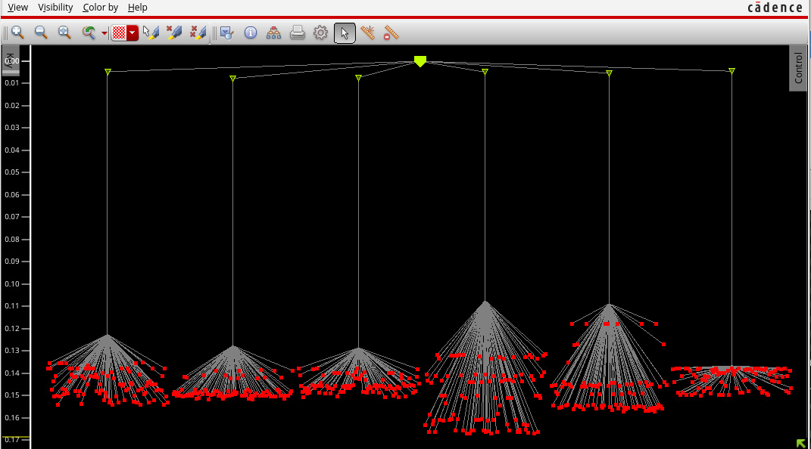

*Скриншот — Тактовая сеть в CTD: корень, промежуточные clock-ячейки и конечные точки. Вертикальная шкала показывает insertion delay.*

На приведённом скриншоте:

- **Верхний узел** — корень отображаемого clock-дерева.
- **Промежуточные узлы и ветви** — структура распределения clock.
- **Конечные точки — sinks** — принимающие clock-пины.
- **Вертикальная координата** соответствует задержке прихода clock: время увеличивается сверху вниз.
- **Горизонтальная координата** помогает разделить ветви и не соответствует положению объектов на кристалле.

Цвета зависят от выбранного режима **Color by**. Красный цвет конечной точки сам по себе не означает нарушение: проверьте режим отображения и легенду.

#### Группы балансировки и интерпретация задержек

**Skew group** объединяет конечные точки, между которыми инструмент контролирует согласованность прихода clock. Сопоставляйте результаты внутри одной группы, для одинаковых фронтов и analysis views.

Вертикальный разброс точек в CTD помогает найти интересующие ветви, но численное значение skew следует подтверждать отчётом соответствующей группы. При чтении latency отличайте задержку физической clock-сети от source latency, если они представлены раздельно.

Вместе с clock может оптимизироваться и тракт данных. Поэтому изменение slack после CTS объясняйте по обеим тактовым ветвям и конкретным изменениям ячеек, а не только по общему skew.

<a id="lab4-routing"></a>

### 4.3. Routing: физические особенности и диагностика

Назначение трассировки, команды этапа и результат описаны в [основном README](README.md#main-routing). Далее рассмотрены физические особенности и дополнительные проверки.

В [скрипте routing](README.md#main-routing) отдельный вызов post-route оптимизации отсутствует. Если результат требует исправлений, выполняют предусмотренные flow операции оптимизации или ECO, после чего повторяют анализ и проверки.

#### Просмотр соединений

<a id="fig-04"></a>

Общий вид трассированного блока показан в [основном README](README.md#main-fig-routing).

Выделите одну сигнальную сеть и проследите её от выходного пина драйвера до входных пинов потребителей. Найдите горизонтальные и вертикальные участки, смену слоя и соответствующие vias.

**Пересечение проводников разных слоёв само по себе не создаёт электрического соединения.** Для соединения необходим межслойный переход.

<a id="lab4-fillers"></a>

#### Физические структуры filler-ячеек

<a id="fig-gaps-before-fillers"></a>
<a id="fig-filler-cell"></a>

Назначение fillers, промежутки в рядах и пример `sg13g2_fill_4` показаны в [основном README](README.md#main-fillers-decap).

Кроме участков шин VDD/VSS, filler содержит необходимые для конкретной библиотеки технологические области, например области карманов и имплантации. При стыковке с соседними ячейками они обеспечивают непрерывность соответствующих структур и помогают выполнить правила технологии.

LEF-представление показывает доступные инструменту размещения и трассировки физические объекты, но не полную внутреннюю топологию ячейки.

**Filler cells и metal fill — разные объекты.** Filler cells заполняют промежутки в рядах стандартных ячеек. Metal fill представляет собой дополнительные металлические фигуры для выполнения требований к плотности металлизации.

<a id="lab4-decap"></a>

#### Заряд и напряжение decap

<a id="fig-decap-principle"></a>

Назначение decap и схема поддержки локального питания приведены в [основном README](README.md#main-fig-decap-principle). Ниже оценим изменение напряжения и рассмотрим внутреннее устройство ячейки.

**При нормальной работе decap не разряжается до нуля на каждом такте.** Напряжение на ней изменяется лишь немного: например, условно, с 1,20 до 1,18 В, затем возвращается к исходному уровню. Эти числа иллюстрируют принцип работы и не задают допустимую просадку для проекта.

Для упрощённой оценки:

$$
\Delta V \approx \frac{I_{\mathrm{cap}}\Delta t}{C},
$$

где $I_{\mathrm{cap}}$ — средний ток, отдаваемый ёмкостью за интервал $\Delta t$, а $C$ — её величина. При одинаковом отданном заряде большая ёмкость теряет меньше напряжения. В реальной сети результат также зависит от места установки и параметров соединений.

#### Пример на CMOS-инверторе

Рассмотрим инвертор с входом **A** и выходом **Y**. Здесь важно различать две ёмкости:

- **Выходная нагрузка $C_{\mathrm{load}}$** — ёмкость выходного соединения и входов подключённых потребителей.
- **Развязывающая ёмкость $C_{\mathrm{decap}}$** — ёмкость между локальными шинами VDD и VSS.

Когда вход **A изменяется с 1 на 0**, PMOS открывается, а NMOS закрывается. Через PMOS заряжается выходная нагрузка, и напряжение Y повышается. Ток поступает от источника питания; decap может локально отдать часть заряда и уменьшить кратковременную просадку VDD.

Когда вход **A изменяется с 0 на 1**, PMOS закрывается, а NMOS открывается. Выходная нагрузка разряжается через NMOS в VSS, и напряжение Y снижается.

Эти процессы показаны на [рисунке](#fig-decap-inverter).

<a id="fig-decap-inverter"></a>

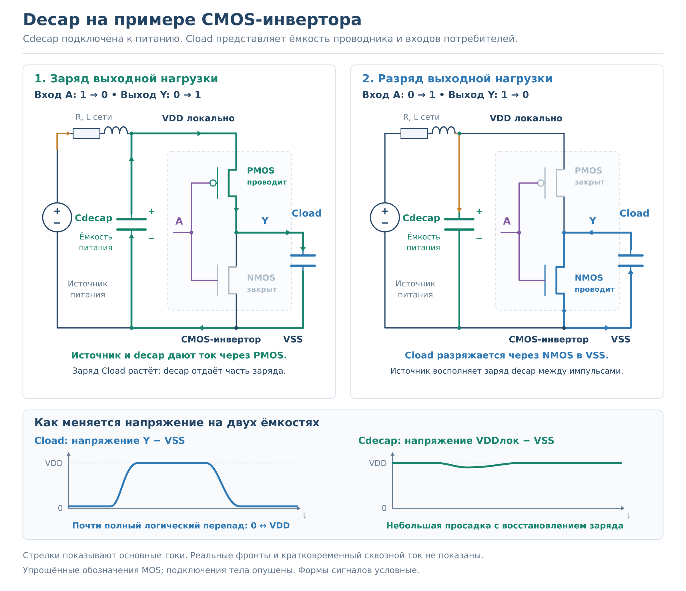

*Рисунок — Слева выходная нагрузка заряжается через PMOS при поддержке локальной decap. Справа нагрузка разряжается через NMOS. Внизу сравниваются изменения напряжения на выходной и развязывающей ёмкостях. Показаны основные токи; схема и формы сигналов упрощены.*

**Decap подключена к питанию, поэтому она не добавляется непосредственно к выходной нагрузке инвертора.** Напряжение на $C_{\mathrm{load}}$ при переключениях проходит почти полный диапазон от 0 до VDD, а напряжение на $C_{\mathrm{decap}}$ остаётся около рабочего уровня питания с небольшими колебаниями.

#### Чем опасна просадка питания

Для ячейки важно **локальное напряжение между её пинами VDD и VSS**. Оно может уменьшаться как из-за снижения потенциала VDD, так и из-за повышения потенциала VSS.

При уменьшении питания транзисторы обычно слабее управляют нагрузкой. Например, PMOS инвертора может медленнее заряжать выходную ёмкость: выход позже достигает необходимого уровня, а длительность фронта увеличивается.

Это может привести к следующим последствиям:

- **Увеличение задержки тракта данных.** Данные позже приходят к принимающему регистру, уменьшая setup-запас. При достаточно большой задержке возникает setup-нарушение.
- **Изменение задержек тактовой сети.** Просадка около clock-буферов может изменить время прихода clock и skew. Результат для setup и hold зависит от относительных изменений запускающей и принимающей ветвей и пути данных.
- **Снижение помехоустойчивости.** Изменяются уровни сигналов и пороги переключения. При неблагоприятных условиях принимающая ячейка может неверно распознать логическое значение.
- **Нарушение работы элементов хранения.** Достаточно глубокая или длительная просадка может привести к неправильному захвату данных или потере сохранённого состояния.

Если из-за изменения задержек нарушаются setup или hold, корректный захват данных регистром перестаёт гарантироваться; одним из возможных последствий является метастабильность.

**Небольшая просадка сама по себе ещё не означает ошибку.** Её влияние зависит от глубины, длительности, расположения затронутых ячеек и момента относительно переключений данных и clock.

Положительный slack при анализе только на номинальном напряжении не подтверждает устойчивость к локальным просадкам. Для такой оценки необходимы анализ питания и обоснованный учёт напряжения при расчёте задержек.

#### Как устроена decap

В CMOS-библиотеках развязывающую ёмкость часто реализуют с помощью **MOS-структур**. Затвор и полупроводниковая область образуют электроды, разделённые тонким диэлектриком.

Например, в простом варианте на NMOS:

- затвор подключён к VDD;
- исток, сток и тело подключены к VSS;
- ёмкость затвора используется как развязывающая ёмкость между шинами питания.

Это пример принципа устройства; конкретная схема decap определяется библиотекой.

<a id="fig-decap-cell"></a>

LEF-представление `sg13g2_decap_4` показано в [основном README](README.md#main-fig-decap-cell); оно не раскрывает внутреннюю структуру MOS-ёмкости.

#### Когда decap полезнее обычного filler

Decap-заполнитель позволяет использовать свободное место в ряду для увеличения локальной ёмкости питания. Это полезно около областей с высокой одновременной активностью, например clock-буферов и групп регистров.

**Зарядка decap требует энергии.** При включении питания ёмкость необходимо зарядить, а во время работы — восполнять отданный заряд. Decap помогает доставить ток локально в нужный момент, но не является самостоятельным источником энергии.

Поэтому замена всех fillers на decap не является универсальным правилом:

- при одинаковой скорости нарастания питания дополнительная ёмкость увеличивает начальный зарядный ток;
- реальные decap могут увеличивать токи утечки и потери;
- эффективность зависит от расположения относительно потребителей и сети питания;
- размеры ячеек должны соответствовать свободным участкам, а небольшие промежутки могут требовать обычных fillers.

Decap помогают уменьшать **кратковременные колебания питания**, но не устраняют постоянное падение напряжения из-за высокого сопротивления сети. Их количество и расположение выбирают с учётом потребностей схемы и результатов анализа питания.

#### Какие ячейки вставляет add_fillers

Команда `add_fillers` из [скрипта routing](README.md#main-routing) получает список библиотечных ячеек из `ENV_FILLER_CELLS`. Посмотреть фактическое содержимое списка можно командой:

```tcl
puts $::env(ENV_FILLER_CELLS)
```

После вставки проверьте фактически использованные библиотечные ячейки, легальность размещения и подключение их VDD/VSS. В этом flow заполнители добавляются после трассировки, поэтому физические проверки выполняйте уже с учётом их присутствия.

#### Дополнительная диагностика после routing

Команды обновления RC, итогового timing и физических проверок приведены в [основном README](README.md#main-checks). Для подробного анализа дополните их следующими сведениями:

| Команда или источник | Что проверить |
| --- | --- |
| `report_constraint -all_violators` | Заданные электрические ограничения и оставшиеся нарушения |
| `report_area` | Площадь учитываемых ячеек и состав отчёта |
| Итоговая статистика routing в журнале | Длина проводников, число vias и распределение ресурсов по слоям, если эти сведения выводятся |

При сравнении площади и utilization уточняйте, учитываются ли physical-only cells. Заполнение промежутков fillers не означает соответствующего увеличения площади функциональной логики.

Сравните net delay и transition с результатом после CTS. Если одновременно выполнялась оптимизация, различия timing могут быть связаны и с изменениями состава или размещения ячеек.

Маркеры физических проверок позволяют найти проблемные участки в GUI.

Пример отображения нарушений DRC в Innovus показан на [рисунке](#fig-05).

<a id="fig-05"></a>

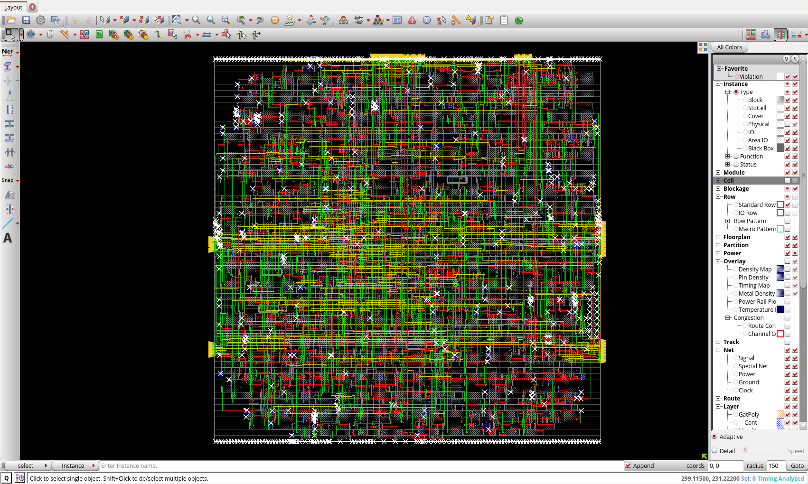

*Рисунок — Результаты проверки геометрических правил и отображение нарушений в Innovus.*

> **Примечание.** В демонстрационном примере нарушения DRC созданы намеренно, чтобы показать их отображение и поиск. В реализации, подготовленной к изготовлению, такие нарушения недопустимы. В этой лабораторной выполните проверки и зафиксируйте обнаруженные нарушения согласно требованиям задания.

<a id="lab4-export"></a>

### 4.4. Особенности экспортируемых моделей

Назначение файлов, необходимые переменные и полный скрипт экспорта приведены в [основном README](README.md#main-export). Здесь рассмотрены особенности получаемых моделей.

<a id="lab4-rc-extraction"></a>

Обновление RC выполняется по [основной инструкции](README.md#main-checks). Команда просмотра `all_rc_corners -active` только перечисляет активные RC corners; она не создаёт и не активирует новые условия анализа.

#### Экспорт LEF

**LEF-абстракт не содержит полного внутреннего устройства блока.** Он используется вместе с другими представлениями, например временной моделью Liberty.

#### Экспорт временной модели Liberty

Команда `write_timing_model` формирует **извлечённую временную модель блока — ETM (Extracted Timing Model)**.

Такая `.lib` описывает реализованный блок через его внешние временные характеристики. Это отдельная модель блока, созданная с использованием библиотек ячеек, ограничений и рассчитанных задержек.

Удаление повторений необходимо, поскольку один view может входить одновременно в списки setup и hold.

Временное изменение активных views внутри цикла относится к извлечению модели. После цикла восстанавливаются условия анализа, используемые в проекте.

Имена Liberty-библиотек для разных views различаются, а `cell_name` остаётся именем реализованного блока. Оно должно согласовываться с именами блока в других представлениях.

Параметр `-include_power_ground` добавляет сведения о питании и земле; он сам по себе не означает извлечение полноценной модели потребляемой мощности.

#### Экспорт SPEF

В примере основного README `typ` — **имя конкретного RC corner** в конфигурации проекта.

Если используются несколько RC corners, выгрузите необходимые SPEF отдельно для каждого из них. Указывайте corner в имени файла, чтобы однозначно связать паразитные параметры с условиями анализа.

Имя analysis view и имя RC corner могут совпадать, но это разные объекты MMMC.

#### Экспорт итогового netlist

Итоговый netlist отражает изменения, внесённые при физической реализации, включая добавленные clock-ячейки и изменения логики при оптимизации.

Для моделирования вместе с ним потребуются совместимые Verilog-модели используемых библиотечных ячеек.

#### Экспорт SDF

SDF используют вместе с соответствующим итоговым netlist и моделями ячеек для моделирования с задержками.

**Netlist и SDF должны относиться к одной реализации.** После изменения состава ячеек, имён экземпляров или соединений ранее выгруженный SDF может перестать соответствовать схеме.

Зафиксируйте, какой analysis view использован для SDF. Если выгружаются несколько вариантов, включайте имя view в имя файла.

<a id="lab4-timing-eco"></a>

## 5. Подробный разбор timing reports и ECO

Откройте сохранённую базу в интерактивном сеансе по [основной инструкции](README.md#main-checks). Ниже разобран конкретный timing report и показана последовательность локальных изменений схемы.

<a id="lab4-timing-report"></a>

### 5.1. Разбор конкретного временного отчёта

Порядок чтения `report_timing`, основные поля и отличие от сводки `time_design` описаны в [основном README](README.md#main-checks). Для подробного разбора пригодятся ещё несколько полей:

| Поле | Что анализировать |
| --- | --- |
| **Group** | Группу путей, к которой отнесён рассматриваемый путь |
| **Cell** | Тип библиотечной ячейки, использованной в этой точке пути |
| **Arc** | Конкретную дугу между пинами ячейки, например `A → Y` |
| **Fanout** | Число подключённых потребителей |
| **Arrival** | Накопленное время прихода сигнала, а не задержку только текущей ячейки |

В сводках различайте **WNS** и поле **worst slack**: последнее может показывать положительный запас, если все рассматриваемые пути выполняют ограничения.

#### Разбор приведённого примера

Исходный отчёт показан на [рисунке](#fig-08).

<a id="fig-08"></a>

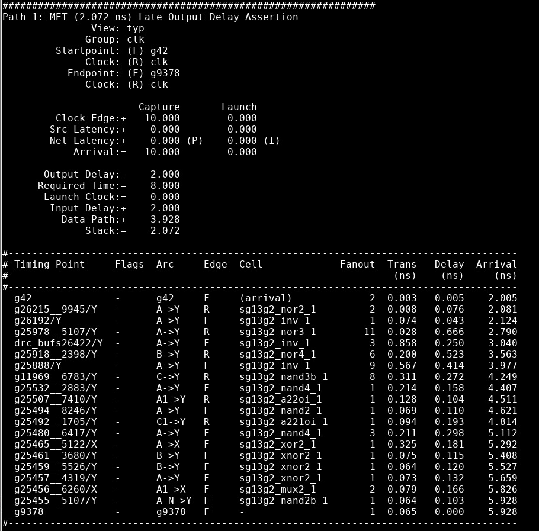

*Рисунок — Late-отчёт пути от входного порта g42 до выходного порта g9378 до ECO.*

В этом примере:

- startpoint — входной порт `g42`;
- endpoint — выходной порт `g9378`;
- analysis view — `typ`;
- опорный clock — `clk`;
- принимающий фронт расположен в момент 10 нс;
- input delay равен 2 нс;
- output delay равен 2 нс.

Требуемое время на выходном порту:

$$
Required = 10 - 2 = 8\ \text{нс}.
$$

Время прихода данных:

$$
Arrival = 2 + 3{,}928 = 5{,}928\ \text{нс}.
$$

Временной запас:

$$
Slack = 8 - 5{,}928 = 2{,}072\ \text{нс}.
$$

Надпись `MET` означает, что рассматриваемое условие выполнено.

**Это путь между портами блока, а не между регистрами.** Он иллюстрирует совместный учёт input delay, задержки внутренней логики и output delay.


В приведённом отчёте:

- **`Startpoint: (F) g42`** — рассматривается спадающий переход данных на входном порту `g42`.
- **`Endpoint: (F) g9378`** — этот переход распространяется через логику и приводит к спадающему переходу на выходном порту `g9378`.
- **`Clock: (R) clk`** — соответствующее временное условие связано с нарастающим фронтом clock.

Таким образом, **спадающий переход данных может анализироваться относительно нарастающего фронта clock**. Обозначение `F` возле сигнального порта не означает использование отрицательного фронта тактового сигнала.

В столбце **`Edge`** направление перехода указано для каждой точки пути. При прохождении через логику оно может изменяться:

- **Инвертор** меняет направление: входной `R` вызывает выходной `F`, а входной `F` — выходной `R`.
- **Неинвертирующий буфер** сохраняет направление: `R` вызывает `R`, а `F` — `F`.

Поэтому вдоль одного пути в отчёте могут встречаться и `R`, и `F`.

**Направление перехода влияет на расчёт задержки.** В библиотеке отдельно описываются задержки и длительности нарастающего и спадающего переходов. Для одной ячейки при одинаковой нагрузке эти значения могут различаться.

<a id="lab4-drive-strength"></a>

### 5.2. Почему существуют ячейки X1, X2 и X4

Одна логическая функция может иметь несколько физических реализаций с разной **нагрузочной способностью — drive strength**.

Например, ячейки:

- `sg13g2_inv_1`;
- `sg13g2_inv_2`;
- `sg13g2_inv_4`

выполняют одинаковую функцию:

$$
Y = \neg A.
$$

Обозначения X1, X2 и X4 обычно используют для различения вариантов нагрузочной способности. В рассматриваемой библиотеке соответствующие варианты обозначены суффиксами `_1`, `_2` и `_4`.

Более сильный вариант способен обеспечивать больший ток заряда и разряда нагрузки. На уровне транзисторов этого часто достигают увеличением эффективной ширины каналов, в том числе использованием нескольких параллельных пальцев. Конкретная реализация определяется библиотекой.

При этом меняются:

- площадь и геометрия ячейки;
- входная ёмкость;
- характеристики задержки и выходного transition;
- внутренние ёмкости, утечки и затраты мощности.

Для примера в [документации библиотеки IHP](https://ihp-open-pdk.readthedocs.io/en/latest/libraries/sg13g2_stdcell/cells/sg13g2_inv.html) приведены следующие значения:

| Ячейка | Логическая функция | Площадь, мкм² | Ёмкость входа A, фФ |
| --- | --- | ---: | ---: |
| `sg13g2_inv_1` | Инвертор | 5,4432 | 2,867 |
| `sg13g2_inv_2` | Инвертор | 7,2576 | 5,675 |
| `sg13g2_inv_4` | Инвертор | 10,8864 | 11,221 |

Значения приведены для иллюстрации. При анализе своего проекта используйте подключённые LEF и Liberty соответствующего corner.

**X4 не означает «в четыре раза быстрее» или «в четыре раза больше по площади».** Результат зависит от входного фронта, выходной нагрузки и условий анализа.

LEF-представления вариантов показаны на [рисунках](#fig-cell-drive-strength).

<a id="fig-cell-drive-strength"></a>

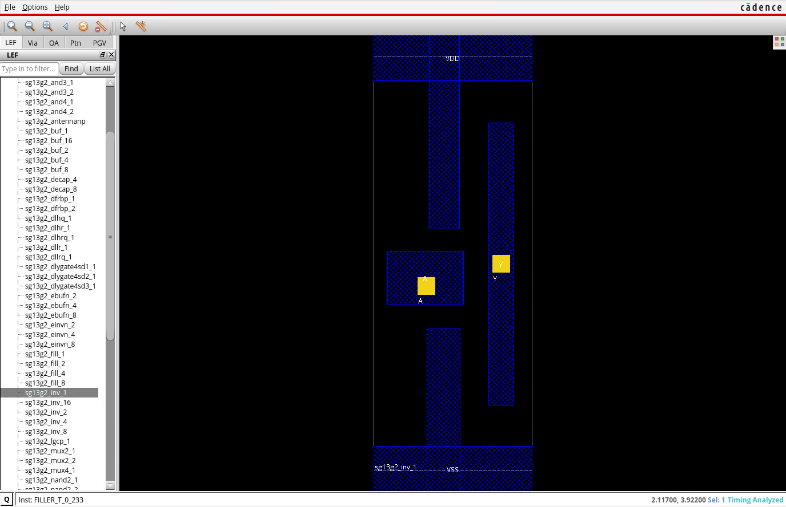

*Рисунок — LEF-представление инвертора sg13g2_inv_1.*

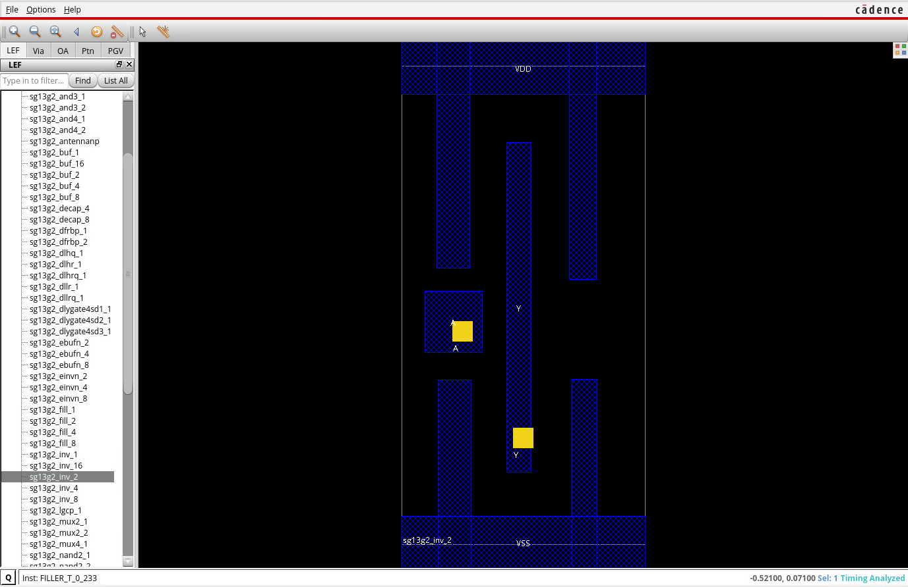

*Рисунок — LEF-представление инвертора sg13g2_inv_2.*

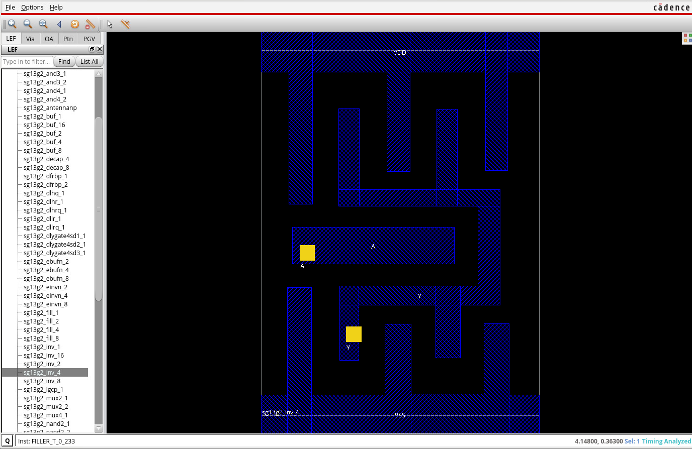

*Рисунок — LEF-представление инвертора sg13g2_inv_4.*

На скриншотах видны границы ячеек и геометрия доступных пинов. **LEF-абстракт не показывает полную транзисторную структуру.** По этим изображениям нельзя определить число транзисторов или ширину их каналов.

#### Зачем выбирать разные варианты

Для небольшой нагрузки слабой ячейки может быть достаточно. Использование более сильной ячейки в таком месте увеличит площадь и нагрузку на предыдущий каскад без необходимой пользы.

При большой нагрузке более сильная ячейка может уменьшить задержку и длительность выходного фронта. Однако её увеличенная входная ёмкость способна замедлить предыдущую ячейку: теперь ей необходимо заряжать и разряжать большую ёмкость.

Эти два эффекта показаны на [рисунке](#fig-drive-strength-tradeoff). Сравниваются инверторы X1 и X4 при одинаковых предыдущем драйвере, сигнале на его входе и внешней выходной нагрузке.

<a id="fig-drive-strength-tradeoff"></a>

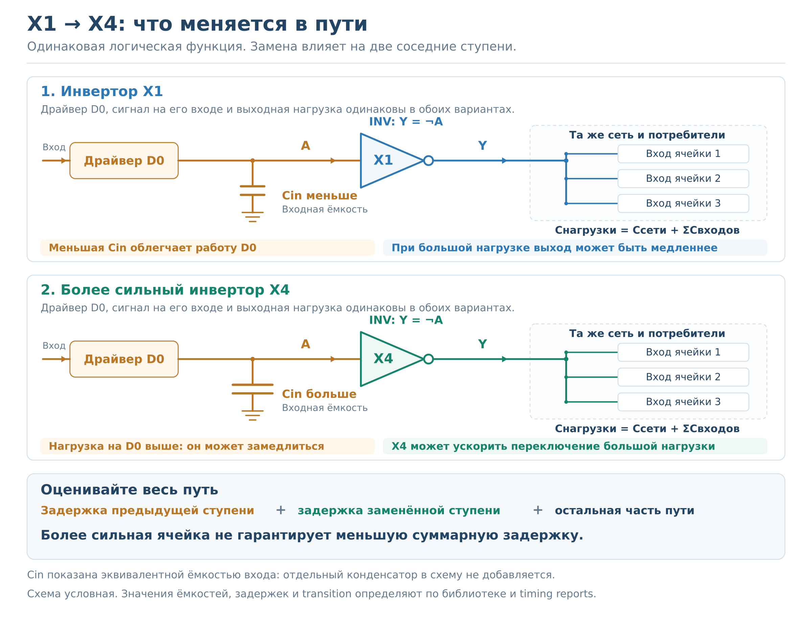

*Рисунок — Более сильный инвертор может быстрее переключать выходную нагрузку, но его большая входная ёмкость увеличивает нагрузку на предыдущий каскад. Схема условная.*

На рисунке **Cin** обозначает эквивалентную входную ёмкость инвертора. Это свойство ячейки, а не отдельный конденсатор, добавленный в схему.

Поэтому при замене X1 на X2 или X4 оценивают **весь затронутый путь**, включая предыдущий и последующий каскады. Проверяют изменение задержек, transition и запасов setup/hold: улучшение одного участка не гарантирует улучшения всего пути.

<a id="lab4-eco-principle"></a>

### 5.3. Что такое ECO

**ECO (Engineering Change Order)** — локальное изменение уже реализованной схемы. Оно позволяет скорректировать отдельные ячейки и соединения после основного маршрута физической реализации.

В этой работе рассматриваются изменения, сохраняющие логическую функцию схемы:

- добавление неинвертирующего буфера;
- удаление ранее добавленного буфера с восстановлением соединения;
- замена ячейки на вариант с той же логической функцией и другой нагрузочной способностью.

#### Как вставка буфера влияет на путь

При вставке буфера предыдущая ячейка начинает управлять его входом, а буфер — выбранными потребителями и соединениями до них. Если изменение затрагивает только одну ветвь, остальные потребители остаются подключёнными к исходному драйверу.

В результате одновременно происходят два изменения:

- **Перераспределяется нагрузка.** Вместо ёмкости выделенной ветви исходный драйвер видит входную ёмкость буфера и соединение до него. Это может уменьшить задержку драйвера и улучшить его выходной transition.
- **Добавляется новая ступень.** Буфер вносит собственную задержку; изменяются длины соединений и их паразитные параметры.

Итог зависит от соотношения этих эффектов. Поэтому **вставка буфера может как увеличить, так и уменьшить задержку всего пути**. Более сильный буфер также не гарантирует меньшую суммарную задержку: его большая входная ёмкость увеличивает нагрузку на предыдущую ячейку.

#### Порядок выполнения ECO

1. Сохраните исходную базу и отчёты выбранного пути.
2. При необходимости удалите fillers в соответствии с учебным flow и выполните выбранное изменение средствами ECO.
3. Разместите и легализуйте затронутые ячейки.
4. Выполните ECO-трассировку изменённых соединений.
5. Восстановите заполнение свободных участков рядов.
6. Обновите паразитные параметры и повторите временной анализ.
7. Проверьте setup и hold, электрические ограничения, размещение, связность и геометрические правила. Сохраните результат в отдельную базу.

**Оценивайте результат после завершения физических изменений и обновления RC.** Отчёт сразу после изменения netlist ещё не характеризует окончательно размещённый и трассированный вариант.

Проверяйте не только выбранный путь, но и общую сводку setup/hold: изменение общей сети или драйвера может повлиять на несколько потребителей.

<a id="lab4-eco-commands"></a>

### 5.4. Выполнение ECO в интерактивном сеансе

Ниже показан пример покомандного выполнения. Имена пути и ячеек относятся к демонстрационному проекту.

**Для собственного проекта замените startpoint, endpoint, analysis view и пин вставки на реальные объекты своей базы.** В эксперименте с путём между регистрами выберите соответствующие запускающий и принимающий регистры.

#### Исходные параметры и контрольная точка

Перед началом убедитесь, что исходные RC и timing обновлены по [порядку из основного README](README.md#main-checks).

```tcl
set design_name [get_db current_design .name]

# Демонстрационный путь input -> output
set eco_start g42
set eco_end   g9378
set eco_view  typ

# Вход потребителя, перед которым вставляется буфер
set eco_sink_pin {g25459__5526/B}
set eco_cell sg13g2_buf_4

# Обозначение варианта эксперимента
set eco_tag insert_buf4_01
set eco_report_dir ./reports/ECO.${eco_tag}

file mkdir ./db
file mkdir $eco_report_dir

write_db ./db/DB.${design_name}.pre_eco.enc

report_timing \
    -from $eco_start -to $eco_end \
    -view $eco_view -late

report_timing \
    -from $eco_start -to $eco_end \
    -view $eco_view -early
```

Сохраните консольный журнал сеанса Innovus: он должен содержать оба исходных отчёта. При сдаче укажите, где в журнале находятся исходные и итоговые результаты. Также можно сохранить вывод команд отдельными текстовыми файлами.

Для каждой операции задавайте отдельный `eco_tag`, например `insert_buf4_01`, `delete_buf4_01` или `resize_buf2_01`, заново задавайте `eco_report_dir` и выполняйте `file mkdir $eco_report_dir` до записи отчётов. Это разделит имена отчётов и итоговых баз. Исходную контрольную точку `pre_eco` сохраняйте один раз, до первой правки, чтобы не перезаписать её изменённым состоянием.

Проверьте выбранный пин в своей базе:

```tcl
get_pins $eco_sink_pin
```

В демонстрационном примере буфер добавляется перед входом `B` ячейки `g25459__5526`. Для другого проекта точку вставки выбирают по его временному пути и связности.

#### Подготовка к изменениям

Удалите заполнители, добавленные с префиксом `FILLER`, чтобы освободить места для ECO-ячеек:

```tcl
delete_filler -prefix FILLER
```

Задайте режим ECO:

```tcl
# Соблюдать ограничения на изменение объектов
set_db eco_honor_dont_touch       true
set_db eco_honor_dont_use         true
set_db eco_honor_fixed_status     true
set_db eco_honor_fixed_wires      true

# Наследовать атрибуты исходной сети
set_db eco_inherit_net_attribute  true

# Сохранить локальную проверку логической эквивалентности
set_db eco_check_logical_equivalence true

# Выполнить размещение и обновление timing после серии правок
set_db eco_refine_place          false
set_db eco_update_timing         false

set_db eco_prefix ECO
```

Настройки `eco_refine_place false` и `eco_update_timing false` откладывают соответствующие операции до завершения серии изменений. Ниже они выполняются явно.

**Не отключайте ограничения `dont_touch`, `dont_use` и `fixed` только для того, чтобы команда выполнилась.** Сначала определите, почему выбранный объект защищён и допускается ли его изменение в данном эксперименте.

Настройка `eco_spread_inverter` относится к распределению инверторов по буферизуемой сети. Для рассматриваемой вставки неинвертирующего буфера отдельно менять её не требуется.

#### Добавление буфера

```tcl
eco_add_repeater \
    -cells $eco_cell \
    -pins $eco_sink_pin
```

Параметр `-cells` задаёт библиотечную ячейку, а `-pins` — выбранные точки подключения.

Найдите фактически созданный экземпляр по сообщениям команды и в Layout. Его имя не обязано совпадать с `eco1`, показанным на демонстрационном скриншоте.

#### Удаление и замена ячейки

Следующие команды показывают другие операции. **Они не являются обязательным продолжением каждой вставки.**

```tcl
# Удалить выбранный повторитель:
# eco_delete_repeater -insts <имя_экземпляра>

# Заменить его на другой вариант буфера:
# eco_update_cell -insts <имя_экземпляра> -cells sg13g2_buf_2

```

Перед выполнением подставьте реальное имя экземпляра.

При замене сохраняйте логическую функцию. Например, замена инвертора X1 на инвертор X2 сохраняет инверсию, а замена инвертора на неинвертирующий буфер меняет функцию схемы.

#### Размещение, трассировка и восстановление заполнителей

После выбранных изменений выполните:

```tcl
place_detail -eco true
check_place

route_eco

add_fillers \
    -base_cells $::env(ENV_FILLER_CELLS) \
    -prefix FILLER

check_place
```

Используйте тот же разрешённый набор filler/decap cells, что и при основном маршруте.

После этих операций проверьте связность и геометрию:

```tcl
check_connectivity \
    -type all \
    -out_file ${eco_report_dir}/connectivity.rpt

check_drc \
    -check_only all \
    -out_file ${eco_report_dir}/drc.rpt
```

Если проверки обнаружили проблемы, исправьте их до сохранения окончательного результата.

#### Обновление RC и временного анализа

После ECO-трассировки выполните новую экстракцию:

```tcl
reset_parasitics
extract_rc
```

Затем сформируйте сводки отдельно для setup и hold:

```tcl
time_design -post_route -report_only -expanded_views \
    -report_dir $eco_report_dir \
    -report_prefix setup

time_design -post_route -report_only -expanded_views -hold \
    -report_dir $eco_report_dir \
    -report_prefix hold
```

Повторно просмотрите выбранный путь и сохраните итоговые отчёты в том же консольном журнале либо в отдельных файлах:

```tcl
report_timing \
    -from $eco_start -to $eco_end \
    -view $eco_view \
    -late -path_type full_clock

report_timing \
    -from $eco_start -to $eco_end \
    -view $eco_view \
    -early -path_type full_clock
```

**Отчёт сразу после изменения netlist, до завершения размещения, трассировки и обновления RC, не подтверждает итоговые временные характеристики реализации.**

Верните автоматическое размещение и обновление timing для последующих отдельных ECO-команд:

```tcl
set_db eco_refine_place  true
set_db eco_update_timing true
```

Сохраните результат под отдельным именем:

```tcl
write_db ./db/DB.${design_name}.ECO.${eco_tag}.enc
```

Имя контрольной точки должно отражать вариант эксперимента. Не называйте результат `fix_hold`, если исправление hold не подтверждено соответствующим отчётом.

<a id="lab4-eco-comparison"></a>

### 5.5. Сравнение отчётов до и после ECO

Результат демонстрационной вставки показан на [рисунке](#fig-10). Сравните его с исходным отчётом на [рисунке](#fig-08).

<a id="fig-10"></a>

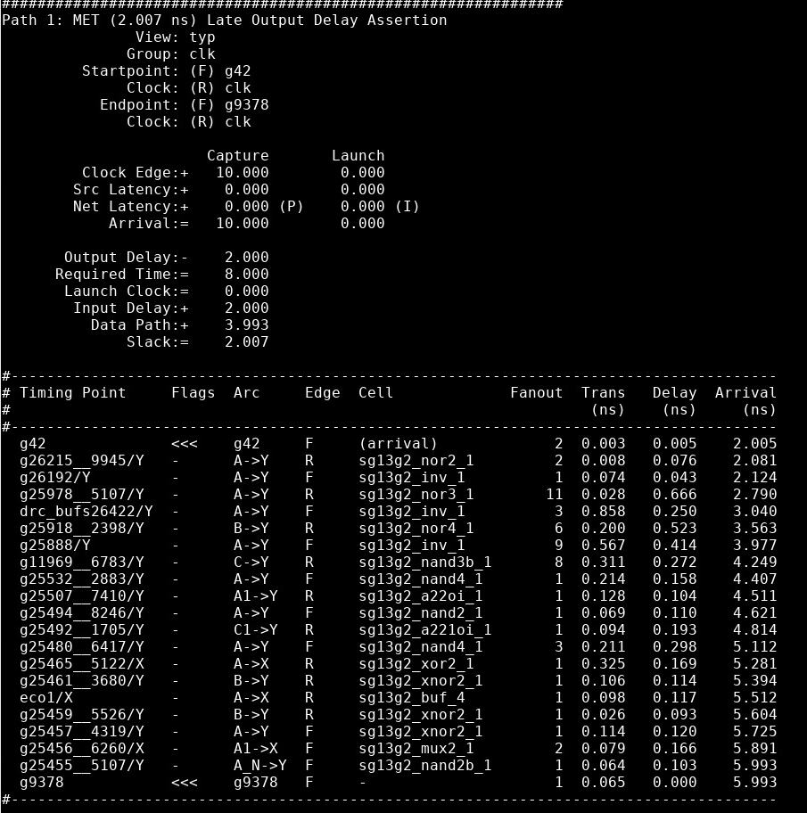

*Рисунок — Тот же путь после вставки буфера sg13g2_buf_4; добавленная ячейка представлена строкой eco1/X.*

По отображённым значениям:

| Показатель | До ECO | После ECO | Изменение |
| --- | ---: | ---: | ---: |
| Data Path, нс | 3,928 | 3,993 | +0,065 |
| Arrival, нс | 5,928 | 5,993 | +0,065 |
| Required Time, нс | 8,000 | 8,000 | 0 |
| Slack, нс | +2,072 | +2,007 | −0,065 |

В этом примере задержка пути увеличилась на **65 пс**, а временной запас уменьшился на ту же величину. Условие по-прежнему выполнено.

В строке `eco1/X` показан инкремент `Delay = 0,117 нс`. **Он не равен итоговому изменению задержки всего пути:** после вставки изменились нагрузки, фронты и задержки других участков.

Например, transition на выходе `g25459__5526/Y` уменьшился с 0,064 до 0,026 нс, а на выходе `g25461__3680/Y` увеличился с 0,075 до 0,106 нс. Поэтому нельзя описывать результат как одинаковое улучшение фронтов во всех точках пути.

Для сравнения вариантов X1/X2/X4 сохраняйте одинаковыми:

- исходную базу;
- точку и схему подключения;
- количество добавляемых буферов;
- условия MMMC и временные ограничения;
- порядок размещения, трассировки и экстракции.

При сравнении проверьте последовательность ячеек: после ECO худший путь между теми же startpoint и endpoint может проходить через другой набор ячеек. Учитывайте это при объяснении изменения slack.

**В задании оцениваются корректность ECO-операций и объяснение результата.** Улучшение slack или намеренное получение отрицательного запаса не являются обязательными результатами эксперимента.

## Часть II. Лабораторное задание

<a id="lab4-assignment"></a>

## 6. Задания и условия выполнения

<a id="lab4-environment"></a>

### Организация независимых запусков и ECO-экспериментов

Настройка Makefile и запуск реализации описаны в [основном README](README.md#main-preparation), открытие базы в debug — в [разделе проверки результата](README.md#main-checks). Для исследований дополнительно учитывайте следующее:

- При повторном независимом запуске задавайте отдельный `INNOVUS_IMPL_RUN_DIR`, чтобы не перезаписать предыдущие результаты.
- В имени базы используется `ENV_DESIGN` — имя проекта; `ENV_DESIGN_DIR` содержит путь к каталогу проекта.
- Для сравнения независимых изменений восстанавливайте одну и ту же исходную базу. Эксперимент с удалением начинайте из состояния после вставки буфера. Замену исходной ячейки можно выполнять из исходной базы; замену добавленного буфера — из состояния после его вставки.
- Каждому результату задавайте отдельное имя; сохраняйте исходную контрольную точку, команды ECO и соответствующие отчёты.

<a id="lab4-grade-4"></a>

### 6.1. Задание на «4»

Условия, материалы для сдачи и вопросы находятся в [основном README](README.md#main-grade-4).

<a id="lab4-grade-5"></a>

### 6.2. Задание на «5»

ECO-задание и десять дополнительных вопросов перенесены в [основной README](README.md#main-grade-5). Для выполнения экспериментов используйте [пошаговые ECO-команды](#lab4-eco-commands) и [разбор сравнения отчётов](#lab4-eco-comparison).
