# Лабораторная работа №4. Физическая реализация цифрового блока

В этой работе вы превратите схему после синтеза в физическую реализацию: разместите стандартные ячейки, построите тактовую сеть и соедините элементы проводниками. Затем проверите результат и сохраните данные для дальнейшего использования блока.

**Для оценки «4»** выполните основной маршрут на своём проекте с одним собственным floorplan, подготовьте материалы и ответьте на восемь основных вопросов в конце файла.

**В этом README собраны команды основного маршрута и экспорта, а также [задания на «4» и «5» с вопросами для защиты](#main-assignment).** [README.extra.md](README.extra.md) содержит углублённые пояснения, дополнительные настройки и пошаговые ECO-команды. Ссылки на него стоят рядом с соответствующими темами.

## Содержание

- [1. Из чего состоит маршрут](#main-route)
- [2. Временной путь, RC-параметры, setup и hold](#main-timing)
- [3. Подготовка проекта и запуск](#main-preparation)
- [4. Этапы физической реализации](#main-stages)
- [5. Итоговые проверки и чтение отчётов](#main-checks)
- [6. Сохранение результата и экспорт](#main-export)
- [7. Задания и защита](#main-assignment)
  - [7.1. Задание на оценку «4»](#main-grade-4)
  - [7.2. Задание на оценку «5»](#main-grade-5)

<a id="main-route"></a>

## 1. Из чего состоит маршрут

После логического синтеза известно, **какие ячейки нужны и как они соединены**. Физический маршрут определяет, **где эти ячейки будут находиться и как пройдут реальные соединения**.

Используйте подготовленный в [лабораторной №3](../lab3/README.md) floorplan. Он задаёт границы die/core, ряды размещения, расположение пинов и структуру питания.

Основная последовательность — **placement → CTS → routing**. На [рисунке](#main-fig-stages) показано, как меняется один и тот же блок.

<a id="main-fig-stages"></a>

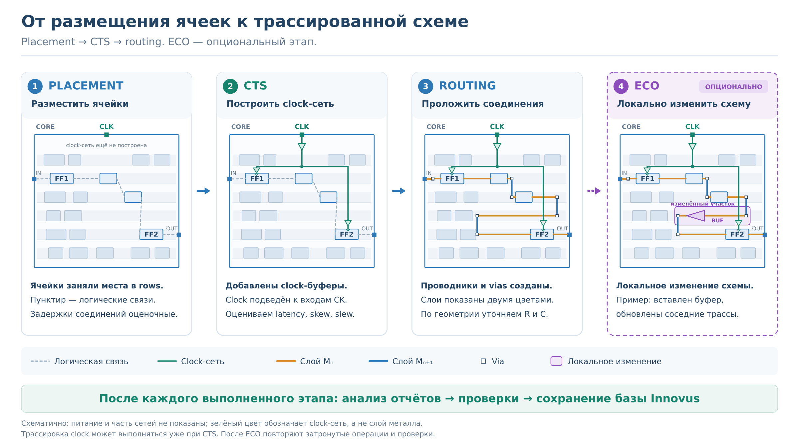

*Рисунок — Размещение ячеек, построение тактовой сети и трассировка. ECO — дополнительное локальное изменение реализации; оно относится к заданию на «5».*

После каждого этапа анализируют отчёты и сохраняют **полную базу Innovus** — состояние проекта, из которого можно продолжить работу. Оптимизация выполняется в предусмотренных flow операциях: инструмент может перемещать ячейки, менять их варианты и добавлять буферы, сохраняя функцию схемы.

Для запуска нужны следующие данные:

| Исходные данные | Для чего используются |
| --- | --- |
| **Netlist после синтеза** | Задаёт экземпляры ячеек и логические соединения между ними |
| **Технологические данные и LEF** | Описывают слои, правила, размеры ячеек, пины и ограничения для физической реализации |
| **Liberty (`.lib`)** | Содержит модели задержек ячеек, электрические характеристики и временные требования |
| **SDC/MMMC** | Задаёт clocks, временные ограничения и сценарии анализа |
| **Floorplan** | Определяет подготовленную область реализации, размещение пинов и питание |

**MMMC** позволяет анализировать одну схему в нескольких режимах и условиях. В конкретном **analysis view** объединяются ограничения режима и условия расчёта задержек. Для учебной работы используйте предоставленную конфигурацию и проверяйте, какие views активны для setup и hold.

Подробнее: [исходные данные](README.extra.md#lab4-inputs), [MMMC и analysis views](README.extra.md#lab4-mmmc).

<a id="main-timing"></a>

## 2. Временной путь, RC-параметры, setup и hold

### Что такое временной путь

**Временной путь** — последовательность ячеек и соединений, по которой инструмент рассчитывает распространение данных и проверяет время их прихода.

Для пути между регистрами передача выглядит так:

1. Активный фронт clock приходит к запускающему регистру.
2. Через задержку **clock-to-Q** новые данные появляются на его выходе **Q**.
3. Данные проходят комбинационную логику и соединения.
4. Данные приходят на вход **D** принимающего регистра, где проверяются условия захвата.

Пример такого пути и ветвей clock показан на [рисунке](#main-fig-timing-path).

<a id="main-fig-timing-path"></a>

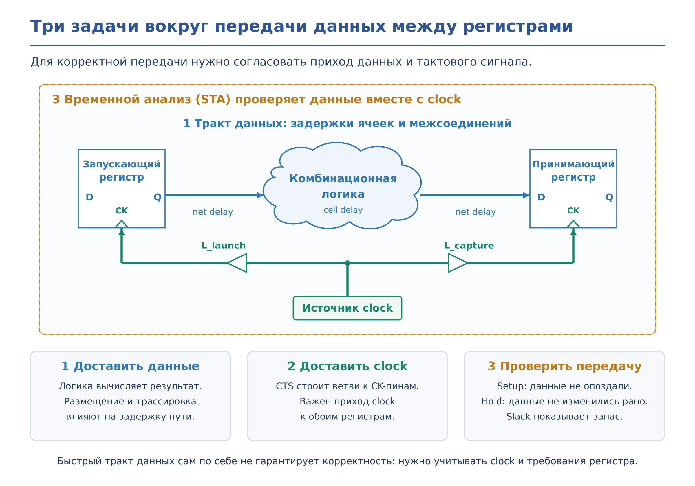

*Рисунок — Передача данных между регистрами. Временной анализ учитывает задержки ячеек и соединений, а также приход clock к запускающему и принимающему регистрам.*

**Cell delay** — задержка внутри ячейки, **net delay** — задержка межсоединения. Поэтому одинаковая логическая схема может иметь разное быстродействие при другом размещении, длине проводников или выборе вариантов ячеек.

Существуют также пути **от входного порта к регистру**, **от регистра к выходному порту** и **между портами**. Внешнюю часть передачи описывают input/output delays в SDC. Подробнее: [временные характеристики](README.extra.md#lab4-timing-basics), [ограничения на границах блока](README.extra.md#lab4-io-delays).

<a id="main-rc"></a>

### Почему межсоединения тоже вносят задержку

**Задержку вносят не только ячейки, но и соединяющие их проводники.** У межсоединений есть два важных параметра:

- **Сопротивление R** — проводники и переходы между слоями (**vias**) имеют конечное сопротивление.
- **Ёмкость C** — проводник образует ёмкости относительно подложки, опорных проводников и соседних линий, отделённых от него диэлектриком.

При переключении выход ячейки-драйвера заряжает или разряжает ёмкости соединения и входов потребителей. Из-за конечного сопротивления и ёмкости напряжение вдоль соединения изменяется не мгновенно: сигнал приходит к потребителю с задержкой, а его фронт может стать медленнее. Этот вклад межсоединения учитывается как **net delay**.

На R и C влияют длина и сечение проводников, выбранные слои, vias и расположение соседних линий. При прочих равных более длинное соединение обычно имеет большие сопротивление и ёмкость.

**Ёмкость проводника и входная ёмкость потребителей — разные составляющие нагрузки.** Изменение нагрузки влияет также на задержку управляющей ячейки — **cell delay**. Поэтому при анализе пути учитывают и ячейки, и соединения.

Происхождение ёмкости проводника показано на [рисунке](#main-fig-wire-capacitance).

<a id="main-fig-wire-capacitance"></a>

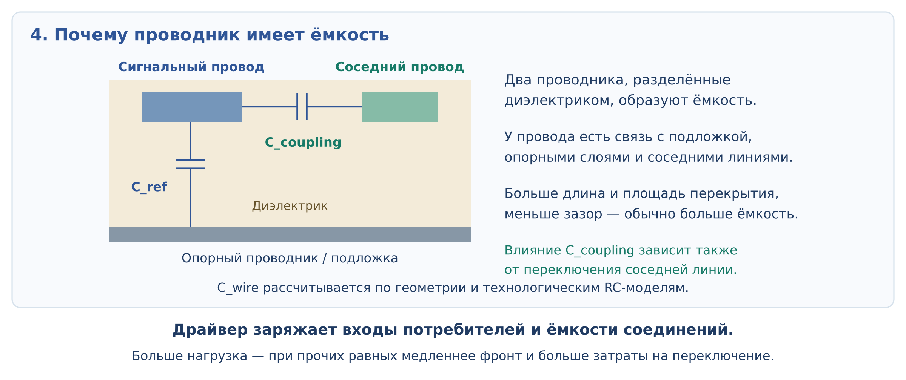

*Рисунок — Ёмкость проводника относительно опорного проводника и ёмкостная связь с соседней линией. На рисунке показано происхождение C; сопротивление проводника также учитывается при расчёте задержки.*

До трассировки инструмент использует **оценку RC**. После routing выполняют **RC-экстракцию**: рассчитывают паразитные сопротивления и ёмкости по полученной геометрии и технологическим данным, затем обновляют временной анализ. Поэтому предварительный timing после placement может отличаться от результата после routing даже при сохранении логической функции схемы.

Подробнее: [ёмкостная нагрузка и fanout](README.extra.md#fig-delay-transition-load), [RC corner — условия расчёта межсоединений](README.extra.md#lab4-rc-corner). Команды обновления RC приведены в [разделе об итоговых проверках](#main-checks).

### Что проверяют setup и hold

Для корректного захвата данные на входе **D** должны быть стабильны около активного фронта clock принимающего регистра:

- **Setup time** — необходимый интервал стабильности данных **до** фронта.
- **Hold time** — необходимый интервал стабильности данных **после** фронта.

Рассмотрим обычную однотактную передачу по положительным фронтам одного clock без skew. Данные запускаются при `t = 0` и предназначены для захвата при `t = T`, где `T` — период clock.

**Setup-проверка** определяет, успевают ли новые данные установиться до следующего фронта с учётом setup time. **Hold-проверка** определяет, не приходят ли новые данные слишком рано после исходного фронта и не мешают ли удержанию прежних данных. Эти случаи показаны на [рисунке](#main-fig-setup-hold).

<a id="main-fig-setup-hold"></a>

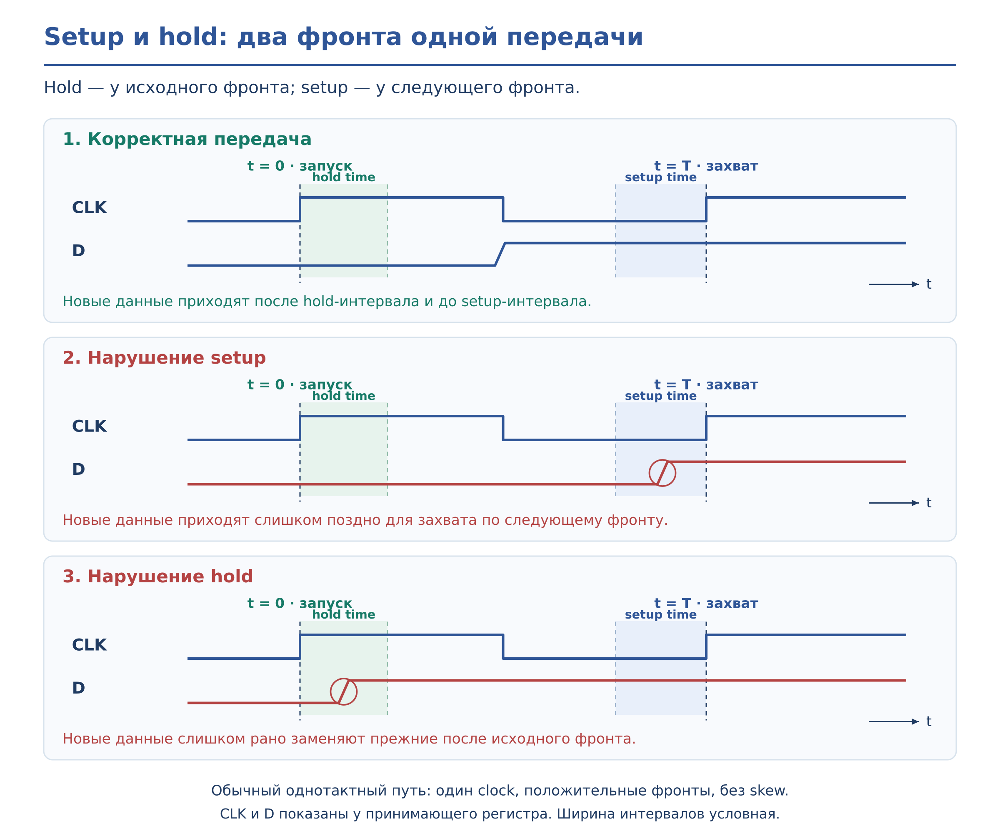

*Рисунок — Setup и hold для обычного однотактного пути. CLK и D показаны у принимающего регистра; ширина интервалов условная.*

При нарушении требований регистр может захватить неверное значение или перейти в метастабильное состояние: корректное значение и время установления выхода перестают гарантироваться. Отрицательный slack сообщает о нарушении расчётного условия, а не о том, что каждый такой переход обязательно приведёт к наблюдаемому сбою.

**Удлинение периода обычно помогает setup для такого пути, но не устраняет hold-нарушение:** hold проверяется около того же исходного фронта. В реальном анализе также учитываются задержки тактовой сети, uncertainty и выбранные условия расчёта.

Подробнее: [работа D-триггера](README.extra.md#lab4-registers), [setup, hold и метастабильность](README.extra.md#lab4-setup-hold), [вариации задержек и OCV](README.extra.md#lab4-ocv).

### Что означает slack

**Slack — временной запас** относительно проверяемого требования. Инструмент сопоставляет время прихода данных (**arrival time**) и требуемое время (**required time**):

| Проверка | Формула | Как понимать отрицательный slack |
| --- | --- | --- |
| **Setup** | `slack = required − arrival` | Данные приходят позже допустимого времени |
| **Hold** | `slack = arrival − required` | Новые данные приходят раньше допустимого времени |

Положительный slack означает выполнение условия с запасом, нулевой — выполнение на границе. Например, при setup required time = 8 нс и arrival time = 7,5 нс запас составляет 0,5 нс.

Всегда смотрите **тип проверки и analysis view**. Положительный setup slack одного пути не подтверждает выполнение hold или ограничений остальных путей и views.

<a id="main-preparation"></a>

## 3. Подготовка проекта и запуск


### 3.1. Настройте Makefile

Проверьте основные переменные:

| Переменная | Что указать |
| --- | --- |
| `ENV_DESIGN`, `ENV_DESIGN_DIR` | Имя и каталог своего проекта |
| `PDK_DIR` | Каталог PDK |
| `ENV_NETLIST` | Netlist после синтеза |
| `ENV_MMMC` | Конфигурацию временного анализа проекта |
| `ENV_FLOORPLAN_FILE` | Собственный floorplan из лабораторной №3 |
| `INNOVUS_IMPL_SCRIPT` | Управляющий Tcl-скрипт физической реализации |
| `INNOVUS_IMPL_RUN_DIR` | Рабочий каталог запуска |

При смене проекта проверьте имя floorplan-файла: в учебном Makefile оно может быть указано явно. Netlist, библиотеки, SDC/MMMC и floorplan должны соответствовать друг другу. Порядок загрузки проекта описан в [лабораторной №3](../lab3/README.md).

### 3.2. Соберите управляющий Tcl-скрипт

В `flow_scripts/flow.innovus.impl.tcl` подключите предоставленный файл процедур `innovus.step` и составьте последовательность их вызовов. Используйте реальные имена процедур из этого файла.

1. Загрузка проекта и floorplan.
2. Проверка настроек анализа и `check_timing`.
3. Placement, отчёты и сохранение базы.
4. CTS с предоставленными настройками, отчёты и сохранение базы.
5. Routing, вставка fillers, обновление RC, итоговые проверки и сохранение базы.
6. Экспорт LEF, GDS, Liberty, SPEF, netlist и SDF.

Сопоставьте вызовы процедур с основными командами внутри них:

| Операция | Команда или действие |
| --- | --- |
| Placement | `place_opt_design` |
| CTS | Настройка правил clock-сети, `create_clock_tree_spec`, загрузка спецификации и `clock_opt_design` |
| Routing | `route_design -global_detail` |
| Fillers | `add_fillers -base_cells $::env(ENV_FILLER_CELLS) -prefix FILLER` |
| Отчёты этапа | `time_design` с `-pre_cts`, `-post_cts` или `-post_route`; отдельно setup и `-hold` |
| Дополнительные отчёты | Предоставленная процедура `user_reports` |
| База этапа | `write_db ./db/DB.$::env(ENV_DESIGN).${STAGE}.enc` |

`STAGE` — имя текущего этапа, заданное процедурой. `user_reports` — процедура учебного flow. При использовании готовой процедуры её внутренние команды уже выполняются: повторно запускать тот же этап вручную не требуется.

Полные фрагменты команд приведены ниже: [placement](#main-placement), [CTS](#main-cts), [routing](#main-routing) и [экспорт](#main-export-commands). Для CTS сохраните предоставленные настройки ячеек, слоёв и правил трассировки clock.

В начале Tcl-скрипта создайте каталоги результатов:

```tcl
file mkdir ./db ./reports ./out
```

### 3.3. Проверьте проект до placement

После загрузки данных и до placement выполните в **Tcl-консоли Innovus** либо соответствующем месте управляющего скрипта:

```tcl
check_timing
report_clocks -description
get_db [get_db analysis_views -if {.is_setup}] .name
get_db [get_db analysis_views -if {.is_hold}] .name
```

Убедитесь, что загружен нужный модуль, определены clocks и активные views, заданы предусмотренные проектом input/output delays. В GUI проверьте die/core, rows, пины и питание.

Исправьте ошибки подготовки и временных ограничений. Намеренно оставленные предупреждения объясните. **Отсутствие замечаний `check_timing` ещё не подтверждает выполнение setup и hold.**

<a id="main-check-timing"></a>

### 3.4. Разбор замечаний `check_timing`

В отчёте обратите внимание на:

- последовательные элементы без определённого clock;
- точки и пути без необходимых ограничений — **unconstrained**;
- сообщения об отсутствии ограничений на входах и выходах.

Дополнительно проверьте, что для сигнальных портов заданы предусмотренные заданием input/output delays: необходимые значения `-min` и `-max` относительно нужного clock.

Состав проверок и названия сообщений зависят от версии Innovus. Пример результата показан на [скриншоте](#main-fig-check-timing).

<a id="main-fig-check-timing"></a>

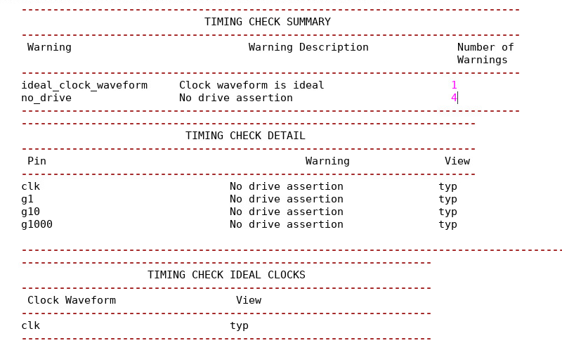

*Скриншот — Проверка условий временного анализа перед placement.*

Если отсутствие ограничения или исключение пути является намеренным, укажите соответствующие объекты и объясните причину. Не добавляйте `false_path` только для удаления предупреждений: исключение должно соответствовать работе схемы.

> **Примечание к скриншоту.** В демонстрационном примере намеренно не заданы ограничения драйверов входных портов, чтобы показать предупреждения `no_drive` и необходимость их разбора. Сообщение `ideal_clock_waveform` связано с использованием идеального clock: до построения тактовой сети такое состояние может быть предусмотрено маршрутом и само по себе не является ошибкой.

**Каждое замечание необходимо разобрать до запуска маршрута.** Определите затронутые объекты, исправьте причину в исходных данных или SDC/MMMC и повторите проверку.

Если базовых сообщений недостаточно, используйте [дополнительные отчёты для диагностики](README.extra.md#lab4-timing-checks).

### 3.5. Запустите реализацию

В **терминале Linux**, из корневого каталога проекта:

```bash
module load cadence/DDI/23.10.000
make innovus.impl
```

`module load` подключает окружение Cadence. Используйте явную цель `innovus.impl`: обычный `make` в учебном Makefile запускает Genus.

После каждого этапа проверьте журнал, отчёты и наличие сохранённой базы. При ошибке выполнения исправьте её причину и повторите необходимые операции.

Относительные пути `./db`, `./reports` и `./out` отсчитываются от рабочего каталога Innovus — по умолчанию `run/innovus_impl`. Каталог `out` отличается от `outputs`, указанного в некоторых переменных Makefile.

Подробнее о переменных и запуске: [окружение лабораторной](README.extra.md#lab4-environment).

<a id="main-stages"></a>

## 4. Этапы физической реализации

Следующие разделы поясняют этапы, которые выполняет собранный управляющий скрипт. При использовании готовых процедур повторно вызывать их внутренние команды вручную не нужно.

<a id="main-placement"></a>

### 4.1. Placement — размещение стандартных ячеек

На входе имеются netlist и подготовленный floorplan. **Placement выбирает положение стандартных ячеек в области core** с учётом связей, временных ограничений и доступного места.

Во время легализации инструмент располагает ячейки в допустимых рядах — **rows**, устраняет перекрытия и соблюдает ограничения размещения. Предусмотренная flow оптимизация может менять варианты ячеек и добавлять буферы, поэтому число и площадь ячеек после этапа могут отличаться от исходных.

#### Команды placement

Фрагмент выполняется внутри процедуры этапа: `STAGE` должна содержать его имя, `ENV_DESIGN` — имя проекта, а `user_reports` должна быть подключена из учебного flow.

```tcl
# Размещение и оптимизация до CTS
place_opt_design

# ------------------
# Reports
# ------------------

# Setup
time_design -pre_cts \
    -report_only \
    -expanded_views \
    -report_dir ./reports/R.${STAGE} \
    -report_prefix R.${STAGE}

# Hold
time_design -pre_cts \
    -report_only \
    -expanded_views \
    -report_dir ./reports/R.${STAGE} \
    -report_prefix R.${STAGE} \
    -hold

# Дополнительные отчёты учебного flow
user_reports

# Сохранение базы проекта
write_db ./db/DB.$::env(ENV_DESIGN).${STAGE}.enc
```

Без `-hold` команда `time_design` формирует setup-отчёты; второй вызов — hold-отчёты. `-expanded_views` добавляет отчёты по активным views, а `-report_dir` и `-report_prefix` задают каталог и имена результатов.

**`-report_only` использует уже подготовленные RC-данные.** После ручных изменений обновляйте анализ предусмотренным flow способом.

#### Результат placement

Пример размещения приведён на [рисунке](#main-fig-placement).

<a id="main-fig-placement"></a>

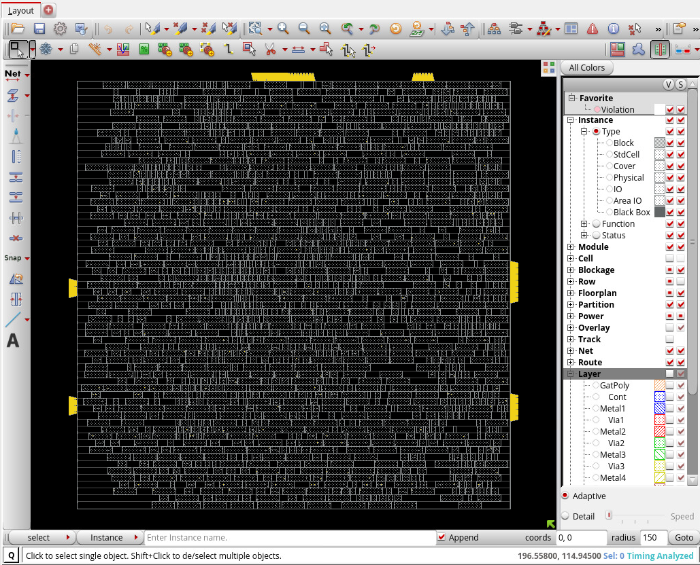

*Рисунок — Ячейки размещены в рядах core; видны занятые и свободные участки.*

**Что получаем:** размещённую и легализованную схему, предварительные timing reports и базу после placement. Эта база содержит положение ячеек и служит исходным состоянием для построения тактовой сети.

Проверьте легальность размещения, setup timing, площадь и **congestion** — оценочную нехватку ресурсов трассировки в отдельных областях. Для отчёта congestion используйте `report_congestion -overflow` либо `report_congestion -hotspot`; команда без этих параметров в учебной версии выдаёт ошибку.

Для timing используются отчёты `time_design -pre_cts`. Сигнальные соединения ещё не прошли окончательную трассировку, поэтому их RC оцениваются предварительно. Hold до CTS можно использовать для диагностики; окончательный вывод по нему делать рано.

Подробнее: [особенности формирования отчётов и дополнительные проверки после placement](README.extra.md#lab4-placement).

<a id="main-cts"></a>

### 4.2. CTS — синтез тактовой сети

После placement известны места регистров. **CTS (Clock Tree Synthesis) строит сеть доставки clock к их тактовым входам.** Инструмент добавляет и размещает clock-буферы и, при необходимости, инверторы, формирует ветви сети и выполняет предусмотренную flow оптимизацию.

Clock распространяется по физической сети с задержкой. **Clock latency** описывает время его распространения от выбранной опорной точки до конечной точки, а **skew** — разность приходов clock к рассматриваемым регистрам. CTS управляет этими характеристиками и длительностью фронтов с учётом заданных ограничений.

В учебном flow после настройки правил трассировки clock создаётся и загружается спецификация сети, затем вызывается `clock_opt_design`. Используйте полный предоставленный набор настроек допустимых ячеек, слоёв и правил.

#### Команды CTS

Переменные `BOT_CTS_LAYER_name`, `TOP_CTS_LAYER_name`, `BOT_CTS_LAYER_num` и `TOP_CTS_LAYER_num` задаются учебным окружением. Перед запуском также должны быть заданы `ENV_DESIGN`, `STAGE` и подключена `user_reports`.

```tcl
# ------------------
# Правила трассировки clock: двойная ширина и spacing
# ------------------
create_route_rule -name CTS_2W2S \
    -width_multiplier "$::env(TOP_CTS_LAYER_name):$::env(BOT_CTS_LAYER_name) 2" \
    -spacing_multiplier "$::env(TOP_CTS_LAYER_name):$::env(BOT_CTS_LAYER_name) 2"

create_route_type -name CTS_RULE \
    -bottom_preferred_layer $::env(BOT_CTS_LAYER_num) \
    -top_preferred_layer $::env(TOP_CTS_LAYER_num) \
    -route_rule CTS_2W2S

# Назначение правил категориям clock-соединений
set_db cts_route_type_leaf  CTS_RULE
set_db cts_route_type_trunk CTS_RULE
set_db cts_route_type_top   CTS_RULE

# ------------------
# Спецификация и синтез тактовой сети
# ------------------
create_clock_tree_spec -out_file ccopt_default.spec
source ccopt_default.spec

clock_opt_design

# ------------------
# Отчёты после CTS
# ------------------
time_design -post_cts -report_only -expanded_views \
    -report_dir ./reports/R.${STAGE} \
    -report_prefix R.${STAGE}

time_design -post_cts -report_only -expanded_views \
    -report_dir ./reports/R.${STAGE} \
    -report_prefix R.${STAGE} \
    -hold

user_reports

# ------------------
# Сохранение базы
# ------------------
write_db ./db/DB.$::env(ENV_DESIGN).${STAGE}.enc
```

В примере правило `CTS_2W2S` задаёт множители ширины и расстояния 2 для clock-соединений. После создания и загрузки спецификации `clock_opt_design` строит тактовую сеть и выполняет предусмотренную оптимизацию.

#### Результат CTS

Для просмотра результата в GUI включите **Net → Clock**. Пример показан на [рисунке](#main-fig-cts).

<a id="main-fig-cts"></a>

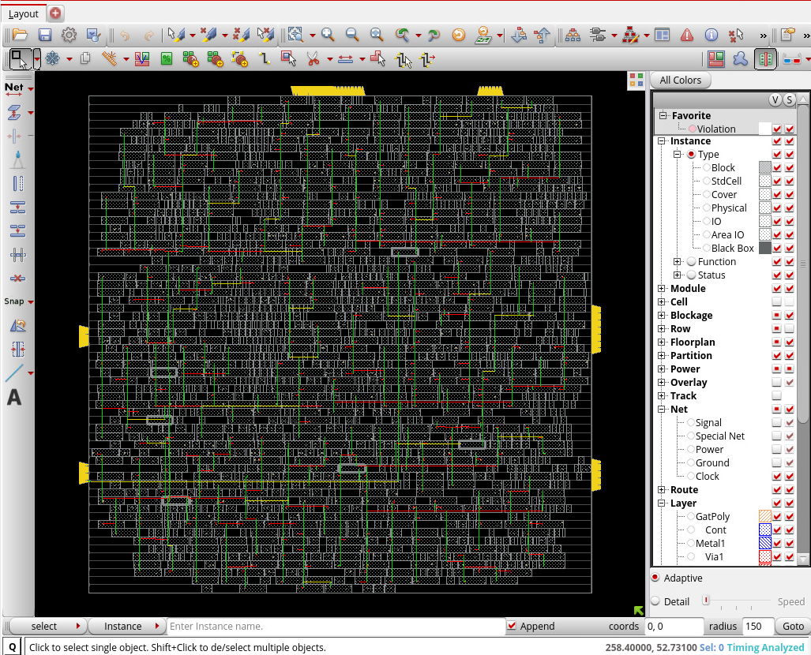

*Рисунок — Тактовые соединения среди размещённых стандартных ячеек.*

**Что получаем:** базу с построенной тактовой сетью и отчёты о её характеристиках. Она становится исходной для трассировки сигнальных цепей. Timing после CTS должен учитывать распространение clock по созданной сети — **propagated clock**.

Проверьте **setup и hold** с помощью `time_design -post_cts`, отдельно с `-hold`. Посмотрите задержки clock, skew и нарушения ограничений фронтов. Уменьшение skew само по себе не гарантирует улучшения всех путей: важны обе ветви clock и тракт данных.

Подробнее: [настройка CTS, отчёты и просмотр дерева в CTD](README.extra.md#lab4-cts).

<a id="main-routing"></a>

### 4.3. Routing — трассировка соединений

После размещения и CTS необходимо реализовать сигнальные связи физическими проводниками. **Routing прокладывает соединения на разрешённых слоях металлизации и создаёт межслойные переходы — vias.** При этом учитываются доступные ресурсы и геометрические правила.

В учебном flow используется `route_design -global_detail`: глобальная трассировка определяет направления прохождения соединений, детальная формирует их конкретную геометрию.

#### Команды routing

В процедуре этапа выполняются трассировка, добавление заполнителей, обновление RC, формирование отчётов и сохранение базы:

```tcl
# ------------------
# Глобальная и детальная трассировка
# ------------------
route_design -global_detail

# ------------------
# Заполнение свободных участков рядов
# ------------------
add_fillers \
    -base_cells $::env(ENV_FILLER_CELLS) \
    -prefix FILLER

# ------------------
# Обновление RC и отчёты после трассировки
# ------------------
reset_parasitics
extract_rc

time_design -post_route -report_only -expanded_views \
    -report_dir ./reports/R.${STAGE} \
    -report_prefix R.${STAGE}

time_design -post_route -report_only -expanded_views \
    -report_dir ./reports/R.${STAGE} \
    -report_prefix R.${STAGE} \
    -hold

user_reports

# ------------------
# Сохранение базы
# ------------------
write_db ./db/DB.$::env(ENV_DESIGN).${STAGE}.enc
```

`ENV_FILLER_CELLS` задаёт список допустимых ячеек-заполнителей. `reset_parasitics` удаляет прежние паразитные параметры, а `extract_rc` рассчитывает их для текущей реализации с настройками экстракции учебного flow.

#### Результат routing

Пример результата приведён на [рисунке](#main-fig-routing).

<a id="main-fig-routing"></a>

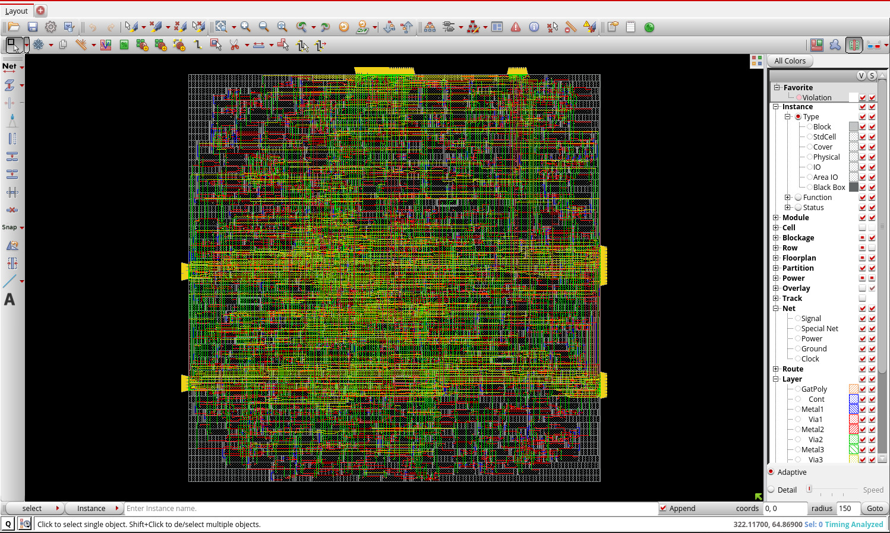

*Рисунок — Трассированная реализация с проводниками на разных слоях металлизации.*

Назначение добавляемых ячеек-заполнителей разобрано [ниже](#main-fillers-decap).

**Что получаем:** трассированную базу с проводниками и vias. По их геометрии и технологическим данным можно уточнить паразитные сопротивления и ёмкости — **RC**, а затем задержки соединений. Эта база используется для итоговых проверок, экспорта и дальнейших ECO-экспериментов.

Обновите RC, проверьте setup/hold, размещение, связность и геометрию по следующему разделу. Завершение трассировки само по себе не подтверждает выполнение всех требований.

Подробнее: [диагностика после routing](README.extra.md#lab4-routing) и [RC corner](README.extra.md#lab4-rc-corner).

<a id="main-fillers-decap"></a>

### 4.4. Filler и decap: зачем заполняют свободные участки рядов

#### Filler cells

После размещения между стандартными ячейками остаются свободные промежутки. Пример показан на [рисунке](#main-fig-gaps-before-fillers).

<a id="main-fig-gaps-before-fillers"></a>

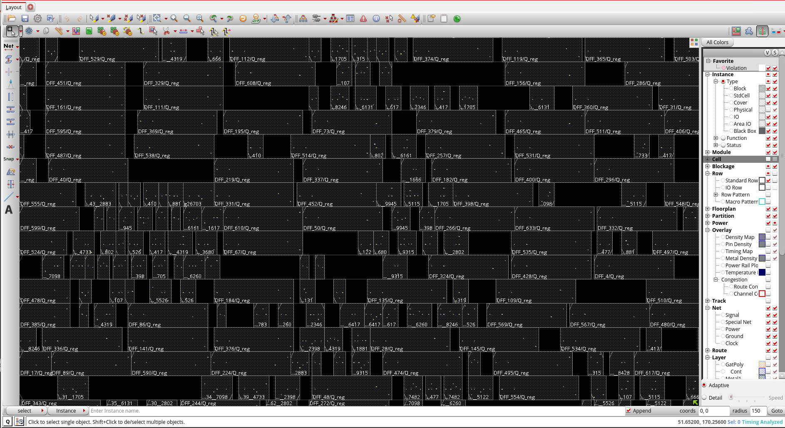

*Рисунок — Промежутки между стандартными ячейками до вставки заполнителей.*

**Filler cells — ячейки-заполнители**, которые занимают такие промежутки и обеспечивают предусмотренную библиотекой непрерывность физических структур, в том числе шин VDD/VSS. Обычный filler не выполняет логическую функцию. Ячейки разной ширины позволяют заполнить промежутки разных размеров.

Пример filler `sg13g2_fill_4` показан на [рисунке](#main-fig-filler-cell).

<a id="main-fig-filler-cell"></a>

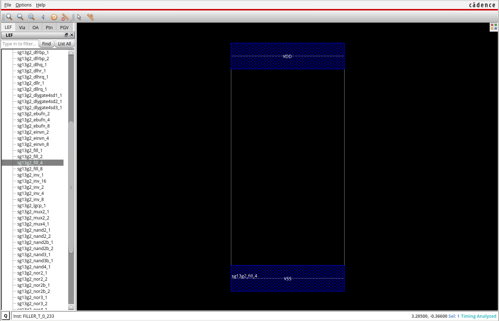

*Рисунок — Граница filler-ячейки и пины питания VDD/VSS в LEF-представлении.*

#### Decap cells

**Decap (decoupling capacitor)** — ячейка с развязывающей ёмкостью между **VDD и VSS**. Она накапливает заряд и помогает поддерживать локальное питание при кратковременном увеличении тока, например когда одновременно переключается много ячеек.

Decap отдаёт часть накопленного заряда нагрузке, а затем восполняет его от источника питания. Это помогает уменьшить кратковременную просадку напряжения. Принцип показан на [рисунке](#main-fig-decap-principle).

<a id="main-fig-decap-principle"></a>

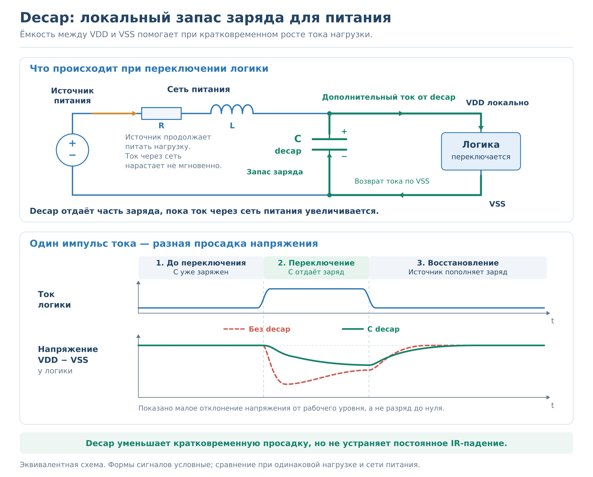

*Рисунок — Decap поддерживает питание при переключении логики и затем восстанавливает заряд. Формы сигналов условные.*

Decap-заполнитель позволяет использовать свободное место и для заполнения ряда, и для увеличения локальной ёмкости питания. Он не заменяет источник питания и не устраняет постоянное падение напряжения из-за высокого сопротивления сети. Количество и расположение decap выбирают с учётом библиотеки и потребностей схемы; заменять ими все fillers автоматически не требуется.

Пример `sg13g2_decap_4` показан на [рисунке](#main-fig-decap-cell).

<a id="main-fig-decap-cell"></a>

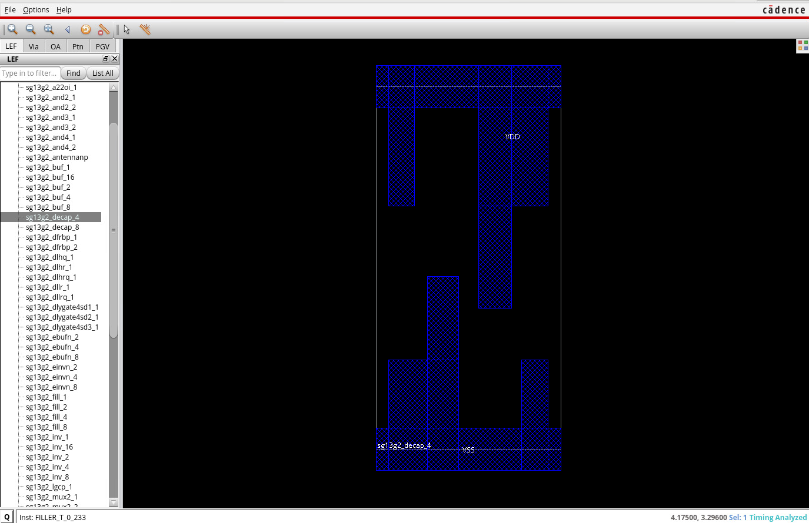

*Рисунок — Decap-ячейка с пинами VDD/VSS. LEF показывает физический абстракт; внутренняя структура конденсатора здесь не показана.*

В учебном flow команда `add_fillers` использует список `ENV_FILLER_CELLS`: в нём могут быть обычные fillers, decap-заполнители или их сочетание. После вставки проверяйте размещение и подключение питания. Префикс `FILLER` в имени экземпляра сам по себе не определяет тип библиотечной ячейки.

Подробнее: [физические структуры fillers](README.extra.md#lab4-fillers), [устройство decap, пример на инверторе и последствия просадки питания](README.extra.md#lab4-decap).

<a id="main-checks"></a>

## 5. Итоговые проверки и чтение отчётов


### Обновите RC и сформируйте отчёты

После routing и добавления fillers выполните следующую последовательность. Если она уже включена в процедуру маршрута, используйте полученные отчёты.

```tcl
file mkdir ./reports/final

reset_parasitics
extract_rc

time_design -post_route -report_only -expanded_views \
    -report_dir ./reports/final -report_prefix final_setup

time_design -post_route -report_only -expanded_views -hold \
    -report_dir ./reports/final -report_prefix final_hold

report_timing -late -path_type full_clock -max_paths 1
report_timing -early -path_type full_clock -max_paths 1

check_place
check_connectivity -type all -out_file ./reports/final/connectivity.rpt
check_drc -check_only all -out_file ./reports/final/drc.rpt
```

`extract_rc` рассчитывает паразитные сопротивления и ёмкости текущих соединений. Здесь `-report_only` используется после обновления RC. Настройки экстракции берите из учебного flow.

Сохраните отчёты и консольный журнал, включая результат `check_place` и подробные timing reports.

### Как прочитать `time_design` и `report_timing`

Сначала посмотрите сводки `time_design`: они помогают оценить состояние проекта в целом. **Setup и hold рассматривайте отдельно**, с учётом analysis views и групп путей.

| Показатель | Что означает |
| --- | --- |
| **WNS — Worst Negative Slack** | Худший отрицательный запас в рассматриваемой сводке; при отсутствии нарушений обычно отображается 0 |
| **TNS — Total Negative Slack** | Сумма отрицательных запасов по правилам формирования сводки |
| **Violating endpoints** | Число конечных точек, для которых обнаружено нарушение |

Затем откройте подробный `report_timing` для конкретного пути:

1. Найдите **startpoint**, **endpoint**, clock, analysis view и тип проверки — setup/late или hold/early.
2. Проследите строки пути: экземпляры ячеек, их пины и соединения. Посмотрите, где накапливается задержка.
3. Сопоставьте **arrival time**, **required time** и **slack**. Объясните знак slack по формулам из раздела 2.
4. При чтении полного отчёта учитывайте и ветви clock, особенно после CTS.

В таблице пути **Transition / Trans** описывает длительность фронта, а **Delay** — вклад соответствующего участка в задержку. Обозначения **R** и **F** означают нарастающий и спадающий переход сигнала в указанной точке. У пути между регистрами переход на выходе Q запускающего регистра и на входе D принимающего относится к данным; фронт clock указан отдельно.

Для сопоставления результатов используйте одинаковые условия анализа. Подробный разбор реального отчёта приведён в [extra](README.extra.md#lab4-timing-report).

Запишите, есть ли нарушения setup/hold, размещения, связности и геометрии. Для оценки «4» требуется **просмотреть и зафиксировать результат проверок**. Завершение команды без ошибки само по себе не подтверждает отсутствие нарушений в реализации.

<a id="main-debug"></a>

### Откройте сохранённый результат в GUI

Укажите в Makefile путь к фактически сохранённой базе, например:

```makefile
export ENV_DB = $(INNOVUS_IMPL_RUN_DIR)/db/DB.$(ENV_DESIGN).Route.enc
```

Суффикс `Route` должен совпадать с именем этапа в вашем flow, включая регистр символов. Затем в **терминале Linux**:

```bash
module load cadence/DDI/23.10.000
make innovus.debug
```

Учебный debug-скрипт должен восстановить базу из `ENV_DB`. Для открытия GUI в **Tcl-консоли Innovus**:

```tcl
gui_show
```

Покажите размещённые ячейки, тактовую сеть и сигнальную трассировку. Рабочий каталог debug-сеанса по умолчанию — `run/innovus_debug`; относительные пути при сохранении отсчитываются уже от него.

<a id="main-export"></a>

## 6. Сохранение результата и экспорт


Сохраните полные базы после **placement, CTS и routing** со всеми сопутствующими файлами. Экспортируйте итоговую реализацию в следующие форматы:

| Файл | Что содержит и зачем нужен |
| --- | --- |
| **LEF** | Размеры блока, пины и препятствия для трассировки; для размещения блока на следующем уровне иерархии |
| **GDS** | Геометрию топологии; для сборки и физических проверок |
| **Liberty (`.lib`)** | Временную модель блока для выбранного view; для анализа на следующем уровне иерархии |
| **SPEF** | Паразитные R и C соединений; для расчёта задержек |
| **Verilog netlist (`.v`)** | Итоговые ячейки и связи; для проверок и моделирования |
| **SDF** | Рассчитанные задержки и временные проверки; для моделирования с задержками |

**Все выходные файлы должны относиться к одному состоянию проекта.** После изменения реализации обновите RC, отчёты и затронутые экспортируемые данные.

<a id="main-export-commands"></a>

### Команды экспорта

Выполняйте этот фрагмент после [обновления RC и итоговых проверок](#main-checks). Если после них менялись ячейки или соединения, сначала повторите экстракцию и анализ.

Параметры должны быть заданы учебным flow:

| Переменная | Что задаёт |
| --- | --- |
| `top_layer` | Верхний слой, до которого формируются препятствия OBS в LEF-абстракте |
| `setup_views`, `hold_views` | Исходные списки активных views для setup и hold |
| `sdf_view` | Analysis view для выгрузки SDF |

В примере SPEF используется **RC corner `typ`**. Если в проекте другое имя, замените его в параметре `-rc_corner` и имени файла. RC corner и analysis view — разные объекты, даже если их имена совпадают.

```tcl
# Имя проекта и каталоги результатов
set design_name [get_db current_design .name]
file mkdir ./db ./reports/final ./out

# Активные RC corners
puts "Active RC corners: [all_rc_corners -active]"

# LEF: физический абстракт блока
write_lef_abstract \
    -stripe_pins \
    -top_layer $top_layer \
    -no_cut_obs \
    ./out/${design_name}.lef

# GDSII: геометрия топологии
write_stream ./out/${design_name}.gds \
    -lib_name DesignLib \
    -unit 1000 \
    -mode ALL

# Liberty: временная модель для каждого view
# Сформировать список views без повторений
set timing_model_views \
    [lsort -unique [concat $setup_views $hold_views]]

foreach view $timing_model_views {
    # Для извлечения ETM выбранный view активен
    # одновременно для setup и hold
    set_analysis_view \
        -setup [list $view] \
        -hold [list $view]

    write_timing_model \
        -view $view \
        -blackbox_2d \
        -force \
        -include_power_ground \
        -lib_name ${design_name}_${view} \
        -cell_name $design_name \
        ./out/${design_name}_${view}.lib
}

# Восстановить исходные списки активных views
set_analysis_view \
    -setup $setup_views \
    -hold $hold_views

# SPEF: паразитные параметры выбранного RC corner
write_parasitics \
    -spef_file ./out/${design_name}.typ.spef.gz \
    -rc_corner typ

# Verilog: итоговый netlist
write_netlist ./out/${design_name}.v

# SDF: задержки для выбранного analysis view
write_sdf ./out/${design_name}.sdf \
    -target_application verilog \
    -precision 4 \
    -view $sdf_view

# Полная итоговая база Innovus
write_db ./db/DB.${design_name}.final.enc
```

Цикл Liberty создаёт отдельную модель для каждого view без повторений. На время извлечения выбранный view активируется для setup и hold; после цикла восстанавливаются исходные списки.

Для полного GDS необходимы настроенное соответствие слоёв и геометрия библиотечных ячеек. Netlist и SDF используются с совместимыми моделями ячеек и должны относиться к одной реализации.

**База Innovus позволяет продолжить работу над реализацией, а экспорт передаёт отдельные представления другим инструментам.** При восстановлении должны оставаться доступны все сопутствующие файлы базы, библиотеки и данные учебного окружения.

Убедитесь, что файлы созданы в ожидаемом каталоге и в журнале нет ошибок. Проверки внутри Innovus не заменяют технологический signoff DRC/LVS.

Подробнее: [особенности LEF, ETM, SPEF и SDF](README.extra.md#lab4-export).

<a id="main-assignment"></a>

## 7. Задания и защита

| Оценка | Что необходимо выполнить |
| --- | --- |
| **«4»** | Основной маршрут на одном собственном floorplan, проверка результата, сохранение баз и отчётов, экспорт шести форматов и ответы на основные вопросы |
| **«5»** | Всё задание на «4», затем ECO-эксперименты: вставка буфера, его удаление и замена ячейки на вариант другой нагрузочной способности; ответы на дополнительные вопросы |

<a id="main-grade-4"></a>

### 7.1. Задание на оценку «4»

Цель базового задания — выполнить маршрут своего проекта, разобраться в назначении этапов и показать полученный результат. Используйте **один собственный floorplan** из лабораторной №3.

#### Что необходимо выполнить

1. **Подготовьте окружение и проект.** Настройте Makefile и управляющий Tcl-скрипт по [разделу 3](#main-preparation). Проверьте исходные данные и выполните `check_timing`. Исправьте ошибки подготовки, объясните намеренно оставленные предупреждения.
2. **Пройдите основной маршрут:** placement → CTS → routing. Используйте предоставленные процедуры и последовательности из [раздела 4](#main-stages), включая fillers, отчёты и сохранение баз.
3. **Проверьте результат.** Просмотрите реализацию в GUI, определите наличие setup/hold-нарушений, выполните проверки размещения, связности и геометрии. Зафиксируйте обнаруженные нарушения по [разделу 5](#main-checks).
4. **Сохраните материалы и выполните экспорт.** Подготовьте базы после трёх этапов, скрипт и отчёты. Выгрузите LEF, GDS, Liberty, SPEF, Verilog netlist и SDF по [разделу 6](#main-export); кратко объясните назначение каждого формата.
5. **Ответьте на основные вопросы.** На защите покажите свою реализацию, файлы и отчёты и объясните основные понятия своими словами.

<a id="main-deliverables"></a>

#### Материалы для сдачи на «4»

- [ ] Свой проект после placement, CTS и routing; сохранённые базы этих этапов.
- [ ] Makefile и управляющий Tcl-скрипт, позволяющие повторить запуск.
- [ ] Результат `check_timing` и объяснение оставленных предупреждений.
- [ ] Отчёты этапов, итоговые сводки setup/hold и подробные примеры путей.
- [ ] Результаты проверок размещения, связности и геометрии; перечень найденных нарушений.
- [ ] Файлы LEF, GDS, Liberty, SPEF, Verilog netlist и SDF.
- [ ] Краткое объяснение полученного результата и назначения сохранённых файлов.

<a id="main-questions"></a>

#### Основные вопросы для защиты на «4»

1. Что происходит на этапе **placement**?
2. Для чего выполняется **CTS** и что появляется в схеме после этого этапа?
3. Что происходит на этапе **routing**?
4. Что проверяют **setup и hold** и что означает положительный или отрицательный **slack**?
5. Для чего сохраняются **полная база Innovus и отчёты**? Как открыть сохранённый результат?
6. Какую информацию содержат итоговые файлы **LEF, GDS, Liberty (`.lib`), SPEF, Verilog-netlist (`.v`) и SDF**? Для каких задач используется каждый формат?
7. Как прочитать отчёт **`report_timing`**? Покажите на своём примере начало и конец пути, analysis view, последовательность ячеек, arrival time, required time и slack. Как определить, выполнено ли проверяемое временное условие?
8. Как прочитать сводку, сформированную **`time_design`**? Где указаны результаты setup или hold? Что означают **WNS, TNS и число нарушающих endpoints**? Чем эта сводка отличается от подробного отчёта одного пути?

Достаточно объяснить эти понятия своими словами и показать результаты своего проекта. Подробный разбор алгоритмов, внутреннего устройства ячеек и ручной расчёт задержек для базового задания не требуются.

<a id="main-grade-5"></a>

### 7.2. Задание на оценку «5»


Выполните [задание на оценку «4»](#main-grade-4) и дополнительно проведите **ECO-эксперименты в интерактивном режиме Innovus**.

Цель дополнительного задания — самостоятельно изменить реализованную схему, проследить влияние изменений на временные характеристики и объяснить результат. Принцип ECO, варианты ячеек и пошаговые команды приведены в [расширенной методичке](README.extra.md#lab4-timing-eco).

#### Что необходимо выполнить

1. **Откройте исходную базу в режиме debug.**

   Откройте базу после routing по [инструкции запуска debug в основном README](#main-debug).

   Сохраните исходную базу отдельно, чтобы иметь возможность повторить эксперимент.

2. **Выберите исследуемый путь.**

   С помощью `report_timing` выберите любой путь данных с заданными временными ограничениями и сохраните его исходный отчёт.

   Зафиксируйте startpoint, endpoint, analysis view, задержку пути и slack. Найдите в GUI ячейки и соединения выбранного пути.

   Для последующих сравнений используйте те же startpoint, endpoint и условия анализа.

3. **Вставьте неинвертирующий буфер.**

   Используйте `eco_add_repeater`, чтобы добавить буфер перед выбранным потребителем или группой потребителей.

   Проверьте, где появилась новая ячейка и как изменилось подключение сети.

   Выполните физические операции и обновление анализа из пункта 6. Сравните отчёт выбранного пути с исходным: найдите добавленный буфер и изменения задержек, transition и slack.

4. **Удалите ранее добавленный буфер.**

   Используйте `eco_delete_repeater`. Проверьте восстановление соединения между исходным драйвером и потребителями.

   Выполните действия из пункта 6, повторите анализ и объясните изменения.

   Учитывайте, что после повторного размещения и трассировки геометрия соединений может отличаться от исходной. Поэтому удаление буфера не гарантирует точного восстановления прежнего значения slack.

5. **Замените ячейку на другой вариант.**

   Используйте `eco_update_cell`, чтобы заменить буфер или другой комбинационный элемент на вариант **с той же логической функцией и другой нагрузочной способностью**, например X1 на X2 или X4.

   Выполните действия из пункта 6. Сравните задержки и transition заменённой ячейки и предыдущего каскада, а также итоговые задержку и slack всего пути.

   Объясните, почему изменение одной ячейки повлияло на другие участки пути.

6. **Завершайте физическую реализацию каждого исследуемого изменения.**

   После каждой операции из пунктов 3–5 используйте [порядок выполнения ECO из extra](README.extra.md#lab4-eco-commands):

   - разместите и легализуйте затронутые ячейки;
   - выполните ECO-трассировку;
   - восстановите fillers;
   - обновите паразитные параметры и временной анализ;
   - проверьте setup, hold и результаты физических проверок.

   Сравнивайте отчёты при одинаковых временных ограничениях и analysis views.

   **Окончательные выводы делайте после завершения физических операций и обновления RC.**

7. **Сохраните результаты и базы данных.**

   Сохраните исходную базу и отдельные базы после вставки, удаления и замены ячейки, Tcl-команды экспериментов, исходные и итоговые отчёты выбранного пути и сводки setup/hold.

   Кратко опишите изменения задержек, transition и slack. Используйте разные имена файлов и каталогов для каждого результата; укажите, из какой базы выполнена каждая операция.

<a id="main-grade-5-questions"></a>

#### Дополнительные вопросы для защиты на «5»

Базовые вопросы из [основного README](#main-questions) также входят в защиту. Дополнительно подготовьте ответы на следующие вопросы:

1. Чем отличаются варианты ячейки **X1, X2 и X4** при одинаковой логической функции?

2. Какие изменения выполняют команды `eco_add_repeater`, `eco_delete_repeater` и `eco_update_cell`?

3. Что представляют собой **RC-параметры межсоединений** и что задаёт **RC corner**?

4. Для чего используется **MMMC** и из каких основных объектов состоит его конфигурация?

5. Что такое **временной путь**? Где он может начинаться и заканчиваться?

6. Что такое **буфер** и для чего его используют при физической реализации схемы?

7. Что такое **congestion** и как перегруженность ресурсов трассировки влияет на реализацию схемы?

8. Из каких основных составляющих складывается **потребляемая мощность цифровой схемы**?

9. Для чего выполняют команду `check_timing` и какие проблемы она помогает обнаружить?

10. Что такое **filler cells и decap cells**, чем они отличаются и для чего используются?
