# Лабораторная работа №4
# Физическая реализация цифрового блока

**Размещение, синтез тактовой сети, трассировка и ECO в Cadence Innovus**

## Часть I. Краткая методичка

## 1. Цель работы

Освоить маршрут физической реализации цифрового блока в Cadence Innovus — от подготовленного floorplan до трассированной схемы. Изучить назначение размещения стандартных ячеек, синтеза тактовой сети, трассировки и локальных изменений средствами ECO. Научиться проверять корректность реализации, анализировать влияние размеров floorplan и выбора буферов на характеристики схемы, оценивать компромиссы между временными характеристиками, площадью и ресурсами трассировки, а также сохранять промежуточные и итоговые базы проекта.
### 1.1. Основные задачи топологического проектирования

После логического синтеза схема представлена **списком ячеек и связей между ними — netlist**. Физическое проектирование определяет размещение ячеек и соединяет их проводниками на слоях металлизации.

Основные этапы маршрута показаны на [рисунке](#fig-physical-design-sequence).

<a id="fig-physical-design-sequence"></a>

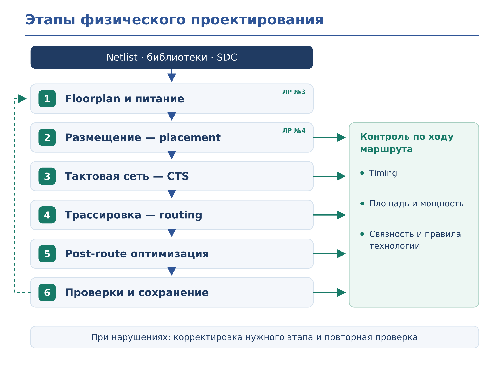

*Рисунок — Основные этапы физического проектирования.*

Задача — сохранить логическую функцию, выполнить временные ограничения и правила технологии при приемлемых площади и потребляемой мощности.

Эти требования взаимосвязаны: например, вставка буферов меняет задержки, площадь и потребление. Поэтому маршрут выполняется итерационно: **изменение реализации → проверка → корректировка**.

В лабораторной работе №3 подготовлены floorplan и сеть питания. В этой работе маршрут продолжается с размещения стандартных ячеек.
### 1.2. Основные временные и физические характеристики

#### Почему триггеры важны в цифровой схеме

Комбинационная логика вычисляет результат по текущим входным значениям, но сама по себе не хранит состояние. **Триггеры позволяют сохранять данные между тактами:** промежуточные результаты вычислений, значения счётчиков, состояние управляющих автоматов.

**D-триггер (flip-flop)** хранит один бит. Группа триггеров образует многоразрядный регистр. Далее при рассмотрении временного пути запускающий и принимающий элементы будем называть регистрами.

В синхронной схеме регистры разделяют вычисления на такты:

**захват данных → вычисление в комбинационной логике → захват результата.**

Передача данных между регистрами образует **временной путь**: запускающий регистр выдаёт данные после активного фронта clock, затем они проходят через комбинационную логику и межсоединения к входу D принимающего регистра.

Корректность передачи зависит от задержки данных и времени прихода clock к обоим регистрам. Поэтому физическое проектирование решает три связанные задачи:

- **Доставить данные:** разместить ячейки и построить соединения с подходящими задержками.
- **Доставить clock:** построить тактовую сеть до CK-пинов регистров.
- **Проверить передачу:** выполнить временной анализ с учётом трактов данных и clock, требований setup и hold.

Временной путь и связь этих задач показаны на [рисунке](#fig-register-physical-design-tasks).

<a id="fig-register-physical-design-tasks"></a>

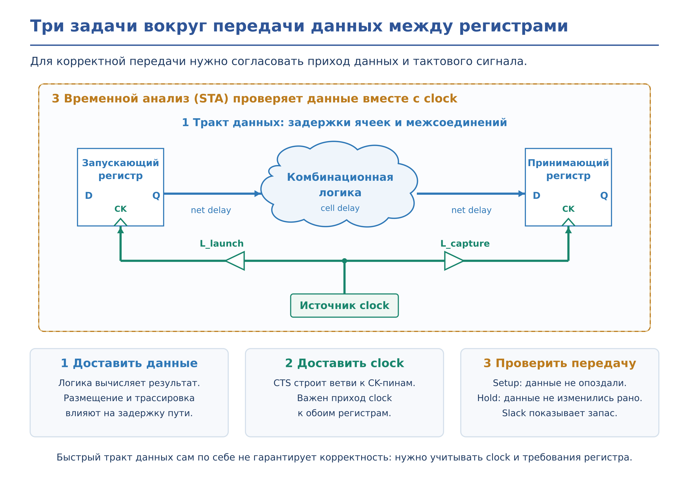

*Рисунок — Данные проходят от выхода Q запускающего регистра через логику и межсоединения к входу D принимающего. Тракт данных показан синим, тактовая сеть — зелёным. Временной анализ учитывает оба тракта.*

В задержку передачи данных входят **clock-to-Q запускающего регистра**, задержки логических ячеек (**cell delay**) и межсоединений (**net delay**). Ветви тактовой сети определяют моменты запуска и захвата данных.

Регистры задают границы многих временных путей. Также анализируют пути от входных портов к регистрам, от регистров к выходным портам и между входными и выходными портами.
#### Как D-триггер захватывает данные по фронту clock

D-триггер имеет вход данных **D**, тактовый вход **CK** и выход **Q**. По активному фронту CK он захватывает значение D и сохраняет его до следующего захвата.

Рассмотрим реализацию из двух последовательно соединённых **защёлок — master и slave**. Это один из вариантов устройства триггера; схема конкретной библиотечной ячейки может отличаться.

Защёлка работает в двух режимах:

- **Запись:** вход подключён к внутреннему узлу, и данные проходят внутрь.
- **Хранение:** вход отключён, а обратная связь поддерживает сохранённое состояние.

В статической CMOS-защёлке хранение можно организовать с помощью двух инверторов в замкнутой петле. Транзисторные ключи, управляемые clock, переключают защёлку между записью и хранением.

Для рассматриваемого D-триггера по положительному фронту последовательность следующая:

| Состояние clock | Master | Slave |
| --- | --- | --- |
| CK = 0 | Принимает данные с D | Хранит прежнее значение Q |
| CK ↑ | Переходит к хранению | Открывается для передачи данных master |
| CK = 1 | Хранит захваченное состояние | Передаёт сохранённые данные master к Q |

До положительного фронта изменения D проходят в master, но не достигают Q. При приходе фронта master отключается от D, а slave передаёт сохранённое состояние к выходу. После фронта новые изменения D уже не проходят через закрытый master.

При переходе CK обратно в 0 slave сохраняет выходное значение, а master начинает принимать данные для следующего захвата. Последовательность показана на [рисунке](#fig-clock-edge-inside).

<a id="fig-clock-edge-inside"></a>

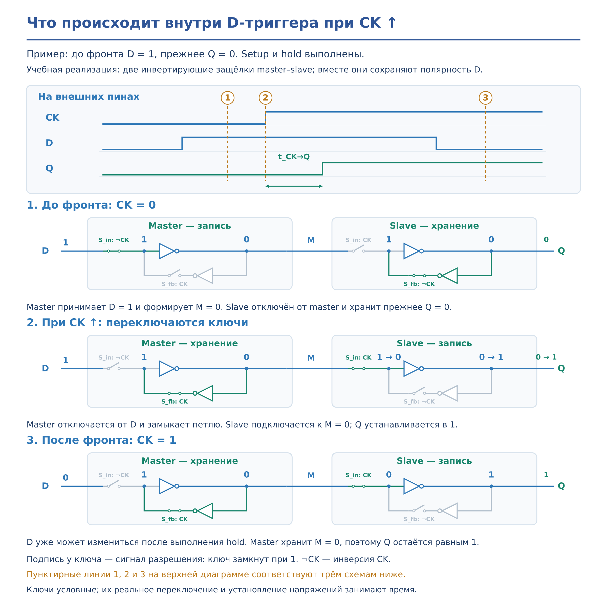

*Рисунок — Работа master и slave до положительного фронта CK, при его приходе и после установления выхода. Пунктирные линии 1, 2 и 3 соответствуют схемам ниже. У ключей указан сигнал разрешения: ключ замкнут при 1; ¬CK — инверсия CK.*

На рисунке каждая защёлка инвертирует данные, поэтому две последовательные защёлки сохраняют исходную полярность: захваченное D = 1 приводит к Q = 1.

**Захват по фронту возникает благодаря согласованному переключению двух защёлок.** Переключение транзисторов и изменение внутренних напряжений занимают время, поэтому Q устанавливается с задержкой **clock-to-Q**.

По фронту триггер захватывает значение D, а не обязательно переключает Q: если новое значение совпадает с прежним, выход остаётся неизменным.

#### Основные временные характеристики

| Характеристика | Что означает |
| --- | --- |
| **Период clock, T** | Интервал между соседними одноимёнными фронтами clock; частота f = 1/T |
| **Clock-to-Q** | Задержка от активного фронта clock до соответствующего изменения выхода регистра |
| **Cell delay / Net delay** | Задержка ячейки / межсоединения |
| **Setup time** | Требуемое время стабильности D до захватывающего фронта |
| **Hold time** | Требуемое время стабильности D после захватывающего фронта |
| **Clock latency** | Задержка прихода clock от выбранной опорной точки до clock-пина регистра |
| **Clock skew** | Разность задержек прихода clock к рассматриваемым регистрам |
| **Transition / slew** | Длительность нарастания или спада сигнала между заданными уровнями напряжения |
| **Fanout** | Количество входов-потребителей сети |
| **Capacitance** | Ёмкостная нагрузка входов потребителей и межсоединений |

Для пары регистров на [рисунке](#fig-register-physical-design-tasks) примем:

$$
t_{\mathrm{skew}} = L_{\mathrm{capture}} - L_{\mathrm{launch}},
$$

где $L_{\mathrm{launch}}$ и $L_{\mathrm{capture}}$ — задержки ветвей clock от общей опорной точки. Положительный skew означает более поздний приход clock к принимающему регистру.

#### Setup, hold и метастабильность

**Setup time и hold time — требования принимающего регистра к стабильности данных на входе D относительно активного фронта clock:**

- **Setup time** — данные должны установиться достаточно рано до фронта.
- **Hold time** — данные должны сохраняться достаточно долго после фронта.

Эти требования связаны с физической работой триггера. Внутренние напряжения меняются постепенно: транзисторы переключаются, а ёмкости узлов заряжаются и разряжаются. Входные данные должны успеть подготовить состояние к захвату и не помешать его завершению.

Рассмотрим внутренние узлы **X и Y** защёлки master:

- **При соблюдении setup и hold** к моменту захвата напряжения успевают приблизиться к устойчивым уровням: один узел — к 0, другой — к VDD. Обратная связь поддерживает это состояние.
- **При нарушении setup** D меняется слишком поздно: внутренние напряжения могут не успеть установиться до отключения входного тракта.
- **При нарушении hold** D меняется слишком рано после фронта: входной тракт ещё может влиять на узел хранения и мешать завершению захвата.

Сравнение этих случаев показано на [рисунке](#fig-flipflop-setup-hold).

<a id="fig-flipflop-setup-hold"></a>

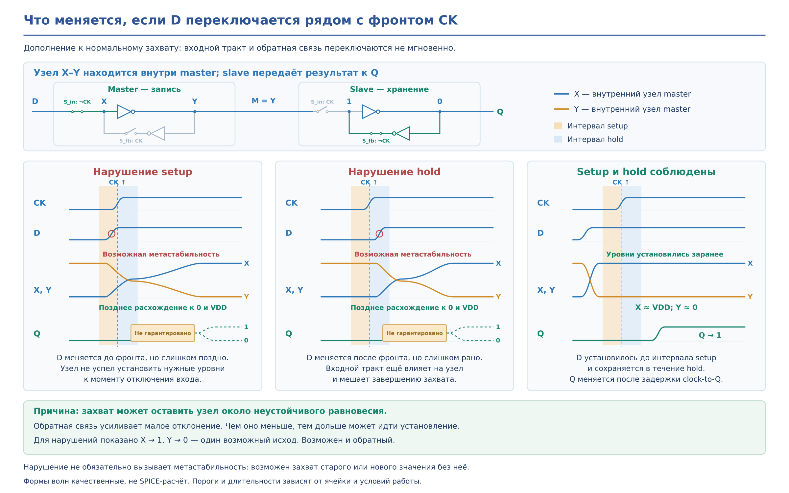

*Рисунок — Слева показано нарушение setup, в центре — нарушение hold, справа — корректный захват. X и Y — внутренние узлы master. Жёлтым выделен интервал setup, голубым — hold. Формы сигналов условные.*

**Метастабильность** возникает, если захват оставляет внутренний узел около **неустойчивого равновесия**. Напряжения находятся около порогов переключения инверторов, а устойчивое состояние ещё не установлено.

Обратная связь усиливает малое отклонение и постепенно переводит узел в одно из двух устойчивых состояний. Чем ближе начальное состояние к равновесию, тем дольше может длиться установление.

В результате Q может установиться позже ожидаемого и нарушить работу следующей логики. **Нарушение setup или hold не обязательно вызывает метастабильность:** возможен захват прежнего или нового значения без неё, но корректность захвата уже не гарантируется.

#### Проверки пути и временной запас

**Setup-проверка определяет, не приходят ли новые данные слишком поздно, hold-проверка — не приходят ли они слишком рано.**

Для обычного однотактного пути между регистрами одного clock без skew новые данные запускаются фронтом в момент $t=0$:

- **Hold** проверяет, что прежние данные на входе принимающего регистра сохраняются достаточно долго после исходного фронта.
- **Setup** проверяет, что новые данные успевают установиться перед следующим фронтом в момент $t=T$.

Различие проверяемых фронтов показано на [рисунке](#fig-setup-hold).

<a id="fig-setup-hold"></a>

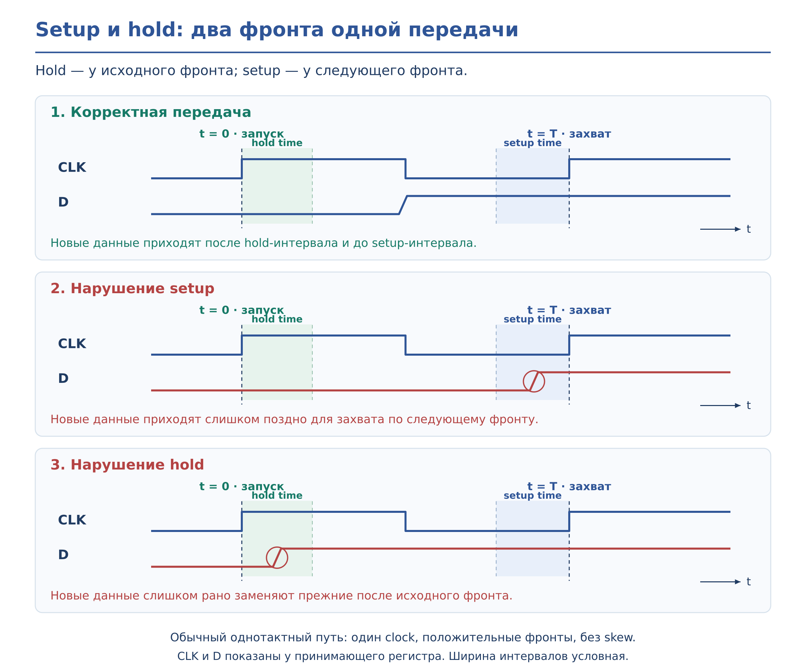

*Рисунок — Проверка hold относительно исходного фронта и setup относительно следующего.*

Setup и hold time — требования регистра, а **slack — запас выполнения соответствующей проверки всего пути**:

$$
Slack_{\mathrm{setup}} = Required_{\mathrm{setup}} - Arrival_{\mathrm{max}},
$$

$$
Slack_{\mathrm{hold}} = Arrival_{\mathrm{min}} - Required_{\mathrm{hold}}.
$$

Arrival — расчётное время прихода данных, required — предельное время для соответствующей проверки. Положительный slack означает выполнение условия с запасом, отрицательный — нарушение.

Уменьшение задержки тракта данных может улучшить setup, но ухудшить hold. Увеличение периода clock само по себе не исправляет hold обычного однотактного пути.

Для сводной оценки отдельно по setup и hold используют:

- **WNS** — худший отрицательный запас.
- **TNS** — сумму отрицательных запасов по учитываемым конечным точкам.

Правила сводки зависят от отчёта; поле `worst slack` может показывать и положительный запас.

#### Буферы и задержка распространения

**Буфер (buffer)** — логическая ячейка, которая сохраняет логическое значение сигнала: при 0 на входе на выходе устанавливается 0, при 1 — 1. Изменение выхода происходит с некоторой задержкой.

Основные применения буферов в физическом проектировании показаны на [рисунке](#fig-buffer-uses).

<a id="fig-buffer-uses"></a>

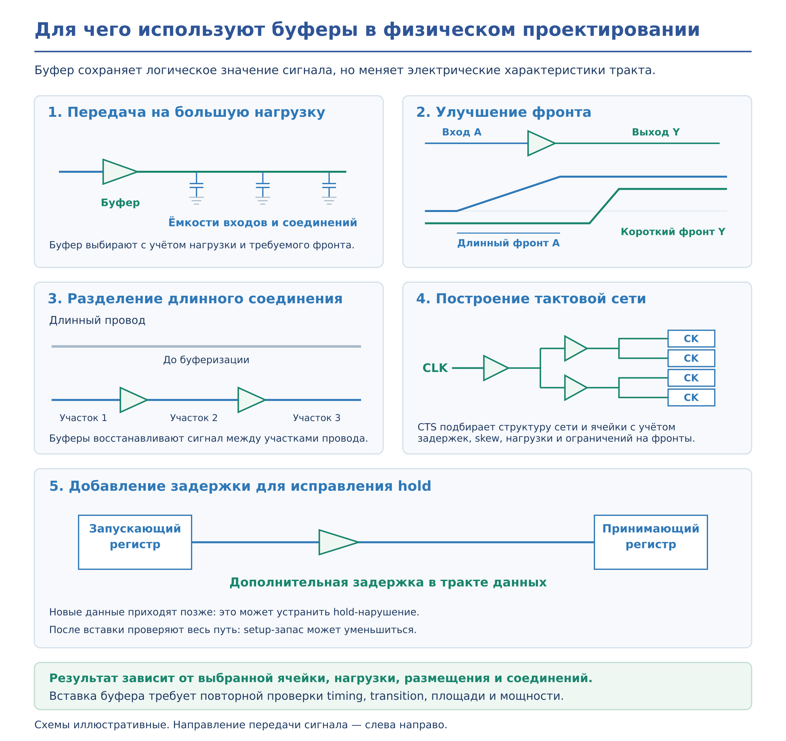

*Рисунок — Работа с ёмкостной нагрузкой, улучшение фронтов, буферизация длинных соединений, построение тактовой сети и добавление задержки для исправления hold.*

Буферы различаются нагрузочной способностью. Более мощный буфер обычно быстрее переключает большую нагрузку, но занимает больше площади и создаёт большую входную ёмкость для предыдущей ячейки. Поэтому вставка буфера требует проверки характеристик всего пути.

**Задержка распространения (delay)** — время между изменением сигнала на входе и соответствующим изменением на выходе. Её измеряют между пересечениями заданных уровней напряжения, как показано на [рисунке](#fig-buffer-delay).

<a id="fig-buffer-delay"></a>

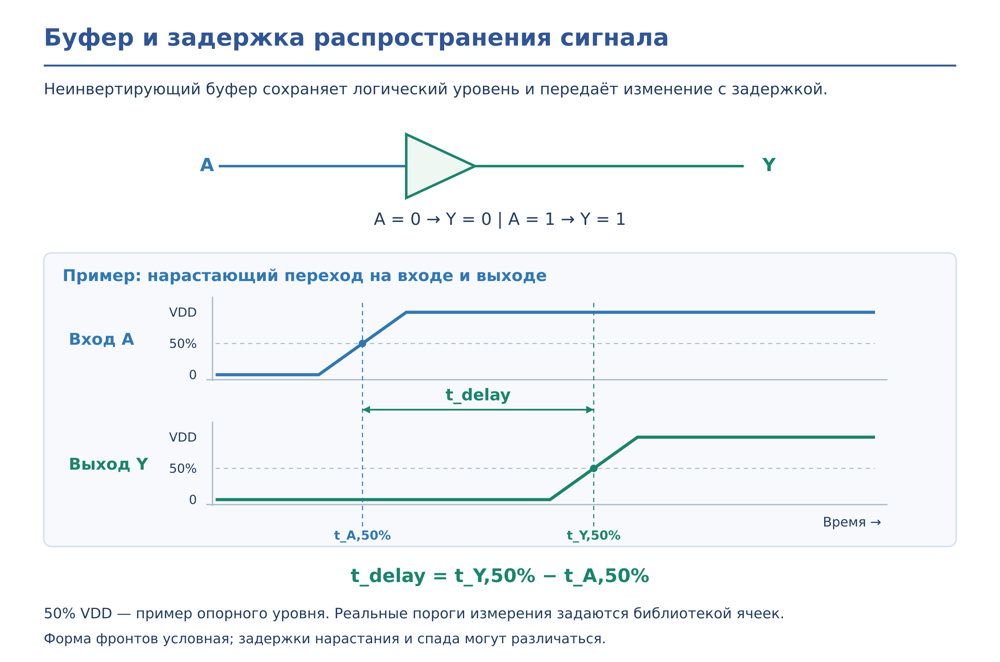

*Рисунок — Измерение задержки между входом и выходом неинвертирующего буфера.*

Для показанного примера:

$$
t_{\mathrm{delay}} = t_{Y,50\%} - t_{A,50\%}.
$$

Задержка зависит от типа ячейки, длительности входного фронта, выходной нагрузки и условий работы. Пороги измерения задаются библиотекой ячеек; 50% — пример.

#### Длительность фронта — transition

**Transition (slew)** — время нарастания или спада одного сигнала между заданными уровнями напряжения. Чем больше transition, тем медленнее изменяется сигнал.

На [рисунке](#fig-transition) показано измерение длительности нарастающего и спадающего фронтов между уровнями 20% и 80% напряжения питания.

<a id="fig-transition"></a>

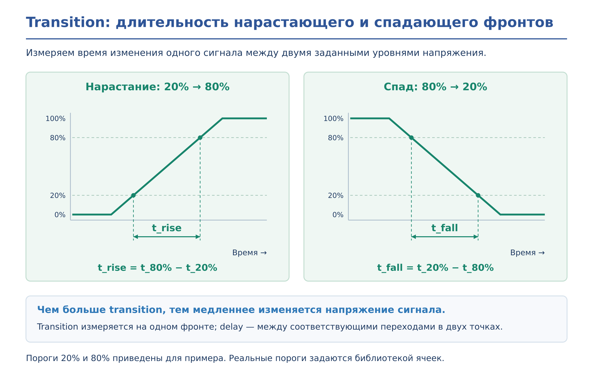

*Рисунок — Измерение длительности нарастающего и спадающего фронтов.*

Для нарастающего фронта:

$$
t_{\mathrm{transition,rise}} = t_{80\%} - t_{20\%}.
$$

Для спадающего фронта:

$$
t_{\mathrm{transition,fall}} = t_{20\%} - t_{80\%}.
$$

Реальные пороги измерения задаются библиотекой ячеек.

Медленный входной фронт обычно увеличивает задержку следующей ячейки и может повышать её внутреннюю мощность. Поэтому при анализе пути проверяют и задержки, и transition, включая соблюдение заданных ограничений на длительность фронтов.

#### Fanout и ёмкостная нагрузка

Выход ячейки нагружен входами потребителей и соединяющим их проводником, как показано на [рисунке](#fig-delay-transition-load). В упрощённой модели:

$$
C_{\mathrm{load}} \approx \sum_i C_{\mathrm{in},i} + C_{\mathrm{wire}}.
$$

<a id="fig-delay-transition-load"></a>

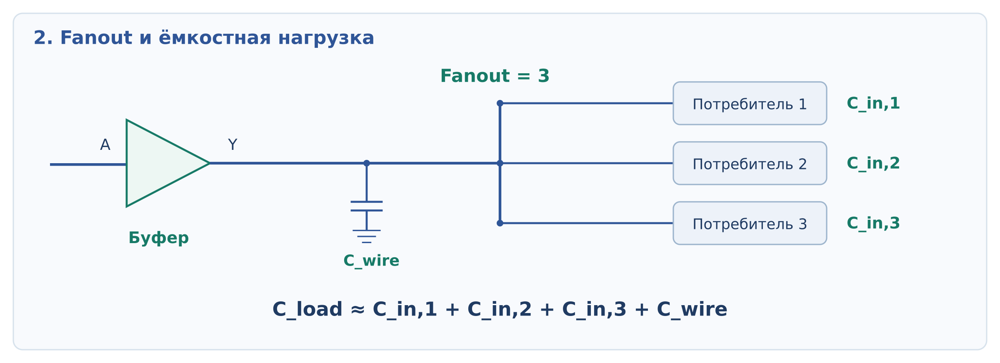

*Рисунок — Три входа-потребителя и ёмкость соединения образуют нагрузку выходного буфера.*

**Входная ёмкость потребителя** возникает прежде всего из-за затворов MOS-транзисторов: затвор отделён от полупроводника диэлектриком. Один вход ячейки может управлять несколькими затворами. Их ёмкости и паразитные ёмкости внутренних входных соединений учитываются моделью пина в `.lib`. Физический смысл показан на [рисунке](#fig-input-capacitance).

<a id="fig-input-capacitance"></a>

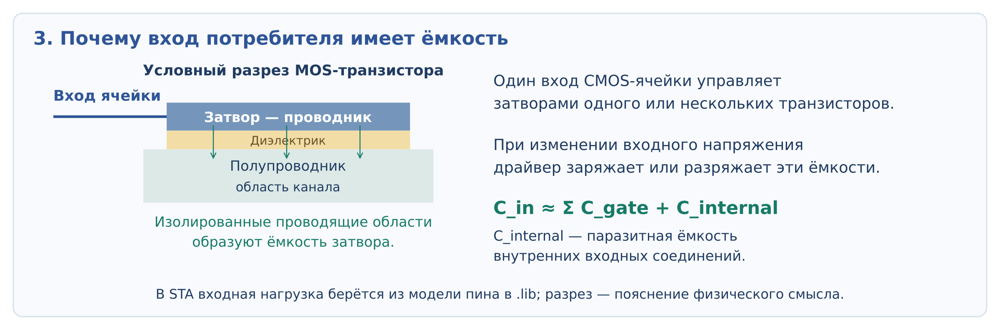

*Рисунок — Затворы транзисторов и внутренние соединения формируют входную ёмкость ячейки.*

**Ёмкость проводника** возникает из-за его связи через диэлектрик с подложкой, опорными проводниками и соседними сигнальными линиями. Она зависит от геометрии и технологических параметров. Влияние связи с соседними линиями зависит также от их переключения, как поясняется на [рисунке](#fig-wire-capacitance).

<a id="fig-wire-capacitance"></a>

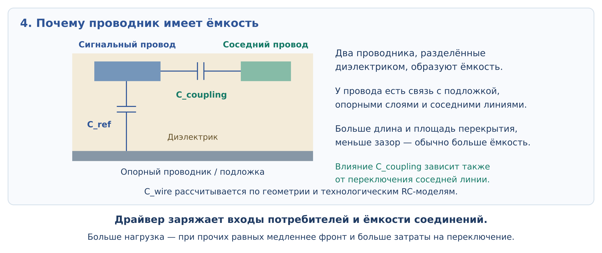

*Рисунок — Ёмкость относительно опорного проводника и ёмкостная связь с соседней линией.*

Драйвер заряжает и разряжает эти ёмкости. При прочих равных увеличение нагрузки замедляет фронты и увеличивает затраты энергии на переключение. **Одинаковый fanout не означает одинаковую нагрузку:** потребители и соединения могут иметь разные ёмкости.

#### Физические характеристики

| Показатель | Что показывает |
| --- | --- |
| **Площадь ячеек** | Сумму площадей учитываемых ячеек; отличается от площади core и die |
| **Utilization** | Долю доступной площади размещения, занятую учитываемыми ячейками |
| **Congestion** | Загруженность ресурсов трассировки в выбранной области |
| **Потребляемая мощность** | Затраты мощности на переключения, внутренние процессы в ячейках и утечки |

**Площадь ячеек и utilization** характеризуют заполнение области размещения. В упрощённом случае, когда весь core доступен для ячеек:

$$
Utilization = \frac{\sum_i A_{\mathrm{cell},i}}{A_{\mathrm{core}}}\cdot100\%.
$$

Пример одинаковых core с разной заполненностью показан на [рисунке](#fig-area-utilization).

<a id="fig-area-utilization"></a>

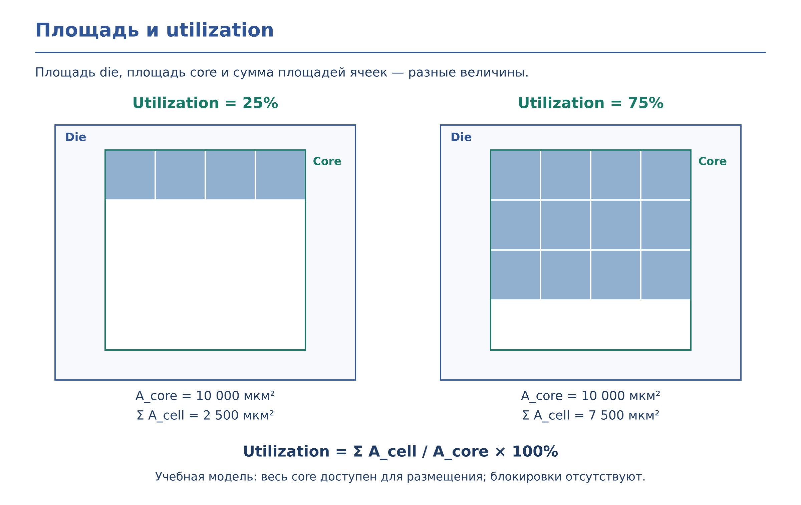

*Рисунок — Различие площади core и суммарной площади ячеек; utilization 25% и 75%.*
**Congestion** характеризует загруженность ресурсов трассировки. На слоях металлизации задаются **треки** — линии сетки, определяющие возможные положения проводников. Для каждого слоя обычно устанавливается предпочтительное направление трассировки: горизонтальное или вертикальное.

Доступные ресурсы ограничены: часть треков может быть занята другими соединениями или недоступна из-за препятствий и технологических ограничений. Если потребность в соединениях превышает доступные ресурсы, возникает **перегрузка**. Пример для одного слоя показан на [рисунке](#fig-routing-congestion).

<a id="fig-routing-congestion"></a>

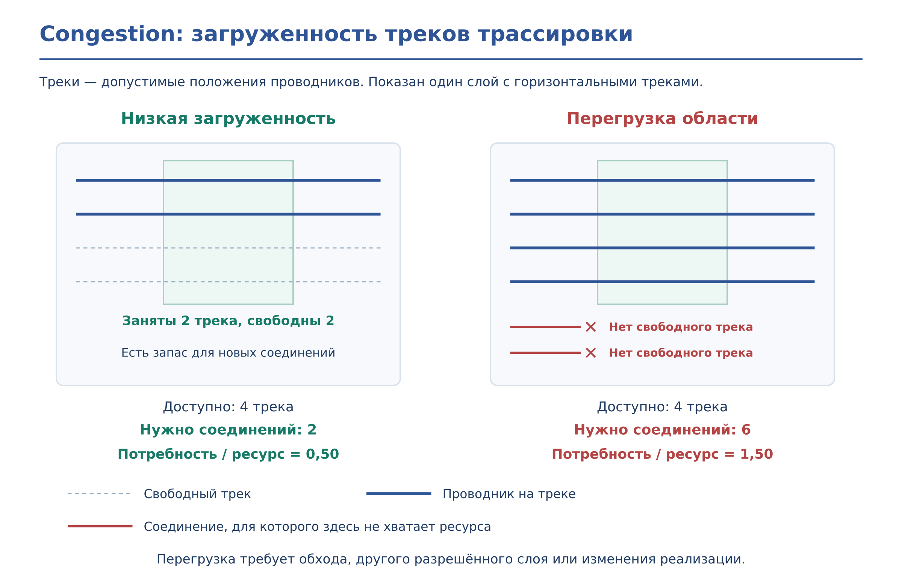

*Рисунок — Слева заняты два из четырёх треков. Справа для шести соединений четырёх треков недостаточно.*

В реальном проекте congestion анализируют **по участкам, слоям и направлениям**. Общая карта помогает найти проблемную область, а послойный анализ — определить, где именно не хватает ресурсов.

Простая суммарная оценка может скрывать перегрузку отдельного слоя, как показано на [рисунке](#fig-congestion-by-layer).

<a id="fig-congestion-by-layer"></a>

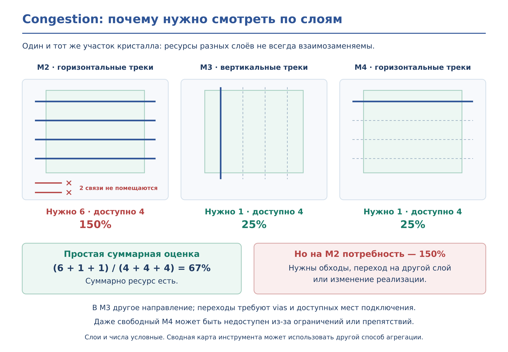

*Рисунок — Суммарная потребность составляет 67% ресурсов, но на M2 достигает 150%. Числа условные; способ агрегации в инструменте может отличаться.*

Свободные ресурсы другого слоя не всегда могут заменить перегруженные: необходимо учитывать направление трассировки, препятствия, доступ к пинам и допустимые положения переходов **vias**.

Если прямое соединение построить нельзя, трассировщик может использовать обход или перейти на другие разрешённые слои. Пример такого пути показан на [рисунке](#fig-routing-layer-detour).

<a id="fig-routing-layer-detour"></a>

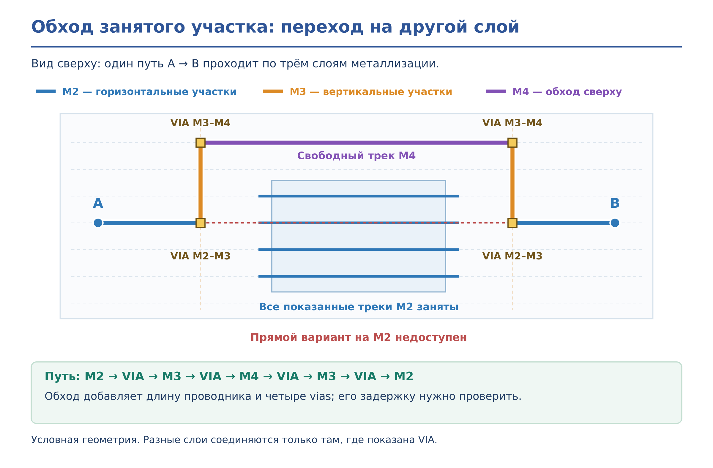

*Рисунок — Вид сверху: соединение A–B обходит занятый участок M2 через M3 и M4. Каждый слой показан своим цветом, жёлтые квадраты обозначают vias.*

Обход добавляет длину проводника и переходы между слоями, что меняет сопротивление, ёмкость и задержку соединения. Поэтому устранение перегрузки требует повторной проверки временных характеристик.

**Низкая utilization не гарантирует низкий congestion:** даже при свободном месте для ячеек множество соединений может проходить через одну небольшую область.

**Потребляемая мощность** складывается из трёх составляющих:

- **Мощность переключения нагрузок (switching power)** — затраты на заряд и разряд ёмкостей межсоединений и входов потребителей. Приближённо:

  $$
  P_{\mathrm{switching}} \approx \alpha C_{\mathrm{load}}V^2f,
  $$

  где $\alpha$ — среднее число переходов 0 → 1 за период clock, $C_{\mathrm{load}}$ — переключаемая ёмкость, $V$ — напряжение питания, $f$ — частота clock.

- **Внутренняя мощность (internal power)** — затраты на переключение внутренних ёмкостей ячейки и кратковременный сквозной ток между VDD и VSS. Например, во время изменения входного уровня CMOS-инвертора PMOS и NMOS могут некоторое время проводить одновременно.

- **Мощность утечек (leakage power)** — потребление даже без переключений. Закрытый транзистор не является идеальным разрывом: через него и другие структуры протекают малые токи. Утечки зависят от технологии, температуры, напряжения и состояния ячейки.

Первые две составляющие относятся к **динамической мощности**, утечки — к **статической**:

$$
P_{\mathrm{total}} =
P_{\mathrm{switching}} +
P_{\mathrm{internal}} +
P_{\mathrm{leakage}}.
$$

Механизмы потребления показаны на [рисунке](#fig-power-components). Внутренняя мощность и утечки поясняются на примере CMOS-инвертора, границы которого выделены пунктиром.

<a id="fig-power-components"></a>

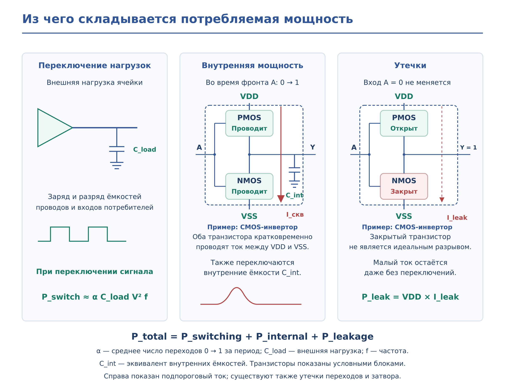

*Рисунок — Переключение внешней нагрузки, внутренние потери при переключении и утечки в устойчивом состоянии.*

Сравнивать результаты следует при одинаковых условиях: clocks, analysis views, правилах подсчёта площади и модели активности для оценки мощности.


```text
  ____ _____ ___  ____
 / ___|_   _/ _ \|  _ \
 \___ \ | || | | | |_) |
  ___) || || |_| |  __/
 |____/ |_| \___/|_|
```


### 1.3. Компромиссы при физическом проектировании

Физическое проектирование — поиск реализации, которая одновременно выполняет несколько требований. Изменение, полезное для одного показателя, может ухудшить другой. Часто обсуждают **PPA: Power, Performance, Area** — мощность, быстродействие и площадь. Однако связность, технологические правила и выполнение обязательных временных ограничений остаются условиями допустимости результата.

| Решение | Возможная польза | Возможная цена |
| --- | --- | --- |
| Ускорить тракт данных | Улучшить setup | Уменьшить hold-запас, если минимальная задержка этого тракта также сократится |
| Добавить задержку для исправления hold | Улучшить hold | Ухудшить setup, увеличить число ячеек и занимаемую площадь |
| Применить более мощную ячейку | Улучшить управление нагрузкой и выходной transition, иногда уменьшить задержку | Увеличить площадь и входную нагрузку на предыдущую ячейку; возможно увеличение мощности |
| Добавить буферы | Разделить нагрузку и улучшить передачу сигнала по длинному соединению | Добавить собственные задержки, площадь и затраты мощности |
| Уменьшить core | Сократить площадь блока и потенциально длины соединений | Увеличить плотность и риск congestion, усложнить трассировку |
| Увеличить core | Дать больше ресурсов размещению и трассировке | Увеличить площадь; некоторые соединения могут стать длиннее |
| Усложнить clock-сеть | Улучшить отдельные характеристики доставки clock | Увеличить число clock-ячеек, проводников и переключаемую ёмкость |

Зависимости в таблице не являются безусловными: результат проверяется по отчётам. В частности, вставка буфера не обязана ухудшать setup, а более мощная ячейка не обязана ускорять весь путь.

Компромисс setup/hold хорошо виден при добавлении задержки в тракт данных. Если задержка возросла и для max-, и для min-анализа, данные приходят позже: это может помочь hold, но уменьшить setup-запас. Поэтому после такого изменения проверяют обе характеристики. Раздельная работа с setup и hold, включая контроль ухудшения setup при hold-исправлениях, отражена, например, в [документации оптимизатора OpenROAD](https://openroad.readthedocs.io/en/latest/main/src/rsz/README.html).

Skew также нельзя оценивать только по принципу «меньше — всегда лучше». В простом пути одного clock более поздний приход clock к принимающему регистру относительно запускающего, при прочих равных, даёт больше времени для setup, но ужесточает hold. Изменение clock-сети затрагивает несколько путей, поэтому оценивается результат всех требуемых проверок.

В этой работе оба дополнительных эксперимента демонстрируют компромиссы: изменение размеров floorplan влияет на размещение и соединения, а ECO-вставка буферов — на задержки, фронты, нагрузки и временные запасы. Цель исследования — объяснить изменения, а не получить улучшение всех показателей одновременно.

## 2. Исходные данные

Используйте проект из предыдущих лабораторных работ. Демонстрационный проект преподавателя показывает порядок работы с инструментом и не заменяет ваш проект.

Для выполнения работы необходимы:

- синтезированный netlist, прошедший проверку эквивалентности в лабораторной №2;
- временные ограничения SDC и конфигурация MMMC;
- технологические и библиотечные файлы учебного окружения;
- подготовленный floorplan и сеть питания из лабораторной №3;
- предоставленные преподавателем процедуры физической реализации.

Объект реализации — тот модуль, для которого подготовлен исходный floorplan. Раздельная физическая реализация всех модулей и последующая иерархическая интеграция в это задание автоматически не входят.

Файл floorplan не является полной базой проекта: для его загрузки необходимо предварительно импортировать совместимые netlist и библиотеки. Для контрольных точек этой работы сохраняйте полную базу Innovus.

## 3. Подготовка проекта

### 3.1. MMMC: в каких условиях анализируется схема

**MMMC (Multi-Mode Multi-Corner)** — настройка анализа и оптимизации одной схемы для нескольких режимов работы и условий расчёта задержек. Netlist может оставаться тем же, но ограничения и задержки в разных условиях будут различаться.

#### Режим работы и corner

**Mode** описывает режим работы схемы. Например, в функциональном режиме выполняются обычные вычисления, а в тестовом — операции сканирования. Для режимов могут различаться clocks, периоды, значения управляющих сигналов и временные исключения. Они описываются соответствующими SDC. Наличие нескольких режимов в нашем учебном проекте не предполагается автоматически.

**Corner** описывает условия, в которых рассчитываются задержки. Для ячеек существенны параметры **PVT**:

| Параметр | Значение |
| --- | --- |
| Process | Вариант технологических параметров транзисторов, представленный библиотекой |
| Voltage | Напряжение питания |
| Temperature | Температура |

Библиотеки `.lib` содержат временные модели ячеек для определённых условий. Обозначения `SS`, `TT`, `FF` обычно указывают на варианты process, но для выбора модели нужно учитывать также напряжение и температуру. Межсоединения имеют собственные RC-условия. Не следует считать, что единственного «медленного» corner достаточно для всех временных проверок.

#### Из каких объектов состоит MMMC

| Объект | Назначение |
| --- | --- |
| **Library set** | Объединяет необходимые timing-библиотеки, например стандартных ячеек и используемых макроблоков |
| **Timing condition** | В конфигурациях Common UI связывает library sets и, при необходимости, заданные operating conditions для расчёта задержек ячеек |
| **RC corner** | Задаёт технологические данные и параметры расчёта сопротивлений и ёмкостей межсоединений |
| **Delay corner** | Объединяет условия расчёта задержек ячеек и межсоединений |
| **Constraint mode** | Связывает режим работы с его SDC-файлами |
| **Analysis view** | Объединяет один constraint mode и один delay corner в конкретный сценарий анализа |

Связь `analysis view = constraint mode + delay corner` описана в [материале Cadence по MMMC](https://community.cadence.com/cfs-file/__key/telligent-evolution-components-attachments/00-29-01-00-01-33-26-59/Timing-and-Mode-Setup.v1.pdf). Состав объектов Common UI, включая timing conditions, показан в [материале Cadence по Stylus](https://indico.fnal.gov/event/74818/contributions/343661/attachments/200822/280173/Stylus_Introduction_Aug2026.pdf). Синтаксис старых примеров не следует переносить в учебный flow без проверки версии.

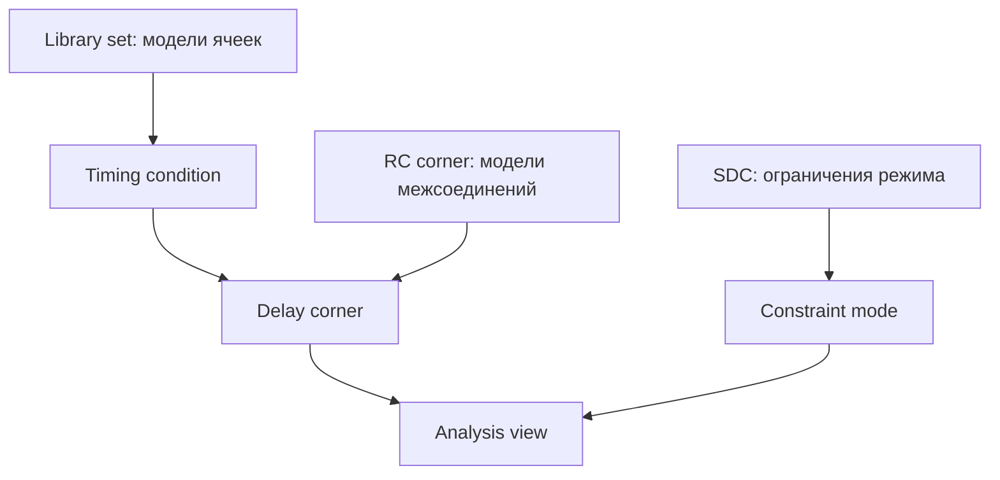

Это схема связей, а не порядок выполнения Tcl-команд. В некоторых вариантах интерфейса library set указывается непосредственно в delay corner. В конфигурации также могут быть раздельные early/late timing conditions и RC corners; такие настройки берутся из предоставленного flow.

#### Какие views используются для setup и hold

Создать analysis view недостаточно: необходимо указать, какие views активны для setup и какие — для hold. Один view может использоваться для обеих проверок. Пример такого учебного подхода приведён в [лабораторной Cornell по Innovus](https://cornell-ece6745.github.io/ece6745-mkdocs/ece6745-lab7/).

Setup проверяет, успевают ли данные к принимающему фронту, а hold — не изменяются ли они слишком рано. Для этих проверок могут потребоваться разные условия. При этом правило «SS только для setup, FF только для hold» не является универсальным: набор views определяется технологией и требованиями проекта.

Пример ниже иллюстрирует организацию конфигурации; это не имена объектов нашей библиотеки:

| Analysis view | Constraint mode | Delay corner | Назначение в примере |
| --- | --- | --- | --- |
| `func_view_a` | `functional` | `corner_a` | Setup |
| `func_view_b` | `functional` | `corner_b` | Hold |

Здесь режим и его SDC одинаковые, а условия расчёта задержек различаются. Имя `func_view_a` само по себе не определяет назначение: нужно проверить фактический список активных views. Если в учебном flow используется один view для setup и hold, это допустимое учебное упрощение, но не проверка всех условий работы изделия.

#### Как прочитать MMMC своего проекта

Откройте предоставленный файл конфигурации, например `mmmc.view`, и проследите связи от активного analysis view к его данным:

1. Какой constraint mode выбран и какие SDC он загружает?
2. Какой delay corner используется?
3. Какие timing conditions/library sets и файлы `.lib` задают модели ячеек?
4. Какой RC corner выбран и откуда взяты данные межсоединений?
5. Активен ли view для setup, hold или обеих проверок?

В следующих timing reports проверяйте название view. Положительный slack в одном view не подтверждает выполнение ограничений во всех остальных. Для сравнения трёх размеров floorplan и вариантов ECO сохраняйте одинаковую конфигурацию MMMC.

Пример просмотра конфигурации будет приведён на [скриншоте 12](#screen-12).

<a id="screen-12"></a>

> **Место для скриншота 12 — Конфигурация MMMC учебного проекта.**
>
> Показать MMMC Browser либо читаемый фрагмент файла и отчёта конфигурации. Выделить активные setup/hold views и связь одного view с constraint mode, SDC, delay corner, timing condition/library set и RC corner. Использовать реальные имена объектов учебного flow.
>
> Файл: [lab4_screen_12_mmmc.png](doc/images/lab4_screen_12_mmmc.png).

<!-- После подготовки скриншота замените блок-заглушку строкой ниже. -->
<!--  -->

*Скриншот 12 — Режимы и условия временного анализа в MMMC.*

### 3.2. Input delay и output delay: временные условия на границах блока

При анализе отдельного блока инструмент видит его внутренние ячейки и соединения. Однако входные данные приходят из внешней схемы, а выходные передаются другой схеме. Эту внешнюю часть временного пути нужно описать в SDC.

`set_input_delay` и `set_output_delay` задают временные условия относительно указанного clock. Они не вставляют элементы задержки и не задают физическую задержку самого порта. При проектировании блока внешней схемой может быть соседний блок на том же кристалле, а не только устройство на плате.

Границы учитываемых участков показаны на [рисунке 11](#fig-11).

<a id="fig-11"></a>

> **Место для рисунка 11 — Input delay и output delay на границах блока.**
>
> Нарисовать две отдельные цепочки. Входной путь: внешний запускающий регистр → внешняя логика/соединение → входной порт → внутренняя логика → внутренний принимающий регистр. Выходной путь: внутренний запускающий регистр → внутренняя логика → выходной порт → внешняя логика/соединение → внешний принимающий регистр. Обозначить границу анализируемого блока и общий опорный clock. Для input delay выделить внешние clock-to-Q и задержку до входного порта. Для output delay выделить внешнюю задержку после выходного порта и требования setup/hold внешнего регистра. Не изображать output delay как задержку от внутреннего регистра до выходного порта.
>
> Файл: [lab4_11_io_delays.png](doc/images/lab4_11_io_delays.png).

<!-- После подготовки рисунка замените блок-заглушку строкой ниже. -->
<!-- 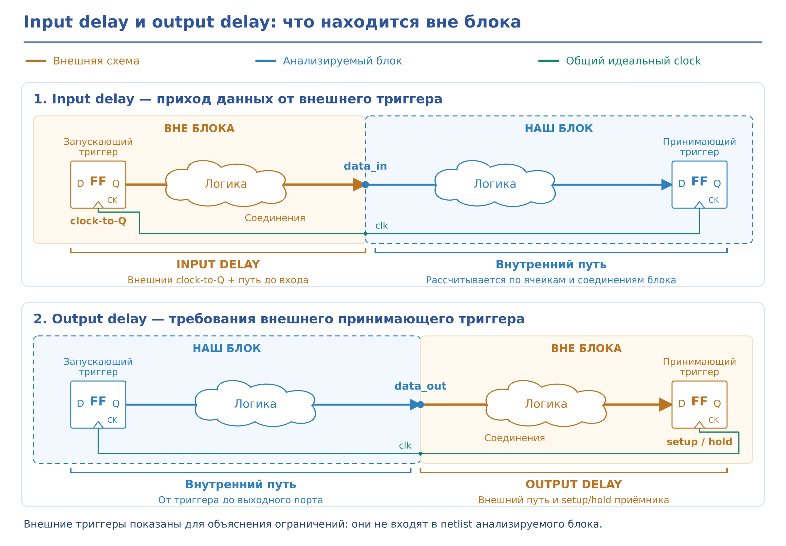 -->

*Рисунок 11 — Временные ограничения на входах и выходах анализируемого блока.*

#### Input delay: когда данные появляются на входе

**Input delay** описывает время прихода данных на входной порт относительно опорного фронта внешнего запускающего clock. В простом синхронном примере это clock-to-Q внешнего регистра плюс задержка внешней логики и соединения до нашего входа. После порта инструмент рассчитывает внутреннюю часть пути самостоятельно. Назначение команды описано в [документации Intel по input constraints](https://www.intel.com/content/www/us/en/docs/programmable/683243/25-1/input-constraints-set-input-delay.html).

- `-max` задаёт наиболее поздний приход входных данных для setup-анализа.
- `-min` задаёт наиболее ранний приход для hold-анализа.

#### Output delay: какие требования предъявляет внешний приёмник

**Output delay** описывает внешнюю часть проверки пути, заканчивающегося на выходе нашего блока. Для setup учитывается время, необходимое после порта для доставки данных внешнему регистру и выполнения его setup. Для hold учитывается ранний внешний путь и требование удержания данных.

Для простого примера с совпадающими опорными фронтами clock, без внешнего clock skew:

```text
output_delay_max = внешняя задержка данных max + setup внешнего регистра
output_delay_min = внешняя задержка данных min − hold внешнего регистра
```

Знак перед hold объясняет, почему `output_delay -min` может быть отрицательным. Это не отрицательное время распространения сигнала, а способ задать требование к раннему изменению данных на выходе. При несовпадении приходов clock на блок и внешний приёмник нужно учитывать и внешние clock delays; более общий расчёт приведён в [документации AMD по output delays](https://docs.amd.com/r/en-US/2026.1/ug1387-acap-hardware-ip-platform-dev-methodology/Defining-Output-Delays?contentId=IOVLWbP67gHYDmDWFwbv8w).

#### Числовой пример

Ниже условный пример, не обязательные значения для лабораторной. Единицы времени — нс; анализируется передача по положительным фронтам общего clock с периодом 10 нс. Внешний clock skew, clock latency и uncertainty в пояснении опущены. Имена портов необходимо заменить на реальные.

```tcl
create_clock -name clk -period 10.0 [get_ports clk]

set_input_delay  -clock [get_clocks clk] -max  3.0 [get_ports data_in]
set_input_delay  -clock [get_clocks clk] -min  0.5 [get_ports data_in]

set_output_delay -clock [get_clocks clk] -max  2.0 [get_ports data_out]
set_output_delay -clock [get_clocks clk] -min -0.3 [get_ports data_out]
```

| Значение | Как его понимать в этом примере |
| --- | --- |
| Input delay max = 3,0 нс | Для setup данные появляются на входе через 3,0 нс после запускающего фронта. До следующего фронта остаётся 7,0 нс, из которых ещё нужно учесть внутренний путь и setup принимающего регистра |
| Input delay min = 0,5 нс | Для hold новые данные могут появиться на входе уже через 0,5 нс после запускающего фронта |
| Output delay max = 2,0 нс | Для внешней части setup-проверки зарезервированы 2,0 нс. К выходному порту данные должны прийти не позднее 8,0 нс после запускающего фронта, если принимающий фронт наступает в 10,0 нс |
| Output delay min = −0,3 нс | Для hold выходные данные не должны начать изменяться ранее чем через 0,3 нс после соответствующего опорного фронта |

Например, output delay max = 2,0 нс может складываться из 0,8 нс внешней задержки и 1,2 нс setup. Значение min = −0,3 нс — из 0,2 нс ранней внешней задержки и 0,5 нс hold. Это самостоятельно выбранные числа для иллюстрации знаков и временного бюджета.

Значение output delay max = 2,0 нс **не означает**, что наш блок должен выдать данные через 2,0 нс после clock: оно ограничивает время, оставшееся внутренней части пути. Внешние ограничения и их отражение в required time разобраны в [документации Altera по чтению timing reports](https://docs.altera.com/r/docs/683243/25.3/quartus-prime-pro-edition-user-guide-timing-analyzer/correlating-constraints-to-the-timing-report).

#### Что проверить в SDC своего проекта

Проверьте, какие сигнальные порты имеют input/output delays, относительно какого clock они заданы, присутствуют ли необходимые `-max` и `-min` и откуда взяты значения. В реальном проекте их получают из требований интерфейса или согласованного временного бюджета соседних блоков.

Не назначайте одинаковые input delays автоматически всем входам: clock-порт и асинхронные управляющие сигналы требуют рассмотрения по своему назначению. Input transition/модель драйвера и выходная ёмкостная нагрузка задаются отдельно — input/output delay их не заменяют.

Ограничения интерфейса входят в SDC соответствующего constraint mode. Поэтому при сравнении floorplan и ECO необходимо сохранять одинаковыми и MMMC, и input/output delays.

### 3.3. Порядок подготовки проекта


1. Запустите Innovus в настроенном учебном окружении.
2. Восстановите полную базу проекта либо импортируйте исходные данные и загрузите floorplan.
3. Проверьте выбранный модуль, библиотеки, clocks и активные analysis views.
4. Выполните `check_timing`, изучите результат и устраните ошибки временных ограничений.
5. Проверьте геометрию die/core, размещение пинов, сеть питания и ограничения размещения/трассировки.
6. Сохраните исходную базу и отчёт `check_timing` перед запуском реализации.

### 3.4. Проверка временных ограничений перед маршрутом

После загрузки netlist, библиотек и SDC/MMMC, до запуска placement выполните в Tcl-консоли:

```tcl
check_timing
```

Проверьте сообщения о некорректных или неполных временных ограничениях. Особое внимание обратите на отсутствие clock у последовательных элементов и на точки/пути без необходимых ограничений (`unconstrained`). Для сигнальных входов и выходов проверьте наличие предусмотренных заданием input/output delays. Состав и названия проверок зависят от версии инструмента; ориентируйтесь на фактический отчёт.

Не начинайте маршрут с необъяснёнными проблемами ограничений. Исправьте ошибки в SDC/MMMC и повторите `check_timing`. Если отсутствие ограничения является намеренным, укажите соответствующие объекты и обоснуйте его. Не добавляйте `false_path` только для удаления предупреждений.

`check_timing` проверяет готовность схемы и ограничений к временному анализу. Отсутствие замечаний в этой проверке не означает выполнения setup/hold: slack оценивается по отдельным timing reports.

Сохраните результат проверки вместе с исходными отчётами. Повторяйте её перед каждым из трёх маршрутов с разными floorplan, а также после изменения netlist или временных ограничений.

**Полезные отчёты перед запуском маршрута**

| Отчёт или проверка | Что искать | Зачем смотреть |
| --- | --- | --- |
| `check_timing` | Проблемы полноты и корректности временных ограничений, сообщения об unconstrained-объектах | Убедиться, что последующий timing-анализ имеет смысл |
| Clocks и analysis views | Периоды, формы clock, выбранные setup/hold views и соответствующие corners | Исключить запуск с неверным clock или набором условий |
| Проверка ограничений интерфейса | Input/output delays, нагрузки выходов, входные transitions, исключения | Проверить, что интерфейс описан в соответствии с заданием |
| Сводка проекта | Число и площадь ячеек, размеры die/core, utilization | Зафиксировать исходное состояние и проверить импорт |

Названия строк в таблицах обозначают назначение отчётов, а не гарантированные имена Tcl-команд. Точные команды и имена файлов будут приведены для учебной версии Innovus.

Пример проверки clocks, периодов и активных analysis views приведён на [скриншоте 1](#screen-01).

<a id="screen-01"></a>

> **Место для скриншота 1 — Проверка clocks и analysis views.**
>
> Окно или консоль со списком clocks, периодами и активными setup/hold analysis views, а также результатом `check_timing`. При необходимости собрать два читаемых фрагмента: настройки анализа и сообщения проверки. Подписать параметры, которые необходимо проверить перед запуском.
>
> Файл: [lab4_screen_01.png](doc/images/lab4_screen_01.png).

<!-- После подготовки скриншота замените блок-заглушку строкой ниже. -->
<!--  -->

*Скриншот 1 — Проверка clocks и analysis views.*

Учебные blockages из лабораторной №3 не должны случайно определять результат новой работы. Для исследования размеров floorplan используется упрощённый вариант без дополнительных placement и routing blockages.

> **Будет добавлено:** команды запуска, подключения процедур, восстановления и сохранения базы.

Восстановите исходную базу по примеру на [скриншоте 2](#screen-02).

<a id="screen-02"></a>

> **Место для скриншота 2 — Загрузка исходного проекта.**
>
> Окно восстановления полной базы либо консоль с проверенной командой загрузки. Выделить выбранную базу и признаки успешного восстановления. Не подменять восстановление базы загрузкой одного floorplan.
>
> Файл: [lab4_screen_02.png](doc/images/lab4_screen_02.png).

<!-- После подготовки скриншота замените блок-заглушку строкой ниже. -->
<!--  -->

*Скриншот 2 — Загрузка исходного проекта.*

Исходное состояние проекта показано на [рисунке 1](#fig-01). Перед запуском проверьте границы die/core, пины и питание.

<a id="fig-01"></a>

> **Место для рисунка 1.** Скриншот Innovus: границы die и core, rows, сигнальные пины и сеть питания. Подписать основные объекты.
>
> Файл: [lab4_01_initial_floorplan.png](doc/images/lab4_01_initial_floorplan.png).

<!-- После подготовки рисунка замените блок-заглушку строкой ниже. -->
<!--  -->

*Рисунок 1 — Исходный floorplan перед физической реализацией.*

## 4. Основные этапы физической реализации

После подготовки floorplan известны размеры блока, расположение пинов и сеть питания. Но стандартные ячейки ещё нужно разместить, подвести к регистрам тактовый сигнал и построить сигнальные соединения.

Эти задачи выполняются последовательно:

| Этап | Что делает инструмент | Что получаем |
| --- | --- | --- |
| **Размещение — placement** | Выбирает места для стандартных ячеек в области core. Учитывает связи между ними, временные ограничения и доступное место | Размещённые ячейки. Их соединения пока оцениваются без окончательной трассировки |
| **Синтез тактовой сети — CTS** | Строит сеть доставки clock к регистрам: добавляет clock-буферы и при необходимости инверторы, чтобы обеспечить требуемые фронты и согласовать время прихода clock | Структуру тактовой сети, для которой можно оценить задержки clock и различия времени его прихода к регистрам |
| **Трассировка — routing** | Соединяет пины ячеек и пины блока проводниками на разрешённых слоях металлизации и переходами между слоями — vias | Физические соединения, по которым можно уточнить сопротивления, ёмкости и задержки межсоединений |
| **Оптимизация после трассировки — post-route** | Использует результаты трассировки и временного анализа для исправления нарушений. При необходимости изменяет ячейки и затронутые соединения | Обновлённую реализацию, которую нужно повторно проверить по timing, связности и геометрическим правилам |

После каждого этапа проверяют результат и сохраняют базу. Если ограничения не выполнены, выясняют причину и корректируют реализацию.


### 4.1. Размещение стандартных ячеек — placement

Выполните размещение, легализацию и предусмотренную потоком оптимизацию.

Запуск placement и признак завершения этапа показаны на [скриншоте 3](#screen-03).

<a id="screen-03"></a>

> **Место для скриншота 3 — Запуск placement.**
>
> Проверенный способ запуска placement в учебном flow: Tcl-консоль или доступный диалог GUI. Выделить команду или параметры запуска и сообщение о завершении.
>
> Файл: [lab4_screen_03.png](doc/images/lab4_screen_03.png).

<!-- После подготовки скриншота замените блок-заглушку строкой ниже. -->
<!--  -->

*Скриншот 3 — Запуск placement.*

Проверьте, что ячейки размещены в допустимых местах, не перекрываются и соблюдают ограничения floorplan. Просмотрите размещение, оценку congestion и setup timing. Сохраните базу после placement и соответствующие отчёты.

**Какие отчёты полезны после placement**

| Отчёт или проверка | Что искать | Зачем смотреть |
| --- | --- | --- |
| Timing summary по setup | WNS, TNS и число нарушающих endpoints с разбивкой по views и группам путей, если она доступна | Оценить предварительное выполнение временных ограничений |
| Подробный setup timing report | Startpoint/endpoint, состав логики, cell/net delays, arrival/required time и slack | Найти источник большой задержки и понять структуру пути |
| Электрические ограничения | Нарушения max transition, max capacitance и max fanout, если эти ограничения заданы | Найти цепи с неблагоприятной нагрузкой или фронтами |
| Проверка размещения | Перекрытия, размещение вне допустимых областей, соблюдение rows и blockages | Проверить легальность размещения |
| Congestion | Расположение областей с недостатком оценочных ресурсов трассировки | Предварительно оценить риск сложной трассировки |
| Сводка ячеек и площади | Количество, площадь, состав ячеек и utilization | Увидеть изменения после оптимизации |

До трассировки задержки соединений зависят от используемой оценки RC. Congestion на этом этапе — прогноз, а не результат детальной трассировки. Hold до CTS можно просматривать для диагностики, но вывод о финальном выполнении hold по нему делать нельзя.

Пример результата placement приведён на [рисунке 2](#fig-02). Обратите внимание на расположение стандартных ячеек относительно пинов и свободных областей core.

<a id="fig-02"></a>

> **Место для рисунка 2.** Общий вид размещения и увеличенный фрагмент с отдельными стандартными ячейками и rows.
>
> Файл: [lab4_02_placement.png](doc/images/lab4_02_placement.png).

<!-- После подготовки рисунка замените блок-заглушку строкой ниже. -->
<!--  -->

*Рисунок 2 — Размещение стандартных ячеек после placement.*

### 4.2. Синтез тактовой сети — CTS

Выполните синтез тактовой сети и предусмотренную потоком оптимизацию.

Порядок запуска CTS показан на [скриншоте 4](#screen-04).

<a id="screen-04"></a>

> **Место для скриншота 4 — Запуск CTS.**
>
> Консоль с вызовом процедуры CTS либо соответствующий диалог используемой версии. Выделить clock и применяемые настройки; точные поля добавить после проверки flow.
>
> Файл: [lab4_screen_04.png](doc/images/lab4_screen_04.png).

<!-- После подготовки скриншота замените блок-заглушку строкой ниже. -->
<!--  -->

*Скриншот 4 — Запуск CTS.*

Покажите clock-сеть в GUI, найдите добавленные clock-буферы/инверторы. Просмотрите доступные отчёты по latency, skew и transition. Проверьте setup и hold, сохраните базу после CTS и отчёты.

**Какие отчёты полезны после CTS**

| Отчёт или проверка | Что искать | Зачем смотреть |
| --- | --- | --- |
| Сводка clock-сети | Число конечных точек, clock-буферов/инверторов, уровни сети и площадь clock-ячеек, если доступны | Оценить построенную структуру и затраты на её реализацию |
| Clock latency / insertion delay | Время прихода clock к конечным точкам, его разброс и принятые в отчёте определения | Понять задержки распространения clock |
| Skew | Разность приходов clock для анализируемых конечных точек и условия измерения | Оценить согласованность приходов clock; сравнивать один clock, одинаковые фронты и view |
| Clock transition и capacitance | Нарушения заданных ограничений на фронты и нагрузки clock-сетей | Проверить качество передачи clock |
| Timing summary по setup и hold | WNS, TNS и число нарушающих endpoints отдельно для setup и hold | Оценить timing с учётом физической тактовой сети |
| Подробные setup/hold reports | Clock launch/capture paths, путь данных, uncertainty и slack | Разобраться, как clock-сеть влияет на конкретные проверки |

Снижение skew само по себе не гарантирует улучшения setup и hold всех путей. Анализируйте соответствующие launch/capture ветви и полный расчёт slack. При чтении latency отличайте задержку физической clock-сети от source latency, если они представлены раздельно.

До CTS и после CTS могут использоваться разные модели тактовой сети. При объяснении изменений timing учитывайте условия анализа.

На [рисунке 3](#fig-03) показана выделенная тактовая сеть после CTS. Найдите источник clock, промежуточные clock-ячейки и принимающие регистры.

<a id="fig-03"></a>

> **Место для рисунка 3.** Скриншот с выделенной clock-сетью; подписать clock-пин, буферы и регистры.
>
> Файл: [lab4_03_clock_tree.png](doc/images/lab4_03_clock_tree.png).

<!-- После подготовки рисунка замените блок-заглушку строкой ниже. -->
<!--  -->

*Рисунок 3 — Тактовая сеть после CTS.*

**Просмотр тактовой сети в CTD**

После CTS рассмотрите тактовую сеть в CTD. Пример будет приведён на [скриншоте 11](#screen-11). Проследите ветвление от источника clock через промежуточные clock-ячейки до конечных регистров. Сопоставьте выбранную ветвь со структурой сети в основном окне Innovus на [рисунке 3](#fig-03).

<a id="screen-11"></a>

> **Место для скриншота 11 — Просмотр тактовой сети в CTD.**
>
> Показать окно CTD после выполнения CTS: источник clock, несколько уровней ветвления, промежуточные clock-буферы/инверторы и конечные регистры. Выделить одну ветвь и подписать основные элементы. Если в используемой версии доступны характеристики выбранной ветви или конечных точек, оставить их читаемыми. Точный способ открытия CTD и названия полей добавить после получения скриншота из рабочего окружения.
>
> Файл: [lab4_screen_11_ctd.png](doc/images/lab4_screen_11_ctd.png).

<!-- После подготовки скриншота замените блок-заглушку строкой ниже. -->
<!--  -->

*Скриншот 11 — Структура тактовой сети в CTD после CTS.*

### 4.3. Трассировка — routing

Выполните трассировку сигнальных цепей и оптимизацию после трассировки в порядке, предусмотренном учебным потоком.

Последовательность запуска routing и post-route оптимизации показана на [скриншоте 5](#screen-05).

<a id="screen-05"></a>

> **Место для скриншота 5 — Запуск routing и post-route оптимизации.**
>
> Консоль с последовательностью процедур routing/post-route либо проверенные диалоги GUI. Отметить порядок действий и сообщения о завершении.
>
> Файл: [lab4_screen_05.png](doc/images/lab4_screen_05.png).

<!-- После подготовки скриншота замените блок-заглушку строкой ниже. -->
<!--  -->

*Скриншот 5 — Запуск routing и post-route оптимизации.*

Рассмотрите соединение на нескольких слоях металлизации и переходы между слоями. Проверьте итоговые setup и hold, связность и геометрические нарушения средствами Innovus.

Пример трассировки и увеличенный участок соединения приведены на [рисунке 4](#fig-04). Пересечение проводников разных слоёв означает соединение только при наличии соответствующих vias.

<a id="fig-04"></a>

> **Место для рисунка 4.** Общий вид трассировки и увеличенный фрагмент одной сети с подписями слоёв и vias.
>
> Файл: [lab4_04_routing.png](doc/images/lab4_04_routing.png).

<!-- После подготовки рисунка замените блок-заглушку строкой ниже. -->
<!--  -->

*Рисунок 4 — Результат трассировки и межслойные переходы.*

**Какие отчёты полезны после routing и post-route оптимизации**

| Отчёт или проверка | Что искать | Зачем смотреть |
| --- | --- | --- |
| Итоговый timing summary | Setup/hold WNS, TNS и число нарушающих endpoints по заданным views | Оценить выполнение временных ограничений после трассировки |
| Подробные setup/hold reports | Изменения cell/net delays, clock paths и slack | Найти причину отличий от результата после CTS |
| Электрические ограничения | Оставшиеся нарушения transition, capacitance и fanout при наличии таких ограничений | Проверить качество сигналов после физической реализации соединений |
| Связность | Разрывы, незавершённые соединения и короткие замыкания в рамках возможностей проверки | Убедиться, что требуемые соединения реализованы корректно |
| Геометрические проверки Innovus | Типы, количество и координаты нарушений правил | Найти участки, требующие исправления; не смешивать эти проверки с signoff DRC |
| Статистика трассировки | Длина соединений, число vias, распределение по слоям и явно исключённые категории сетей | Сравнить физические затраты в трёх вариантах floorplan |
| Итоговая сводка ячеек | Число, площадь и состав ячеек | Учесть изменения, внесённые CTS и последующей оптимизацией |

Для временного анализа после routing используйте RC-данные, подготовленные учебным потоком для этого этапа, и указывайте применённую модель. Если между измерениями выполнялась оптимизация, изменения timing могут быть вызваны не только уточнением межсоединений, но и изменениями ячеек.

Дополнительно может быть полезен отчёт по мощности: он позволяет оценить вклад clock и остальных частей схемы, если инструмент предоставляет такую разбивку. Сравнение имеет смысл при одинаковых условиях и согласованном задании активности переключений. В текущем задании отчёт по мощности не является обязательным.

Зафиксируйте все оставшиеся нарушения: их тип, количество и расположение. Завершение команды без ошибки само по себе не подтверждает корректность результата.

Результаты физических проверок оформляйте по примеру [рисунка 5](#fig-05): укажите тип проверки, число нарушений и расположение выбранного маркера, если нарушения присутствуют.

<a id="fig-05"></a>

> **Место для рисунка 5.** Скриншот отчёта или окна результатов проверок; при наличии нарушений показать соответствующий маркер в GUI.
>
> Файл: [lab4_05_physical_checks.png](doc/images/lab4_05_physical_checks.png).

<!-- После подготовки рисунка замените блок-заглушку строкой ниже. -->
<!--  -->

*Рисунок 5 — Проверка связности и геометрических нарушений.*

### 4.4. Сохранение результата

Сохраните итоговую трассированную базу, отчёты и управляющий скрипт, позволяющий повторить маршрут из определённого исходного состояния.

Сохраните полную базу проекта по примеру на [скриншоте 6](#screen-06).

<a id="screen-06"></a>

> **Место для скриншота 6 — Сохранение полной базы проекта.**
>
> Окно сохранения или Tcl-консоль: показать путь, имя контрольной точки и успешное завершение сохранения полной базы. Использовать обозначения реальной версии Innovus.
>
> Файл: [lab4_screen_06.png](doc/images/lab4_screen_06.png).

<!-- После подготовки скриншота замените блок-заглушку строкой ниже. -->
<!--  -->

*Скриншот 6 — Сохранение полной базы проекта.*

В этой инструкции конечной точкой маршрута является трассированная база Innovus. Экспорт GDS, SDF и SPEF будет добавлен в инструкцию после согласования выходных данных для следующих лабораторных. Проверки внутри Innovus не заменяют технологический signoff DRC/LVS.

## 5. Чтение timing reports и принцип ECO

### 5.1. Что показывает временной отчёт

Для анализа пути сначала определите startpoint, endpoint, clock и analysis view. Затем проследите последовательность ячеек и соединений от запускающего до принимающего регистра. Пример отчёта с основными полями приведён на [рисунке 8](#fig-08).

| Поле или характеристика | Что анализировать |
| --- | --- |
| Cell delay | Вклад ячеек в задержку пути |
| Net delay | Вклад межсоединений в задержку пути |
| Transition | Длительность фронта сигнала в выбранной точке |
| Capacitance | Ёмкостную нагрузку выбранной сети/выхода по отчёту |
| Data arrival time | Расчётное время прихода данных |
| Data required time | Требуемое время прихода данных |
| Slack | Запас относительно проверяемого временного условия |

Для setup slack определяется как `data required time − data arrival time`. Отрицательное значение означает нарушение setup в рассматриваемых условиях анализа. Hold проверяется отдельно, с использованием минимальных задержек.

Сравнивайте отчёты при одинаковых clocks, analysis views и настройках анализа. После CTS учитывается физическая тактовая сеть; после routing уточняются задержки межсоединений. Поэтому изменение slack между этапами может иметь несколько причин.

### 5.2. Что такое ECO

ECO (Engineering Change Order) позволяет локально изменить реализованную схему. В этой работе рассматривается вставка неинвертирующих буферов в тракт данных. Схема до и после такой вставки показана на [рисунке 9](#fig-09).

Общий порядок: сохранить исходную базу → изменить netlist средствами ECO → разместить затронутые ячейки → выполнить ECO-трассировку → повторить timing и физические проверки. Порядок вызова конкретных процедур определяется учебным flow. Пример действий будет приведён на [скриншоте 10](#screen-10).

Буфер разрывает исходную нагрузку на несколько участков: предыдущая ячейка управляет его входом, а буфер — последующей частью цепи. Одновременно добавляются собственная задержка буфера и новые соединения. Поэтому вставка буфера может как увеличить задержку пути, так и уменьшить её за счёт улучшения transition и условий нагрузки.

Более мощный буфер способен управлять большей нагрузкой, но обычно имеет большую входную ёмкость. Для сравнения вариантов следует анализировать весь путь, а не только задержку добавленной ячейки. Пример сопоставления отчётов до и после ECO приведён на [рисунке 10](#fig-10).

### 5.3. Какие отчёты полезны после ECO

| Отчёт или проверка | Что искать | Зачем смотреть |
| --- | --- | --- |
| Setup report выбранного пути | Строки добавленных буферов, cell/net delays, arrival/required time и slack | Проследить эффект каждой ECO-итерации |
| Параметры исследуемых сетей | Transition, capacitance и fanout в сопоставимых точках | Объяснить различия между типами буферов |
| Hold report между выбранными регистрами | Минимальный путь и hold slack | Проверить, как изменение тракта данных повлияло на hold |
| Общая setup/hold summary | Глобальные WNS/TNS и худшие endpoints | Проверить, не затронуты ли другие пути; выбранная сеть может иметь несколько потребителей |
| Проверки размещения, связности и геометрии | Легальность новых ячеек, корректность подключения и отсутствие новых физических проблем | Убедиться, что ECO выполнено физически корректно |
| Проверка логической эквивалентности | Соответствие изменённого netlist исходной логической функции с учётом правил сравнения | Подтвердить, что буферы не изменили функцию схемы |

В намеренно ухудшенном варианте отрицательный setup slack — ожидаемый результат эксперимента. Это не отменяет проверки связности, размещения и геометрии.

### 5.4. Как сохранять и сопоставлять отчёты

Для каждого набора отчётов записывайте имя проекта, вариант floorplan, этап, analysis view/corner, clock и период, единицы времени и используемую модель clock/RC. Для ECO дополнительно указывайте тип и фактическое количество вставленных буферов.

WNS показывает худший запас, TNS — суммарную величину отрицательных запасов по правилам конкретной сводки. При сравнении сохраняйте одинаковый охват endpoints и способ формирования отчётов. Одной строки WNS недостаточно, чтобы объяснить причину изменения: используйте подробные отчёты соответствующих путей.

Для изучения достаточно сохранять несколько характерных путей, включая худшие setup и hold, а не все возможные пути схемы. Отчёты этого раздела — справочный перечень; обязательный состав материалов для сдачи задан в разделе 9.

## Часть II. Лабораторное задание

## 6. Задания и условия выполнения

| Оценка | Необходимо выполнить |
| --- | --- |
| **4** | Пройти базовый маршрут: placement → CTS → routing → post-route оптимизация. Проверить результат и сохранить базу и отчёты. |
| **5** | Выполнить задание на 4, сравнить три реализации с разными размерами die и провести исследование ECO-вставки буферов разной нагрузочной способности. |

Задания на оценку 5 выполняются дополнительно к базовой части. Если базовый вариант соответствует условиям исследования floorplan, он засчитывается как один из трёх маршрутов.

### 6.1. Задание на оценку «4»

На своём проекте выполните базовый маршрут с использованием предоставленных процедур:

1. Подготовьте проект и выполните `check_timing` по разделу 3. Исправьте ошибки ограничений и объясните намеренно оставленные предупреждения.
2. Выполните placement, CTS, routing и post-route оптимизацию по разделу 4.
3. Проверьте итоговые setup/hold, связность и геометрические нарушения.
4. Сохраните контрольные точки после placement, CTS и routing/post-route оптимизации, управляющий скрипт и отчёты.
5. Подготовьте материалы для сдачи по разделу 9.1.

### 6.2. Задание на оценку «5»

Дополнительно выполните оба исследования:

1. Три варианта размеров die с полным маршрутом и сравнением результатов — раздел 7.
2. ECO-вставка буферов разной нагрузочной способности и анализ выбранного пути — раздел 8.

Используйте методические пояснения из первой части. Оформите таблицы, выводы и дополнительные материалы по разделу 9.2.

## 7. Дополнительное задание №1: три размера floorplan

### 7.1. Условия эксперимента

Подготовьте три квадратных floorplan с фиксированными размерами **die**:

| Вариант | Размер die, мкм | Площадь die, мкм² |
| --- | --- | --- |
| Малый | 200 × 200 | 40 000 |
| Средний | 300 × 300 | 90 000 |
| Большой | 400 × 400 | 160 000 |

Размеры в таблице относятся к die. Отступы core от границ die сохраняйте одинаковыми во всех вариантах, используя значения исходного floorplan. Размеры core определяйте по фактической геометрии базы.

При задании геометрии используйте явные размеры die и одинаковые отступы core, как показано на [скриншоте 7](#screen-07).

<a id="screen-07"></a>

> **Место для скриншота 7 — Задание размеров die и отступов core.**
>
> Диалог floorplan либо Tcl-консоль с явными размерами die. Выделить размеры в мкм, отступы core и способ задания геометрии; не путать die с core.
>
> Файл: [lab4_screen_07.png](doc/images/lab4_screen_07.png).

<!-- После подготовки скриншота замените блок-заглушку строкой ниже. -->
<!--  -->

*Скриншот 7 — Задание размеров die и отступов core.*

Соблюдайте общие правила:

| Объект или параметр | Требование |
| --- | --- |
| Входные сигнальные пины, кроме clock | Группа по центру левой стороны die |
| Clock-пин | По центру верхней стороны die |
| Выходные пины | Группа по центру правой стороны die |
| Пины | Одинаковые порядок, слои, размеры и расстояния между соседними пинами |
| Core | Одинаковые отступы от die |
| Сеть питания | Одинаковые правила построения, слои, ширины и отступы; длины проводников адаптируются к геометрии |
| Дополнительные blockages | Отсутствуют |
| Netlist, SDC, MMMC, библиотеки | Одинаковые |
| Настройки реализации и анализа | Одинаковые; при наличии настройки seed сохраняйте её значение |

Каждый вариант начинайте с одного синтезированного netlist и соответствующего исходного floorplan, без результатов placement, CTS или routing другого варианта.

Расположите группы пинов на заданных сторонах по примеру на [скриншоте 8](#screen-08).

<a id="screen-08"></a>

> **Место для скриншота 8 — Настройка расположения пинов.**
>
> Pin Editor или проверенные команды размещения пинов. Показать выбор групп: входы слева по центру, clock сверху по центру, выходы справа по центру; выделить порядок, слой и расстояние между пинами.
>
> Файл: [lab4_screen_08.png](doc/images/lab4_screen_08.png).

<!-- После подготовки скриншота замените блок-заглушку строкой ниже. -->
<!--  -->

*Скриншот 8 — Настройка расположения пинов.*

Расположение пинов и соотношение размеров трёх вариантов показаны на [рисунке 6](#fig-06). Геометрию вариантов на схеме следует показать в одном масштабе.

<a id="fig-06"></a>

> **Место для рисунка 6.** Три схемы die 200 × 200, 300 × 300 и 400 × 400 мкм в одном масштабе: входы слева по центру, clk сверху по центру, выходы справа по центру; обозначить core и отступы.
>
> Файл: [lab4_06_floorplan_variants.png](doc/images/lab4_06_floorplan_variants.png).

<!-- После подготовки рисунка замените блок-заглушку строкой ниже. -->
<!--  -->

*Рисунок 6 — Три варианта floorplan с одинаковыми правилами размещения пинов.*

### 7.2. Порядок выполнения

1. До запуска сформулируйте прогноз: как размер die может повлиять на размещение, длину соединений и timing.
2. Подготовьте три floorplan по условиям раздела 7.1.
3. Для каждого варианта выполните `check_timing` по разделу 3, затем полный маршрут из раздела 4.
4. Сохраните отдельные базы, отчёты и скриншоты размещения и трассировки.
5. Заполните сравнительную таблицу. Используйте одинаковые определения показателей, единицы измерения и analysis views.

| Показатель | 200 × 200 | 300 × 300 | 400 × 400 |
| --- | --- | --- | --- |
| Размеры core, мкм | | | |
| Площадь core, мкм² | | | |
| Итоговая utilization, % | | | |
| Суммарная площадь стандартных ячеек, мкм² | | | |
| Длина сигнальных соединений, мкм | | | |
| Число vias сигнальных соединений | | | |
| Setup WNS / TNS, нс | | | |
| Hold WNS / TNS, нс | | | |
| Нарушения связности: тип и количество | | | |
| Геометрические нарушения: тип и количество | | | |

В длину и число vias сигнальных соединений не включайте сеть питания. Укажите, включена ли clock-сеть, и используйте одно правило во всех вариантах. Для utilization укажите определение инструмента и этап измерения.

Для визуального сравнения используйте общий масштаб и одинаковую видимость слоёв, как на [рисунке 7](#fig-07).

<a id="fig-07"></a>

> **Место для рисунка 7.** Три результата реализации в одном масштабе; различать границу core и область, фактически занятую логикой.
>
> Файл: [lab4_07_floorplan_results.png](doc/images/lab4_07_floorplan_results.png).

<!-- После подготовки рисунка замените блок-заглушку строкой ниже. -->
<!--  -->

*Рисунок 7 — Сравнение размещения и трассировки в трёх размерах die.*

### 7.3. Анализ результатов

В выводах ответьте:

- Как изменилась фактически занятая логикой область? Распределились ли ячейки по core или остались компактной группой?
- Как изменились длина соединений и число vias?
- Как изменились setup и hold? Совпадают ли худшие пути в трёх вариантах?
- Какую роль сыграло расположение пинов?
- Подтвердился ли исходный прогноз? Какой вариант вы выбрали бы для этой схемы и почему?

Больший die не обязан давать худший timing, а меньший — лучшую реализацию. Оценивается корректность эксперимента и объяснение наблюдений. Получать отрицательный slack в этом задании не требуется.

## 8. Дополнительное задание №2: исследование ECO-вставки буферов

### 8.1. Выбор пути и исходного состояния

Выберите одну из трёх трассированных реализаций. В ней найдите путь между двумя регистрами с положительным setup slack.

Сохраните отдельную исходную базу для ECO. Для выбранного пути зафиксируйте:

- startpoint, endpoint и используемые clock;
- analysis view и период clock;
- состав пути и выбранный участок вставки в тракте данных;
- задержки ячеек и межсоединений;
- data arrival time, data required time и setup slack;
- transition и ёмкостные нагрузки на выбранном участке.

Буферы вставляются в тракт данных. Тактовую сеть в этом эксперименте не изменяйте.

Выбор и выделение исходного пути для ECO показаны на [скриншоте 9](#screen-09).

<a id="screen-09"></a>

> **Место для скриншота 9 — Выбор временного пути для ECO.**
>
> Окно анализа пути или консоль с запросом timing: показать startpoint, endpoint, setup analysis view и положительный исходный slack. Выделить путь в GUI и выбранную цепь для вставки.
>
> Файл: [lab4_screen_09.png](doc/images/lab4_screen_09.png).

<!-- После подготовки скриншота замените блок-заглушку строкой ниже. -->
<!--  -->

*Скриншот 9 — Выбор временного пути для ECO.*

Пример разбора исходного пути приведён на [рисунке 8](#fig-08). Сопоставьте startpoint и endpoint отчёта с объектами в GUI.

<a id="fig-08"></a>

> **Место для рисунка 8.** Читаемый фрагмент timing report: startpoint, endpoint, clock, строки cell/net delay, arrival time, required time и slack; при необходимости отдельный фрагмент пути в GUI.
>
> Файл: [lab4_08_setup_path_report.png](doc/images/lab4_08_setup_path_report.png).

<!-- После подготовки рисунка замените блок-заглушку строкой ниже. -->
<!--  -->

*Рисунок 8 — Исходный setup-путь и основные поля timing report.*

### 8.2. Вставка разных буферов

Выберите несколько доступных неинвертирующих буферов с одинаковой логической функцией, но разной нагрузочной способностью. Запишите точные имена библиотечных ячеек. Рекомендуемый для черновика объём — не менее трёх вариантов; окончательный перечень будет указан по учебной библиотеке.

Для каждого типа буфера:

1. Восстановите одну и ту же исходную трассированную базу.
2. Вставьте буфер или небольшую последовательную цепочку буферов выбранного типа в намеченный участок.
3. Выполните необходимое размещение и ECO-трассировку.
4. Повторите временной анализ и сохраните отчёт выбранного пути.
5. Постепенно увеличивайте число последовательно включённых буферов до появления отрицательного setup slack этого пути.
6. Сохраните итоговую ECO-базу, скрипт изменений и результаты проверок.

Пример вставки буфера и последующих операций размещения и ECO-трассировки приведён на [скриншоте 10](#screen-10).

<a id="screen-10"></a>

> **Место для скриншота 10 — Выполнение ECO-вставки и ECO-трассировки.**
>
> Последовательность скриншотов консоли или доступных диалогов: выбор сети и типа буфера, вставка, размещение и ECO-трассировка. Отметить фактическое имя добавленной ячейки и подтверждение её подключения. Точные команды брать из проверенного flow.
>
> Файл: [lab4_screen_10.png](doc/images/lab4_screen_10.png).

<!-- После подготовки скриншота замените блок-заглушку строкой ниже. -->
<!--  -->

*Скриншот 10 — Выполнение ECO-вставки и ECO-трассировки.*

Сравнение разных типов начинайте с исходной базы, а увеличение количества внутри одного варианта выполняйте последовательно. Следите, чтобы добавленные буферы не были удалены или заменены последующей оптимизацией: фиксируйте фактические типы и количество в базе.

Во всех вариантах сохраняйте исходные SDC, период clock, analysis views и настройки анализа. Вставляйте буферы в один выбранный участок и одинаковым способом. Если меняется физическое расположение цепочки, учитывайте это при объяснении результатов.

Отслеживайте путь с выбранными startpoint и endpoint; он может перестать быть глобально худшим. Если между этими регистрами есть несколько ветвей, проверяйте, что отчёт проходит через исследуемую цепочку.

Принцип последовательной ECO-вставки показан на [рисунке 9](#fig-09). После подключения убедитесь, что исследуемый путь проходит через все добавленные буферы.

<a id="fig-09"></a>

> **Место для рисунка 9.** Точная схема до/после: запускающий регистр, исходная логика, выделенный участок вставки, последовательная цепочка неинвертирующих буферов и принимающий регистр. Clock не изменяется.
>
> Файл: [lab4_09_eco_buffers.png](doc/images/lab4_09_eco_buffers.png).

<!-- После подготовки рисунка замените блок-заглушку строкой ниже. -->
<!--  -->

*Рисунок 9 — Тракт данных до и после ECO-вставки буферов.*

### 8.3. Таблица результатов

Запишите исходное состояние и результаты каждой итерации. Укажите используемые единицы времени.

| Тип буфера | Число добавленных буферов | Задержка ячеек пути | Задержка межсоединений пути | Data arrival time | Data required time | Setup slack | Hold slack* |
| --- | --- | --- | --- | --- | --- | --- | --- |
| Исходная схема | 0 | | | | | | |
| … | … | | | | | | |

\* Hold проверяйте отдельным min-анализом между теми же регистрами. Минимальный путь может отличаться от исследуемого setup-пути; укажите это в отчёте.

Отдельно приведите transition и нагрузку на входе исследуемого участка, на выходе последнего добавленного буфера и на входе принимающего регистра. Выберите одинаковый фронт сигнала для сопоставимых измерений.

Для каждого типа буфера получите точку с положительным и точку с отрицательным setup slack. Отрицательный slack в итоговой ECO-базе является намеренным результатом эксперимента; храните её отдельно от базовой реализации.

Характерные изменения в timing report до и после ECO показаны на [рисунке 10](#fig-10). При сравнении используйте одинаковые поля и условия анализа.

<a id="fig-10"></a>

> **Место для рисунка 10.** Два сопоставимых фрагмента отчётов с выделенными строками добавленных буферов, задержками, transition, capacitance, arrival time, required time и slack; показать положительный и отрицательный setup slack.
>
> Файл: [lab4_10_eco_timing_comparison.png](doc/images/lab4_10_eco_timing_comparison.png).

<!-- После подготовки рисунка замените блок-заглушку строкой ниже. -->
<!--  -->

*Рисунок 10 — Сравнение timing reports до и после ECO.*

### 8.4. Исследование отчётов

По результатам эксперимента объясните:

1. Как рассчитывается setup slack из data arrival time и data required time?
2. Какие строки timing report соответствуют вставленным буферам?
3. Как изменились задержки ячеек, межсоединений, transition и нагрузки?
4. Всегда ли добавление очередного буфера ухудшало setup slack? Если нет, чем это объясняется?
5. При каком количестве буферов каждого типа возникло нарушение?
6. Почему более мощный буфер не обязательно даёт меньшую задержку всей цепочки?
7. Как изменился hold между выбранными регистрами? Стал ли исследуемый путь худшим setup-путём проекта?

Проверьте связность, геометрические нарушения и сохранение логической функции после ECO. Вставка неинвертирующих буферов должна сохранять логическую функцию, однако правильность подключения необходимо подтвердить. Конкретный способ проверки эквивалентности будет указан в учебном потоке.

## 9. Что предоставить для сдачи

### 9.1. На оценку «4»

- Управляющий Tcl-скрипт и необходимые исходные настройки для повторения маршрута.
- Полные базы после placement, CTS и routing/post-route оптимизации.
- Исходный отчёт `check_timing` и пояснения к намеренно оставленным предупреждениям, если они есть.
- Итоговые отчёты по setup, hold, связности и геометрическим нарушениям.
- Скриншоты размещения, тактовой сети и трассировки с краткими пояснениями.
- Краткий вывод о результате реализации и список оставшихся нарушений с объяснениями.

### 9.2. На оценку «5»

Дополнительно предоставьте:

- скрипты подготовки трёх floorplan и запуска маршрутов;
- итоговые базы и отчёты всех трёх реализаций;
- сравнительную таблицу, исходный прогноз и выводы по размерам floorplan;
- исходную базу для ECO и скрипты экспериментов с разными буферами;
- итоговую ECO-базу для каждого типа буфера;
- таблицу итераций, характерные timing reports до и после вставки и анализ результатов;
- результаты проверок после ECO, включая проверку логической функции.

Библиотечные файлы PDK включать в сдаваемые материалы не требуется. Базы и скрипты должны восстанавливаться в настроенном учебном окружении.

## 10. На защите

Для базовой части будьте готовы:

- объяснить назначение placement, CTS, routing и post-route оптимизации;
- показать clock-сеть и несколько сигнальных соединений с vias;
- найти startpoint, endpoint, arrival time, required time и slack в отчёте;
- объяснить результаты итоговых проверок;
- показать сохранение и восстановление базы.

Для оценки 5 дополнительно объясните влияние геометрии floorplan на вашу реализацию, продемонстрируйте ECO-изменение и разберите различия между вариантами буферов по отчётам.

## 11. Рекомендуемая организация результатов

Имена ниже — рекомендуемые имена каталогов результатов, а не команды или обязательная структура учебного flow.

```text
lab4/
  scripts/
  fp_200/
    db/
    reports/
    images/
  fp_300/
    db/
    reports/
    images/
  fp_400/
    db/
    reports/
    images/
  eco/
    baseline/
    buffer_variant_1/
    buffer_variant_2/
    buffer_variant_3/
  report.md
```

В каждом отчёте указывайте вариант реализации, этап, analysis view и единицы измерения. Не перезаписывайте исходную базу результатами следующего эксперимента.

## 12. Перед публикацией: уточнения для преподавателя

Этот раздел не входит в студенческое задание.

1. Зафиксировать объект реализации, версию Innovus и реальные команды Common UI учебного потока.
2. Добавить команды запуска, имена процедур, пути к исходным данным, сохранение/восстановление баз и образцы отчётов.
3. Проверить совместимость die 200/300/400 мкм с пинами и питанием; указать численные отступы core и параметры pin placement. Для оценки 4 определить допустимость исходного floorplan №3 с учебными blockages; в сравнении использовать упрощённые варианты.
4. Уточнить критерии приёмки базового маршрута: требования к timing, допустимые/известные нарушения физических проверок. Не считать любое нарушение автоматически допустимым только потому, что оно описано.
5. Выбрать доступные буферы разной нагрузочной способности и проверить, что для маленького проекта отрицательный setup slack достижим за разумное число ECO-итераций. Ограничение периода в ходе студенческого эксперимента не менять; если нужен иной исходный период, задать его заранее для общей исходной базы ECO.
6. Подготовить проверенный способ сохранения ECO-буферов, анализа выбранной ветви, проверки эквивалентности и получения длины соединений/числа vias.
7. Определить состав финального экспорта: GDS, netlist, SDF, SPEF и данные для следующих лабораторных.
