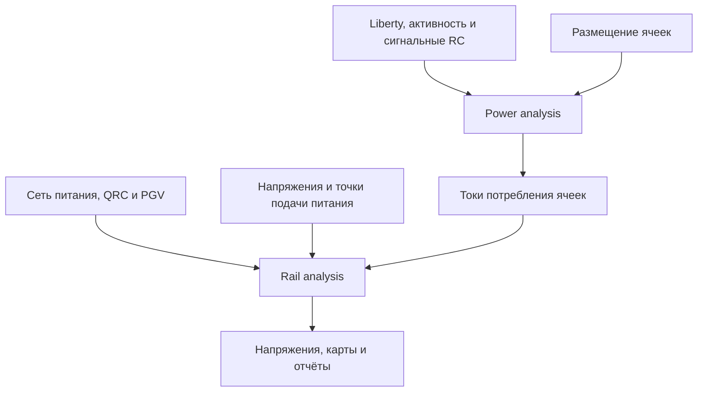
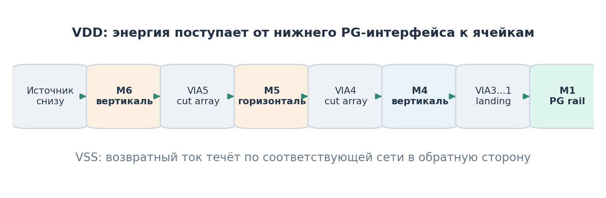
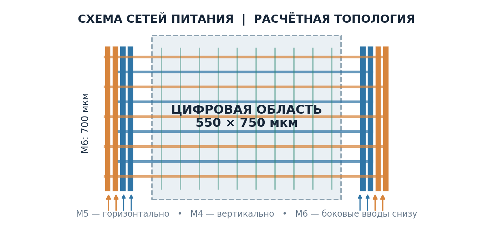
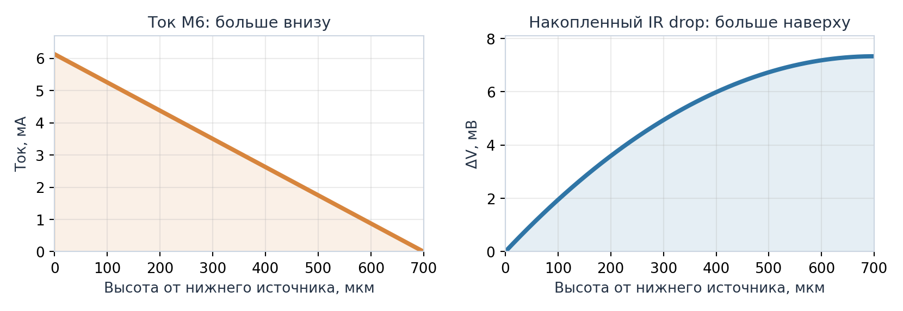
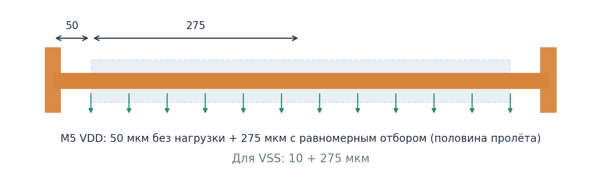
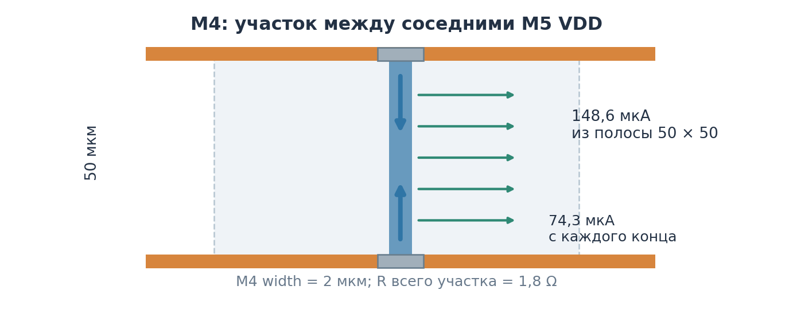
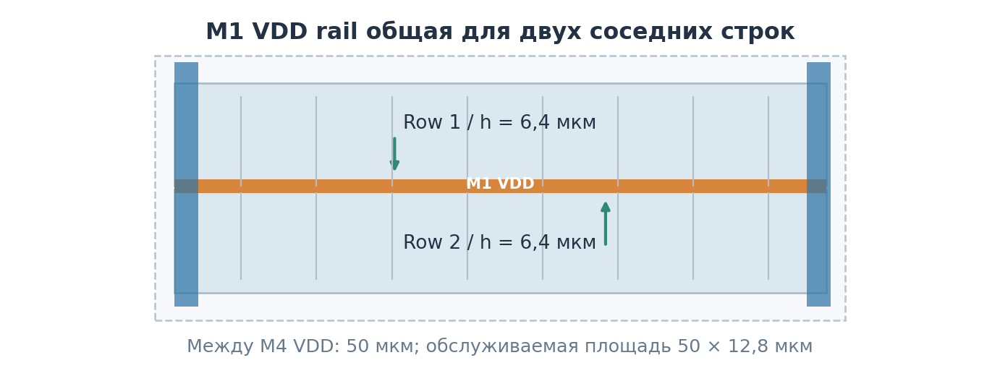
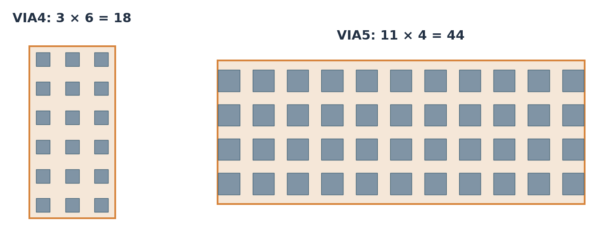
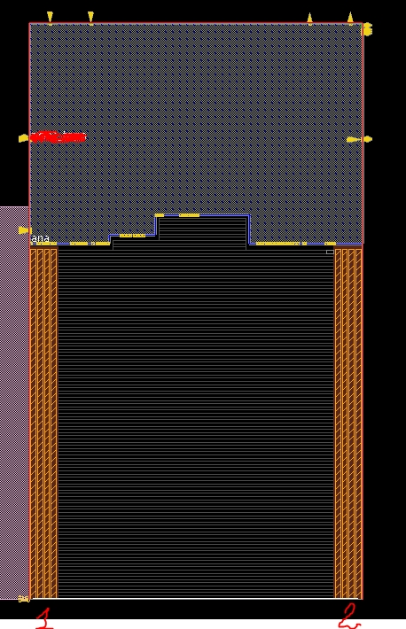

# Лабораторная работа № 5. Анализ потребляемой мощности и сети питания в Cadence Voltus

В предыдущей работе вы познакомились с placement, CTS и routing цифрового блока. Теперь необходимо проверить, как построенная сеть питания доставляет ток к ячейкам и какое напряжение они получают. Для анализа можно использовать собственный проект или готовый учебный вариант, предоставленный преподавателем.

**Цель работы** — подготовить модели для анализа питания, рассчитать среднюю потребляемую мощность и статическое падение напряжения, научиться читать карты и отчёты Voltus и сохранять результаты для повторного просмотра.

На «4» предоставляются простой учебный дизайн и полностью готовый floorplan: студент проходит подготовленный маршрут до физической реализации, выполняет анализ питания и объясняет результат. На «5» студент самостоятельно создаёт floorplan по рисунку и сравнивает два варианта питания: подключение шин M1 к верхним боковым шинам через стеки vias и подключение через распределённую сетку. Динамический анализ включён как ознакомительный раздел.

**Статус первой редакции.** Команды ориентированы на Voltus 20.10 **Stylus Common UI** и подготовленные Tcl-скрипты. Полный запуск на учебном проекте ещё предстоит проверить. В Makefile используется IHP SG13G2, а в первоначальных Tcl оставлены примеры для GPDK90. До выполнения работы преподаватель должен подготовить согласованные модели, пути и условия анализа. Отсутствующие результаты в этой редакции обозначены местами для скриншотов.

**Текущий расчётный пример** — блок 180 нм из [методики расчёта сетки питания](doc/ASIC180_PDN_Full_Calculation_Methodology_RU.pdf): цифровая область 550 × 750 мкм, восемь боковых шин M6, питание 1,55 В и мощность 38 мВт. Его геометрия и иллюстрации используются ниже до подготовки материалов другого дизайна. Числа ручного расчёта не являются результатами Voltus. Для запуска этого блока нужны его собственные модели и физические данные; параметры IHP/GPDK90 к нему автоматически не переносятся.

Углублённые пояснения вынесены в [README.extra.md](README.extra.md#lab5-extra). Для базового задания достаточно основного файла.

## Содержание

1. [Назначение анализа](#lab5-purpose)
2. [Основные понятия](#lab5-basics)
   - [Допустимое падение напряжения](#lab5-ir-limit)
3. [Расчёт сетки питания: пример 180 нм](#lab5-pdn-calculation)
   - [Исходные данные](#lab5-pdn-inputs)
   - [Токи и потери по слоям](#lab5-pdn-currents)
   - [Итог оценки и проверка в Voltus](#lab5-pdn-estimate)
4. [Подготовка и запуск](#lab5-preparation)
   - [Выбор проекта](#lab5-project-choice)
5. [Практические этапы](#lab5-practice)
   - [Прохождение физического маршрута](#lab5-physical-flow)
   - [Генерация PGV](#lab5-pgv)
   - [Статический анализ](#lab5-static)
   - [Просмотр результатов в GUI](#lab5-gui)
   - [Знакомство с динамическим анализом](#lab5-dynamic)
6. [Разбор результатов](#lab5-results)
7. [Сохранение данных](#lab5-save)
8. [Задания и защита](#lab5-assessment)

<a id="lab5-purpose"></a>

## 1. Назначение анализа

Соединение вывода ячейки с сетью VDD само по себе не гарантирует, что на этом выводе будет номинальное напряжение. Металлические проводники и переходные отверстия имеют сопротивление. Когда по ним протекает ток, потенциалы в разных точках сети различаются.

**Voltus** позволяет оценить потребление схемы и исследовать её сеть питания. В работе последовательно решаются две задачи:

1. **Power analysis** — определить потребляемую мощность и токи ячеек при выбранных условиях и активности.
2. **Rail analysis** — приложить эти токи к электрической модели сети питания и определить напряжения в её узлах.

Обмен данными между этапами показан на [схеме](#fig-lab5-flow).

<a id="fig-lab5-flow"></a>



*Рисунок — Основные данные и этапы анализа питания. Схема условная.*

Анализ выполняется для определённого сценария. Его результат относится к выбранным библиотекам, напряжению, температуре, активности и модели источников. Успешное завершение команды и отсутствие заметной просадки на карте ещё не подтверждают корректность исходных условий.

<a id="lab5-basics"></a>

## 2. Основные понятия

### 2.1. Сеть питания

Сеть питания, или **PDN — Power Distribution Network**, соединяет точки подачи питания с выводами ячеек. В учебном блоке этот путь может проходить через кольцо питания, полосы, локальные шины стандартных ячеек и переходные отверстия.

В этой работе рассматривается один постоянно включённый домен с сетями **VDD** и **VSS**, номинальный потенциал VSS равен нулю. Отключаемые домены и power gates в используемые скрипты не включены.

Путь питания в текущем примере показан на [рисунке](#fig-lab5-pdn): M6 → M5 → M4 → локальные подключения M1. Через M2/M3 проходят необходимые соединения и стеки vias.

<a id="fig-lab5-pdn"></a>



*Рисунок — Путь VDD к ячейке и обратный путь через отдельную сеть VSS. Схема из методики, с. 5; локальные участки M2/M3 не образуют дополнительную распределённую сетку.*

### 2.2. Падение напряжения

Для отдельного резистивного участка:

$$
\Delta V = I R,
$$

где $\Delta V$ — падение напряжения, В; $I$ — ток участка, А; $R$ — его сопротивление, Ом.

Реальная PDN содержит разветвления и параллельные пути. Ток каждого участка зависит от потребления подключённых ячеек и устройства всей сети. Поэтому одну формулу для отдельного сопротивления нельзя без дополнительных предположений применять ко всему блоку.

На стороне VDD локальный потенциал может снижаться, на стороне VSS — повышаться. Напряжение питания конкретной ячейки определяется разностью:

$$
V_{\text{cell}} = VDD_{\text{local}} - VSS_{\text{local}}.
$$

**Условный пример:** при номинальном питании 1,55 В, локальном VDD 1,53 В и локальном VSS 0,01 В ячейка получает 1,52 В. Суммарная потеря — 30 мВ. Это иллюстрация принципа, а не измерение на текущем блоке.

Снижение напряжения питания обычно увеличивает задержки ячеек и при достаточно большой просадке может нарушить работу схемы. В этой лабораторной изучается питание; влияние на timing не считается автоматически перепроверенным после выполнения rail analysis.

Подробнее: [распределённая сеть и сопротивления](README.extra.md#lab5-extra-resistance).

<a id="lab5-ir-limit"></a>

### 2.3. Допустимое падение напряжения

**Допустимая просадка, или IR-drop budget,** — заданный предел потери напряжения питания относительно принятого опорного значения. Порог позволяет сопоставить результат анализа с требованием к питанию.

Его выбирают по условиям проекта: допустимому диапазону питания ячеек и макросов, условиям проверки timing, запасам на отклонения источника и потерям на пути питания. **Единого допустимого процента для всех технологий и проектов нет.** Напряжение одного доступного файла Liberty само по себе не задаёт весь допустимый бюджет PDN. Если источник в модели подключён непосредственно к точкам кристалла, потери до этих точек учитываются отдельными исходными условиями, а не появляются в расчёте автоматически.

В этой работе для объяснения используем **суммарную потерю локального питания ячейки**, включающую снижение VDD и подъём VSS. При номинальном потенциале VSS, равном нулю:

$$
\Delta V_{\text{cell}} = V_{\text{nom}} - (VDD_{\text{local}} - VSS_{\text{local}}),
$$

$$
\delta_{\text{cell}} = \frac{\Delta V_{\text{cell}}}{V_{\text{nom}}}\cdot100\%.
$$

Здесь $V_{\text{nom}}$ — опорное напряжение питания в данной модели, В; $\Delta V_{\text{cell}}$ — потеря локального питания, В; $\delta_{\text{cell}}$ — относительная просадка, %.

Если предел задан как $\delta_{\text{lim}}$ процентов, условие имеет вид:

$$
\delta_{\text{cell}} \leq \delta_{\text{lim}},
\qquad
V_{\text{cell}} \geq V_{\text{nom}}\left(1-\frac{\delta_{\text{lim}}}{100}\right).
$$

**Для текущего примера 180 нм** в методике принят предварительный бюджет **2%** при $V_{\text{nom}}=1{,}55$ В:

$$
\Delta V_{\text{lim}}=1{,}55\cdot0{,}02=0{,}031\;\text{В}=31\;\text{мВ},
\qquad V_{\text{cell,min}}=1{,}519\;\text{В}.
$$

Это учебный ориентир для выбора геометрии PDN, а не универсальная норма технологии и не подтверждение signoff. В ручной модели полные 1,55 В приложены к нижним концам M6, потери до этих точек приняты нулевыми. Если в реальном проекте часть бюджета расходуется выше по цепи питания, доступный бюджет блока нужно пересчитать. Применение 2% как обязательного критерия сдачи должно быть явно задано в условии.

Для отдельной сети можно задавать собственный предел: максимальное падение VDD или максимальный подъём VSS. Такой критерий нужно явно отличать от суммарной потери VDD−VSS. Если разрешить весь суммарный бюджет отдельно каждой стороне, допускаемая потеря удвоится.

Для статического анализа оцениваются напряжения при усреднённых токах. Для динамического необходимо дополнительно определить временной интервал и метрику: например, минимум мгновенной разности VDD−VSS либо конкретный показатель effective instance voltage. Эти метрики могут различаться. Их допустимые пределы нельзя молча считать одинаковыми или автоматически складывать максимумы двух отдельных расчётов.

Порог, вид анализа и проверяемую величину зафиксируйте **до сравнения результатов**. Настройка цветовой шкалы GUI не заменяет электрический критерий. Практический порядок проверки приведён в [разделе 6.3](#lab5-ir-limit-check).

### 2.4. Состав потребляемой мощности

В отчёте различаются три составляющие:

| Составляющая | Что описывает |
|---|---|
| **Internal power** | Потребление, связанное с внутренней работой ячейки; определяется библиотечной моделью и условиями переключений |
| **Switching power** | Заряд и разряд внешней нагрузки выходных сигналов |
| **Leakage power** | Потребление, связанное с токами утечки |

Итоговая мощность складывается из этих составляющих. Для грубой оценки среднего тока нагрузки при одном напряжении можно использовать $I_{\text{avg}} \approx P_{\text{avg}}/V$. Это оценка суммарного потребления, а не правило равномерного распределения тока по топологии.

### 2.5. Активность переключений

Потребление зависит от того, какие сигналы переключаются и как часто. В подготовленных скриптах используется оценённая активность, заданная через `set_default_switching_activity` и распространяемая по схеме.

`INPUT_ACTIVITY` и `ACTIVITY_PERIOD` совместно задают нормирование входной активности. В рассмотренном интерфейсе плотность переходов соответствует отношению активности к периоду. **Единицы периода определяются Liberty.** Значение `8.0` нельзя считать наносекундами без проверки единиц библиотеки.

Эта настройка не изменяет clocks из SDC. Тактовые ограничения уже должны присутствовать в восстановленной базе. Reset и другие управляющие входы необходимо задать в состоянии, соответствующем исследуемому режиму.

Подробнее: [активность и расчёт мощности](README.extra.md#lab5-extra-activity).

### 2.6. Статический и динамический анализ

| Вид анализа сети | Модель потребления | Что исследуем |
|---|---|---|
| **Статический** | Усреднённые токи ячеек | Распределение напряжений при среднем потреблении |
| **Динамический** | Токи, изменяющиеся во времени | Изменения напряжения и просадки при переключениях в исследуемом временном интервале |

**Статический IR drop не означает анализ только утечек.** Средние токи включают потребление от переключений и внутренней работы ячеек.

В **vectorless dynamic** Voltus строит события переключений по активности и таймингам. Полученный сценарий зависит от этих предположений. Вариант с VCD использует события из моделирования и в данную базовую последовательность не входит.

### 2.7. Для чего нужна PGV

**PGV — Power Grid View** представляет ячейку для анализа питания: её подключения к сети, точки приложения токов и доступные электрические свойства. PGV и Liberty выполняют разные задачи.

В первом варианте используется **technology-only** библиотека `techonly.cl`, формируемая по LEF и технологии экстракции QRC. Она общая для статического и динамического скриптов.

В этом варианте не выполняется SPICE-характеризация внутренних ёмкостей стандартных ячеек. Поэтому динамический запуск рассматривается как знакомство с маршрутом расчёта. Исследование влияния decap требует согласованных характеризованных моделей.

Подробнее: [technology-only и характеризованные PGV](README.extra.md#lab5-extra-pgv).

<a id="lab5-pdn-calculation"></a>

## 3. Расчёт сетки питания: пример 180 нм

Ручной расчёт нужен, чтобы выбрать начальную геометрию и понять, какие участки могут давать существенные потери. Затем эти предположения проверяются на извлечённой сети в Voltus. Ниже приведён основной разбор из [полной методики](doc/ASIC180_PDN_Full_Calculation_Methodology_RU.pdf); дискретные отборы тока, уравнительные токи, RC-эффекты и подробности via-массивов разобраны в PDF отдельно.

<a id="lab5-pdn-inputs"></a>

### 3.1. Геометрия и исходные данные

На [исходном скриншоте Innovus](#fig-lab5-floorplan-reference) показаны боковые шины. Для варианта с сеткой добавляются горизонтальные M5 и вертикальные M4:

<a id="fig-lab5-pdn180-topology"></a>



*Рисунок — Расчётная топология из методики, с. 1. Иллюстрация показывает устройство сети; размеры и число полос следует брать из параметров, а не измерять по рисунку. Это не проверенный layout.*

| Параметр | Значение текущего примера |
|---|---|
| Технология и цифровая область | 180 нм; 550 × 750 мкм; $A=412\,500$ мкм² |
| Номинальное питание | 1,55 В; номинальный VSS — 0 В |
| Мощность цифровой части | 38 мВт из Power Report; режим, активность и corner в исходном материале не зафиксированы |
| Исходные M6 | Восемь шин: четыре VDD и четыре VSS; ширина 10,24 мкм, длина 700 мкм; питание подаётся снизу |
| Порядок M6 слева направо | Левая группа: VDD, VDD, VSS, VSS; правая: VSS, VSS, VDD, VDD |
| Добавляемые M5 | Горизонтальные; ширина 4 мкм; шаг одноимённой сети 50 мкм |
| Добавляемые M4 | Вертикальные; ширина 2 мкм; шаг одноимённой сети 50 мкм |
| Полные пролёты M5 в модели | VDD — 650 мкм; VSS — 570 мкм |
| Локальные M1 | Ширина 0,8 мкм; одна VDD-шина обслуживает две строки высотой по 6,4 мкм |
| Удельное поверхностное сопротивление $R_\square$ | M1–M4: 0,072 Ом/□; M5–M6: 0,035 Ом/□ |
| Предварительный бюджет | Суммарная потеря VDD−VSS не более 31 мВ, или 2% |

**Шаг 50 мкм задан между полосами одной сети:** VDD→VDD или VSS→VSS. Он не означает расстояние 50 мкм между любыми соседними полосами. В Tcl необходимо отдельно проверить, как команда задаёт шаг, пару VDD/VSS, расстояние между ними и начальное смещение.

Геометрия и технологические числа взяты из методики, с. 3–4. Значения $R_\square$ используются как исходные данные этой оценки; они не заменяют corner-specific экстракцию. Для режима 1,65 В мощность не установлена: переносить в него 38 мВт без повторного power analysis нельзя.

**Граница применимости геометрии:** M6 имеет длину 700 мкм при высоте цифровой области 750 мкм. В реальном floorplan нужно подтвердить координаты и путь питания верхних 50 мкм. Непрерывная модель отбора вдоль M6 этого не проверяет. Размеры die/core, положение выводов и точные координаты всех шин одним скриншотом также не определяются.

<a id="lab5-pdn-currents"></a>

### 3.2. Суммарный ток и его распределение

Для одного домена оцениваем средний ток:

$$
I_{\text{block}}\approx\frac{P}{V}
=\frac{38\;\text{мВт}}{1{,}55\;\text{В}}
\approx24{,}516\;\text{мА}.
$$

При симметричном питании и равномерной нагрузке на одну сторону приходится $I_{\text{block}}/2=12{,}258$ мА, а на одну из четырёх M6-шин VDD:

$$
I_6=I_{\text{block}}/4\approx6{,}129\;\text{мА}.
$$

Такие же по модулю токи возвращаются по четырём M6-шинам VSS. **Делить ток блока на восемь нельзя:** VDD и VSS образуют прямой и обратный пути одной нагрузки.

Для дальнейших оценок принимаем равномерную нагрузку по площади:

$$
j_A=\frac{I_{\text{block}}}{A}
\approx0{,}05943\;\text{мкА}/\text{мкм}^2.
$$

$j_A$ — нагрузка на единицу площади размещения, а не плотность тока в сечении металла для проверки EM. Реальные токи зависят от размещения и активности ячеек; равное деление между M6 — предположение модели.

### 3.3. M6: сопротивление и распределённая нагрузка

Для прямоугольного однородного проводника без учёта переходов:

$$
R=R_\square\frac{L}{w},
\qquad
R_6=0{,}035\frac{700}{10{,}24}\approx2{,}3926\;\text{Ом}.
$$

Если вся нагрузка подключена к дальнему концу, падение одной M6 равно $I_6R_6\approx14{,}664$ мВ. При **непрерывном равномерном отборе вдоль 700 мкм** ток линейно уменьшается от $I_6$ у источника до нуля у конца. Тогда:

$$
\Delta V_{6,\text{one}}=\frac{I_6R_6}{2}\approx7{,}332\;\text{мВ},
\qquad
\Delta V_{6,\text{VDD+VSS}}\approx14{,}664\;\text{мВ}.
$$

<a id="fig-lab5-pdn180-m6"></a>



*Рисунок — Ток и накопленная потеря напряжения одной M6 в непрерывной модели, методика, с. 7. Ток максимален снизу, падение относительно источника — сверху.*

Коэффициент $1/2$ следует из распределения тока, а не является общим правилом для шин. Например, для $N$ равных отборов в точках $L/N,2L/N,\ldots,L$:

$$
\Delta V_{6,\text{top}}=I_6R_6\frac{N+1}{2N}.
$$

При $N=10$ получается около 8,065 мВ на одну шину вместо 7,332 мВ непрерывной модели. При другом положении отборов результат иной. Поэтому в Voltus существенны фактические места подключения M5 и реальные токи.

### 3.4. M5: выбор ширины и расчёт двух сторон питания

Одна M5 при шаге одноимённой сети 50 мкм обслуживает полосу высотой 50 мкм:

$$
I_5=I_{\text{block}}\frac{50}{750}\approx1{,}6344\;\text{мА}.
$$

При одинаковых потенциалах концов и симметричной нагрузке с каждой стороны поступает $I_5/2\approx0{,}8172$ мА. В модели пролёт VDD составляет 650 мкм, VSS — 570 мкм, а нагрузка размещена на центральных 550 мкм. Поэтому с каждой стороны остаётся ненагруженный участок 50 мкм для VDD и 10 мкм для VSS.

<a id="fig-lab5-pdn180-m5"></a>



*Рисунок — Половина M5: для VDD 50 + 275 мкм, для VSS 10 + 275 мкм. Методика, с. 11. Размеры в микрометрах; схема условная.*

При $w_5=4$ мкм:

$$
R_{50}=0{,}035\frac{50}{4}=0{,}4375\;\text{Ом},\quad
R_{10}=0{,}0875\;\text{Ом},\quad
R_{275}=2{,}40625\;\text{Ом}.
$$

На ненагруженном продолжении течёт постоянный ток $I_5/2$, а на половине нагруженной области его среднее значение равно $I_5/4$:

$$
\Delta V_{5,\text{VDD}}=\frac{I_5}{2}R_{50}+\frac{I_5}{4}R_{275}
\approx1{,}3407\;\text{мВ},
$$

$$
\Delta V_{5,\text{VSS}}=\frac{I_5}{2}R_{10}+\frac{I_5}{4}R_{275}
\approx1{,}0547\;\text{мВ}.
$$

Суммарная потеря от M5 — **около 2,3954 мВ**. В методике на M5 условно выделено 4 мВ: при той же модели ширина 2 мкм дала бы вдвое большую потерю, около 4,7908 мВ, а ширина 4 мкм укладывается в этот частный бюджет. Это пример выбора ширины по оценке, а не доказательство оптимальности сетки.

Формула $IR/8$ применима к двухсторонне питаемой линии с равномерной нагрузкой **по всей длине** и равными потенциалами концов. Здесь отдельно учтены ненагруженные продолжения. Симметрия, указанные пролёты и деление тока между несколькими M6-контактами должны быть проверены по фактической геометрии.

### 3.5. M4 и M1: локальная доставка тока

Для M4 используем участок между соседними M5 одной сети длиной 50 мкм. При шаге M4 той же сети 50 мкм ему соответствует площадь 50 × 50 мкм²:

$$
I_4=I_{\text{block}}\frac{50\cdot50}{412\,500}
\approx148{,}58\;\text{мкА},
\qquad
R_4=0{,}072\frac{50}{2}=1{,}8\;\text{Ом}.
$$

При равномерном отборе и одинаковых потенциалах концов:

$$
\Delta V_{4,\text{one}}=\frac{I_4R_4}{8}\approx0{,}03343\;\text{мВ},
\qquad
\Delta V_{4,\text{VDD+VSS}}\approx0{,}06686\;\text{мВ}.
$$



*Рисунок — Модель локального участка M4 при равных потенциалах концов, методика, с. 12.*

В реальной сетке потенциалы соседних M5 могут различаться. Дополнительно возникает уравнительная составляющая тока: например, разность 0,1 мВ на сопротивлении 1,8 Ом соответствует 55,56 мкА. Она меняет токи в концах M4; это перераспределение между узлами сети, а не дополнительное потребление ячеек.

Для M1 одна общая VDD-шина питает две строки по 6,4 мкм. Участку между M4 одной сети соответствует нагрузка площади 50 × 12,8 мкм²:

$$
I_1=I_{\text{block}}\frac{50\cdot12{,}8}{412\,500}
\approx38{,}037\;\text{мкА}.
$$

Сопротивление половины участка:

$$
R_{1,\text{half}}=0{,}072\frac{25}{0{,}8}=2{,}25\;\text{Ом},
\qquad
\Delta V_{1,\text{one}}=\frac{I_1}{4}R_{1,\text{half}}
\approx0{,}02140\;\text{мВ}.
$$

При симметричной модели VSS суммарно получаем **0,04279 мВ**. Одинаковая нагрузка двух сторон и отсутствие дополнительных потерь в локальных соединениях — упрощения этой оценки.



*Рисунок — Участок M1 и обслуживаемая площадь, методика, с. 14.*

### 3.6. Vias и проверка EM

Металл соседних слоёв соединяется через допустимые переходы. Для предварительной оценки числа одинаковых cuts по одному направлению используется:

$$
N=\left\lfloor\frac{W-2e+s}{a+s}\right\rfloor,
$$

где $W$ — доступный размер металла, $a$ — размер cut, $s$ — расстояние между cuts, $e$ — требуемый enclosure. Округление выполняется вниз. Расчёт повторяют для второго направления и проверяют ограничения обоих металлических слоёв.

| Переход | Перекрытие металлов | Принятые $a/s/e$, мкм | Предварительный массив |
|---|---|---|---|
| VIA4, M4↔M5 | 2 × 4 мкм | 0,32 / 0,36 / 0 | 3 × 6 = 18 cuts |
| VIA5, M5↔M6 | 4 × 10,24 мкм | 0,60 / 0,36 / 0,02 | 11 × 4 = 44 cuts |



*Рисунок — Геометрические кандидаты via-массивов, методика, с. 15. DRC-допустимость не подтверждена; это не готовые определения переходов для Innovus.*

Перед созданием массивов нужны реальные правила PDK: enclosure, spacing, направления, допустимые via definitions и manufacturing grid. VIA5 почти полностью занимает доступное окно; дополнительные ограничения могут изменить число cuts. Нулевой enclosure VIA4 принят только в этой предварительной модели.

Оценка $R_{\text{array}}\approx R_{\text{cut}}/N$ предполагает одинаковые параллельные cuts и не учитывает сопротивления подводящего металла и неравномерность тока. В PDF приведены условные добавки **0,09906 мВ для VIA4** и **0,02786 мВ для VIA5** на обе сети. Они действуют только если значения 6 Ом и 1,5 Ом действительно относятся к одному cut и выполняются принятые деления токов. Переходы VIA1–VIA3 и локальные M2/M3 в итог ещё не включены.

**Электромиграция (EM)** проверяется отдельно от падения напряжения. Деление тока на ширину даёт мА/мкм, а не объёмную плотность тока. Для вывода о допустимости нужны правила технологии для металла и vias, температура, срок службы и соответствующая метрика тока: average, RMS или peak. Эти пределы в исходных данных не определены; выполнение IR-бюджета не означает прохождение EM.

<a id="lab5-pdn-estimate"></a>

### 3.7. Итог оценки и что проверять в Voltus

| Участок | Потеря VDD + VSS по принятой модели, мВ |
|---|---:|
| M6, непрерывная равномерная нагрузка | 14,6642 |
| M5, с ненагруженными продолжениями | 2,3954 |
| M4 | 0,06686 |
| M1 | 0,04279 |
| **Формальная сумма металлов** | **17,1693** |
| VIA4 и VIA5, условные добавки | 0,1269 |
| **Сумма с условными VIA4/VIA5** | **17,2962** |

По этой сумме до 31 мВ остаётся около 13,704 мВ. **Это остаток ручного бюджета, а не подтверждённый запас реального проекта.** Сложены характерные максимумы отдельных моделей, которые не обязательно относятся к одной физической ячейке. Не учтены все локальные переходы, реальные распределения мощности и взаимодействие ветвей; отдельно остаётся вопрос верхних 50 мкм. Для связанной сети нельзя заранее назначить равные потенциалы всем концам и считать результат точным.

При переходе к Voltus:

1. Восстановите фактическую геометрию, проверьте имена сетей, связность, vias и путь до всех PG pins. Источники текущей модели расположены у нижних концов M6.
2. Задайте реальные библиотеки, условия и активность, получите power report. Сопоставьте мощность с исходными 38 мВт и объясните различия; не подгоняйте активность только ради совпадения числа.
3. Выполните статический расчёт извлечённой PDN. Проверьте VDD и VSS, локальное питание одной и той же ячейки, положение худшей области и её путь к источнику.
4. Сравните потери по участкам с ручной оценкой. Объясните различия геометрией, нагрузкой, граничными условиями и упрощениями. Точного совпадения с 17,2962 мВ не требуется.

На «4» этот раздел помогает объяснить результат готового floorplan. На «5» используйте его для обоснования начальной сетки варианта B; варианты A и B описаны в [задании](#lab5-grade5). Параметры M5 4/50 и M4 2/50 — стартовая точка расчёта, которую необходимо согласовать с реальными технологическими правилами.


<a id="lab5-preparation"></a>

## 4. Подготовка и запуск

<a id="lab5-project-choice"></a>

### 4.1. Выбор проекта

Можно выбрать один из двух вариантов:

1. **Собственный проект.** Используйте проект из лабораторной работы 4 или другой синтезируемый цифровой блок. Самостоятельно подготавливать новую архитектуру специально для этой работы не обязательно.
2. **Готовый учебный вариант.** Используйте простой дизайн и полностью подготовленный floorplan, предоставленные преподавателем. Для базового задания на «4» разрабатывать RTL и самостоятельно строить floorplan не требуется: нужно пройти предоставленный маршрут, проверить результат и выполнить анализ в Voltus.

Для обоих вариантов действуют одинаковые задания и критерии оценки. Оцениваются настройка анализа, проверки, чтение результатов и объяснение эксперимента; самостоятельная разработка RTL не является обязательным условием получения оценки.

При выборе собственного проекта обеспечьте его совместимость с учебным маршрутом, библиотеками и используемым floorplan. Самостоятельное построение floorplan по рисунку относится к дополнительному заданию на «5», в том числе при использовании готового RTL.

К началу анализа в Voltus выбранный проект должен удовлетворять следующим условиям:

- Содержать последовательностную и комбинационную логику с осмысленным режимом работы и переключениями.
- Иметь корректные тактовые ограничения и определённые состояния управляющих сигналов.
- Быть подготовленным до физической реализации после routing с подключённым питанием.
- Использовать ячейки и макросы, для которых доступны необходимые логические, физические и электрические модели.
- Иметь согласованные входные данные из следующего раздела; не содержать неподдержанных black box, мешающих анализу.

Для готового варианта преподаватель предоставляет исходный RTL или ссылку на зафиксированную версию, ограничения, полностью готовый floorplan и настройки маршрута. Для задания на «5» используется рисунок инициализированного floorplan, по которому студент создаёт свою реализацию. В текущем тексте геометрия и расчёт относятся к блоку 180 нм из методики. Сам PDF не содержит комплекта RTL, netlist, физической базы и моделей: эти данные для запуска предоставляются отдельно. Выбор открытого RTL по этому скриншоту не предполагается.

| Оценка | Что предоставляется | Что делает студент |
|---|---|---|
| «4» | Простой дизайн, полностью готовый floorplan и управляющие файлы маршрута | Проходит маршрут, выполняет проверки и анализ питания, показывает и объясняет результат |
| «5» | Те же исходные RTL и модели, а также рисунок floorplan с исходными боковыми шинами | Самостоятельно строит floorplan по рисунку, создаёт два варианта PDN и сравнивает результаты |

### 4.2. Необходимые данные

В начале базовой части используются выданные RTL, ограничения и готовый floorplan. База после routing и сигнальный SPEF получаются при прохождении физического маршрута и затем служат входами Voltus.

| Данные | Назначение и обязательная проверка |
|---|---|
| База Innovus после routing | Физическое размещение и сеть питания; база должна читаться установленной версией Voltus |
| Liberty, MMMC и SDC | Модели ячеек, выбранный analysis view и clocks; ссылки из базы должны оставаться доступными |
| Technology LEF и LEF ячеек | Слои, геометрия и выводы питания; technology LEF читается первым |
| QRC extraction technology | Электрические параметры экстракции; нужен файл, поддерживаемый применяемым Cadence flow |
| Карта LEF/QRC слоёв | Согласование имён слоёв, если оно требуется выбранной технологией |
| Сигнальный SPEF | Паразитные параметры для power/timing расчёта; файл должен соответствовать выбранному RC corner и проекту |
| Файлы точек питания VDD/VSS | Координаты и слои подключения идеальных источников |

Сигнальный SPEF не заменяет модель сети питания. Сеть питания извлекается из физических данных с использованием соответствующей технологии и библиотечных представлений.

**Для IHP SG13G2 до запуска необходимо подготовить QRC technology и проверить состав библиотек.** Наличие LEF, Liberty или файла для другого экстрактора само по себе не означает готовность данных для этого шага.

### 4.3. Управляющие файлы

В корне проекта находится `Makefile`, в каталоге `flow_scripts/` — следующие файлы:

| Файл | Действие |
|---|---|
| `flow.voltus.pgv.tcl` | Генерация и проверка technology-only библиотеки |
| `flow.voltus.static.tcl` | Расчёт средней мощности, токов и статического IR drop |
| `flow.voltus.dynamic.tcl` | Динамический vectorless расчёт мощности и сети питания |
| `flow.voltus.gui.tcl` | Загрузка сохранённых результатов для просмотра |

Скрипты линейные: параметры заданы в начале файла, затем следуют команды инструмента. Makefile запускает их и создаёт рабочие каталоги. **Параметры, записанные в Tcl, не меняются автоматически при изменении одноимённых или похожих переменных Makefile.**

### 4.4. Рабочий каталог и относительные пути

Все команды `make` выполняются **из корня проекта**. Makefile запускает Voltus с рабочим каталогом `run/voltus`.

| Путь внутри Voltus | Положение относительно корня проекта |
|---|---|
| `./outputs/pgv/tech_pgv` | `run/voltus/outputs/pgv/tech_pgv` |
| `./reports/static_power` | `run/voltus/reports/static_power` |
| `./reports/static_rail` | `run/voltus/reports/static_rail` |
| `./reports/dynamic_power` | `run/voltus/reports/dynamic_power` |
| `./reports/dynamic_rail` | `run/voltus/reports/dynamic_rail` |
| `../data` | `run/data`, а не `data` проекта |
| `../design` | `run/design` |

В примерах из исходного практикума использована другая структура каталогов. Перед запуском замените входные пути абсолютными либо пересчитайте их от `run/voltus`. Для файлов в `data` текущего проекта относительный префикс будет `../../data`.

### 4.5. Что настроить в Tcl

| Скрипт и параметры | Что указать |
|---|---|
| PGV: `LEF_FILES`, `QRC_TECH_FILE`, `LEF_LAYER_MAP` | Реальные файлы выбранного PDK; в список LEF должны входить используемые физические ячейки |
| PGV: `VOLTAGE`, `-power_pins`, `-ground_pins` | Напряжение и библиотечные выводы питания |
| PGV: `-filler_cells`, `-decap_cells` | Реальные имена ячеек; примеры `FILL1`/`DECAP1` не переносятся автоматически на IHP |
| Static/dynamic: `DESIGN_DB`, `SPEF_FILE` | Фактические входные данные после трассировки |
| Static/dynamic: `ANALYSIS_VIEW`, `RC_CORNER` | Существующие объекты MMMC, согласованные с библиотеками и SPEF |
| Static/dynamic: `VOLTAGE`, `TEMPERATURE` | Условия исследуемого режима, согласованные с моделями |
| Static/dynamic: `POWER_NET`, `GROUND_NET`, `PGV_FILE` | Сети проекта и сгенерированная библиотека |
| Static/dynamic: `VDD_PAD_FILE`, `VSS_PAD_FILE` | Реальные точки питания |
| Static/dynamic: параметры активности | Активность входов, нормирующий период, работа clock gating и состояния управляющих сигналов |
| Dynamic: `TIME_RESOLUTION` | Разрешение, достаточное для рассматриваемых фронтов и токовых пиков |
| Критерий оценки просадки | Опорное напряжение, допустимая потеря в мВ или %, вид анализа, метрика и область применения предела |
| GUI: `DESIGN_DB`, `POWER_DB`, `RAIL_STATE` | Одна согласованная физическая база и результаты выбранного запуска |

Значения `0.9`, `125`, `AV_wc_on`, `RC_wc_125` и пути GPDK90 в первоначальных скриптах являются примерами. Для текущего проекта их нужно определить по фактическим библиотекам и условиям работы.

Не смешивайте имя сети проекта с именем библиотечного вывода. Например, `POWER_NET` используется для сети, а `-power_pins` при подготовке PGV описывает выводы библиотечных ячеек.

### 4.6. Точки подачи питания

Для VDD и VSS подготовьте отдельные файлы формата `xy`. Каждая строка задаёт имя источника, координаты и слой:

```text
*vsrc_name x y layer_name
vsrc1 22.215 374.800 Metal5
```

Это **пример формата**, а не координаты для вашего блока. Координаты задаются в микрометрах. Источник должен попадать на проводник нужной сети и указанного слоя. Число и расположение источников задают принятую модель питания; их необходимо сохранить вместе с результатами.

До начала расчёта убедитесь, что:

- [ ] Восстанавливается нужная база после routing, доступны её библиотеки и ограничения.
- [ ] Имена VDD/VSS и подключения питания соответствуют проекту.
- [ ] Для всех используемых ячеек доступны необходимые библиотечные представления.
- [ ] Технология QRC и карта слоёв относятся к выбранному PDK.
- [ ] Напряжение, температура, analysis view и RC corner согласованы.
- [ ] Известны единицы времени, мощности и напряжения.
- [ ] Активность соответствует исследуемому режиму; reset не удерживает схему в состоянии сброса вместо рабочего режима.
- [ ] Пути в скриптах проверены относительно `run/voltus`.

<a id="lab5-practice"></a>

## 5. Практические этапы

Команды в блоках `bash` выполняются в терминале Linux, команды в блоках `tcl` — в консоли Voltus. Запускайте этапы последовательно в отдельных сеансах. После проверки результата завершайте предыдущий сеанс командой `exit`.

Содержимое расчётных Tcl ниже объясняется по назначению команд. **После запуска скрипта через Makefile повторно выполнять его расчётные команды не требуется.**

<a id="lab5-physical-flow"></a>

### 5.1. Прохождение физического маршрута

**Задача этапа:** получить физическую базу и паразитные параметры для анализа питания. Для задания на «4» используется полностью готовый floorplan преподавателя; самостоятельное его построение выполняется в задании на «5».

1. Выберите учебный дизайн и настройте входные файлы предоставленного маршрута. В базовом варианте сохраните выданные параметры floorplan и питания.
2. Если исходными данными служит RTL, выполните синтез через существующую цель:

   ```bash
   make genus.syn
   ```

3. Запустите этап floorplan, используя предоставленный готовый вариант:

   ```bash
   make innovus.fp
   ```

4. Пройдите placement, CTS и routing через подготовленный implementation-скрипт:

   ```bash
   make innovus.impl
   ```

5. Выполните предусмотренные маршрутом проверки, просмотрите логи и физическую реализацию. Сохраните базу после routing и соответствующий SPEF, запишите их фактические пути и условия.
6. Укажите полученные файлы в настройках Voltus и переходите к подготовке PGV и анализу питания.

Цели Makefile запускают предоставленные Tcl-файлы; конкретные операции определяются их содержимым. В выпускаемой версии учебного flow этап `innovus.fp` должен использовать выданный готовый floorplan, а implementation-скрипт — завершать необходимые физические операции и сохранение данных. Подключение этого варианта и выходные пути необходимо проверить до выдачи задания.

<a id="lab5-pgv"></a>

### 5.2. Генерация PGV

**Задача этапа:** подготовить представления библиотечных ячеек для анализа сети питания.

1. Настройте `flow.voltus.pgv.tcl` по разделу подготовки.
2. Из корня проекта выполните:

   ```bash
   make voltus.pgv
   ```

3. Просмотрите сообщения генерации и результаты `check_pg_library`.
4. Проверьте состав ячеек и наличие необходимых представлений. Разберите сообщения о неизвестных слоях, отсутствующих выводах и неполном покрытии.
5. Сохраните управляющий скрипт, сведения о моделях и отчёты проверки.

В скрипте `read_physical` читает LEF, `set_pg_library_mode` задаёт тип и параметры библиотеки, `write_pg_library` выполняет генерацию, а `check_pg_library` проверяет полученный результат.

Результат находится в `run/voltus/outputs/pgv/tech_pgv/techonly.cl`, отчёты проверки — в `run/voltus/reports/pgv`, основной лог — в `run/voltus/logs/voltus_pgv.log`. Библиотечный объект с расширением `.cl` может представлять контейнер; сохраняйте его целиком.

Переходите к анализу после проверки библиотеки. Повторная генерация не нужна только из-за изменения входной активности; изменение технологии, состава ячеек или условий библиотечной модели требует проверки её применимости.

<a id="lab5-static"></a>

### 5.3. Статический анализ

**Задача этапа:** определить среднее потребление схемы, получить токи VDD/VSS и рассчитать распределение напряжений в сети питания.

1. Настройте `flow.voltus.static.tcl`: базу, view, SPEF, условия, активность и источники.
2. Из корня проекта выполните:

   ```bash
   make voltus.static
   ```

3. Просмотрите лог: восстановленный проект, выбранные условия, сообщения библиотек и активности, результаты power и rail analysis.
4. Откройте `run/voltus/reports/static_power/static.rpt`. Проверьте единицы, составляющие мощности, представленные группы ячеек и правдоподобность результата.
5. Убедитесь, что созданы токи для обеих сетей, power DB и каталог состояния rail analysis.
6. Запишите фактический путь к каталогу состояния — он понадобится для GUI.

Основные команды связаны следующим образом:

| Команда | Что проверить | Для чего |
|---|---|---|
| `read_db`, `read_spef` | Проект, доступность библиотек, выбранный RC corner | Анализировать нужную физическую реализацию |
| `set_db power_view` | Существующий analysis view | Выбрать условия power analysis |
| `set_default_switching_activity`, `propagate_activity` | Источник и распространение активности | Получить осмысленные токи потребления |
| `report_power` | Сводку мощности и файлы токов | Подготовить нагрузку сети питания |
| `set_rail_analysis_config` | Метод `static`, модели, температуру | Настроить расчёт PDN |
| `set_power_pads` | Сети, координаты и слои источников | Задать граничные условия питания |
| `set_power_data` | Файлы `static_<net>.ptiavg` для VDD и VSS | Передать усреднённые токи в rail analysis |
| `report_rail` | Домен `CORE`, завершение и выходной каталог | Получить напряжения и отчёты |

`CORE` — имя домена анализа, создаваемого в учебном скрипте. Это не имя встроенной функции и не обязательное имя домена любого проекта.

| Выходные данные | Содержимое |
|---|---|
| `reports/static_power/static.rpt` | Отчёт средней мощности |
| `reports/static_power/static_power.db` | Power DB для просмотра распределения потребления |
| `reports/static_power/static_VDD.ptiavg`, `static_VSS.ptiavg` | Средние токи по сетям при именах VDD/VSS |
| `reports/static_rail/` | Каталог с состояниями и отчётами rail analysis |
| `logs/voltus_static.log` | Условия запуска, сообщения и диагностика |

В таблице пути указаны **от `run/voltus`**. Если имена сетей изменены, имена файлов токов изменяются соответственно.

Почти нулевое потребление или малая просадка требуют объяснения. Сначала проверьте clocks, активность, reset и библиотечные данные, затем оценивайте качество сети.

<a id="lab5-gui"></a>

### 5.4. Просмотр сохранённых результатов в GUI

**Задача этапа:** совместить результаты анализа с физической топологией. Для этого используется отдельный `flow.voltus.gui.tcl`, который загружает сохранённые данные и не запускает расчёт повторно.

1. В `flow.voltus.gui.tcl` укажите ту же `DESIGN_DB`, на которой выполнялся анализ.
2. Для статического запуска оставьте `POWER_DB` равным `./reports/static_power/static_power.db` либо задайте путь к выбранному сохранённому варианту.
3. Заполните `RAIL_STATE` **фактическим путём к каталогу состояния**, созданному `report_rail`. Возьмите путь из лога или списка каталогов внутри `reports/static_rail`. Не задавайте вместо него только общий родительский каталог `static_rail`.
4. Из корня проекта выполните:

   ```bash
   make voltus.gui
   ```

5. Проверьте, что загружены нужные проект, power DB и rail state.

Если `RAIL_STATE` оставлен пустым, скрипт выведет найденные каталоги статических и динамических результатов и остановится с пояснением. Заполните параметр и повторите запуск. Имя состояния не выбирается автоматически по принципу «последнее в списке».

В просмотрщике выполняются команды:

```tcl
read_db -physical_data $DESIGN_DB
gui_show

read_power_rail_results \
    -power_db $POWER_DB \
    -rail_directory $RAIL_STATE

gui_set_power_rail_display -plot $PLOT
```

Переменная `PLOT` в скрипте задаёт первоначальную карту, по умолчанию `ir`. Для дальнейшего просмотра используйте панель **Power & Rail → Power & Rail Plots** или переключайте доступные представления из консоли:

```tcl
gui_set_power_rail_display -plot unc
gui_set_power_rail_display -plot ip
gui_set_power_rail_display -plot tc
gui_set_power_rail_display -plot ir
```

Каждая команда показывает очередное представление. Начните с `unc`, затем исследуйте потребление и напряжения. Через **Layers/Nets** выбирайте нужную сеть, слои и видимость источников. Выбранный объект и его свойства можно проверить через **Attribute Viewer**, в рассматриваемом интерфейсе — клавишей `q`.

Разбор карт приведён в [разделе 6](#lab5-results).

<a id="lab5-dynamic"></a>

### 5.5. Знакомство с динамическим анализом

Этот раздел предназначен для демонстрации и самостоятельного расширения работы. В первой редакции его выполнение не входит в обязательный объём на «4».

**Задача этапа:** увидеть токи и напряжения во времени, понять отличие среднего потребления от кратковременной нагрузки.

1. Настройте `flow.voltus.dynamic.tcl`, согласовав базу, питание, модели и активность со статическим вариантом.
2. Укажите осмысленное `TIME_RESOLUTION`. Слишком грубое разрешение может сгладить токовые пики; чрезмерно мелкое увеличивает объём расчёта.
3. Из корня проекта выполните:

   ```bash
   make voltus.dynamic
   ```

4. В логе проверьте распознанные clocks и фактический временной интервал расчёта. `ACTIVITY_PERIOD` и `TIME_RESOLUTION` не задают сами по себе длительность моделирования.
5. Убедитесь, что rail analysis использует `dynamic_<net>.ptiavg`.
6. Для просмотра измените в GUI-скрипте `POWER_DB` на базу динамического запуска, а `RAIL_STATE` — на соответствующее динамическое состояние. Выполните `make voltus.gui` в новом сеансе.
7. Через **Power & Rail → Dynamic Results → Waveforms** откройте токи потребления и сохранённое напряжение выбранной ячейки.

Ключевые отличия скрипта:

| Настройка | Значение и смысл |
|---|---|
| `power_method` | `dynamic_vectorless` — построение событий по активности и таймингам |
| `power_disable_static false` | Дополнительно сохраняются усреднённые данные; основной режим остаётся динамическим |
| `set_dynamic_power_simulation -resolution` | Задаёт временное разрешение power analysis |
| `set_rail_analysis_config -method dynamic` | Запускает динамический расчёт сети |
| `-save_voltage_waveforms true` | Сохраняет напряжения во времени |

Результаты находятся в `reports/dynamic_power` и `reports/dynamic_rail`, лог — в `logs/voltus_dynamic.log`, относительно `run/voltus`.

Динамическая карта худших значений объединяет экстремумы разных узлов за исследуемый интервал. Они могут возникать в разные моменты времени. Для объяснения конкретной просадки изучите waveform выбранной ячейки.

Подробнее: [динамическая нагрузка и ёмкости](README.extra.md#lab5-extra-dynamic).

<a id="lab5-results"></a>

## 6. Разбор результатов

### 6.1. Сначала условия и сводка

Для каждого результата зафиксируйте проект и исходную базу, версии инструмента и моделей, analysis view, RC corner, напряжение, температуру, параметры активности и точки питания. Затем укажите итоговую мощность и её составляющие, значения напряжений и положение выбранных проблемных объектов.

Проверьте единицы в заголовках отчётов. При сравнении переводите значения в одинаковые единицы; например, нельзя сопоставлять числа в В и мВ без пересчёта.

### 6.2. Карты потребления и питания

| Представление | Что показывает | Что проверить |
|---|---|---|
| `unc` | Неподключённые узлы | Наличие и положение разрывов; связность до интерпретации напряжений |
| `ip` | Суммарную мощность экземпляров | Какие ячейки потребляют больше и где они размещены |
| `tc` | Токи в точках потребления | Области повышенной нагрузки |
| `ir` | Результат rail analysis для выбранных сетей | Название величины, легенду, единицы, сеть и расположение источников |
| `ivdn` / `ivdd` | Напряжения или показатели падения на экземплярах в соответствующем net/domain представлении | Точное определение отображаемого поля и локальное питание выбранной ячейки |
| `rlrp` | Сопротивление пути с наименьшим сопротивлением и возможность его трассировки | Какие участки образуют путь питания выбранной ячейки; анализ включён в статическом скрипте |

**Различайте локальный потенциал и величину падения.** Для VDD при известном номинале $\Delta V_{VDD}=V_{DD,nom}-V_{DD,local}$. Для земли рассматривайте подъём относительно её номинального потенциала. Не делайте вывод по одному цвету без проверки легенды и численного значения.

Падение на VDD и подъём VSS для оценки питания ячейки нужно брать **для одной и той же ячейки**, а в динамике — с учётом времени. Глобальный минимум VDD и глобальный максимум VSS могут находиться в разных местах.

Карта статического результата должна быть оформлена как показано в [описании рисунка](#fig-lab5-static-map).

<a id="fig-lab5-static-map"></a>

> **Место для скриншота — Статический результат rail analysis.**
>
> Показать выбранную сеть, источники, легенду и единицы. Отметить исследуемую область и численное значение выбранного объекта. Подпись должна содержать условия анализа. Использовать фактический результат проекта.
>
> Файл: `doc/images/lab5_static_ir_map.png`.

<a id="lab5-ir-limit-check"></a>

### 6.3. Проверка допустимой просадки

1. Укажите $V_{\text{nom}}$, предел просадки и его источник: требования проекта или явно заданное учебное условие. Определите, относится ли предел к VDD, VSS или суммарной потере питания ячейки.
2. Выберите результат нужного вида анализа. Для динамики дополнительно укажите интервал и определение используемой метрики.
3. По численным данным проверьте максимальную просадку или минимальное локальное питание среди исследуемых объектов. Для суммы VDD−VSS используйте значения одной ячейки; для мгновенной динамической оценки — также одного момента времени.
4. Сопоставьте результат с пределом. Сохраните худшее значение, положение объекта и доступные сведения о превышениях. Скриншот одной произвольно выбранной точки не подтверждает соблюдение предела во всём проекте.
5. Запишите вывод: «укладывается в заданный критерий» или «критерий превышен» с числами и единицами. Если численный предел не задан, укажите измеренную просадку и отметьте, что соответствие допуску не оценивалось.

В интерфейсе Voltus 20.10 параметр `-threshold` команды `set_pg_nets` для VDD задаёт **минимальный потенциал сети в вольтах**, а для VSS — допустимый верхний потенциал земли. Это не процент падения. Пересчёт бюджета в эти значения и распределение его между VDD/VSS должны быть явными. Отдельные пороги двух сетей не заменяют проверку суммарного питания ячеек.

Текущие расчётные скрипты не задают проектный бюджет автоматически. При настройке порогов GUI и фильтров используйте выбранное требование. Выполнение этого критерия подтверждает только соответствующий результат power integrity; сохранение требуемых timing-параметров проверяется отдельным анализом.

### 6.4. Объяснение выбранной области

1. Выберите область с заметной просадкой или наиболее низким локальным питанием.
2. Определите, какие ячейки и токи связаны с этой областью.
3. Сопоставьте её положение с источниками, полосами питания, переходами между слоями и возможными разрывами.
4. Для выбранной ячейки исследуйте доступные свойства и путь питания. Отделяйте наблюдение от предположения о причине.
5. Сформулируйте вывод, опираясь на карту и численные данные.

Высокая мощность ячейки не гарантирует, что именно у неё будет наибольшая просадка: существенны также её положение и устройство PDN. Расстояние до источника само по себе не определяет сопротивление сети.

### 6.5. Типовые ситуации

| Наблюдение | Что проверить в первую очередь |
|---|---|
| Не создаются файлы токов | Завершение power analysis, настройки записи токов, имена сетей и выходной каталог |
| Мощность почти нулевая | Clocks, активность, reset, библиотечные модели и полноту обработки проекта |
| Есть неподключённые узлы | Физические соединения питания, vias, состав PGV и точки источников |
| Странные значения по всему блоку | Напряжение, модели, единицы, карту слоёв и граничные условия |
| GUI показывает неожиданный вариант | Согласованность физической базы, power DB и выбранного rail state |
| Две карты выглядят одинаково | Численные значения, автоматическую перенастройку цветовой шкалы и загрузку нужных состояний |

Определение и численный пример бюджета приведены в [разделе 2.3](#lab5-ir-limit), порядок проверки — в [разделе 6.3](#lab5-ir-limit-check). Если заданный предел превышен, сначала подтвердите корректность данных и расчёта, затем исследуйте причины результата.

<a id="lab5-save"></a>

## 7. Сохранение данных

Результат должен позволять восстановить условия и повторно открыть карты. Один скриншот этого не обеспечивает.

| Что сохранить | Для чего |
|---|---|
| Makefile и использованные Tcl | Восстановить команды, параметры и каталоги запуска |
| Сведения об исходной базе, SPEF и моделях | Определить физический проект и набор данных; сохранить доступные пути/версии либо копии необходимых входов |
| PGV и отчёты её проверки | Восстановить библиотечную модель и её применимость |
| Файлы источников VDD/VSS | Восстановить граничные условия |
| Power report, power DB и использованные токи | Проверить потребление и открыть его распределение |
| Полный выбранный каталог rail state | Открыть карты и подробные результаты; для динамики — также сохранённые waveforms |
| Логи, скриншоты и краткие выводы | Подтвердить условия расчёта и объяснить наблюдения |

Сохраните необходимые данные **вне `run/voltus`** до выполнения `make clean`: эта цель удаляет рабочий каталог Voltus. Для вариантов используйте разные имена, например `results/lab5/pdn_a` и `results/lab5/pdn_b`.

Не требуется заново экспортировать все форматы из лабораторной 4. Для этой работы нужны входы power/rail analysis и данные, подтверждающие именно выполненные расчёты.

После сохранения проверьте, что можете открыть выбранный результат через GUI-скрипт с корректными путями. При копировании следите за доступностью исходной физической базы и библиотек, на которые она ссылается.

<a id="lab5-assessment"></a>

## 8. Задания и защита

Ниже зафиксировано разделение заданий на «4» и «5». Численные условия и требования к устранению нарушений уточняются после проверки учебного flow.

<a id="lab5-grade4"></a>

### 8.1. Задание на «4»

1. Получить простой учебный дизайн, полностью готовый floorplan и управляющие файлы преподавателя. При желании использовать собственный проект, совместимый с учебным маршрутом.
2. Пройти предоставленный маршрут: при необходимости выполнить синтез, затем использовать готовый floorplan, выполнить placement, CTS и routing.
3. Выполнить предусмотренные физическим маршрутом проверки, сохранить базу после routing и соответствующий SPEF.
4. Проверить настройки питания, библиотек и активности, подготовить technology-only PGV и разобрать результаты её проверки.
5. Выполнить расчёт средней мощности и статический rail analysis.
6. Проверить корректность исходных условий, состав потребления и наличие неподключённых участков.
7. Открыть сохранённый результат в GUI, показать потребление, токи и напряжения.
8. Исследовать выбранную область и объяснить её результат. Если задан бюджет, сопоставить с ним худшее значение по проекту и зафиксировать превышения.
9. Сохранить данные и подготовить краткие выводы.

Самостоятельное построение floorplan и сравнение двух вариантов сети питания относятся к дополнительному заданию на «5».

Требуется выполнить предусмотренные проверки и зафиксировать обнаруженные проблемы. Если исходные данные делают расчёт недостоверным, их необходимо исправить и повторить анализ. Обязательное устранение всех электрических нарушений или достижение конкретной просадки без отдельно заданного критерия не требуется.

#### Материалы для сдачи на «4»

- [ ] Makefile и фактически использованные Tcl.
- [ ] Предоставленный floorplan и данные после прохождения физического маршрута: база после routing, соответствующий SPEF и результаты предусмотренных проверок.
- [ ] Условия расчёта, сведения об исходной базе и моделях.
- [ ] PGV, лог генерации и отчёты проверки.
- [ ] Файлы источников VDD/VSS.
- [ ] Отчёт мощности, power DB и файлы токов.
- [ ] Выбранный rail state целиком и лог анализа.
- [ ] Скриншоты потребления и статического результата с легендой, единицами и выбранным объектом.
- [ ] Результат проверки неподключённых узлов и объяснение исследованной области.
- [ ] Заданный бюджет просадки, его источник и сравнение с измеренным результатом либо явная отметка, что численный предел не задан.
- [ ] Краткие выводы и возможность повторного открытия результата.

<a id="lab5-main-questions"></a>

#### Основные вопросы для защиты

1. Какие задачи решают power analysis и rail analysis? Какие данные связывают эти этапы?
2. Почему подключённая к VDD ячейка может получать напряжение ниже номинального?
3. Как сопротивления металла и vias и токи потребления влияют на IR drop?
4. Из каких составляющих складывается потребляемая мощность?
5. Почему для статического IR drop недостаточно учитывать только утечки?
6. Что задаёт активность переключений и откуда Voltus получает clocks?
7. Для чего нужны Liberty, LEF, QRC technology, PGV и сигнальный SPEF?
8. Что задают файлы точек питания? Как проверить их соответствие топологии?
9. Как различить на карте напряжение узла и величину просадки? Где смотреть единицы и значение выбранного объекта?
10. Что показывают `unc`, `ip`, `tc` и `ir`? Какие выводы вы сделали по своему проекту?
11. Как связаны локальные VDD, VSS и напряжение питания ячейки?
12. Какие данные нужно сохранить, чтобы повторно открыть результат в GUI?
13. Откуда берётся допустимый порог IR drop? Как перевести его из процентов в вольты и чем отличаются предел по VDD и предел по VDD−VSS?

<a id="lab5-grade5"></a>

### 8.2. Дополнительное задание на «5»

После выполнения базовой части самостоятельно создайте floorplan по рисунку преподавателя и проведите **два эксперимента с подключением сети питания** на этом floorplan.

#### Исходный рисунок и построение floorplan

В текущей редакции используется пример из методики: цифровая область **550 × 750 мкм**, по бокам — **восемь исходных шин M6, по четыре с каждой стороны**. Каждая шина имеет ширину 10,24 мкм и длину 700 мкм, ввод питания — снизу. Слева порядок VDD, VDD, VSS, VSS; справа он зеркальный. Готовая физическая база этого floorplan для задания на «5» не выдаётся.

1. Возьмите тот же логический дизайн, который используется для экспериментов, и самостоятельно создайте floorplan по изображению.
2. Воспроизведите заданную геометрию и расположение исходных шин, разместите выводы и подготовьте области размещения. Используйте размеры из [таблицы исходных данных](#lab5-pdn-inputs), а скриншот — как топологический ориентир. Параметры, не зафиксированные в условии, включая точные координаты, выберите и укажите самостоятельно. Проверьте путь питания верхних 50 мкм цифровой области.
3. Сохраните Tcl создания floorplan и исходную базу. Оба эксперимента должны использовать одну и ту же выбранную геометрию, исходные боковые шины и расположение выводов.
4. Подготовьте две копии реализации для вариантов A и B. Стремитесь сохранить одинаковыми placement и clock tree, используя общую контрольную базу, если это позволяет предоставленный flow. Если перестроение маршрута изменило размещение, CTS или состав ячеек, зафиксируйте различия и учтите их в выводах.

Исходный вид должен быть задан на [рисунке](#fig-lab5-floorplan-reference).

<a id="fig-lab5-floorplan-reference"></a>



*Рисунок — Исходный скриншот Innovus из методики, с. 3. Это топологический ориентир; размеры для расчёта взяты из последующих измерений и приведены в таблице. Геометрия верхней части изображения не входит автоматически в модель цифровой области 550 × 750 мкм. Размещение выводов и отсутствующие координаты необходимо задать отдельно.*

#### Эксперимент 1. Подключение M1 к верхним шинам

1. Подключите локальные шины питания стандартных ячеек на M1 к соответствующим исходным боковым шинам верхнего металла.
2. Для перехода между слоями используйте допустимые **стеки vias через промежуточные слои**. Под «подключить M1 к верхнему металлу» не подразумевается один переход, пропускающий промежуточные слои. Локальные участки металла, необходимые для такого подключения, допускаются.
3. Дополнительную распределённую сетку полос внутри core в этом варианте не создавайте. Сети VDD и VSS должны оставаться раздельными и полностью подключёнными.
4. Завершите необходимые физические операции, выполните проверки связности и технологической корректности питания, получите базу и данные экстракции для **варианта A**.
5. Выполните статический power/rail analysis. Сохраните условия, мощность, токи, напряжения, состояние GUI и скриншоты.

#### Эксперимент 2. Подключение через сетку питания

1. На floorplan той же геометрии сохраните исходные верхние боковые шины и добавьте распределённые полосы питания внутри core.
2. Сформируйте сетку с путями в двух направлениях на подходящих слоях. Выберите и укажите слои, ширину и шаг полос. Соединения создавайте только между проводниками одной сети: VDD и VSS образуют электрически раздельные сети.
   Для текущего примера начальные параметры — M5 горизонтально, ширина 4 мкм, шаг одноимённой сети 50 мкм; M4 вертикально, ширина 2 мкм, тот же шаг. Обоснуйте выбор по [расчётному разделу](#lab5-pdn-calculation) и проверьте допустимость по PDK. Геометрические кандидаты VIA4/VIA5 из PDF нельзя считать уже проверенными via definitions.
3. Подключите сетку к исходным боковым шинам и локальным шинам M1 через допустимые via-соединения.
4. Завершите физические операции, повторите проверки и экстракцию для **варианта B**. Нельзя использовать паразитные параметры варианта A как актуальную модель изменённой реализации.
5. Выполните статический power/rail analysis и сохраните результаты отдельно от варианта A.

Исследуемый фактор — **топология сети питания**. Сохраните одинаковыми логический дизайн, размеры die/core, исходные верхние шины, точки подачи питания, библиотеки и PGV, view, напряжение, температуру, clocks, настройки активности и состояния управляющих сигналов. Изменение выходных каталогов служит только сохранению данных.

Если мощность или токи двух вариантов различаются, покажите это в отчёте и объясните возможное влияние изменений signal routing, нагрузок или состава ячеек. Не приписывайте всю разницу напряжений только PDN, не проверив условия нагрузки.

#### Сравнение вариантов

Откройте правильные power DB и rail states для A и B. Используйте одинаковые сети, слои просмотра, единицы и границы цветовой шкалы. Для каждого варианта покажите расположение источников и выбранную проблемную область.

| Показатель | Вариант A: подключение M1 к верхним шинам | Вариант B: питание через сетку |
|---|---|---|
| Слои и способ подключения | Заполнить | Заполнить |
| Ширина и шаг дополнительных полос | Указать отсутствие сетки; описать локальные подключения | Заполнить |
| Использованные via-соединения | Описать | Описать |
| Результат проверки связности питания | Заполнить | Заполнить |
| Суммарная мощность, в одинаковых единицах | Заполнить | Заполнить |
| Максимальное падение VDD, мВ | Заполнить | Заполнить |
| Максимальный подъём VSS, мВ | Заполнить | Заполнить |
| Минимальное локальное питание VDD−VSS и положение объекта | Заполнить | Заполнить |
| Заданный бюджет и результат сравнения с ним | Заполнить либо указать отсутствие предела | Заполнить либо указать отсутствие предела |
| Дополнительные ресурсы питания | Описать занятые слои и проводники | Описать занятые слои и проводники |

Объясните, как изменились пути доставки тока, роль сопротивлений металла и vias, положение областей просадки и затраты на дополнительные проводники. Обсудите, какие ресурсы для сигнальной трассировки занимает сетка.

Конкретное улучшение или заранее заданная кратность снижения IR drop не требуются. Нужно получить корректные результаты и объяснить фактическую разницу. Если разница мала, проверьте применение изменённой сети, условия нагрузки, точки питания и численные значения; одинаковые цвета при автоматической шкале сами по себе не подтверждают совпадение результатов.

#### Материалы для сдачи на «5»

- [ ] Все материалы базовой части на «4».
- [ ] Tcl самостоятельного построения floorplan и сохранённая исходная база, соответствующая рисунку.
- [ ] Две физические реализации: A с подключением локальных шин M1 к верхним боковым шинам и B с распределённой сеткой.
- [ ] Tcl формирования обоих вариантов питания и описание их геометрических параметров.
- [ ] Краткое обоснование ширины и шага сетки B: исходные токи, модель сопротивления, принятый бюджет и ограничения ручной оценки.
- [ ] Результаты проверки связности и технологической корректности питания.
- [ ] Базы, данные экстракции, логи, power/rail reports и состояния для обоих вариантов.
- [ ] Таблица сравнения с единицами и согласованными условиями анализа.
- [ ] Скриншоты топологии питания и сопоставимые карты напряжений с одинаковой шкалой.
- [ ] Объяснение наблюдаемой разницы и стоимости дополнительных ресурсов питания.

<a id="lab5-extra-questions"></a>

#### Дополнительные вопросы для защиты на «5»

Базовые вопросы также входят в защиту на «5».

1. Какие параметры floorplan были заданы рисунком и какие вы выбрали самостоятельно?
2. Как подключены шины M1 в варианте A? Почему для перехода на верхний металл нужен стек vias?
3. Как устроена сетка варианта B? Почему пересечения проводников разных сетей не должны создавать короткое замыкание VDD/VSS?
4. Как изменение ширины, шага полос и количества параллельных путей влияет на сопротивление сети?
5. Чем отличаются путь с наименьшим сопротивлением и эффективное сопротивление сети?
6. Почему локальное питание нужно оценивать с учётом как VDD, так и VSS?
7. Какие условия вы сохранили одинаковыми при сравнении? Какие различия появились после физического маршрута?
8. Почему после изменения сети нужно обновить её электрическую модель и не использовать прежние результаты экстракции?
9. Какова стоимость сетки: какие металлы, vias и ресурсы для сигнальной трассировки она использует?
10. Как изменились карты и численные результаты вашего проекта? Чем объясняется положение худшей области?
11. Почему более разветвлённая сеть не гарантирует заранее заданного улучшения при любых условиях?
12. Чем статическая оценка отличается от динамической и какие эффекты не охватывает выполненное сравнение?
13. Откуда в расчёте распределённой линии берутся коэффициенты $1/2$ и $1/8$? При каких условиях они применимы?
14. Почему ток блока делится между четырьмя M6 VDD, а не между всеми восемью шинами VDD/VSS? Как изменится деление при несимметричной нагрузке?
15. Почему геометрическое число cuts и выполнение IR-бюджета ещё не подтверждают DRC и EM?

## Методическая основа

Геометрия, исходные числа, ручной расчёт и иллюстрации текущего примера: [«Расчёт сетки питания цифрового блока ASIC. Cadence Innovus Stylus · 180 нм · M6 → M5 → M4 → M1»](doc/ASIC180_PDN_Full_Calculation_Methodology_RU.pdf), предоставленная преподавателем методика, 24 страницы. Параметры относятся к этому примеру; инженерные предположения и непроверенные данные не становятся технологическими нормами при переносе в лабораторную.

Практическая последовательность опирается на **Cadence Rapid Adoption Kit — Power and Rail Analysis Using Voltus IC Integrity (Common UI), Voltus 20.10, июль 2020**: подготовка библиотек, static power, Power Debugger, static rail, dynamic power и dynamic rail analysis. Данные исходного учебного комплекта не считаются данными проекта IHP SG13G2.


Обоснование связи допустимой просадки с timing и условиями проекта: Kevin Kelley, Cadence Design Systems, [Using First Encounter and VoltageStorm to Optimize Peak IR drop or Power Mesh Area](https://citeseerx.ist.psu.edu/document?doi=5e1214e8d34770c360c450b8c5cf596320bba593&repid=rep1&type=pdf).
