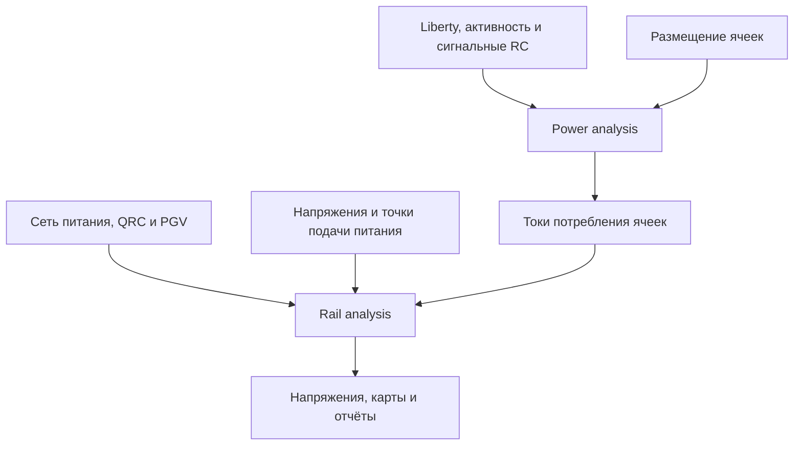

# Лабораторная работа № 5. Анализ потребляемой мощности и сети питания в Cadence Voltus

В предыдущей работе вы выполнили placement, CTS и routing цифрового блока. Теперь необходимо проверить, как построенная сеть питания доставляет ток к ячейкам и какое напряжение они получают.

**Цель работы** — подготовить модели для анализа питания, рассчитать среднюю потребляемую мощность и статическое падение напряжения, научиться читать карты и отчёты Voltus и сохранять результаты для повторного просмотра.

В этой редакции базовое задание на «4» включает PGV, статический анализ и просмотр результатов. На «5» предлагается эксперимент с активностью переключений. Динамический анализ включён как ознакомительный раздел.

**Статус первой редакции.** Команды ориентированы на Voltus 20.10 **Stylus Common UI** и подготовленные Tcl-скрипты. Полный запуск на учебном проекте ещё предстоит проверить. В Makefile используется IHP SG13G2, а в первоначальных Tcl оставлены примеры для GPDK90. До выполнения работы преподаватель должен подготовить согласованные модели, пути и условия анализа. Отсутствующие результаты в этой редакции обозначены местами для скриншотов.

Углублённые пояснения вынесены в [README.extra.md](README.extra.md#lab5-extra). Для базового задания достаточно основного файла.

## Содержание

1. [Назначение анализа](#lab5-purpose)
2. [Основные понятия](#lab5-basics)
3. [Подготовка и запуск](#lab5-preparation)
4. [Практические этапы](#lab5-practice)
   - [Генерация PGV](#lab5-pgv)
   - [Статический анализ](#lab5-static)
   - [Просмотр результатов в GUI](#lab5-gui)
   - [Знакомство с динамическим анализом](#lab5-dynamic)
5. [Разбор результатов](#lab5-results)
6. [Сохранение данных](#lab5-save)
7. [Задания и защита](#lab5-assessment)

<a id="lab5-purpose"></a>

## 1. Назначение анализа

Соединение вывода ячейки с сетью VDD само по себе не гарантирует, что на этом выводе будет номинальное напряжение. Металлические проводники и переходные отверстия имеют сопротивление. Когда по ним протекает ток, потенциалы в разных точках сети различаются.

**Voltus** позволяет оценить потребление схемы и исследовать её сеть питания. В работе последовательно решаются две задачи:

1. **Power analysis** — определить потребляемую мощность и токи ячеек при выбранных условиях и активности.
2. **Rail analysis** — приложить эти токи к электрической модели сети питания и определить напряжения в её узлах.

Обмен данными между этапами показан на [схеме](#fig-lab5-flow).

<a id="fig-lab5-flow"></a>



*Рисунок — Основные данные и этапы анализа питания. Схема условная.*

Анализ выполняется для определённого сценария. Его результат относится к выбранным библиотекам, напряжению, температуре, активности и модели источников. Успешное завершение команды и отсутствие заметной просадки на карте ещё не подтверждают корректность исходных условий.

<a id="lab5-basics"></a>

## 2. Основные понятия

### 2.1. Сеть питания

Сеть питания, или **PDN — Power Distribution Network**, соединяет точки подачи питания с выводами ячеек. В учебном блоке этот путь может проходить через кольцо питания, полосы, локальные шины стандартных ячеек и переходные отверстия.

В этой работе рассматривается один постоянно включённый домен с сетями **VDD** и **VSS**, номинальный потенциал VSS равен нулю. Отключаемые домены и power gates в используемые скрипты не включены.

Принцип доставки питания к ячейкам должен быть показан на [рисунке](#fig-lab5-pdn).

<a id="fig-lab5-pdn"></a>

> **Место для рисунка — Путь питания к ячейкам.**
>
> Показать источник VDD, сопротивления металла и vias, несколько потребляющих ячеек и обратный путь через VSS. Отметить номинальные и локальные потенциалы. Подписать, что схема условная.
>
> Файл: `doc/images/lab5_pdn_principle.png`.

### 2.2. Падение напряжения

Для отдельного резистивного участка:

$$
\Delta V = I R,
$$

где $\Delta V$ — падение напряжения, В; $I$ — ток участка, А; $R$ — его сопротивление, Ом.

Реальная PDN содержит разветвления и параллельные пути. Ток каждого участка зависит от потребления подключённых ячеек и устройства всей сети. Поэтому одну формулу для отдельного сопротивления нельзя без дополнительных предположений применять ко всему блоку.

На стороне VDD локальный потенциал может снижаться, на стороне VSS — повышаться. Напряжение питания конкретной ячейки определяется разностью:

$$
V_{\text{cell}} = VDD_{\text{local}} - VSS_{\text{local}}.
$$

**Условный пример:** при номинальном питании 1,00 В, локальном VDD 0,96 В и локальном VSS 0,01 В ячейка получает 0,95 В. Эти числа иллюстрируют принцип и не задают параметры учебного PDK.

Снижение напряжения питания обычно увеличивает задержки ячеек и при достаточно большой просадке может нарушить работу схемы. В этой лабораторной изучается питание; влияние на timing не считается автоматически перепроверенным после выполнения rail analysis.

Подробнее: [распределённая сеть и сопротивления](README.extra.md#lab5-extra-resistance).

### 2.3. Состав потребляемой мощности

В отчёте различаются три составляющие:

| Составляющая | Что описывает |
|---|---|
| **Internal power** | Потребление, связанное с внутренней работой ячейки; определяется библиотечной моделью и условиями переключений |
| **Switching power** | Заряд и разряд внешней нагрузки выходных сигналов |
| **Leakage power** | Потребление, связанное с токами утечки |

Итоговая мощность складывается из этих составляющих. Для грубой оценки среднего тока нагрузки при одном напряжении можно использовать $I_{\text{avg}} \approx P_{\text{avg}}/V$. Это оценка суммарного потребления, а не правило равномерного распределения тока по топологии.

### 2.4. Активность переключений

Потребление зависит от того, какие сигналы переключаются и как часто. В подготовленных скриптах используется оценённая активность, заданная через `set_default_switching_activity` и распространяемая по схеме.

`INPUT_ACTIVITY` и `ACTIVITY_PERIOD` совместно задают нормирование входной активности. В рассмотренном интерфейсе плотность переходов соответствует отношению активности к периоду. **Единицы периода определяются Liberty.** Значение `8.0` нельзя считать наносекундами без проверки единиц библиотеки.

Эта настройка не изменяет clocks из SDC. Тактовые ограничения уже должны присутствовать в восстановленной базе. Reset и другие управляющие входы необходимо задать в состоянии, соответствующем исследуемому режиму.

Подробнее: [активность и расчёт мощности](README.extra.md#lab5-extra-activity).

### 2.5. Статический и динамический анализ

| Вид анализа сети | Модель потребления | Что исследуем |
|---|---|---|
| **Статический** | Усреднённые токи ячеек | Распределение напряжений при среднем потреблении |
| **Динамический** | Токи, изменяющиеся во времени | Изменения напряжения и просадки при переключениях в исследуемом временном интервале |

**Статический IR drop не означает анализ только утечек.** Средние токи включают потребление от переключений и внутренней работы ячеек.

В **vectorless dynamic** Voltus строит события переключений по активности и таймингам. Полученный сценарий зависит от этих предположений. Вариант с VCD использует события из моделирования и в данную базовую последовательность не входит.

### 2.6. Для чего нужна PGV

**PGV — Power Grid View** представляет ячейку для анализа питания: её подключения к сети, точки приложения токов и доступные электрические свойства. PGV и Liberty выполняют разные задачи.

В первом варианте используется **technology-only** библиотека `techonly.cl`, формируемая по LEF и технологии экстракции QRC. Она общая для статического и динамического скриптов.

В этом варианте не выполняется SPICE-характеризация внутренних ёмкостей стандартных ячеек. Поэтому динамический запуск рассматривается как знакомство с маршрутом расчёта. Исследование влияния decap требует согласованных характеризованных моделей.

Подробнее: [technology-only и характеризованные PGV](README.extra.md#lab5-extra-pgv).

<a id="lab5-preparation"></a>

## 3. Подготовка и запуск

### 3.1. Необходимые данные

Используйте собственный трассированный проект из лабораторной работы 4.

| Данные | Назначение и обязательная проверка |
|---|---|
| База Innovus после routing | Физическое размещение и сеть питания; база должна читаться установленной версией Voltus |
| Liberty, MMMC и SDC | Модели ячеек, выбранный analysis view и clocks; ссылки из базы должны оставаться доступными |
| Technology LEF и LEF ячеек | Слои, геометрия и выводы питания; technology LEF читается первым |
| QRC extraction technology | Электрические параметры экстракции; нужен файл, поддерживаемый применяемым Cadence flow |
| Карта LEF/QRC слоёв | Согласование имён слоёв, если оно требуется выбранной технологией |
| Сигнальный SPEF | Паразитные параметры для power/timing расчёта; файл должен соответствовать выбранному RC corner и проекту |
| Файлы точек питания VDD/VSS | Координаты и слои подключения идеальных источников |

Сигнальный SPEF не заменяет модель сети питания. Сеть питания извлекается из физических данных с использованием соответствующей технологии и библиотечных представлений.

**Для IHP SG13G2 до запуска необходимо подготовить QRC technology и проверить состав библиотек.** Наличие LEF, Liberty или файла для другого экстрактора само по себе не означает готовность данных для этого шага.

### 3.2. Управляющие файлы

В корне проекта находится `Makefile`, в каталоге `flow_scripts/` — следующие файлы:

| Файл | Действие |
|---|---|
| `flow.voltus.pgv.tcl` | Генерация и проверка technology-only библиотеки |
| `flow.voltus.static.tcl` | Расчёт средней мощности, токов и статического IR drop |
| `flow.voltus.dynamic.tcl` | Динамический vectorless расчёт мощности и сети питания |
| `flow.voltus.gui.tcl` | Загрузка сохранённых результатов для просмотра |

Скрипты линейные: параметры заданы в начале файла, затем следуют команды инструмента. Makefile запускает их и создаёт рабочие каталоги. **Параметры, записанные в Tcl, не меняются автоматически при изменении одноимённых или похожих переменных Makefile.**

### 3.3. Рабочий каталог и относительные пути

Все команды `make` выполняются **из корня проекта**. Makefile запускает Voltus с рабочим каталогом `run/voltus`.

| Путь внутри Voltus | Положение относительно корня проекта |
|---|---|
| `./outputs/pgv/tech_pgv` | `run/voltus/outputs/pgv/tech_pgv` |
| `./reports/static_power` | `run/voltus/reports/static_power` |
| `./reports/static_rail` | `run/voltus/reports/static_rail` |
| `./reports/dynamic_power` | `run/voltus/reports/dynamic_power` |
| `./reports/dynamic_rail` | `run/voltus/reports/dynamic_rail` |
| `../data` | `run/data`, а не `data` проекта |
| `../design` | `run/design` |

В примерах из исходного практикума использована другая структура каталогов. Перед запуском замените входные пути абсолютными либо пересчитайте их от `run/voltus`. Для файлов в `data` текущего проекта относительный префикс будет `../../data`.

### 3.4. Что настроить в Tcl

| Скрипт и параметры | Что указать |
|---|---|
| PGV: `LEF_FILES`, `QRC_TECH_FILE`, `LEF_LAYER_MAP` | Реальные файлы выбранного PDK; в список LEF должны входить используемые физические ячейки |
| PGV: `VOLTAGE`, `-power_pins`, `-ground_pins` | Напряжение и библиотечные выводы питания |
| PGV: `-filler_cells`, `-decap_cells` | Реальные имена ячеек; примеры `FILL1`/`DECAP1` не переносятся автоматически на IHP |
| Static/dynamic: `DESIGN_DB`, `SPEF_FILE` | Фактические входные данные после трассировки |
| Static/dynamic: `ANALYSIS_VIEW`, `RC_CORNER` | Существующие объекты MMMC, согласованные с библиотеками и SPEF |
| Static/dynamic: `VOLTAGE`, `TEMPERATURE` | Условия исследуемого режима, согласованные с моделями |
| Static/dynamic: `POWER_NET`, `GROUND_NET`, `PGV_FILE` | Сети проекта и сгенерированная библиотека |
| Static/dynamic: `VDD_PAD_FILE`, `VSS_PAD_FILE` | Реальные точки питания |
| Static/dynamic: параметры активности | Активность входов, нормирующий период, работа clock gating и состояния управляющих сигналов |
| Dynamic: `TIME_RESOLUTION` | Разрешение, достаточное для рассматриваемых фронтов и токовых пиков |
| GUI: `DESIGN_DB`, `POWER_DB`, `RAIL_STATE` | Одна согласованная физическая база и результаты выбранного запуска |

Значения `0.9`, `125`, `AV_wc_on`, `RC_wc_125` и пути GPDK90 в первоначальных скриптах являются примерами. Для текущего проекта их нужно определить по фактическим библиотекам и условиям работы.

Не смешивайте имя сети проекта с именем библиотечного вывода. Например, `POWER_NET` используется для сети, а `-power_pins` при подготовке PGV описывает выводы библиотечных ячеек.

### 3.5. Точки подачи питания

Для VDD и VSS подготовьте отдельные файлы формата `xy`. Каждая строка задаёт имя источника, координаты и слой:

```text
*vsrc_name x y layer_name
vsrc1 22.215 374.800 Metal5
```

Это **пример формата**, а не координаты для вашего блока. Координаты задаются в микрометрах. Источник должен попадать на проводник нужной сети и указанного слоя. Число и расположение источников задают принятую модель питания; их необходимо сохранить вместе с результатами.

До начала расчёта убедитесь, что:

- [ ] Восстанавливается нужная база после routing, доступны её библиотеки и ограничения.
- [ ] Имена VDD/VSS и подключения питания соответствуют проекту.
- [ ] Для всех используемых ячеек доступны необходимые библиотечные представления.
- [ ] Технология QRC и карта слоёв относятся к выбранному PDK.
- [ ] Напряжение, температура, analysis view и RC corner согласованы.
- [ ] Известны единицы времени, мощности и напряжения.
- [ ] Активность соответствует исследуемому режиму; reset не удерживает схему в состоянии сброса вместо рабочего режима.
- [ ] Пути в скриптах проверены относительно `run/voltus`.

<a id="lab5-practice"></a>

## 4. Практические этапы

Команды в блоках `bash` выполняются в терминале Linux, команды в блоках `tcl` — в консоли Voltus. Запускайте этапы последовательно в отдельных сеансах. После проверки результата завершайте предыдущий сеанс командой `exit`.

Содержимое расчётных Tcl ниже объясняется по назначению команд. **После запуска скрипта через Makefile повторно выполнять его расчётные команды не требуется.**

<a id="lab5-pgv"></a>

### 4.1. Генерация PGV

**Задача этапа:** подготовить представления библиотечных ячеек для анализа сети питания.

1. Настройте `flow.voltus.pgv.tcl` по разделу подготовки.
2. Из корня проекта выполните:

   ```bash
   make voltus.pgv
   ```

3. Просмотрите сообщения генерации и результаты `check_pg_library`.
4. Проверьте состав ячеек и наличие необходимых представлений. Разберите сообщения о неизвестных слоях, отсутствующих выводах и неполном покрытии.
5. Сохраните управляющий скрипт, сведения о моделях и отчёты проверки.

В скрипте `read_physical` читает LEF, `set_pg_library_mode` задаёт тип и параметры библиотеки, `write_pg_library` выполняет генерацию, а `check_pg_library` проверяет полученный результат.

Результат находится в `run/voltus/outputs/pgv/tech_pgv/techonly.cl`, отчёты проверки — в `run/voltus/reports/pgv`, основной лог — в `run/voltus/logs/voltus_pgv.log`. Библиотечный объект с расширением `.cl` может представлять контейнер; сохраняйте его целиком.

Переходите к анализу после проверки библиотеки. Повторная генерация не нужна только из-за изменения входной активности; изменение технологии, состава ячеек или условий библиотечной модели требует проверки её применимости.

<a id="lab5-static"></a>

### 4.2. Статический анализ

**Задача этапа:** определить среднее потребление схемы, получить токи VDD/VSS и рассчитать распределение напряжений в сети питания.

1. Настройте `flow.voltus.static.tcl`: базу, view, SPEF, условия, активность и источники.
2. Из корня проекта выполните:

   ```bash
   make voltus.static
   ```

3. Просмотрите лог: восстановленный проект, выбранные условия, сообщения библиотек и активности, результаты power и rail analysis.
4. Откройте `run/voltus/reports/static_power/static.rpt`. Проверьте единицы, составляющие мощности, представленные группы ячеек и правдоподобность результата.
5. Убедитесь, что созданы токи для обеих сетей, power DB и каталог состояния rail analysis.
6. Запишите фактический путь к каталогу состояния — он понадобится для GUI.

Основные команды связаны следующим образом:

| Команда | Что проверить | Для чего |
|---|---|---|
| `read_db`, `read_spef` | Проект, доступность библиотек, выбранный RC corner | Анализировать нужную физическую реализацию |
| `set_db power_view` | Существующий analysis view | Выбрать условия power analysis |
| `set_default_switching_activity`, `propagate_activity` | Источник и распространение активности | Получить осмысленные токи потребления |
| `report_power` | Сводку мощности и файлы токов | Подготовить нагрузку сети питания |
| `set_rail_analysis_config` | Метод `static`, модели, температуру | Настроить расчёт PDN |
| `set_power_pads` | Сети, координаты и слои источников | Задать граничные условия питания |
| `set_power_data` | Файлы `static_<net>.ptiavg` для VDD и VSS | Передать усреднённые токи в rail analysis |
| `report_rail` | Домен `CORE`, завершение и выходной каталог | Получить напряжения и отчёты |

`CORE` — имя домена анализа, создаваемого в учебном скрипте. Это не имя встроенной функции и не обязательное имя домена любого проекта.

| Выходные данные | Содержимое |
|---|---|
| `reports/static_power/static.rpt` | Отчёт средней мощности |
| `reports/static_power/static_power.db` | Power DB для просмотра распределения потребления |
| `reports/static_power/static_VDD.ptiavg`, `static_VSS.ptiavg` | Средние токи по сетям при именах VDD/VSS |
| `reports/static_rail/` | Каталог с состояниями и отчётами rail analysis |
| `logs/voltus_static.log` | Условия запуска, сообщения и диагностика |

В таблице пути указаны **от `run/voltus`**. Если имена сетей изменены, имена файлов токов изменяются соответственно.

Почти нулевое потребление или малая просадка требуют объяснения. Сначала проверьте clocks, активность, reset и библиотечные данные, затем оценивайте качество сети.

<a id="lab5-gui"></a>

### 4.3. Просмотр сохранённых результатов в GUI

**Задача этапа:** совместить результаты анализа с физической топологией. Для этого используется отдельный `flow.voltus.gui.tcl`, который загружает сохранённые данные и не запускает расчёт повторно.

1. В `flow.voltus.gui.tcl` укажите ту же `DESIGN_DB`, на которой выполнялся анализ.
2. Для статического запуска оставьте `POWER_DB` равным `./reports/static_power/static_power.db` либо задайте путь к выбранному сохранённому варианту.
3. Заполните `RAIL_STATE` **фактическим путём к каталогу состояния**, созданному `report_rail`. Возьмите путь из лога или списка каталогов внутри `reports/static_rail`. Не задавайте вместо него только общий родительский каталог `static_rail`.
4. Из корня проекта выполните:

   ```bash
   make voltus.gui
   ```

5. Проверьте, что загружены нужные проект, power DB и rail state.

Если `RAIL_STATE` оставлен пустым, скрипт выведет найденные каталоги статических и динамических результатов и остановится с пояснением. Заполните параметр и повторите запуск. Имя состояния не выбирается автоматически по принципу «последнее в списке».

В просмотрщике выполняются команды:

```tcl
read_db -physical_data $DESIGN_DB
gui_show

read_power_rail_results \
    -power_db $POWER_DB \
    -rail_directory $RAIL_STATE

gui_set_power_rail_display -plot $PLOT
```

Переменная `PLOT` в скрипте задаёт первоначальную карту, по умолчанию `ir`. Для дальнейшего просмотра используйте панель **Power & Rail → Power & Rail Plots** или переключайте доступные представления из консоли:

```tcl
gui_set_power_rail_display -plot unc
gui_set_power_rail_display -plot ip
gui_set_power_rail_display -plot tc
gui_set_power_rail_display -plot ir
```

Каждая команда показывает очередное представление. Начните с `unc`, затем исследуйте потребление и напряжения. Через **Layers/Nets** выбирайте нужную сеть, слои и видимость источников. Выбранный объект и его свойства можно проверить через **Attribute Viewer**, в рассматриваемом интерфейсе — клавишей `q`.

Разбор карт приведён в [разделе 5](#lab5-results).

<a id="lab5-dynamic"></a>

### 4.4. Знакомство с динамическим анализом

Этот раздел предназначен для демонстрации и самостоятельного расширения работы. В первой редакции его выполнение не входит в обязательный объём на «4».

**Задача этапа:** увидеть токи и напряжения во времени, понять отличие среднего потребления от кратковременной нагрузки.

1. Настройте `flow.voltus.dynamic.tcl`, согласовав базу, питание, модели и активность со статическим вариантом.
2. Укажите осмысленное `TIME_RESOLUTION`. Слишком грубое разрешение может сгладить токовые пики; чрезмерно мелкое увеличивает объём расчёта.
3. Из корня проекта выполните:

   ```bash
   make voltus.dynamic
   ```

4. В логе проверьте распознанные clocks и фактический временной интервал расчёта. `ACTIVITY_PERIOD` и `TIME_RESOLUTION` не задают сами по себе длительность моделирования.
5. Убедитесь, что rail analysis использует `dynamic_<net>.ptiavg`.
6. Для просмотра измените в GUI-скрипте `POWER_DB` на базу динамического запуска, а `RAIL_STATE` — на соответствующее динамическое состояние. Выполните `make voltus.gui` в новом сеансе.
7. Через **Power & Rail → Dynamic Results → Waveforms** откройте токи потребления и сохранённое напряжение выбранной ячейки.

Ключевые отличия скрипта:

| Настройка | Значение и смысл |
|---|---|
| `power_method` | `dynamic_vectorless` — построение событий по активности и таймингам |
| `power_disable_static false` | Дополнительно сохраняются усреднённые данные; основной режим остаётся динамическим |
| `set_dynamic_power_simulation -resolution` | Задаёт временное разрешение power analysis |
| `set_rail_analysis_config -method dynamic` | Запускает динамический расчёт сети |
| `-save_voltage_waveforms true` | Сохраняет напряжения во времени |

Результаты находятся в `reports/dynamic_power` и `reports/dynamic_rail`, лог — в `logs/voltus_dynamic.log`, относительно `run/voltus`.

Динамическая карта худших значений объединяет экстремумы разных узлов за исследуемый интервал. Они могут возникать в разные моменты времени. Для объяснения конкретной просадки изучите waveform выбранной ячейки.

Подробнее: [динамическая нагрузка и ёмкости](README.extra.md#lab5-extra-dynamic).

<a id="lab5-results"></a>

## 5. Разбор результатов

### 5.1. Сначала условия и сводка

Для каждого результата зафиксируйте проект и исходную базу, версии инструмента и моделей, analysis view, RC corner, напряжение, температуру, параметры активности и точки питания. Затем укажите итоговую мощность и её составляющие, значения напряжений и положение выбранных проблемных объектов.

Проверьте единицы в заголовках отчётов. При сравнении переводите значения в одинаковые единицы; например, нельзя сопоставлять числа в В и мВ без пересчёта.

### 5.2. Карты потребления и питания

| Представление | Что показывает | Что проверить |
|---|---|---|
| `unc` | Неподключённые узлы | Наличие и положение разрывов; связность до интерпретации напряжений |
| `ip` | Суммарную мощность экземпляров | Какие ячейки потребляют больше и где они размещены |
| `tc` | Токи в точках потребления | Области повышенной нагрузки |
| `ir` | Результат rail analysis для выбранных сетей | Название величины, легенду, единицы, сеть и расположение источников |
| `ivdn` / `ivdd` | Напряжения или показатели падения на экземплярах в соответствующем net/domain представлении | Точное определение отображаемого поля и локальное питание выбранной ячейки |
| `rlrp` | Сопротивление пути с наименьшим сопротивлением и возможность его трассировки | Какие участки образуют путь питания выбранной ячейки; анализ включён в статическом скрипте |

**Различайте локальный потенциал и величину падения.** Для VDD при известном номинале $\Delta V_{VDD}=V_{DD,nom}-V_{DD,local}$. Для земли рассматривайте подъём относительно её номинального потенциала. Не делайте вывод по одному цвету без проверки легенды и численного значения.

Падение на VDD и подъём VSS для оценки питания ячейки нужно брать **для одной и той же ячейки**, а в динамике — с учётом времени. Глобальный минимум VDD и глобальный максимум VSS могут находиться в разных местах.

Карта статического результата должна быть оформлена как показано в [описании рисунка](#fig-lab5-static-map).

<a id="fig-lab5-static-map"></a>

> **Место для скриншота — Статический результат rail analysis.**
>
> Показать выбранную сеть, источники, легенду и единицы. Отметить исследуемую область и численное значение выбранного объекта. Подпись должна содержать условия анализа. Использовать фактический результат проекта.
>
> Файл: `doc/images/lab5_static_ir_map.png`.

### 5.3. Объяснение выбранной области

1. Выберите область с заметной просадкой или наиболее низким локальным питанием.
2. Определите, какие ячейки и токи связаны с этой областью.
3. Сопоставьте её положение с источниками, полосами питания, переходами между слоями и возможными разрывами.
4. Для выбранной ячейки исследуйте доступные свойства и путь питания. Отделяйте наблюдение от предположения о причине.
5. Сформулируйте вывод, опираясь на карту и численные данные.

Высокая мощность ячейки не гарантирует, что именно у неё будет наибольшая просадка: существенны также её положение и устройство PDN. Расстояние до источника само по себе не определяет сопротивление сети.

### 5.4. Типовые ситуации

| Наблюдение | Что проверить в первую очередь |
|---|---|
| Не создаются файлы токов | Завершение power analysis, настройки записи токов, имена сетей и выходной каталог |
| Мощность почти нулевая | Clocks, активность, reset, библиотечные модели и полноту обработки проекта |
| Есть неподключённые узлы | Физические соединения питания, vias, состав PGV и точки источников |
| Странные значения по всему блоку | Напряжение, модели, единицы, карту слоёв и граничные условия |
| GUI показывает неожиданный вариант | Согласованность физической базы, power DB и выбранного rail state |
| Две карты выглядят одинаково | Численные значения, автоматическую перенастройку цветовой шкалы и загрузку нужных состояний |

Универсальный допустимый процент IR drop в этой работе не назначается. Если преподаватель задаёт бюджет, зафиксируйте его источник, единицы и способ сравнения. Без заданного бюджета приводите измеренный результат и объяснение, а не утверждение о прохождении signoff.

<a id="lab5-save"></a>

## 6. Сохранение данных

Результат должен позволять восстановить условия и повторно открыть карты. Один скриншот этого не обеспечивает.

| Что сохранить | Для чего |
|---|---|
| Makefile и использованные Tcl | Восстановить команды, параметры и каталоги запуска |
| Сведения об исходной базе, SPEF и моделях | Определить физический проект и набор данных; сохранить доступные пути/версии либо копии необходимых входов |
| PGV и отчёты её проверки | Восстановить библиотечную модель и её применимость |
| Файлы источников VDD/VSS | Восстановить граничные условия |
| Power report, power DB и использованные токи | Проверить потребление и открыть его распределение |
| Полный выбранный каталог rail state | Открыть карты и подробные результаты; для динамики — также сохранённые waveforms |
| Логи, скриншоты и краткие выводы | Подтвердить условия расчёта и объяснить наблюдения |

Сохраните необходимые данные **вне `run/voltus`** до выполнения `make clean`: эта цель удаляет рабочий каталог Voltus. Для вариантов используйте разные имена, например `results/lab5/base` и `results/lab5/activity_b`.

Не требуется заново экспортировать все форматы из лабораторной 4. Для этой работы нужны входы power/rail analysis и данные, подтверждающие именно выполненные расчёты.

После сохранения проверьте, что можете открыть выбранный результат через GUI-скрипт с корректными путями. При копировании следите за доступностью исходной физической базы и библиотек, на которые она ссылается.

<a id="lab5-assessment"></a>

## 7. Задания и защита

Ниже приведён предлагаемый объём заданий для первой редакции. Численные условия и требования к устранению нарушений уточняются после проверки учебного flow.

<a id="lab5-grade4"></a>

### 7.1. Задание на «4»

1. Использовать собственный проект после routing из лабораторной работы 4.
2. Настроить исходные данные, питание, библиотеки и активность.
3. Сгенерировать technology-only PGV и разобрать результаты проверки.
4. Выполнить расчёт средней мощности и статический rail analysis.
5. Проверить корректность исходных условий, состав потребления и наличие неподключённых участков.
6. Открыть сохранённый результат в GUI, показать потребление, токи и напряжения.
7. Исследовать одну выбранную область и объяснить её результат.
8. Сохранить данные и подготовить краткие выводы.

Требуется выполнить предусмотренные проверки и зафиксировать обнаруженные проблемы. Если исходные данные делают расчёт недостоверным, их необходимо исправить и повторить анализ. Обязательное устранение всех электрических нарушений или достижение конкретной просадки без отдельно заданного критерия не требуется.

#### Материалы для сдачи на «4»

- [ ] Makefile и фактически использованные Tcl.
- [ ] Условия расчёта, сведения об исходной базе и моделях.
- [ ] PGV, лог генерации и отчёты проверки.
- [ ] Файлы источников VDD/VSS.
- [ ] Отчёт мощности, power DB и файлы токов.
- [ ] Выбранный rail state целиком и лог анализа.
- [ ] Скриншоты потребления и статического результата с легендой, единицами и выбранным объектом.
- [ ] Результат проверки неподключённых узлов и объяснение исследованной области.
- [ ] Краткие выводы и возможность повторного открытия результата.

<a id="lab5-main-questions"></a>

#### Основные вопросы для защиты

1. Какие задачи решают power analysis и rail analysis? Какие данные связывают эти этапы?
2. Почему подключённая к VDD ячейка может получать напряжение ниже номинального?
3. Как сопротивления металла и vias и токи потребления влияют на IR drop?
4. Из каких составляющих складывается потребляемая мощность?
5. Почему для статического IR drop недостаточно учитывать только утечки?
6. Что задаёт активность переключений и откуда Voltus получает clocks?
7. Для чего нужны Liberty, LEF, QRC technology, PGV и сигнальный SPEF?
8. Что задают файлы точек питания? Как проверить их соответствие топологии?
9. Как различить на карте напряжение узла и величину просадки? Где смотреть единицы и значение выбранного объекта?
10. Что показывают `unc`, `ip`, `tc` и `ir`? Какие выводы вы сделали по своему проекту?
11. Как связаны локальные VDD, VSS и напряжение питания ячейки?
12. Какие данные нужно сохранить, чтобы повторно открыть результат в GUI?

<a id="lab5-grade5"></a>

### 7.2. Дополнительное задание на «5»

После базовой части выполните **эксперимент с входной активностью** в статическом flow.

1. Сохраните исходный вариант **A**, его скрипт, условия и результаты.
2. Создайте вариант **B** с другим `INPUT_ACTIVITY`. Например, при исходном значении 0.2 можно исследовать 0.4; это пример сценария, а не требование ко всем проектам.
3. Сохраните одинаковыми физическую базу, сеть питания, источники, PGV, view, напряжение, температуру, `ACTIVITY_PERIOD`, clock-gating ratio и состояния управляющих сигналов.
4. Для варианта B задайте отдельные `POWER_DIR` и `RAIL_DIR`. Повторите полный static-скрипт: изменение активности требует нового расчёта мощности и токов.
5. Откройте оба результата с соответствующими им power DB и rail states.
6. Сравните численные значения и карты с одинаковыми границами цветовой шкалы.
7. Объясните изменения мощности, токов, просадок и положения исследуемых областей.

Пути выходных каталогов меняются для сохранности данных и не являются исследуемым физическим фактором.

Для сравнения используйте таблицу:

| Показатель | Вариант A | Вариант B |
|---|---|---|
| `INPUT_ACTIVITY`, `ACTIVITY_PERIOD` и единицы периода | Заполнить | Заполнить |
| Internal power, в выбранных единицах | Заполнить | Заполнить |
| Switching power, в тех же единицах | Заполнить | Заполнить |
| Leakage power, в тех же единицах | Заполнить | Заполнить |
| Суммарная мощность | Заполнить | Заполнить |
| Максимальное падение VDD, мВ | Заполнить | Заполнить |
| Максимальный подъём VSS, мВ | Заполнить | Заполнить |
| Локальное питание и положение выбранной ячейки | Заполнить | Заполнить |

Не требуется получить заранее заданное кратное изменение мощности или просадки. Часть потребления может определяться clocks, утечками и логикой, слабо зависящей от выбранных входов. Если изменение мало, проверьте применение активности и объясните наблюдение.

#### Материалы для сдачи на «5»

- [ ] Все материалы базовой части.
- [ ] Скрипты, условия, отчёты и состояния вариантов A и B.
- [ ] Таблица сравнения с единицами.
- [ ] Сопоставимые карты с одинаковой шкалой и подтверждением выбранного варианта.
- [ ] Объяснение наблюдаемых изменений и границ применимости вывода.

<a id="lab5-extra-questions"></a>

#### Дополнительные вопросы для защиты на «5»

Базовые вопросы также входят в защиту на «5».

1. Почему увеличение входной активности не обязано пропорционально изменить суммарную мощность?
2. Чем отличается переключательная активность данных от активности тактовой сети?
3. Почему область с наибольшей мощностью не всегда совпадает с областью наибольшей просадки?
4. Чем отличаются путь с наименьшим сопротивлением и эффективное сопротивление сети?
5. Как в принципе влияют ширина полос, число vias и расположение источников на питание ячеек?
6. Чем различаются статический, dynamic vectorless и динамический анализ с VCD?
7. Что показывает динамическая карта худших значений и зачем дополнительно смотреть waveform?
8. Какова роль локальных ёмкостей и decap? Какие ограничения имеет наша technology-only модель?
9. Какие условия нужно сохранить при сравнении двух запусков?
10. Какие изменения реализации можно предложить по результатам анализа и что потребуется перепроверить после их внесения?

## Методическая основа

Практическая последовательность опирается на **Cadence Rapid Adoption Kit — Power and Rail Analysis Using Voltus IC Integrity (Common UI), Voltus 20.10, июль 2020**: подготовка библиотек, static power, Power Debugger, static rail, dynamic power и dynamic rail analysis. Данные исходного учебного комплекта не считаются данными проекта IHP SG13G2.
