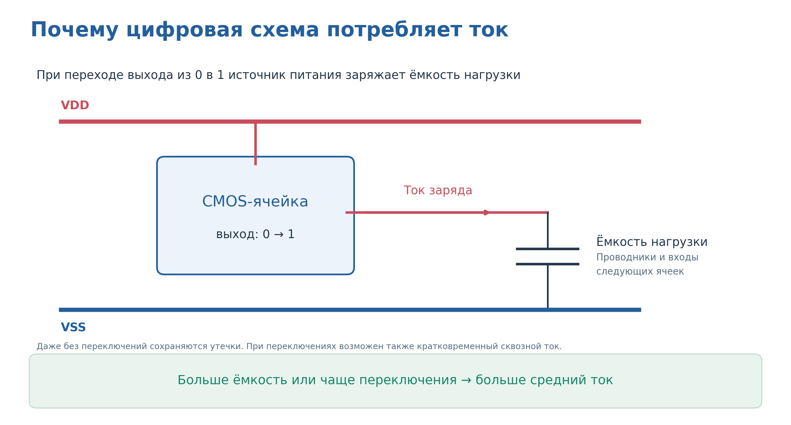
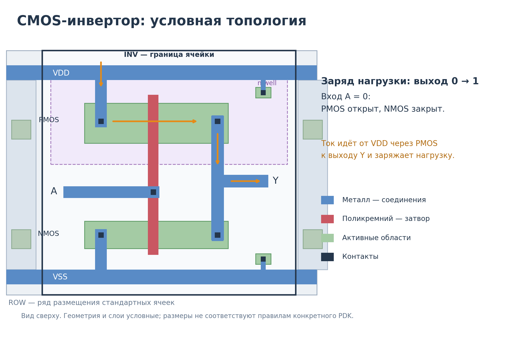
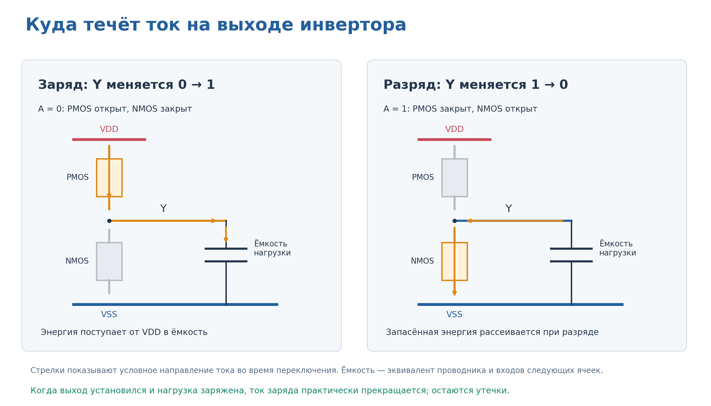
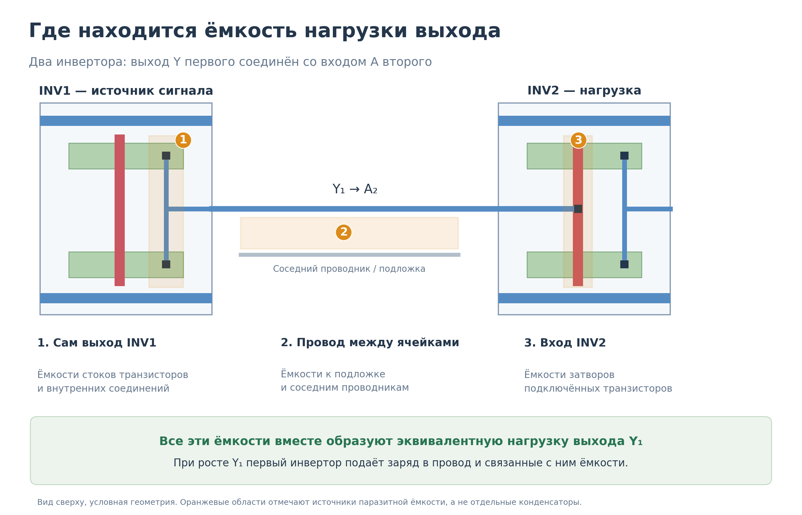
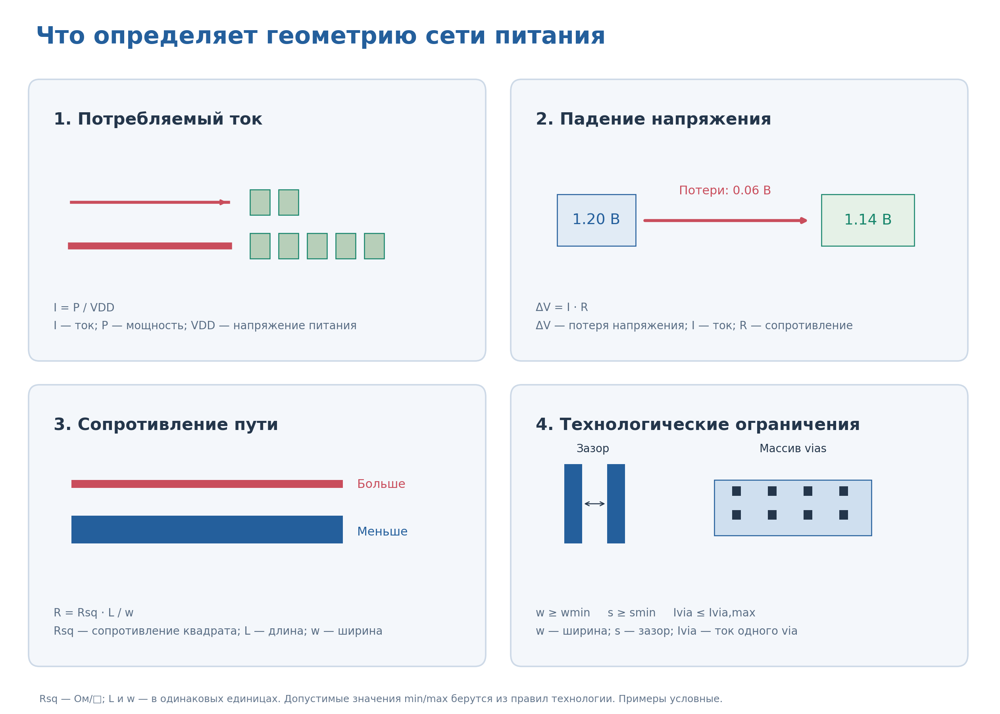
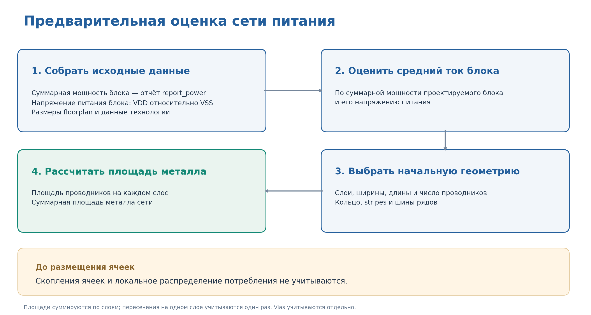

## 4.4. Предварительная оценка сети питания

Сеть питания обеспечивает подвод VDD и возврат тока через VSS для ячеек блока. Она включает кольцо питания, полосы питания — **stripes**, шины вдоль рядов и переходы между слоями — **vias**.

На рисунке 7 показан пример сети питания: кольцо расположено по периметру блока, а горизонтальные шины проходят по границам rows и подводят питание к размещённым в них стандартным ячейкам. Каждая шина подключается к соответствующей сети кольца.

*Рисунок 7 — Кольцо питания VDD/VSS, горизонтальные шины питания и стандартные ячейки в rows. Геометрия и цвета показаны условно.*

### Почему ячейки потребляют ток

При переключении выхода ячейки транзисторы заряжают или разряжают ёмкость нагрузки. Дополнительно существуют токи утечки и кратковременный сквозной ток во время переключения.

На рисунке 8 показан заряд нагрузки от источника питания при переходе выхода из 0 в 1.

*Рисунок 8 — Заряд ёмкости нагрузки при переключении выхода ячейки из 0 в 1.*

Рассмотрим CMOS-инвертор. Он содержит PMOS-транзистор, соединяющий выход с VDD, и NMOS-транзистор, соединяющий выход с VSS. Их затворы подключены к общему входу A.

На рисунке 9 показана условная топология инвертора в ряду стандартных ячеек. Стрелками отмечен путь тока через открытый PMOS к выходу Y во время заряда нагрузки.

*Рисунок 9 — Условная топология инвертора в row: граница ячейки, транзисторы, шины питания и путь тока заряда нагрузки.*

- При **A = 0** PMOS открыт, NMOS закрыт. Через PMOS источник VDD заряжает нагрузку, и напряжение Y растёт.
- При **A = 1** PMOS закрыт, NMOS открыт. Нагрузка разряжается через NMOS в VSS, и напряжение Y снижается.

Эти два процесса сопоставлены на рисунке 10.

*Рисунок 10 — Заряд ёмкости нагрузки через PMOS и её разряд через NMOS. Стрелки показывают условное направление тока во время переключения.*

После установления выходного напряжения ток заряда или разряда практически прекращается. В статическом состоянии сохраняются токи утечки.

### Где находится ёмкость нагрузки

Ёмкость возникает между проводящими областями, разделёнными диэлектриком. При изменении разности потенциалов меняются накопленные заряды и энергия электрического поля.

В микросхеме нагрузка выхода складывается из:

- **паразитных ёмкостей самой ячейки** — в том числе выходных областей транзисторов;
- **ёмкости проводника** — относительно подложки и соседних проводников;
- **входных ёмкостей следующих ячеек** — прежде всего ёмкостей затворов подключённых транзисторов.

Для появления такой нагрузки не нужен отдельный конденсатор: ёмкости возникают из-за геометрии проводников и транзисторов.

На рисунке 11 выход первого инвертора соединён со входом второго. Первый инвертор заряжает ёмкости своего выхода, соединительного провода и входа следующей ячейки.

*Рисунок 11 — Источники ёмкостной нагрузки: выход первого инвертора, межсоединение и вход второго инвертора. Выделенные области не являются отдельными конденсаторами.*

Условный конденсатор на электрической схеме объединяет эти распределённые ёмкости в **эквивалентную нагрузку выхода**. Его подключение к VSS является упрощением: часть реальных ёмкостей связана с другими узлами.

Потребляемый ток зависит не только от количества ячеек, но и от их типов и размеров, ёмкостной нагрузки, частоты и активности переключений, напряжения и температуры. Небольшой активно переключающийся блок может потреблять больше, чем большой блок, который почти не переключается.

### Что учитывают при выборе сети питания

- **Потребляемый ток** — ток, который ячейки получают от сети питания при переключениях и из-за утечек. Чем больше ток через участок сети, тем больше падение напряжения на его сопротивлении и токовая нагрузка на проводники и vias.

- **Допустимое падение напряжения** — насколько напряжение питания у ячеек может уменьшиться относительно напряжения источника. Например, при источнике 1.2 В и допустимых потерях 0.06 В напряжение между VDD и VSS у ячеек должно быть не менее 1.14 В. Это условный пример, а не универсальное требование.

- **Сопротивление проводников и vias** — сопротивление пути от источника питания до ячеек и обратно. Длинные и узкие проводники имеют большее сопротивление; переходы между слоями также вносят свой вклад.

- **Технологические ограничения** — правила изготовления и надёжности: допустимые ширины металла, расстояния между проводниками, геометрия vias и предельные токи.

Эти факторы показаны на рисунке 12.

*Рисунок 12 — Потребляемый ток, падение напряжения, сопротивление проводников и технологические ограничения.*

### Оценка потребляемого тока

Средний ток блока можно оценить по его мощности и напряжению питания:

$$
I_{avg}=\frac{P}{V_{DD}},
$$

где:

- **I_avg** — средний потребляемый ток блока, А;
- **P** — суммарная мощность блока, Вт;
- **V_DD** — напряжение питания блока относительно VSS, В.

Мощность возьмите из отчёта **report_power**, полученного в лабораторной работе №2 для итоговой схемы. Используйте суммарное значение **Total Power** своего блока с учётом вложенных экземпляров, без повторного суммирования дочерних модулей.

Проверьте единицы измерения: перед расчётом мощность необходимо перевести в ватты. Напряжение должно соответствовать условиям этого отчёта.

Например, при мощности 12 мВт и напряжении 1.2 В средний ток составляет **10 мА**. Такая оценка не определяет пиковый ток при одновременном переключении ячеек.

### Влияние геометрии проводников

При протекании тока через сопротивление проводника возникает падение напряжения:

$$
\Delta V=IR,
$$

где:

- **ΔV** — падение напряжения на участке, В;
- **I** — ток через участок, А;
- **R** — сопротивление участка, Ом.

Для прямого участка постоянной ширины:

$$
R=R_{\mathrm{sq}}\cdot\frac{L}{w},
$$

где:

- **R** — сопротивление участка проводника, Ом;
- **R_sq** — сопротивление квадрата выбранного слоя металла, Ом/□;
- **L** — длина участка, мкм;
- **w** — ширина участка, мкм.

Длина и ширина должны быть выражены в одинаковых единицах. Сопротивление квадрата берётся из технологических данных выбранного металла.

При неизменном токе более длинный проводник имеет большее сопротивление, а более широкий — меньшее. При этом увеличение ширины и количества stripes занимает ресурсы трассировки.

### Порядок предварительной оценки

Предварительная оценка выполняется **до размещения стандартных ячеек**. Она использует общие характеристики блока и предполагаемую геометрию сети, не учитывая фактические скопления ячеек и локальное распределение потребления.

Последовательность показана на рисунке 13.

*Рисунок 13 — Предварительная оценка сети питания: исходные данные, средний ток блока, начальная геометрия и площадь металла.*

1. **Соберите исходные данные:**
   - суммарную мощность проектируемого блока из отчёта report_power;
   - напряжение питания VDD относительно VSS для того же режима;
   - размеры die и core;
   - разрешённые слои, параметры металлов и технологические ограничения.

2. **Оцените средний ток блока** по мощности и напряжению питания. Зафиксируйте условия анализа мощности.

3. **Выберите начальную геометрию сети:** слои, ширины, длины и количество проводников кольца, stripes и шин рядов, а также необходимые vias. Геометрия должна соответствовать правилам технологии.

4. **Определите общую площадь металла сети питания** по выбранной геометрии.

Средний ток сам по себе не определяет необходимые ширины и шаг stripes. На этом этапе они являются предварительным выбором, который требует последующей электрической проверки.

### Общая площадь металла сети питания

Площадь прямоугольного участка проводника:

$$
A_i=L_iw_i,
$$

где:

- **A_i** — площадь участка металла, мкм²;
- **L_i** — длина участка, мкм;
- **w_i** — ширина участка, мкм.

Разделив проводники каждого слоя на неперекрывающиеся участки, можно определить общую площадь:

$$
A_{PG}=\sum_{i=1}^{N}A_i,
$$

где:

- **A_PG** — суммарная площадь металла сети питания по всем используемым слоям, мкм²;
- **A_i** — площадь отдельного неперекрывающегося участка, мкм²;
- **N** — количество учитываемых участков;
- **i** — номер участка.

Пересечения на одном слое учитываются один раз. Площади разных слоёв суммируются, даже если проводники совпадают в проекции. Площадь vias учитывается отдельно.

**Результат этапа — начальная геометрия сети и оценка площади её металла.** Эта площадь не равна площади, занятой сетью в проекции на die, и не подтверждает достаточность питания.

После размещения ячеек сеть уточняется с учётом распределения нагрузки. Подробный анализ падения напряжения, токов и электромиграции рассматривается в лабораторной работе по IR Drop.